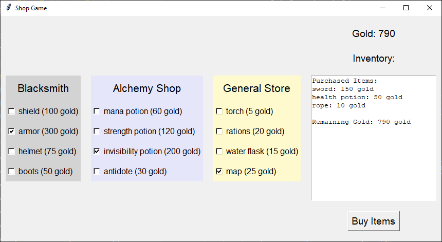

====================================================
RPG inventory
====================================================

Python terminal game
-------------------------

This Python script implements some code for buying inventory in an RPG game.

1. **Define Shops**:

   Three shop dictionaries are defined (`blacksmith`, `alchemy_shop`, and `general_store`). Each has a `'name'` and an `'items'` dictionary of items and their prices.

2. **Initialize Variables**:

   An empty shopping cart (`cart`) and a purse with 1000 gold pieces are initialized.

3. **Display Initial Inventory**:

   The initial inventory of each shop is printed as a numbered list so the user knows what they can buy.

4. **Shopping**:

   - The player visits each shop one by one:
   - The available items in the current shop are displayed with a number for each item.
   - The player types the number of an item to buy it, or types 'exit' to leave the shop.
   - If the player buys an item, the item's price is deducted from the purse, the item is moved from the shop to the cart, and the player moves on to the next shop.
   - If the player doesn't have enough gold, they are told and can choose again.
   - If the player types anything else, they are told the selection is invalid and leave the shop.

5. **Display Final Inventory and Purchases**:

   After visiting all shops, the final inventory of each shop and the items purchased are printed, along with the total cost and remaining gold.

Code:

.. code-block:: python

    # Define the shops with more diverse items
    blacksmith = {
        'name': 'Blacksmith',
        'items': {
            'sword': 150,
            'shield': 100,
            'armor': 300,
            'helmet': 75,
            'boots': 50
        }
    }

    alchemy_shop = {
        'name': 'Alchemy Shop',
        'items': {
            'health potion': 50,
            'mana potion': 60,
            'strength potion': 120,
            'invisibility potion': 200,
            'antidote': 30
        }
    }

    general_store = {
        'name': 'General Store',
        'items': {
            'rope': 10,
            'torch': 5,
            'rations': 20,
            'water flask': 15,
            'map': 25
        }
    }

    stores = [blacksmith, alchemy_shop, general_store]

    # Create an empty shopping cart and set initial gold
    cart = {}
    purse = 1000

    # Function to display the inventory of a store with item numbers
    def display_inventory(store):
        items = [f"{i+1} {item} ({price} gold)" for i, (item, price) in enumerate(store['items'].items())]
        return '\n'.join(items)

    # Print initial inventory
    print("Initial Inventory:")
    for store in stores:
        print(f"{store['name']}:\n{display_inventory(store)}\n")

    # Loop through stores
    for store in stores:
        while True:
            # Input box to show what you can buy
            print(display_inventory(store))
            print(f"Welcome to {store['name']}! Type the number of the item you want to buy (or 'exit' to leave):")

            buy_item = input().lower()
            if buy_item == 'exit':
                break
            if buy_item.isdigit() and 1 <= int(buy_item) <= len(store['items']):
                item_name = list(store['items'].keys())[int(buy_item) - 1]
                if purse >= store['items'][item_name]:
                    purse -= store['items'][item_name]
                    cart[item_name] = store['items'].pop(item_name)
                    print(f"You bought {item_name} for {cart[item_name]} gold. You have {purse} gold left.")
                    break
                else:
                    print("You don't have enough gold for that item.")
            else:
                print("Invalid selection. Exiting store.")
                break

    # Print final inventory and purchases
    print("\nFinal Inventory:")
    for store in stores:
        print(f"{store['name']}:\n{display_inventory(store)}\n")

    print("\nItems Purchased:")
    for item, price in cart.items():
        print(f"{item}: {price} gold")

    print(f"\nTotal cost: {sum(cart.values())} gold")
    print(f"Gold left: {purse} gold")

----

.. admonition:: Task

    #. Convert the terminal version to a tkinter version.

----

Python tkinter version
-------------------------

This program simulates a shop game where the player can visit different stores, view items for sale, and buy items using their available gold.

1. **Shops Definition**:

   - Three shops are defined: "Blacksmith", "Alchemy Shop", and "General Store".
   - Each shop has a set of items with prices.

2. **Game Logic**:

   - The player starts with an initial amount of gold (`1000`).
   - The player can select one item from each store at a time. Only one item per store can be selected due to the use of checkboxes that deselect other options in the same store.

3. **UI Elements**:

   - A Tkinter GUI is created with separate frames for each store.
   - Each store's background color is set to a specific shade to distinguish them (light gray for Blacksmith, lavender for Alchemy Shop, and lemon chiffon for General Store).
   - A label displays the current amount of gold.

4. **Functions**:

   - **create_deselect_command**: Creates a function that ensures only one item can be selected per store by deselecting other checkboxes when one is selected.
   - **update_store**: Updates the store display to reflect current available items and their selection states.
   - **buy_items**: Handles the purchasing of selected items, updates the player's gold, and removes purchased items from the store's inventory.
   - **update_inventory_display**: Shows the items purchased and the remaining gold in the inventory text box.

5. **Tkinter Widgets**:

   - **Checkbuttons**: Used to select items from stores.
   - **Button**: "Buy Items" to purchase the selected items.
   - **Labels**: Display the store names and the player's gold.
   - **Text**: Displays the items purchased and the remaining gold.

Key Syntax to use
~~~~~~~~~~~~~~~~~~~~~

.. py:function:: enumerate(iterable, start=0)

    | Syntax: ``enumerate(iterable, start=0)``
    | Description: Adds a counter to an iterable, returning it as an enumerate object, which can be used to iterate with both the index and the element.
    | Default: ``start=0``, so it is often omitted.
    | Example: ``for index, value in enumerate(['a', 'b', 'c']): print(index, value) # Outputs: 0 a, 1 b, 2 c``

.. py:function:: value1 != value2

    | Syntax: ``value1 != value2``
    | Description: Checks if two values are not equal. Returns ``True`` if ``value1`` and ``value2`` are not equal, otherwise returns ``False``.
    | Example: ``5 != 3  # Outputs: True``; ``5 != 5  # Outputs: False``

.. py:function:: outer_function(parameter1, parameter2, ...)

    | Syntax:

        .. code-block::

            def outer_function(parameter1, parameter2, ...):
                def inner_function():
                    # Use parameter1, parameter2
                return inner_function

    | Description: Defines an ``outer_function`` that creates and returns an ``inner_function``. The ``inner_function`` can access parameters from ``outer_function`` without explicitly taking them as arguments.
    | Parameters:
        - ``parameter1, parameter2, ...``: Parameters needed by ``inner_function`` but provided only once to ``outer_function``.
    | Usage: Call ``outer_function`` with the desired parameters to get the ``inner_function`` ready for later use. This allows ``inner_function`` to run with the necessary context when called, but without requiring additional arguments.
    | Example:

    .. code-block::

        def create_print_command(message):
            def print_message():
                print(message)
            return print_message

        cp_command = create_print_command("Hello")

----

Code:

.. code-block:: python

    import tkinter as tk

    # Define the shops with more diverse items
    blacksmith = {"name": "Blacksmith", "items": {"sword": 150,
                                                "shield": 100, "armor": 300, "helmet": 75, "boots": 50}}

    alchemy_shop = {"name": "Alchemy Shop", "items": {"health potion": 50,
                                                    "mana potion": 60, "strength potion": 120, "invisibility potion": 200, "antidote": 30}}

    general_store = {"name": "General Store", "items": {
        "rope": 10, "torch": 5, "rations": 20, "water flask": 15, "map": 25}}

    # create a list of store dictionaries
    stores = [blacksmith, alchemy_shop, general_store]

    # Create an empty shopping cart and set initial gold
    cart = {}
    purse = 1000

    def create_deselect_command(store_name, index):
        """Creates a command to deselect other checkboxes in the same store."""
        def deselect_others():
            for i, var in enumerate(selected_items[store_name]):
                if i != index:
                    var.set(False)
        return deselect_others

    def update_store():
        # Refresh the store frames
        for i in range(len(stores)):
            store = stores[i]
            frame = store_frames[i]

            # Destroy all existing widgets in the frame
            for widget in frame.winfo_children():
                widget.destroy()

            # Create store label with background color matching the frame
            store_label = tk.Label(frame, text=store["name"], font=("Helvetica", 16), bg=store_colors[store["name"]])
            store_label.pack(pady=10)

            # Create checkboxes for each item in the store
            for index, (item, price) in enumerate(store["items"].items()):
                var = tk.BooleanVar(value=False)
                selected_items[store["name"]][index] = var

                # Call function to deselect other checkboxes in the store
                deselect_command = create_deselect_command(store["name"], index)

                item_check = tk.Checkbutton(
                    frame,
                    text=f"{item} ({price} gold)",
                    variable=var,
                    font=("Helvetica", 12),
                    command=deselect_command,  # Use the deselect function
                    bg=store_colors[store["name"]],  # Set background color to match store frame
                )
                item_check.pack(anchor="w", pady=5)

    def update_inventory_display():
        """Update the inventory display to show the current cart and remaining gold."""
        inventory_text.delete(1.0, tk.END)  # Clear the existing content

        # Display purchased items
        inventory_text.insert(tk.END, "Purchased Items:\n")
        for item, price in cart.items():
            inventory_text.insert(tk.END, f"{item}: {price} gold\n")

        # Display remaining gold
        inventory_text.insert(tk.END, f"\nRemaining Gold: {purse} gold")

    def buy_items():
        global purse
        for store in stores:
            store_name = store["name"]
            items_to_remove = []  # Track items to remove after purchase
            for i, (item, price) in enumerate(store["items"].items()):
                if selected_items[store_name][i].get():  # Check if this item was selected
                    if purse >= price:
                        purse -= price
                        cart[item] = price
                        # Mark item for removal from the store
                        items_to_remove.append(item)
                        purse_label.config(text=f"Gold: {purse}")
                    else:
                        # Insufficient gold, just skip this item
                        continue

            # Remove bought items from the store's inventory
            for item in items_to_remove:
                store["items"].pop(item)

        update_store()  # Refresh the store display to remove purchased items
        update_inventory_display()  # Update the inventory display with purchased items

    # Initialize the Tkinter window
    root = tk.Tk()
    root.title("Shop Game")

    # Define colors for each store
    store_colors = {"Blacksmith": "#D3D3D3",
                    "Alchemy Shop": "#E6E6FA", "General Store": "#FFFACD"}

    # Create frames for each store (left side)
    store_frames = []
    for store in stores:
        frame = tk.Frame(root, bg=store_colors[store["name"]])
        frame.pack(side=tk.LEFT, padx=10, pady=10)
        store_frames.append(frame)

    # Create a dictionary of BooleanVars for each store
    selected_items = {}
    for store in stores:
        selected_items[store["name"]] = []
        for _ in store["items"]:
            selected_items[store["name"]].append(tk.BooleanVar(value=False))

    # Create a right side frame for displaying inventory and remaining gold
    right_frame = tk.Frame(root)
    right_frame.pack(side=tk.LEFT, padx=10, pady=10)

    # Label to display current gold
    purse_label = tk.Label(right_frame, text=f"Gold: {purse}", font=("Helvetica", 14))
    purse_label.pack(pady=10)

    # Label to display the shopping cart and purchased items
    inventory_label = tk.Label(right_frame, text="Inventory:", font=("Helvetica", 14))
    inventory_label.pack(pady=10)

    inventory_text = tk.Text(right_frame, height=15, width=30, wrap=tk.WORD)
    inventory_text.pack(pady=10)

    # Button to buy item
    buy_button = tk.Button(right_frame, text="Buy Items", command=buy_items, font=("Helvetica", 14))
    buy_button.pack(pady=10)

    update_store()

    root.mainloop()

----

Functions in more detail
---------------------------

These functions work together to create an interactive shopping experience where users can select items from different stores, purchase them, and see their remaining gold and purchased items.

1. **create_deselect_command(store_name, index)**:

    - This function creates a command to deselect other checkboxes in the same store, so only one item can be selected per store.
    - It defines an inner function (`deselect_others`) that iterates through the store's BooleanVars and sets every one except the one at `index` to `False`.
    - It returns `deselect_others`, which runs whenever that checkbox is clicked.
    - `deselect_command = create_deselect_command(store["name"], index)` avoids the use of parameters in `command=deselect_command` for the Checkbox creation.

2. **update_store()**:

    - This function refreshes the store frames and creates checkboxes for each item.
    - It iterates through each store and its corresponding frame.
    - It destroys all existing widgets in the frame to ensure a fresh start.
    - It creates a label for the store with a background color matching the frame.
    - For each item in the store, it creates a checkbox with a command to deselect other checkboxes in the same store.

3. **update_inventory_display()**:

    - This function updates the inventory display to show the current cart and remaining gold.
    - It clears the existing content in the `inventory_text` widget.
    - It inserts the purchased items and their prices into the `inventory_text`.
    - It also displays the remaining gold.

4. **buy_items()**:

    - This function handles the purchase of selected items and updates the store and inventory.
    - It iterates through each store and checks if an item has been selected.
    - If the item is selected and there is enough gold (`purse`), it deducts the item's price from the purse, adds the item to the cart, and marks the item for removal from the store.
    - After processing all items, it removes the bought items from the store's inventory.
    - It then calls `update_store()` to refresh the store display and `update_inventory_display()` to update the inventory display with the purchased items.

----

RPG Inventory - Multiple Choice Quiz
------------------------------------------

.. mcqgroup::
    :nav_position: both
    :show-instant-feedback:
    :enable-instant-feedback:
    :shuffle_questions:
    :num_questions: 5

    .. multichoice::

        In the terminal version, what does cart[item_name] = store['items'].pop(item_name) do?

        [ ] Copies the item into the cart and leaves it in the store | Incorrect. pop() removes the item from the store.
        [x] Removes the item from the store and adds it to the cart with its price | Correct. pop() removes the key and returns its value (the price), which is stored in the cart.
        [ ] Deletes the whole store | Incorrect. Only one item is removed from the store's items.
        [ ] Adds 1 to the item's price | Incorrect. pop() does not change the price.

    .. multichoice::

        What does purse -= store['items'][item_name] do?

        [ ] Adds the price to the purse | Incorrect. += would add.
        [x] Subtracts the item's price from the gold in the purse | Correct. purse -= x is short for purse = purse - x.
        [ ] Checks whether the purse has enough gold | Incorrect. That check is if purse >= store['items'][item_name]:
        [ ] Removes the item from the store | Incorrect. store['items'].pop() removes the item.

    .. multichoice::

        Why does the terminal version use int(buy_item) - 1 to find the item the player chose?

        [ ] To give the player a discount of 1 gold | Incorrect. It changes the position, not the price.
        [x] The items are numbered from 1 for the player, but list positions start at 0 | Correct. Item 1 is at index 0 of list(store['items'].keys()).
        [ ] To stop the player buying the last item | Incorrect. Every item can still be chosen.
        [ ] Because input() always adds 1 to the number | Incorrect. input() returns exactly what was typed, as a string.

    .. multichoice::

        What does buy_item.isdigit() and 1 <= int(buy_item) <= len(store['items']) check?

        [ ] That the player has enough gold | Incorrect. The gold is checked afterwards with purse >= ...
        [ ] That the player typed exit | Incorrect. exit is checked on the line before.
        [x] That the player typed a whole number that matches one of the shop's item numbers | Correct. isdigit() checks it is a number, and the comparison checks it is between 1 and the number of items.
        [ ] That the item name is spelt correctly | Incorrect. In this version the player types a number, not a name.

    .. multichoice::

        What does enumerate(['a', 'b', 'c']) give you in a for loop?

        [ ] a, b, c | Incorrect. enumerate also gives a counter.
        [x] (0, 'a'), (1, 'b'), (2, 'c') | Correct. enumerate adds an index starting at 0 to each item.
        [ ] (1, 'a'), (2, 'b'), (3, 'c') | Incorrect. The default start is 0.
        [ ] 3 | Incorrect. len() would give 3.

    .. multichoice::

        What is each tk.BooleanVar used for in the tkinter version?

        [ ] Storing the price of an item | Incorrect. Prices are stored in the store dictionaries.
        [x] Storing whether an item's Checkbutton is ticked (True) or not (False) | Correct. Each Checkbutton is linked to a BooleanVar with variable=var.
        [ ] Counting the gold left | Incorrect. purse stores the gold.
        [ ] Storing the store's colour | Incorrect. store_colors stores the colours.

    .. multichoice::

        What does create_deselect_command(store_name, index) return?

        [ ] True or False | Incorrect. It returns a function, not a Boolean.
        [ ] The index of the selected item | Incorrect. It returns the inner function.
        [x] An inner function that the Checkbutton can run later as its command | Correct. The inner function remembers store_name and index, so command= needs no arguments.
        [ ] Nothing | Incorrect. It ends with return deselect_others.

    .. multichoice::

        Why does buy_items() start with global purse?

        [x] So the function can change the purse variable defined outside it | Correct. Without global, purse -= price would cause an UnboundLocalError.
        [ ] To make purse a constant | Incorrect. global does not make a variable constant.
        [ ] To print the purse | Incorrect. global does not print anything.
        [ ] To create a new purse with 1000 gold | Incorrect. It uses the existing purse variable.

    .. multichoice::

        What does purse_label.config(text=f"Gold: {purse}") do?

        [ ] Creates a new label | Incorrect. config() changes a label that already exists.
        [x] Updates the label's text to show the new amount of gold | Correct. config() changes options of an existing widget.
        [ ] Subtracts gold from the purse | Incorrect. It only changes what is displayed.
        [ ] Deletes the label | Incorrect. destroy() would delete it.

    .. multichoice::

        Why does update_store() destroy every widget in each store frame before creating new ones?

        [ ] To close the game | Incorrect. Only the widgets inside the store frames are destroyed.
        [x] So the store is redrawn without the items that have been bought | Correct. The old checkboxes are removed and new ones are created for the remaining items.
        [ ] To reset the gold to 1000 | Incorrect. update_store() does not change the purse.
        [ ] To change the store colours | Incorrect. The colours stay the same.

----

RPG Inventory - Cloze Code Quiz
-------------------------------------

.. clozegroup::
    :nav-position: both
    :num-questions: 3
    :show-instant-feedback:

    .. cloze::
        :instructions: Complete the terminal version's check that the player typed a valid item number.

        if buy_item.@@isdigit | isnumber | isint@@() and 1 <= int(buy_item) <= @@len | max | sum@@(store['items']):
            item_name = list(store['items'].keys())[int(buy_item) @@- 1 | + 1 | * 1@@]

    .. cloze::
        :instructions: Check the player can afford the item, pay for it and move it from the store to the cart.

        if purse @@>= | <= | <@@ store['items'][item_name]:
            purse @@-= | += | =@@ store['items'][item_name]
            cart[item_name] = store['items'].@@pop | get | remove@@(item_name)

    .. cloze::
        :instructions: Complete the inner function that deselects the other checkboxes in a store.

        def create_deselect_command(store_name, index):
            def deselect_others():
                for i, var in @@enumerate | range | zip@@(selected_items[store_name]):
                    if i @@!= | == | <@@ index:
                        var.set(False)
            return @@deselect_others | deselect_others() | index@@

    .. cloze::
        :instructions: Link each Checkbutton to its BooleanVar and its deselect command.

        var = tk.@@BooleanVar | StringVar | IntVar@@(value=False)
        item_check = tk.Checkbutton(
            frame,
            text=f"{item} ({price} gold)",
            @@variable=var | variable=var.get() | value=var@@,
            command=deselect_command,
        )

    .. cloze::
        :instructions: Let buy_items() change the purse, check each checkbox and update the gold label.

        def buy_items():
            @@global | local | nonlocal@@ purse
            for store in stores:
                store_name = store["name"]
                for i, (item, price) in enumerate(store["items"].items()):
                    if selected_items[store_name][i].@@get | set | value@@():
                        if purse >= price:
                            purse -= price
                            cart[item] = price
                            purse_label.@@config | update | text@@(text=f"Gold: {purse}")
