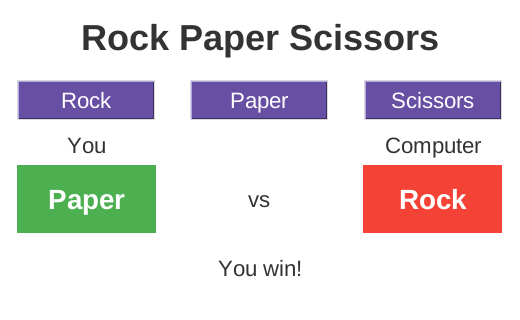
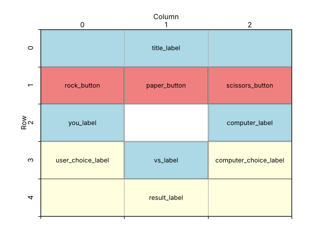

====================================================
Rock paper scissors (tkinter)
====================================================

| This app is a computer versus human game of rock paper scissors.
| It is the tkinter version of the Anvil rock paper scissors app.
| The player clicks Rock, Paper or Scissors. The computer makes a random choice, and both choices are shown in coloured boxes:
| **green** for a win, **red** for a loss and **grey** for a tie.

----

How the program is put together
---------------------------------------

The program is built in this order:

#. **Imports**: ``tkinter`` and ``random``.
#. **Constants**: colours and fonts.
#. **Game data**: a list of the three choices, and two dictionaries that match each result to a colour and a message.
#. **Functions**:

   - ``determine_winner()`` works out who won.
   - ``play()`` plays one round and updates the window.
   - ``rock_click()``, ``paper_click()`` and ``scissors_click()`` are run by the buttons. Each one calls ``play()`` with a different choice.

#. **Main window**: create ``root`` and set its title, size and colour.
#. **Widgets**: create the title, three buttons, the labels that show each player's choice, and the result label.
#. **Layout**: share the spare width between the three columns, then place each widget with ``grid()``.
#. **Event loop**: ``root.mainloop()``.

| The functions are defined **before** the widgets, but ``play()`` uses ``user_choice_label``, ``computer_choice_label`` and ``result_label``.
| This works because the functions only **run** when a button is clicked, and by then the widgets exist.

----

Create the main window
--------------------------------

.. code-block:: python

    import tkinter as tk
    import random

    # Create the main window
    root = tk.Tk()
    root.title("Rock Paper Scissors")
    root.geometry("520x320")
    root.configure(bg="#ffffff")

    root.mainloop()

| ``import random`` loads Python's ``random`` module. Its functions are used with the module name in front, e.g. ``random.choice(...)``.

----

Define constants for formatting
---------------------------------------

.. code-block:: python

    # Constants
    BG_COLOR = "#ffffff"
    TEXT_COLOR = "#333333"
    BUTTON_BG_COLOR = "#6750a4"  # purple
    BUTTON_FG_COLOR = "#ffffff"
    WIN_COLOR = "#4caf50"  # green
    LOSE_COLOR = "#f44336"  # red
    TIE_COLOR = "#9e9e9e"  # grey
    TITLE_FONT = ("Arial", 26, "bold")
    FONT_STYLE = ("Arial", 16)
    CHOICE_FONT = ("Arial", 20, "bold")

| ``WIN_COLOR``, ``LOSE_COLOR`` and ``TIE_COLOR`` do the same job as the coloured win, loss and tie images in the Anvil version.
| Update the window colour using the constant:

.. code-block:: python

    root.configure(bg=BG_COLOR)

----

Store the game data
-------------------------

.. code-block:: python

    # Game data
    CHOICES = ["Rock", "Paper", "Scissors"]
    RESULT_COLORS = {"Win": WIN_COLOR, "Lose": LOSE_COLOR, "Tie": TIE_COLOR}
    RESULT_MESSAGES = {"Win": "You win!", "Lose": "You lose!",
                       "Tie": "It's a tie!"}

- ``CHOICES`` is a **list** of the three moves. The computer picks one of them at random.
- ``RESULT_COLORS`` is a **dictionary**. Each **key** (``"Win"``, ``"Lose"`` or ``"Tie"``) is matched to a **value** (a colour).
- ``RESULT_COLORS["Win"]`` gives ``WIN_COLOR``, which is green.
- ``RESULT_MESSAGES`` matches each result to the message shown to the player. ``"It's a tie!"`` uses double quotes because it contains an apostrophe.
- Using dictionaries means the program does not need an ``if`` statement to choose each colour and message.

----

Decide who wins
-----------------------

.. code-block:: python

    def determine_winner(user, computer):
        """Returns the computer's result, then the user's result.

        Each result is "Win", "Lose" or "Tie".
        """
        if user == computer:
            return "Tie", "Tie"
        elif ((user == "Rock" and computer == "Scissors") or
              (user == "Paper" and computer == "Rock") or
              (user == "Scissors" and computer == "Paper")):
            return "Lose", "Win"
        else:
            return "Win", "Lose"

- The function takes the user's choice and the computer's choice, e.g. ``determine_winner("Paper", "Rock")``.
- If both choices are the same, it is a tie for both players.
- The ``elif`` checks the three ways the **user** can win: rock beats scissors, paper beats rock and scissors beats paper.

  - ``and`` is ``True`` only if **both** comparisons are true.
  - ``or`` is ``True`` if **any** of the three bracketed checks is true.
  - The whole condition is inside an extra pair of brackets so it can be split over three lines.

- If it is not a tie and the user has not won, the ``else`` means the computer has won.
- Each ``return`` sends back **two values**: the computer's result first, then the user's result. For example, ``return "Lose", "Win"`` means the computer lost and the user won.

----

Play a round
--------------------

.. code-block:: python

    def play(user_choice):
        """Plays one round against a random computer choice and shows it."""
        computer_choice = random.choice(CHOICES)
        computer_result, user_result = determine_winner(user_choice,
                                                        computer_choice)
        user_choice_label.config(text=user_choice,
                                 bg=RESULT_COLORS[user_result])
        computer_choice_label.config(text=computer_choice,
                                     bg=RESULT_COLORS[computer_result])
        result_label.config(text=RESULT_MESSAGES[user_result])

- ``random.choice(CHOICES)`` picks the computer's move at random.
- ``computer_result, user_result = determine_winner(...)`` stores the two returned values in two variables at once. This is called **unpacking**.
- ``user_choice_label.config(text=user_choice, bg=RESULT_COLORS[user_result])`` changes the label's text to the user's move and its background to the colour for the user's result.
- The computer's label is updated in the same way with the computer's move and result.
- ``RESULT_MESSAGES[user_result]`` looks up the message to show, e.g. ``"You win!"``.

----

The button functions
-----------------------------

.. code-block:: python

    def rock_click():
        play("Rock")

    def paper_click():
        play("Paper")

    def scissors_click():
        play("Scissors")

| A button's ``command`` must be a function that needs no arguments, so ``command=play("Rock")`` would not work: it would run ``play()`` straight away.
| Each of these small functions calls ``play()`` with a different choice, just like ``rock_click``, ``paper_click`` and ``scissors_click`` in the Anvil version.
| An alternative is ``command=lambda: play("Rock")``. ``lambda`` creates a small function with no name in a single line.

----

Create the widgets
-------------------------

.. code-block:: python

    # Create widgets
    title_label = tk.Label(root, text="Rock Paper Scissors", bg=BG_COLOR,
                           fg=TEXT_COLOR, font=TITLE_FONT)
    rock_button = tk.Button(root, text="Rock", width=9, bg=BUTTON_BG_COLOR,
                            fg=BUTTON_FG_COLOR, font=FONT_STYLE,
                            command=rock_click)
    paper_button = tk.Button(root, text="Paper", width=9, bg=BUTTON_BG_COLOR,
                             fg=BUTTON_FG_COLOR, font=FONT_STYLE,
                             command=paper_click)
    scissors_button = tk.Button(root, text="Scissors", width=9, bg=BUTTON_BG_COLOR,
                                fg=BUTTON_FG_COLOR, font=FONT_STYLE,
                                command=scissors_click)
    you_label = tk.Label(root, text="You", bg=BG_COLOR, fg=TEXT_COLOR,
                         font=FONT_STYLE)
    computer_label = tk.Label(root, text="Computer", bg=BG_COLOR, fg=TEXT_COLOR,
                              font=FONT_STYLE)
    # width and height of a Label are measured in characters and text rows
    user_choice_label = tk.Label(root, text="?", width=9, height=2, bg=TIE_COLOR,
                                 fg=BUTTON_FG_COLOR, font=CHOICE_FONT)
    vs_label = tk.Label(root, text="vs", bg=BG_COLOR, fg=TEXT_COLOR,
                        font=FONT_STYLE)
    computer_choice_label = tk.Label(root, text="?", width=9, height=2,
                                     bg=TIE_COLOR, fg=BUTTON_FG_COLOR,
                                     font=CHOICE_FONT)
    result_label = tk.Label(root, text="Choose rock, paper or scissors.",
                            bg=BG_COLOR, fg=TEXT_COLOR, font=FONT_STYLE)

- The three buttons are each 9 characters wide, so they are the same size. Each ``command`` runs its click function. There are **no brackets** after the function name.
- ``user_choice_label`` and ``computer_choice_label`` start with the text ``"?"`` and a grey background.
- For a Label, ``width=9`` is measured in characters and ``height=2`` in rows of text.
- ``result_label`` starts with an instruction for the player. ``play()`` replaces it with the result.

----

Place the widgets in the window
---------------------------------------

Design the grid positions:

.. code-block:: python

    # Share any spare width equally between the 3 columns,
    # so the widgets stay centred
    root.columnconfigure(0, weight=1)
    root.columnconfigure(1, weight=1)
    root.columnconfigure(2, weight=1)

    # Place widgets in the window
    title_label.grid(row=0, column=0, columnspan=3, pady=(15, 10))
    rock_button.grid(row=1, column=0, padx=5, pady=10)
    paper_button.grid(row=1, column=1, padx=5, pady=10)
    scissors_button.grid(row=1, column=2, padx=5, pady=10)
    you_label.grid(row=2, column=0)
    computer_label.grid(row=2, column=2)
    user_choice_label.grid(row=3, column=0, pady=5)
    vs_label.grid(row=3, column=1)
    computer_choice_label.grid(row=3, column=2, pady=5)
    result_label.grid(row=4, column=0, columnspan=3, pady=15)

- ``columnconfigure(..., weight=1)`` on all three columns shares any spare width equally, so the widgets stay centred.
- The title and result use ``columnspan=3`` to stretch across all three columns.
- The three buttons share row 1. The two choice labels are in columns 0 and 2, with ``vs_label`` between them in column 1.
- ``pady=(15, 10)`` adds 15 pixels above the title and 10 pixels below it.

----

Comparing the Anvil and tkinter versions
------------------------------------------------

.. list-table::
   :header-rows: 1
   :widths: 40 40

   * - **Anvil**
     - **tkinter**
   * - Image components ``self.user`` and ``self.computer``
     - Labels ``user_choice_label`` and ``computer_choice_label``
   * - Coloured win, loss and tie images in Assets
     - ``WIN_COLOR``, ``LOSE_COLOR`` and ``TIE_COLOR`` backgrounds
   * - ``self.images`` dictionary of image paths
     - ``RESULT_COLORS`` dictionary of colours
   * - ``self.user.source = ...``
     - ``user_choice_label.config(text=..., bg=...)``
   * - Button **click** events, e.g. ``rock_click``
     - Button ``command=rock_click``
   * - XYPanel with x and y positions
     - ``grid()`` with rows and columns
   * - Functions are methods of ``Form1`` and use ``self``
     - Functions are ordinary functions, so they do not use ``self``

----

Key syntax
-----------------

.. py:function:: random.choice(sequence)

    | Syntax: ``random.choice(CHOICES)``
    | Description: Returns one randomly chosen item from a list.
    | Example: ``random.choice(["Rock", "Paper", "Scissors"])  # could return "Paper"``

.. py:function:: dictionary[key]

    | Syntax: ``RESULT_COLORS[user_result]``
    | Description: Gets the value stored for a key.
    | Example: ``RESULT_MESSAGES["Tie"]  # "It's a tie!"``

.. py:function:: return value1, value2

    | Syntax: ``return "Lose", "Win"``
    | Description: Returns two values at once (as a tuple).
    | Unpacking: ``computer_result, user_result = determine_winner("Paper", "Rock")`` stores ``"Lose"`` in ``computer_result`` and ``"Win"`` in ``user_result``.

.. py:function:: condition1 and condition2

    | Syntax: ``user == "Rock" and computer == "Scissors"``
    | Description: ``True`` only if **both** conditions are true.

.. py:function:: condition1 or condition2

    | Syntax: ``(user == "Rock" and computer == "Scissors") or (user == "Paper" and computer == "Rock")``
    | Description: ``True`` if **at least one** condition is true. Brackets group each ``and`` check.

.. py:function:: lambda: function(argument)

    | Syntax: ``command=lambda: play("Rock")``
    | Description: Creates a small function with no name. It lets a button call a function with an argument, without writing a separate click function.

----

Full code
------------

.. code-block:: python

    import tkinter as tk
    import random

    # Constants
    BG_COLOR = "#ffffff"
    TEXT_COLOR = "#333333"
    BUTTON_BG_COLOR = "#6750a4"  # purple
    BUTTON_FG_COLOR = "#ffffff"
    WIN_COLOR = "#4caf50"  # green
    LOSE_COLOR = "#f44336"  # red
    TIE_COLOR = "#9e9e9e"  # grey
    TITLE_FONT = ("Arial", 26, "bold")
    FONT_STYLE = ("Arial", 16)
    CHOICE_FONT = ("Arial", 20, "bold")

    # Game data
    CHOICES = ["Rock", "Paper", "Scissors"]
    RESULT_COLORS = {"Win": WIN_COLOR, "Lose": LOSE_COLOR, "Tie": TIE_COLOR}
    RESULT_MESSAGES = {"Win": "You win!", "Lose": "You lose!",
                       "Tie": "It's a tie!"}

    def determine_winner(user, computer):
        """Returns the computer's result, then the user's result.

        Each result is "Win", "Lose" or "Tie".
        """
        if user == computer:
            return "Tie", "Tie"
        elif ((user == "Rock" and computer == "Scissors") or
              (user == "Paper" and computer == "Rock") or
              (user == "Scissors" and computer == "Paper")):
            return "Lose", "Win"
        else:
            return "Win", "Lose"

    def play(user_choice):
        """Plays one round against a random computer choice and shows it."""
        computer_choice = random.choice(CHOICES)
        computer_result, user_result = determine_winner(user_choice,
                                                        computer_choice)
        user_choice_label.config(text=user_choice,
                                 bg=RESULT_COLORS[user_result])
        computer_choice_label.config(text=computer_choice,
                                     bg=RESULT_COLORS[computer_result])
        result_label.config(text=RESULT_MESSAGES[user_result])

    def rock_click():
        play("Rock")

    def paper_click():
        play("Paper")

    def scissors_click():
        play("Scissors")

    # Create the main window
    root = tk.Tk()
    root.title("Rock Paper Scissors")
    root.geometry("520x320")
    root.configure(bg=BG_COLOR)

    # Create widgets
    title_label = tk.Label(root, text="Rock Paper Scissors", bg=BG_COLOR,
                           fg=TEXT_COLOR, font=TITLE_FONT)
    rock_button = tk.Button(root, text="Rock", width=9, bg=BUTTON_BG_COLOR,
                            fg=BUTTON_FG_COLOR, font=FONT_STYLE,
                            command=rock_click)
    paper_button = tk.Button(root, text="Paper", width=9, bg=BUTTON_BG_COLOR,
                             fg=BUTTON_FG_COLOR, font=FONT_STYLE,
                             command=paper_click)
    scissors_button = tk.Button(root, text="Scissors", width=9, bg=BUTTON_BG_COLOR,
                                fg=BUTTON_FG_COLOR, font=FONT_STYLE,
                                command=scissors_click)
    you_label = tk.Label(root, text="You", bg=BG_COLOR, fg=TEXT_COLOR,
                         font=FONT_STYLE)
    computer_label = tk.Label(root, text="Computer", bg=BG_COLOR, fg=TEXT_COLOR,
                              font=FONT_STYLE)
    # width and height of a Label are measured in characters and text rows
    user_choice_label = tk.Label(root, text="?", width=9, height=2, bg=TIE_COLOR,
                                 fg=BUTTON_FG_COLOR, font=CHOICE_FONT)
    vs_label = tk.Label(root, text="vs", bg=BG_COLOR, fg=TEXT_COLOR,
                        font=FONT_STYLE)
    computer_choice_label = tk.Label(root, text="?", width=9, height=2,
                                     bg=TIE_COLOR, fg=BUTTON_FG_COLOR,
                                     font=CHOICE_FONT)
    result_label = tk.Label(root, text="Choose rock, paper or scissors.",
                            bg=BG_COLOR, fg=TEXT_COLOR, font=FONT_STYLE)

    # Share any spare width equally between the 3 columns,
    # so the widgets stay centred
    root.columnconfigure(0, weight=1)
    root.columnconfigure(1, weight=1)
    root.columnconfigure(2, weight=1)

    # Place widgets in the window
    title_label.grid(row=0, column=0, columnspan=3, pady=(15, 10))
    rock_button.grid(row=1, column=0, padx=5, pady=10)
    paper_button.grid(row=1, column=1, padx=5, pady=10)
    scissors_button.grid(row=1, column=2, padx=5, pady=10)
    you_label.grid(row=2, column=0)
    computer_label.grid(row=2, column=2)
    user_choice_label.grid(row=3, column=0, pady=5)
    vs_label.grid(row=3, column=1)
    computer_choice_label.grid(row=3, column=2, pady=5)
    result_label.grid(row=4, column=0, columnspan=3, pady=15)

    # Start the main event loop
    root.mainloop()

----

Rock paper scissors test table
------------------------------------

| The computer's choice is random, so keep clicking until each combination appears.

.. list-table:: Test Cases for Rock Paper Scissors
   :header-rows: 1
   :widths: 20 20 25 35

   * - **You**
     - **Computer**
     - **Message**
     - **Colours (you / computer)**
   * - Rock
     - Rock
     - It's a tie!
     - grey / grey
   * - Rock
     - Paper
     - You lose!
     - red / green
   * - Rock
     - Scissors
     - You win!
     - green / red
   * - Paper
     - Rock
     - You win!
     - green / red
   * - Paper
     - Paper
     - It's a tie!
     - grey / grey
   * - Paper
     - Scissors
     - You lose!
     - red / green
   * - Scissors
     - Rock
     - You lose!
     - red / green
   * - Scissors
     - Paper
     - You win!
     - green / red
   * - Scissors
     - Scissors
     - It's a tie!
     - grey / grey

----

.. admonition:: Tasks

    #. Add a scoring system. Show the number of wins, losses and ties in a label, and update it after each round.
    #. Replace the three click functions with ``command=lambda: play("Rock")`` and so on. Does the game still work?
    #. Make the game "best of 5": after five rounds, show who won the match and reset the scores.

----

Rock Paper Scissors - Multiple Choice Quiz
------------------------------------------------

.. mcqgroup::
    :nav_position: both
    :show-instant-feedback:
    :enable-instant-feedback:
    :shuffle_questions:
    :num_questions: 5

    .. multichoice::

        What does random.choice(CHOICES) return?

        [ ] All three choices | Incorrect. random.choice returns a single item.
        [x] One randomly chosen item from the CHOICES list | Correct. The computer's move is picked at random each round.
        [ ] Always "Rock" | Incorrect. Any of the three items can be chosen.
        [ ] A random number from 1 to 3 | Incorrect. It returns an item from the list, not a number.

    .. multichoice::

        What is RESULT_COLORS["Lose"]?

        [ ] WIN_COLOR | Incorrect. That is the value for the key "Win".
        [x] LOSE_COLOR, which is red | Correct. The key "Lose" is matched to LOSE_COLOR.
        [ ] "You lose!" | Incorrect. The messages are stored in RESULT_MESSAGES.
        [ ] An error | Incorrect. "Lose" is a key in the dictionary.

    .. multichoice::

        What does determine_winner("Rock", "Scissors") return?

        [x] "Lose", "Win" | Correct. Rock beats scissors, so the computer loses and the user wins. The computer's result is returned first.
        [ ] "Win", "Lose" | Incorrect. That would mean the computer won.
        [ ] "Tie", "Tie" | Incorrect. The choices are different.
        [ ] "Rock" | Incorrect. The function returns results, not choices.

    .. multichoice::

        What does determine_winner("Scissors", "Rock") return?

        [ ] "Lose", "Win" | Incorrect. Rock beats scissors, so the user does not win.
        [x] "Win", "Lose" | Correct. None of the user's winning checks is true, so the else runs: the computer wins.
        [ ] "Tie", "Tie" | Incorrect. The choices are different.
        [ ] Nothing | Incorrect. Every path through the function returns two values.

    .. multichoice::

        When is user == "Rock" and computer == "Scissors" True?

        [ ] When the user chose Rock, whatever the computer chose | Incorrect. and needs both parts to be true.
        [ ] When either the user chose Rock or the computer chose Scissors | Incorrect. That would be or.
        [x] Only when the user chose Rock and the computer chose Scissors | Correct. and is only True when both comparisons are True.
        [ ] Never | Incorrect. It is True for that one combination.

    .. multichoice::

        What does computer_result, user_result = determine_winner(user_choice, computer_choice) do?

        [ ] Stores both results in computer_result | Incorrect. Each variable gets one of the two values.
        [x] Stores the first returned value in computer_result and the second in user_result | Correct. This is called unpacking.
        [ ] Calls the function twice | Incorrect. The function is called once and returns two values.
        [ ] Compares the two results | Incorrect. The = stores values; it does not compare them.

    .. multichoice::

        What does user_choice_label.config(text=user_choice, bg=RESULT_COLORS[user_result]) do?

        [ ] Creates a new label | Incorrect. config() changes a label that already exists.
        [x] Shows the user's move in the label and colours it for the user's result | Correct. config() changes both the text and the background.
        [ ] Picks a random move for the user | Incorrect. The user's move comes from the button they clicked.
        [ ] Places the label in the grid | Incorrect. grid() places it.

    .. multichoice::

        Why does the program use rock_click() instead of command=play("Rock")?

        [ ] Because play() only works once | Incorrect. play() can run any number of times.
        [x] command=play("Rock") would run play() straight away; command needs a function it can call later with no arguments | Correct. rock_click has no parameters, and it calls play("Rock") each time the button is clicked.
        [ ] Because buttons cannot run functions | Incorrect. command runs a function when the button is clicked.
        [ ] To make the button purple | Incorrect. bg sets the colour.

    .. multichoice::

        You click Paper and the computer chooses Scissors. What is shown?

        [ ] You win! with your box green | Incorrect. Scissors beats paper.
        [x] You lose! with your box red and the computer's box green | Correct. Scissors beats paper, so the user's result is Lose.
        [ ] It's a tie! with both boxes grey | Incorrect. The choices are different.
        [ ] You lose! with both boxes red | Incorrect. The computer won, so its box is green.

    .. multichoice::

        How many columns does the grid use, and which widgets span all of them?

        [ ] 2 columns; the buttons | Incorrect. There are three buttons side by side.
        [x] 3 columns; title_label and result_label | Correct. Both use columnspan=3.
        [ ] 3 columns; vs_label | Incorrect. vs_label is only in column 1.
        [ ] 5 columns; every label | Incorrect. There are 5 rows, not 5 columns.

----

Rock Paper Scissors - Cloze Code Quiz
-------------------------------------------

.. clozegroup::
    :nav-position: both
    :num-questions: 3
    :show-instant-feedback:

    .. cloze::
        :instructions: Import the random module and pick the computer's move.

        import tkinter as tk
        import @@random | choice | randint@@

        CHOICES = ["Rock", "Paper", "Scissors"]
        computer_choice = random.@@choice | pick | randint@@(CHOICES)

    .. cloze::
        :instructions: Store a colour and a message for each result in dictionaries.

        RESULT_COLORS = @@{ | [ | (@@"Win": WIN_COLOR, "Lose": LOSE_COLOR, "Tie": TIE_COLOR}
        RESULT_MESSAGES = {"Win": "You win!", "Lose": "You lose!", "Tie": @@"It's a tie!" | 'It's a tie!' | It's a tie!@@}

    .. cloze::
        :instructions: Complete the check for a tie and one of the ways the user can win.

        def determine_winner(user, computer):
            if user @@== | = | !=@@ computer:
                return "Tie", "Tie"
            elif ((user == "Rock" @@and | or | +@@ computer == "Scissors") or
                  (user == "Paper" and computer == "Rock") or
                  (user == "Scissors" and computer == "Paper")):
                return "Lose", "Win"
            else:
                return "Win", "Lose"

    .. cloze::
        :instructions: Unpack the two results and colour the user's label.

        @@computer_result, user_result | computer_result + user_result | (computer_result user_result)@@ = determine_winner(user_choice, computer_choice)
        user_choice_label.@@config | set | update@@(text=user_choice, bg=RESULT_COLORS[user_result])

    .. cloze::
        :instructions: Connect the Rock button to its function and stretch the result label across all three columns.

        rock_button = tk.Button(root, text="Rock", width=9, bg=BUTTON_BG_COLOR,
                                fg=BUTTON_FG_COLOR, font=FONT_STYLE, @@command=rock_click | command=rock_click() | command=play@@)
        result_label.grid(row=4, column=0, @@columnspan=3 | columnspan=2 | colspan=3@@, pady=15)
