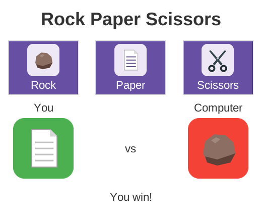
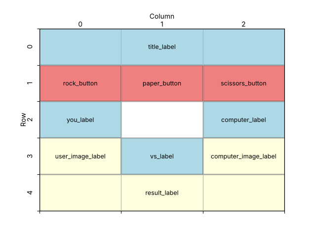

====================================================
Rock paper scissors with images (tkinter)
====================================================

| This is version 2 of the tkinter rock paper scissors game.
| Instead of coloured words, it shows a picture of each player's move, like the Anvil version.
| There are 9 game images: rock, paper and scissors, each in **green** for a win, **red** for a loss and **grey** for a tie, plus a **?** image for the start.
| Each button also shows a small picture of its move.

----

Images
------------

| Put the 13 image files in a folder called **rps_images**, in the same folder as your Python file.

.. code-block:: text

    rock_paper_scissors_v2.py
    rps_images/
        paper_lose.png    paper_tie.png    paper_win.png
        rock_lose.png     rock_tie.png     rock_win.png
        scissors_lose.png scissors_tie.png scissors_win.png
        paper_icon.png    rock_icon.png    scissors_icon.png
        question.png

| The game images are 120 x 120 pixels and the button icons are 64 x 64 pixels. Tkinter's ``PhotoImage`` can load **PNG** and **GIF** files, but not JPG.
| The file names follow a pattern, ``choice_result.png`` and ``choice_icon.png``, all in lowercase. The program uses this pattern to load every image with a loop.

----

How the program is put together
---------------------------------------

The program is built in this order:

#. **Imports**: ``tkinter``, ``random``, and ``Path`` from ``pathlib`` to find the image folder.
#. **Constants**: colours, fonts and the image folder.
#. **Game data**: lists of the choices and results, and a dictionary of messages.
#. **Functions**:

   - ``determine_winner()`` works out who won.
   - ``get_image()`` finds the right image for a choice and result.
   - ``play()`` plays one round and updates the window.
   - ``rock_click()``, ``paper_click()`` and ``scissors_click()`` are run by the buttons.

#. **Main window**: create ``root`` and set its title, size and colour.
#. **Images**: load all 13 images into memory. This must happen **after** the main window is created.
#. **Widgets**: create the title, the three buttons with their icons, the labels and the two image labels.
#. **Layout**: share the spare width between the three columns, then place each widget with ``grid()``.
#. **Event loop**: ``root.mainloop()``.

----

Define constants
-----------------------

.. code-block:: python

    # Constants
    BG_COLOR = "#ffffff"
    TEXT_COLOR = "#333333"
    BUTTON_BG_COLOR = "#6750a4"  # purple
    BUTTON_FG_COLOR = "#ffffff"
    TITLE_FONT = ("Arial", 26, "bold")
    FONT_STYLE = ("Arial", 16)
    # The images are in the rps_images folder, next to this file
    IMAGE_FOLDER = Path(__file__).parent / "rps_images"

- ``Path(__file__)`` is the path of this Python file. ``.parent`` is the folder it is in.
- The ``/`` operator joins paths, so ``Path(__file__).parent / "rps_images"`` is the **rps_images** folder next to the program.
- This means the images are found no matter which folder the program is run from.

----

Store the game data
-------------------------

.. code-block:: python

    # Game data
    CHOICES = ["Rock", "Paper", "Scissors"]
    RESULTS = ["Win", "Lose", "Tie"]
    RESULT_MESSAGES = {"Win": "You win!", "Lose": "You lose!",
                       "Tie": "It's a tie!"}

- ``CHOICES`` and ``RESULTS`` are used together to load the 9 game images with a loop.
- ``RESULT_MESSAGES`` matches each result to the message shown to the player.

----

Decide who wins
-----------------------

.. code-block:: python

    def determine_winner(user, computer):
        """Returns the computer's result, then the user's result.

        Each result is "Win", "Lose" or "Tie".
        """
        if user == computer:
            return "Tie", "Tie"
        elif ((user == "Rock" and computer == "Scissors") or
              (user == "Paper" and computer == "Rock") or
              (user == "Scissors" and computer == "Paper")):
            return "Lose", "Win"
        else:
            return "Win", "Lose"

| This is the same as version 1. It returns **two values**: the computer's result first, then the user's result.

----

Find the right image
---------------------------

.. code-block:: python

    def get_image(choice, result):
        """Returns the image for a choice and result, e.g. "Rock" and "Win"."""
        return images[f"{choice}_{result}"]

- The images are stored in a dictionary called ``images`` with keys like ``"Rock_Win"`` and ``"Scissors_Tie"``.
- The f-string ``f"{choice}_{result}"`` builds the key. For example, ``get_image("Paper", "Lose")`` looks up ``images["Paper_Lose"]``.
- This does the same job as ``get_image_source()`` in the Anvil version, but in one line instead of an ``if`` / ``elif`` / ``else``.

----

Play a round
--------------------

.. code-block:: python

    def play(user_choice):
        """Plays one round against a random computer choice and shows it."""
        computer_choice = random.choice(CHOICES)
        computer_result, user_result = determine_winner(user_choice,
                                                        computer_choice)
        user_image_label.config(image=get_image(user_choice, user_result))
        computer_image_label.config(image=get_image(computer_choice,
                                                    computer_result))
        result_label.config(text=RESULT_MESSAGES[user_result])

- ``random.choice(CHOICES)`` picks the computer's move.
- ``computer_result, user_result = ...`` **unpacks** the two returned values.
- ``user_image_label.config(image=...)`` changes the picture shown in the label, just as ``self.user.source = ...`` does in Anvil.

----

The button functions
-----------------------------

.. code-block:: python

    def rock_click():
        play("Rock")

    def paper_click():
        play("Paper")

    def scissors_click():
        play("Scissors")

| A button's ``command`` must be a function that needs no arguments, so each button gets a small function that calls ``play()`` with its move.

----

Load the images
-----------------------

.. code-block:: python

    # Load the images (this must happen after the main window is created)
    # icons: small pictures for the buttons; images: the 9 game pictures
    images = {}
    icons = {}
    for choice in CHOICES:
        icons[choice] = tk.PhotoImage(
            file=IMAGE_FOLDER / f"{choice.lower()}_icon.png")
        for result in RESULTS:
            file_name = f"{choice.lower()}_{result.lower()}.png"
            images[f"{choice}_{result}"] = tk.PhotoImage(
                file=IMAGE_FOLDER / file_name)
    question_image = tk.PhotoImage(file=IMAGE_FOLDER / "question.png")

- ``images = {}`` and ``icons = {}`` create two empty dictionaries.
- The **outer loop** runs once for each choice. It loads that choice's button icon into ``icons``, e.g. ``icons["Rock"]``.
- The **inner loop** runs once for each result, for every choice: 3 x 3 = 9 game images.
- ``choice.lower()`` turns ``"Rock"`` into ``"rock"``, so the file name matches, e.g. ``rock_win.png``.
- ``tk.PhotoImage(file=...)`` loads an image file so Tkinter can display it.
- ``images[f"{choice}_{result}"] = ...`` stores each image in the dictionary with a key such as ``"Rock_Win"``.
- ``question_image`` is shown before the first round.

.. admonition:: Two things to remember about PhotoImage

    #. Images can only be loaded **after** ``root = tk.Tk()``. Loading them earlier causes ``RuntimeError: Too early to create image``.
    #. Python must keep a variable that refers to each image. If an image is only stored in a local variable inside a function, Python deletes it when the function ends, and the label goes blank. Storing the images in the ``images`` dictionary keeps them all.

----

Create the widgets
-------------------------

.. code-block:: python

    # Create widgets
    title_label = tk.Label(root, text="Rock Paper Scissors", bg=BG_COLOR,
                           fg=TEXT_COLOR, font=TITLE_FONT)
    # A button with an image measures its width in pixels, not characters
    rock_button = tk.Button(root, text="Rock", image=icons["Rock"],
                            compound="top", width=110, bg=BUTTON_BG_COLOR,
                            fg=BUTTON_FG_COLOR, font=FONT_STYLE,
                            command=rock_click)
    paper_button = tk.Button(root, text="Paper", image=icons["Paper"],
                             compound="top", width=110, bg=BUTTON_BG_COLOR,
                             fg=BUTTON_FG_COLOR, font=FONT_STYLE,
                             command=paper_click)
    scissors_button = tk.Button(root, text="Scissors", image=icons["Scissors"],
                                compound="top", width=110, bg=BUTTON_BG_COLOR,
                                fg=BUTTON_FG_COLOR, font=FONT_STYLE,
                                command=scissors_click)
    you_label = tk.Label(root, text="You", bg=BG_COLOR, fg=TEXT_COLOR,
                         font=FONT_STYLE)
    computer_label = tk.Label(root, text="Computer", bg=BG_COLOR, fg=TEXT_COLOR,
                              font=FONT_STYLE)
    user_image_label = tk.Label(root, image=question_image, bg=BG_COLOR)
    vs_label = tk.Label(root, text="vs", bg=BG_COLOR, fg=TEXT_COLOR,
                        font=FONT_STYLE)
    computer_image_label = tk.Label(root, image=question_image, bg=BG_COLOR)
    result_label = tk.Label(root, text="Choose rock, paper or scissors.",
                            bg=BG_COLOR, fg=TEXT_COLOR, font=FONT_STYLE)

- Each button has both ``text`` and an ``image``. ``compound="top"`` puts the image **above** the text. Other options are ``"left"``, ``"right"`` and ``"bottom"``.
- When a button shows an image, its ``width`` is measured in **pixels**, not characters, so ``width=110`` makes each button 110 pixels wide.
- ``user_image_label`` and ``computer_image_label`` are Labels that show an **image** instead of text: ``image=question_image``.

----

Place the widgets in the window
---------------------------------------

Design the grid positions:

.. code-block:: python

    # Share any spare width equally between the 3 columns,
    # so the widgets stay centred
    root.columnconfigure(0, weight=1)
    root.columnconfigure(1, weight=1)
    root.columnconfigure(2, weight=1)

    # Place widgets in the window
    title_label.grid(row=0, column=0, columnspan=3, pady=(15, 10))
    rock_button.grid(row=1, column=0, padx=5, pady=10)
    paper_button.grid(row=1, column=1, padx=5, pady=10)
    scissors_button.grid(row=1, column=2, padx=5, pady=10)
    you_label.grid(row=2, column=0)
    computer_label.grid(row=2, column=2)
    user_image_label.grid(row=3, column=0, pady=5)
    vs_label.grid(row=3, column=1)
    computer_image_label.grid(row=3, column=2, pady=5)
    result_label.grid(row=4, column=0, columnspan=3, pady=15)

| The layout is the same as version 1, with the image labels in row 3.

----

Comparing the Anvil and tkinter versions
------------------------------------------------

.. list-table::
   :header-rows: 1
   :widths: 40 40

   * - **Anvil**
     - **tkinter**
   * - Images uploaded to **Assets**
     - Image files in the **rps_images** folder
   * - ``self.images`` dictionary of image paths
     - ``images`` dictionary of ``PhotoImage`` objects
   * - Image components ``self.user`` and ``self.computer``
     - Labels ``user_image_label`` and ``computer_image_label``
   * - ``self.user.source = ...``
     - ``user_image_label.config(image=...)``
   * - ``get_image_source()`` with ``if`` / ``elif`` / ``else``
     - ``get_image()`` with an f-string key
   * - Button **click** events, e.g. ``rock_click``
     - Button ``command=rock_click``
   * - Button with an image
     - ``tk.Button(..., image=icons["Rock"], compound="top")``

----

Key syntax
-----------------

.. py:function:: tk.PhotoImage(file=path)

    | Syntax: ``tk.PhotoImage(file=IMAGE_FOLDER / "question.png")``
    | Description: Loads a PNG or GIF image so it can be shown in a Label or Button. It must be created after ``root = tk.Tk()``.

.. py:function:: widget.config(image=photo)

    | Syntax: ``user_image_label.config(image=get_image(user_choice, user_result))``
    | Description: Changes the image shown by a Label or Button.

.. py:function:: tk.Button(..., image=photo, compound="top")

    | Syntax: ``tk.Button(root, text="Rock", image=icons["Rock"], compound="top", width=110)``
    | Description: Shows an image and text on a button. ``compound`` sets where the image goes compared with the text: ``"top"``, ``"bottom"``, ``"left"`` or ``"right"``.
    | Note: with an image, ``width`` and ``height`` are measured in pixels.

.. py:function:: Path(__file__).parent / "folder"

    | Syntax: ``Path(__file__).parent / "rps_images"``
    | Description: Builds the path to a folder next to the program. ``/`` joins parts of a path.
    | Import: ``from pathlib import Path``

.. py:function:: for ... in ...: for ... in ...:

    | Syntax: ``for choice in CHOICES:`` then, indented inside it, ``for result in RESULTS:``
    | Description: **Nested loops**. The inner loop runs completely for each pass of the outer loop, so 3 choices x 3 results = 9 passes.

.. py:function:: string.lower()

    | Syntax: ``choice.lower()``
    | Description: Returns a copy of the string in lowercase.
    | Example: ``"Scissors".lower()  # "scissors"``

----

Full code
------------

.. code-block:: python

    import tkinter as tk
    import random
    from pathlib import Path

    # Constants
    BG_COLOR = "#ffffff"
    TEXT_COLOR = "#333333"
    BUTTON_BG_COLOR = "#6750a4"  # purple
    BUTTON_FG_COLOR = "#ffffff"
    TITLE_FONT = ("Arial", 26, "bold")
    FONT_STYLE = ("Arial", 16)
    # The images are in the rps_images folder, next to this file
    IMAGE_FOLDER = Path(__file__).parent / "rps_images"

    # Game data
    CHOICES = ["Rock", "Paper", "Scissors"]
    RESULTS = ["Win", "Lose", "Tie"]
    RESULT_MESSAGES = {"Win": "You win!", "Lose": "You lose!",
                       "Tie": "It's a tie!"}

    def determine_winner(user, computer):
        """Returns the computer's result, then the user's result.

        Each result is "Win", "Lose" or "Tie".
        """
        if user == computer:
            return "Tie", "Tie"
        elif ((user == "Rock" and computer == "Scissors") or
              (user == "Paper" and computer == "Rock") or
              (user == "Scissors" and computer == "Paper")):
            return "Lose", "Win"
        else:
            return "Win", "Lose"

    def get_image(choice, result):
        """Returns the image for a choice and result, e.g. "Rock" and "Win"."""
        return images[f"{choice}_{result}"]

    def play(user_choice):
        """Plays one round against a random computer choice and shows it."""
        computer_choice = random.choice(CHOICES)
        computer_result, user_result = determine_winner(user_choice,
                                                        computer_choice)
        user_image_label.config(image=get_image(user_choice, user_result))
        computer_image_label.config(image=get_image(computer_choice,
                                                    computer_result))
        result_label.config(text=RESULT_MESSAGES[user_result])

    def rock_click():
        play("Rock")

    def paper_click():
        play("Paper")

    def scissors_click():
        play("Scissors")

    # Create the main window
    root = tk.Tk()
    root.title("Rock Paper Scissors")
    root.geometry("520x440")
    root.configure(bg=BG_COLOR)

    # Load the images (this must happen after the main window is created)
    # icons: small pictures for the buttons; images: the 9 game pictures
    images = {}
    icons = {}
    for choice in CHOICES:
        icons[choice] = tk.PhotoImage(
            file=IMAGE_FOLDER / f"{choice.lower()}_icon.png")
        for result in RESULTS:
            file_name = f"{choice.lower()}_{result.lower()}.png"
            images[f"{choice}_{result}"] = tk.PhotoImage(
                file=IMAGE_FOLDER / file_name)
    question_image = tk.PhotoImage(file=IMAGE_FOLDER / "question.png")

    # Create widgets
    title_label = tk.Label(root, text="Rock Paper Scissors", bg=BG_COLOR,
                           fg=TEXT_COLOR, font=TITLE_FONT)
    # A button with an image measures its width in pixels, not characters
    rock_button = tk.Button(root, text="Rock", image=icons["Rock"],
                            compound="top", width=110, bg=BUTTON_BG_COLOR,
                            fg=BUTTON_FG_COLOR, font=FONT_STYLE,
                            command=rock_click)
    paper_button = tk.Button(root, text="Paper", image=icons["Paper"],
                             compound="top", width=110, bg=BUTTON_BG_COLOR,
                             fg=BUTTON_FG_COLOR, font=FONT_STYLE,
                             command=paper_click)
    scissors_button = tk.Button(root, text="Scissors", image=icons["Scissors"],
                                compound="top", width=110, bg=BUTTON_BG_COLOR,
                                fg=BUTTON_FG_COLOR, font=FONT_STYLE,
                                command=scissors_click)
    you_label = tk.Label(root, text="You", bg=BG_COLOR, fg=TEXT_COLOR,
                         font=FONT_STYLE)
    computer_label = tk.Label(root, text="Computer", bg=BG_COLOR, fg=TEXT_COLOR,
                              font=FONT_STYLE)
    user_image_label = tk.Label(root, image=question_image, bg=BG_COLOR)
    vs_label = tk.Label(root, text="vs", bg=BG_COLOR, fg=TEXT_COLOR,
                        font=FONT_STYLE)
    computer_image_label = tk.Label(root, image=question_image, bg=BG_COLOR)
    result_label = tk.Label(root, text="Choose rock, paper or scissors.",
                            bg=BG_COLOR, fg=TEXT_COLOR, font=FONT_STYLE)

    # Share any spare width equally between the 3 columns,
    # so the widgets stay centred
    root.columnconfigure(0, weight=1)
    root.columnconfigure(1, weight=1)
    root.columnconfigure(2, weight=1)

    # Place widgets in the window
    title_label.grid(row=0, column=0, columnspan=3, pady=(15, 10))
    rock_button.grid(row=1, column=0, padx=5, pady=10)
    paper_button.grid(row=1, column=1, padx=5, pady=10)
    scissors_button.grid(row=1, column=2, padx=5, pady=10)
    you_label.grid(row=2, column=0)
    computer_label.grid(row=2, column=2)
    user_image_label.grid(row=3, column=0, pady=5)
    vs_label.grid(row=3, column=1)
    computer_image_label.grid(row=3, column=2, pady=5)
    result_label.grid(row=4, column=0, columnspan=3, pady=15)

    # Start the main event loop
    root.mainloop()

----

Rock paper scissors test table
------------------------------------

| The computer's choice is random, so keep clicking until each combination appears.

.. list-table:: Test Cases for Rock Paper Scissors with Images
   :header-rows: 1
   :widths: 20 20 25 35

   * - **You**
     - **Computer**
     - **Message**
     - **Images (you / computer)**
   * - Rock
     - Rock
     - It's a tie!
     - grey rock / grey rock
   * - Rock
     - Paper
     - You lose!
     - red rock / green paper
   * - Rock
     - Scissors
     - You win!
     - green rock / red scissors
   * - Paper
     - Rock
     - You win!
     - green paper / red rock
   * - Paper
     - Paper
     - It's a tie!
     - grey paper / grey paper
   * - Paper
     - Scissors
     - You lose!
     - red paper / green scissors
   * - Scissors
     - Rock
     - You lose!
     - red scissors / green rock
   * - Scissors
     - Paper
     - You win!
     - green scissors / red paper
   * - Scissors
     - Scissors
     - It's a tie!
     - grey scissors / grey scissors

----

.. admonition:: Tasks

    #. Add a scoring system. Show the number of wins, losses and ties in a label, and update it after each round.
    #. Change ``compound="top"`` to ``compound="left"`` on the buttons. What changes? What else do you need to change so the buttons still fit?
    #. Draw or find your own images (120 x 120 pixels, PNG) and use them instead.

----

Rock Paper Scissors with Images - Multiple Choice Quiz
------------------------------------------------------------

.. mcqgroup::
    :nav_position: both
    :show-instant-feedback:
    :enable-instant-feedback:
    :shuffle_questions:
    :num_questions: 5

    .. multichoice::

        Why are the images loaded after root = tk.Tk()?

        [ ] To make the program faster | Incorrect. The order is required, not just faster.
        [x] A PhotoImage can only be created once the main window exists | Correct. Loading earlier causes RuntimeError: Too early to create image.
        [ ] So the images appear in alphabetical order | Incorrect. The order of loading does not affect how they appear.
        [ ] Because the images are part of the title | Incorrect. The images are shown in Labels.

    .. multichoice::

        What is Path(__file__).parent / "rps_images"?

        [ ] The number of images divided by the file size | Incorrect. Here / joins parts of a path.
        [x] The rps_images folder in the same folder as the program | Correct. __file__ is the program, .parent is its folder, and / adds rps_images.
        [ ] The first image in the folder | Incorrect. It is the path of the folder itself.
        [ ] The folder the user is currently in | Incorrect. It is based on where the program file is, not where it is run from.

    .. multichoice::

        How many times does the line that loads a game image run in the nested loops?

        [ ] 3 | Incorrect. The inner loop runs 3 times for each of the 3 choices.
        [ ] 6 | Incorrect. The loops multiply, they do not add.
        [x] 9 | Correct. 3 choices x 3 results = 9 images.
        [ ] 10 | Incorrect. The question image is loaded separately, after the loops.

    .. multichoice::

        What file name does f"{choice.lower()}_{result.lower()}.png" give when choice is "Paper" and result is "Tie"?

        [ ] Paper_Tie.png | Incorrect. lower() changes both words to lowercase.
        [x] paper_tie.png | Correct. Both parts are made lowercase and joined with an underscore.
        [ ] paper tie.png | Incorrect. The f-string puts an underscore between them.
        [ ] paper_tie | Incorrect. The f-string ends with .png.

    .. multichoice::

        What does get_image("Rock", "Win") return?

        [ ] The text "Rock_Win" | Incorrect. The text is used as a key to look up the image.
        [x] The PhotoImage stored in images["Rock_Win"] | Correct. The f-string builds the key, and the dictionary gives the image.
        [ ] The file name rock_win.png | Incorrect. It returns the loaded image, not the file name.
        [ ] True | Incorrect. The function returns an image.

    .. multichoice::

        What does user_image_label.config(image=...) do?

        [ ] Saves the image to a file | Incorrect. config() changes how the label looks.
        [x] Changes the picture shown in the label | Correct. This is like self.user.source = ... in Anvil.
        [ ] Creates a new label | Incorrect. It changes an existing label.
        [ ] Makes the label bigger | Incorrect. The size comes from the image.

    .. multichoice::

        Why are all the images stored in the images dictionary?

        [ ] Tkinter only accepts images from dictionaries | Incorrect. Any variable can refer to an image.
        [x] Python must keep a reference to each image, or it deletes the image and the label goes blank | Correct. The dictionary keeps every image alive, and lets get_image() find them by key.
        [ ] To make the images smaller | Incorrect. The dictionary does not change the images.
        [ ] To sort the images by colour | Incorrect. Dictionaries look values up by key.

    .. multichoice::

        Why do the buttons use width=110 instead of width=9 as in version 1?

        [ ] Images make the text smaller | Incorrect. The font size is set by FONT_STYLE.
        [x] When a button shows an image, its width is measured in pixels instead of characters | Correct. width=9 would make the button only 9 pixels wide.
        [ ] 110 is the number of the image file | Incorrect. The width is a size, not a file number.
        [ ] Buttons with images must always be 110 wide | Incorrect. Any width in pixels can be used.

    .. multichoice::

        What does compound="top" do on a button?

        [ ] Puts the button at the top of the window | Incorrect. grid() sets where the button goes.
        [x] Puts the image above the text on the button | Correct. compound sets where the image goes compared with the text.
        [ ] Makes the text bold | Incorrect. The font sets the text style.
        [ ] Stacks the three buttons on top of each other | Incorrect. Each button is placed separately with grid().

    .. multichoice::

        What error appears if the rps_images folder is not next to the program?

        [ ] NameError | Incorrect. The variables exist; it is the files that are missing.
        [x] TclError: couldn't open ... no such file or directory | Correct. PhotoImage cannot find the image file.
        [ ] ValueError | Incorrect. No value is being converted.
        [ ] No error: the labels just stay blank | Incorrect. The program stops when an image file cannot be opened.

----

Rock Paper Scissors with Images - Cloze Code Quiz
-------------------------------------------------------

.. clozegroup::
    :nav-position: both
    :num-questions: 3
    :show-instant-feedback:

    .. cloze::
        :instructions: Import Path and build the path to the image folder.

        from @@pathlib | tkinter | random@@ import Path

        IMAGE_FOLDER = Path(__file__).@@parent | folder | path@@ / "rps_images"

    .. cloze::
        :instructions: Load the 9 game images with nested loops.

        images = {}
        for choice in CHOICES:
            for result in @@RESULTS | CHOICES | images@@:
                file_name = f"{choice.@@lower | upper | title@@()}_{result.lower()}.png"
                images[f"{choice}_{result}"] = tk.@@PhotoImage | Image | Label@@(
                    file=IMAGE_FOLDER / file_name)

    .. cloze::
        :instructions: Look up an image from the dictionary.

        def get_image(choice, result):
            return images[@@f"{choice}_{result}" | "choice_result" | choice + result@@]

    .. cloze::
        :instructions: Show the right images after a round.

        user_image_label.config(@@image | source | file@@=get_image(user_choice, user_result))
        computer_image_label.config(image=get_image(computer_choice,
                                                    @@computer_result | user_result | computer_choice@@))

    .. cloze::
        :instructions: Show an icon above the text on the Rock button, and the question image at the start.

        rock_button = tk.Button(root, text="Rock", image=icons["Rock"],
                                compound="@@top | above | up@@", width=110, bg=BUTTON_BG_COLOR,
                                fg=BUTTON_FG_COLOR, font=FONT_STYLE,
                                command=rock_click)

        question_image = tk.PhotoImage(file=IMAGE_FOLDER / "question.png")
        user_image_label = tk.Label(root, @@image=question_image | text=question_image | file="question.png"@@, bg=BG_COLOR)
