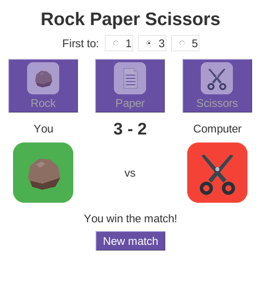
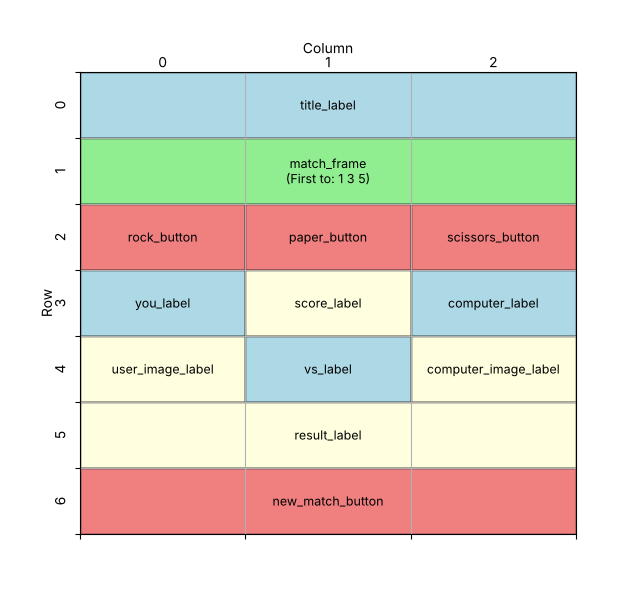

====================================================
Rock paper scissors match play (tkinter)
====================================================

| This is version 3 of the tkinter rock paper scissors game. It adds **match play** to version 2.
| The player chooses **First to 1, 3 or 5** with radio buttons. The score is shown between "You" and "Computer", and tied rounds do not count.
| When a player reaches the target, the match ends: the move buttons are greyed out and a **New match** button is turned on.
| It uses the same 13 images as version 2, in the **rps_images** folder next to the program.

----

How the program is put together
---------------------------------------

The program is built in this order:

#. **Imports**: ``tkinter``, ``random``, and ``Path`` from ``pathlib``.
#. **Constants**: colours, fonts (including a larger ``SCORE_FONT``) and the image folder.
#. **Game data**: the choices, results, round messages and ``MATCH_LENGTHS``.
#. **Scores**: ``user_score`` and ``computer_score``, created outside any function.
#. **Functions**:

   - ``determine_winner()`` and ``get_image()`` are the same as version 2.
   - ``update_score()`` shows the score.
   - ``set_choice_buttons()`` turns the move buttons on or off.
   - ``new_match()`` resets everything for a new match.
   - ``play()`` plays one round, adds to the score and checks for a match winner.
   - ``rock_click()``, ``paper_click()`` and ``scissors_click()`` are run by the buttons.

#. **Main window** and **images**, as in version 2.
#. **Match length**: ``target = tk.IntVar(value=3)``, created after the main window.
#. **Widgets**: the title, a frame of radio buttons, the three move buttons, the labels, the score and the New match button.
#. **Layout**: place each widget with ``grid()``.
#. **Event loop**: ``root.mainloop()``.

----

Define constants and game data
--------------------------------------

.. code-block:: python

    # Constants
    BG_COLOR = "#ffffff"
    TEXT_COLOR = "#333333"
    BUTTON_BG_COLOR = "#6750a4"  # purple
    BUTTON_FG_COLOR = "#ffffff"
    TITLE_FONT = ("Arial", 26, "bold")
    FONT_STYLE = ("Arial", 16)
    SCORE_FONT = ("Arial", 24, "bold")
    # The images are in the rps_images folder, next to this file
    IMAGE_FOLDER = Path(__file__).parent / "rps_images"

    # Game data
    CHOICES = ["Rock", "Paper", "Scissors"]
    RESULTS = ["Win", "Lose", "Tie"]
    RESULT_MESSAGES = {"Win": "You win this round!",
                       "Lose": "You lose this round!",
                       "Tie": "It's a tie! Tied rounds do not count."}
    MATCH_LENGTHS = [1, 3, 5]

- ``SCORE_FONT`` is a larger, bold font so the score stands out.
- The messages now say "this round", because a match has several rounds.
- ``MATCH_LENGTHS`` lists the match lengths the player can choose. The radio buttons are made from this list with a loop.

----

Keep the score
---------------------

.. code-block:: python

    # Scores for the current match
    user_score = 0
    computer_score = 0

- These are **global variables**: they are created outside any function, so they keep their values between button clicks.
- A variable created inside a function is lost when the function ends, so it could not keep a score.

----

Decide who wins and find the image
-----------------------------------------

.. code-block:: python

    def determine_winner(user, computer):
        """Returns the computer's result, then the user's result.

        Each result is "Win", "Lose" or "Tie".
        """
        if user == computer:
            return "Tie", "Tie"
        elif ((user == "Rock" and computer == "Scissors") or
              (user == "Paper" and computer == "Rock") or
              (user == "Scissors" and computer == "Paper")):
            return "Lose", "Win"
        else:
            return "Win", "Lose"

    def get_image(choice, result):
        """Returns the image for a choice and result, e.g. "Rock" and "Win"."""
        return images[f"{choice}_{result}"]

| These two functions are the same as version 2.

----

Show the score and turn the buttons on or off
----------------------------------------------------

.. code-block:: python

    def update_score():
        """Shows the current score in the score label."""
        score_label.config(text=f"{user_score} - {computer_score}")

    def set_choice_buttons(state):
        """Turns the three choice buttons on ("normal") or off ("disabled")."""
        rock_button.config(state=state)
        paper_button.config(state=state)
        scissors_button.config(state=state)

- ``update_score()`` uses an f-string to show the score, e.g. ``"2 - 1"``. It reads the global variables but does not change them, so it does not need ``global``.
- ``set_choice_buttons(state)`` has a **parameter**. Calling it with ``"disabled"`` greys out all three move buttons, and ``"normal"`` turns them back on.
- A disabled button does not run its ``command`` when clicked.

----

Start a new match
------------------------

.. code-block:: python

    def new_match():
        """Resets the scores and images so a new match can start."""
        global user_score, computer_score
        user_score = 0
        computer_score = 0
        update_score()
        user_image_label.config(image=question_image)
        computer_image_label.config(image=question_image)
        result_label.config(text=f"First to {target.get()} wins. Choose a move.")
        set_choice_buttons("normal")
        new_match_button.config(state="disabled")

- ``global user_score, computer_score`` lets the function **change** the global variables. Without it, ``user_score = 0`` would make a new local variable, and the score on screen would not reset properly.
- ``target.get()`` reads the match length chosen with the radio buttons: 1, 3 or 5.
- The move buttons are turned on and the New match button is turned off.

----

Play a round
--------------------

.. code-block:: python

    def play(user_choice):
        """Plays one round, updates the score and checks for a match winner."""
        global user_score, computer_score
        computer_choice = random.choice(CHOICES)
        computer_result, user_result = determine_winner(user_choice,
                                                        computer_choice)
        user_image_label.config(image=get_image(user_choice, user_result))
        computer_image_label.config(image=get_image(computer_choice,
                                                    computer_result))
        if user_result == "Win":
            user_score += 1
        elif user_result == "Lose":
            computer_score += 1
        update_score()

        if user_score == target.get():
            result_label.config(text="You win the match!")
        elif computer_score == target.get():
            result_label.config(text="The computer wins the match!")
        else:
            result_label.config(text=RESULT_MESSAGES[user_result])
            return
        # The match is over: stop play until a new match starts
        set_choice_buttons("disabled")
        new_match_button.config(state="normal")

- ``play()`` also needs ``global``, because ``user_score += 1`` changes a global variable. Without it, Python stops with ``UnboundLocalError: cannot access local variable 'user_score'``.
- A win adds 1 to ``user_score`` and a loss adds 1 to ``computer_score``. A tie changes neither.
- The ``if`` / ``elif`` checks whether either player has reached the target.
- If nobody has won the match yet, the ``else`` shows the round message and ``return`` **ends the function early**.
- The last two lines only run when the match is over: they grey out the move buttons and turn on New match.

----

The button functions
-----------------------------

.. code-block:: python

    def rock_click():
        play("Rock")

    def paper_click():
        play("Paper")

    def scissors_click():
        play("Scissors")

| These are the same as version 2.

----

Create the window, load the images and the match length
--------------------------------------------------------------

.. code-block:: python

    # Create the main window
    root = tk.Tk()
    root.title("Rock Paper Scissors")
    root.geometry("520x560")
    root.configure(bg=BG_COLOR)

    # Load the images (this must happen after the main window is created)
    # icons: small pictures for the buttons; images: the 9 game pictures
    images = {}
    icons = {}
    for choice in CHOICES:
        icons[choice] = tk.PhotoImage(
            file=IMAGE_FOLDER / f"{choice.lower()}_icon.png")
        for result in RESULTS:
            file_name = f"{choice.lower()}_{result.lower()}.png"
            images[f"{choice}_{result}"] = tk.PhotoImage(
                file=IMAGE_FOLDER / file_name)
    question_image = tk.PhotoImage(file=IMAGE_FOLDER / "question.png")

    # The number of wins needed to win the match (1, 3 or 5)
    target = tk.IntVar(value=3)

- The window is taller than version 2 (``"520x560"``) to fit the radio buttons and the New match button.
- ``tk.IntVar(value=3)`` is a Tkinter variable that holds a whole number, starting at 3. The radio buttons store the player's choice in it.
- Like ``PhotoImage``, an ``IntVar`` can only be created **after** ``root = tk.Tk()``. Creating it earlier causes ``RuntimeError: Too early to create variable``.

----

Create the widgets
-------------------------

.. code-block:: python

    # Create widgets
    title_label = tk.Label(root, text="Rock Paper Scissors", bg=BG_COLOR,
                           fg=TEXT_COLOR, font=TITLE_FONT)
    # A frame holds the "First to" label and the three radio buttons in one row
    match_frame = tk.Frame(root, bg=BG_COLOR)
    first_to_label = tk.Label(match_frame, text="First to:", bg=BG_COLOR,
                              fg=TEXT_COLOR, font=FONT_STYLE)
    first_to_label.pack(side="left", padx=5)
    for wins in MATCH_LENGTHS:
        tk.Radiobutton(match_frame, text=str(wins), variable=target, value=wins,
                       bg=BG_COLOR, fg=TEXT_COLOR, font=FONT_STYLE,
                       command=new_match).pack(side="left", padx=5)
    # A button with an image measures its width in pixels, not characters
    rock_button = tk.Button(root, text="Rock", image=icons["Rock"],
                            compound="top", width=110, bg=BUTTON_BG_COLOR,
                            fg=BUTTON_FG_COLOR, font=FONT_STYLE,
                            command=rock_click)
    paper_button = tk.Button(root, text="Paper", image=icons["Paper"],
                             compound="top", width=110, bg=BUTTON_BG_COLOR,
                             fg=BUTTON_FG_COLOR, font=FONT_STYLE,
                             command=paper_click)
    scissors_button = tk.Button(root, text="Scissors", image=icons["Scissors"],
                                compound="top", width=110, bg=BUTTON_BG_COLOR,
                                fg=BUTTON_FG_COLOR, font=FONT_STYLE,
                                command=scissors_click)
    you_label = tk.Label(root, text="You", bg=BG_COLOR, fg=TEXT_COLOR,
                         font=FONT_STYLE)
    score_label = tk.Label(root, text="0 - 0", bg=BG_COLOR, fg=TEXT_COLOR,
                           font=SCORE_FONT)
    computer_label = tk.Label(root, text="Computer", bg=BG_COLOR, fg=TEXT_COLOR,
                              font=FONT_STYLE)
    user_image_label = tk.Label(root, image=question_image, bg=BG_COLOR)
    vs_label = tk.Label(root, text="vs", bg=BG_COLOR, fg=TEXT_COLOR,
                        font=FONT_STYLE)
    computer_image_label = tk.Label(root, image=question_image, bg=BG_COLOR)
    result_label = tk.Label(root, text="First to 3 wins. Choose a move.",
                            bg=BG_COLOR, fg=TEXT_COLOR, font=FONT_STYLE)
    new_match_button = tk.Button(root, text="New match", bg=BUTTON_BG_COLOR,
                                 fg=BUTTON_FG_COLOR, font=FONT_STYLE,
                                 state="disabled", command=new_match)

- ``match_frame`` is a **Frame**: an invisible container that holds the "First to:" label and the three radio buttons.
- The ``for`` loop makes one ``Radiobutton`` for each number in ``MATCH_LENGTHS``.
- All three radio buttons use ``variable=target``, so they form one group: choosing one deselects the others. Clicking a radio button stores its ``value`` in ``target``.
- ``command=new_match`` starts a new match whenever the match length is changed.
- The radio buttons are never stored in variables, because the program never needs to change them. It only needs ``target``.
- ``score_label`` uses ``SCORE_FONT``, and ``new_match_button`` starts with ``state="disabled"`` because no match has finished yet.

.. admonition:: grid() and pack()

    | Inside one container, use either ``grid()`` or ``pack()``, never both.
    | The window uses ``grid()``, so the widgets inside ``match_frame`` are placed with ``pack(side="left")``, which lines them up in a row. The frame itself is placed in the window with ``grid()``.
    | Packing a radio button straight into ``root`` causes ``TclError: cannot use geometry manager grid inside . which already has slaves managed by pack``.

----

Place the widgets in the window
---------------------------------------

Design the grid positions:

.. code-block:: python

    # Share any spare width equally between the 3 columns,
    # so the widgets stay centred
    root.columnconfigure(0, weight=1)
    root.columnconfigure(1, weight=1)
    root.columnconfigure(2, weight=1)

    # Place widgets in the window
    title_label.grid(row=0, column=0, columnspan=3, pady=(15, 5))
    match_frame.grid(row=1, column=0, columnspan=3, pady=5)
    rock_button.grid(row=2, column=0, padx=5, pady=10)
    paper_button.grid(row=2, column=1, padx=5, pady=10)
    scissors_button.grid(row=2, column=2, padx=5, pady=10)
    you_label.grid(row=3, column=0)
    score_label.grid(row=3, column=1)
    computer_label.grid(row=3, column=2)
    user_image_label.grid(row=4, column=0, pady=5)
    vs_label.grid(row=4, column=1)
    computer_image_label.grid(row=4, column=2, pady=5)
    result_label.grid(row=5, column=0, columnspan=3, pady=10)
    new_match_button.grid(row=6, column=0, columnspan=3)

- ``match_frame`` goes in row 1, so every widget below the title moves down one row compared with version 2.
- ``score_label`` fills the empty cell between "You" and "Computer" in row 3.
- ``new_match_button`` is in row 6, under the result.

----

Key syntax
-----------------

.. py:function:: global name

    | Syntax: ``global user_score, computer_score``
    | Description: The first line inside a function that needs to **change** a global variable. Reading a global variable does not need it.

.. py:function:: tk.IntVar(value=number)

    | Syntax: ``target = tk.IntVar(value=3)``
    | Description: A Tkinter variable that holds a whole number. Read it with ``target.get()`` and change it with ``target.set(5)``. Create it after ``root = tk.Tk()``.

.. py:function:: tk.Radiobutton(parent, text, variable, value, command)

    | Syntax: ``tk.Radiobutton(match_frame, text="3", variable=target, value=3, command=new_match)``
    | Description: One option in a group. Radio buttons that share a ``variable`` form a group, and only one can be selected. Clicking one stores its ``value`` in the variable.

.. py:function:: tk.Frame(parent)

    | Syntax: ``match_frame = tk.Frame(root, bg=BG_COLOR)``
    | Description: An invisible container for other widgets. Widgets inside it are created with the frame as their parent.

.. py:function:: widget.pack(side="left")

    | Syntax: ``first_to_label.pack(side="left", padx=5)``
    | Description: Places each widget to the right of the one packed before it. Do not mix ``pack()`` and ``grid()`` in the same container.

.. py:function:: widget.config(state=...)

    | Syntax: ``new_match_button.config(state="normal")``
    | Description: ``"normal"`` lets the widget be used; ``"disabled"`` greys it out so clicking does nothing.

.. py:function:: return

    | Syntax: ``return``
    | Description: Ends a function straight away. Any lines after it in the function are skipped.

----

Full code
------------

.. code-block:: python

    import tkinter as tk
    import random
    from pathlib import Path

    # Constants
    BG_COLOR = "#ffffff"
    TEXT_COLOR = "#333333"
    BUTTON_BG_COLOR = "#6750a4"  # purple
    BUTTON_FG_COLOR = "#ffffff"
    TITLE_FONT = ("Arial", 26, "bold")
    FONT_STYLE = ("Arial", 16)
    SCORE_FONT = ("Arial", 24, "bold")
    # The images are in the rps_images folder, next to this file
    IMAGE_FOLDER = Path(__file__).parent / "rps_images"

    # Game data
    CHOICES = ["Rock", "Paper", "Scissors"]
    RESULTS = ["Win", "Lose", "Tie"]
    RESULT_MESSAGES = {"Win": "You win this round!",
                       "Lose": "You lose this round!",
                       "Tie": "It's a tie! Tied rounds do not count."}
    MATCH_LENGTHS = [1, 3, 5]

    # Scores for the current match
    user_score = 0
    computer_score = 0

    def determine_winner(user, computer):
        """Returns the computer's result, then the user's result.

        Each result is "Win", "Lose" or "Tie".
        """
        if user == computer:
            return "Tie", "Tie"
        elif ((user == "Rock" and computer == "Scissors") or
              (user == "Paper" and computer == "Rock") or
              (user == "Scissors" and computer == "Paper")):
            return "Lose", "Win"
        else:
            return "Win", "Lose"

    def get_image(choice, result):
        """Returns the image for a choice and result, e.g. "Rock" and "Win"."""
        return images[f"{choice}_{result}"]

    def update_score():
        """Shows the current score in the score label."""
        score_label.config(text=f"{user_score} - {computer_score}")

    def set_choice_buttons(state):
        """Turns the three choice buttons on ("normal") or off ("disabled")."""
        rock_button.config(state=state)
        paper_button.config(state=state)
        scissors_button.config(state=state)

    def new_match():
        """Resets the scores and images so a new match can start."""
        global user_score, computer_score
        user_score = 0
        computer_score = 0
        update_score()
        user_image_label.config(image=question_image)
        computer_image_label.config(image=question_image)
        result_label.config(text=f"First to {target.get()} wins. Choose a move.")
        set_choice_buttons("normal")
        new_match_button.config(state="disabled")

    def play(user_choice):
        """Plays one round, updates the score and checks for a match winner."""
        global user_score, computer_score
        computer_choice = random.choice(CHOICES)
        computer_result, user_result = determine_winner(user_choice,
                                                        computer_choice)
        user_image_label.config(image=get_image(user_choice, user_result))
        computer_image_label.config(image=get_image(computer_choice,
                                                    computer_result))
        if user_result == "Win":
            user_score += 1
        elif user_result == "Lose":
            computer_score += 1
        update_score()

        if user_score == target.get():
            result_label.config(text="You win the match!")
        elif computer_score == target.get():
            result_label.config(text="The computer wins the match!")
        else:
            result_label.config(text=RESULT_MESSAGES[user_result])
            return
        # The match is over: stop play until a new match starts
        set_choice_buttons("disabled")
        new_match_button.config(state="normal")

    def rock_click():
        play("Rock")

    def paper_click():
        play("Paper")

    def scissors_click():
        play("Scissors")

    # Create the main window
    root = tk.Tk()
    root.title("Rock Paper Scissors")
    root.geometry("520x560")
    root.configure(bg=BG_COLOR)

    # Load the images (this must happen after the main window is created)
    # icons: small pictures for the buttons; images: the 9 game pictures
    images = {}
    icons = {}
    for choice in CHOICES:
        icons[choice] = tk.PhotoImage(
            file=IMAGE_FOLDER / f"{choice.lower()}_icon.png")
        for result in RESULTS:
            file_name = f"{choice.lower()}_{result.lower()}.png"
            images[f"{choice}_{result}"] = tk.PhotoImage(
                file=IMAGE_FOLDER / file_name)
    question_image = tk.PhotoImage(file=IMAGE_FOLDER / "question.png")

    # The number of wins needed to win the match (1, 3 or 5)
    target = tk.IntVar(value=3)

    # Create widgets
    title_label = tk.Label(root, text="Rock Paper Scissors", bg=BG_COLOR,
                           fg=TEXT_COLOR, font=TITLE_FONT)
    # A frame holds the "First to" label and the three radio buttons in one row
    match_frame = tk.Frame(root, bg=BG_COLOR)
    first_to_label = tk.Label(match_frame, text="First to:", bg=BG_COLOR,
                              fg=TEXT_COLOR, font=FONT_STYLE)
    first_to_label.pack(side="left", padx=5)
    for wins in MATCH_LENGTHS:
        tk.Radiobutton(match_frame, text=str(wins), variable=target, value=wins,
                       bg=BG_COLOR, fg=TEXT_COLOR, font=FONT_STYLE,
                       command=new_match).pack(side="left", padx=5)
    # A button with an image measures its width in pixels, not characters
    rock_button = tk.Button(root, text="Rock", image=icons["Rock"],
                            compound="top", width=110, bg=BUTTON_BG_COLOR,
                            fg=BUTTON_FG_COLOR, font=FONT_STYLE,
                            command=rock_click)
    paper_button = tk.Button(root, text="Paper", image=icons["Paper"],
                             compound="top", width=110, bg=BUTTON_BG_COLOR,
                             fg=BUTTON_FG_COLOR, font=FONT_STYLE,
                             command=paper_click)
    scissors_button = tk.Button(root, text="Scissors", image=icons["Scissors"],
                                compound="top", width=110, bg=BUTTON_BG_COLOR,
                                fg=BUTTON_FG_COLOR, font=FONT_STYLE,
                                command=scissors_click)
    you_label = tk.Label(root, text="You", bg=BG_COLOR, fg=TEXT_COLOR,
                         font=FONT_STYLE)
    score_label = tk.Label(root, text="0 - 0", bg=BG_COLOR, fg=TEXT_COLOR,
                           font=SCORE_FONT)
    computer_label = tk.Label(root, text="Computer", bg=BG_COLOR, fg=TEXT_COLOR,
                              font=FONT_STYLE)
    user_image_label = tk.Label(root, image=question_image, bg=BG_COLOR)
    vs_label = tk.Label(root, text="vs", bg=BG_COLOR, fg=TEXT_COLOR,
                        font=FONT_STYLE)
    computer_image_label = tk.Label(root, image=question_image, bg=BG_COLOR)
    result_label = tk.Label(root, text="First to 3 wins. Choose a move.",
                            bg=BG_COLOR, fg=TEXT_COLOR, font=FONT_STYLE)
    new_match_button = tk.Button(root, text="New match", bg=BUTTON_BG_COLOR,
                                 fg=BUTTON_FG_COLOR, font=FONT_STYLE,
                                 state="disabled", command=new_match)

    # Share any spare width equally between the 3 columns,
    # so the widgets stay centred
    root.columnconfigure(0, weight=1)
    root.columnconfigure(1, weight=1)
    root.columnconfigure(2, weight=1)

    # Place widgets in the window
    title_label.grid(row=0, column=0, columnspan=3, pady=(15, 5))
    match_frame.grid(row=1, column=0, columnspan=3, pady=5)
    rock_button.grid(row=2, column=0, padx=5, pady=10)
    paper_button.grid(row=2, column=1, padx=5, pady=10)
    scissors_button.grid(row=2, column=2, padx=5, pady=10)
    you_label.grid(row=3, column=0)
    score_label.grid(row=3, column=1)
    computer_label.grid(row=3, column=2)
    user_image_label.grid(row=4, column=0, pady=5)
    vs_label.grid(row=4, column=1)
    computer_image_label.grid(row=4, column=2, pady=5)
    result_label.grid(row=5, column=0, columnspan=3, pady=10)
    new_match_button.grid(row=6, column=0, columnspan=3)

    # Start the main event loop
    root.mainloop()

----

Rock paper scissors match play test table
------------------------------------------------

.. list-table:: Test Cases for Rock Paper Scissors Match Play
   :header-rows: 1
   :widths: 45 55

   * - **Test**
     - **Expected result**
   * - Start the app
     - Score 0 - 0, First to 3 selected, New match greyed out
   * - Choose First to 1, then win or lose one round
     - The match ends after one decided round
   * - Play until a round is a tie
     - The score does not change
   * - Play a first-to-3 match to the end
     - Match message; move buttons greyed out; New match turned on
   * - Click a greyed-out move button
     - Nothing happens
   * - Click New match
     - Score 0 - 0, "?" pictures, move buttons on, New match greyed out
   * - Change to First to 5 during a match
     - A new match starts at 0 - 0

----

.. admonition:: Tasks

    #. Add a **First to 10** option. Which one line do you need to change?
    #. Add a label that counts how many matches the player and the computer have each won.
    #. Make the score label turn green when the player wins the match and red when the computer wins.

----

Rock Paper Scissors Match Play - Multiple Choice Quiz
-----------------------------------------------------------

.. mcqgroup::
    :nav_position: both
    :show-instant-feedback:
    :enable-instant-feedback:
    :shuffle_questions:
    :num_questions: 5

    .. multichoice::

        Why are user_score and computer_score created outside any function?

        [ ] So they reset every time a button is clicked | Incorrect. Global variables keep their values between clicks.
        [x] So they keep their values between button clicks | Correct. A variable inside a function is lost when the function ends.
        [ ] Because Tkinter needs them | Incorrect. They are ordinary Python variables.
        [ ] So they can be shown in a Label | Incorrect. Local variables can also be shown in a Label.

    .. multichoice::

        What happens if play() runs user_score += 1 without the line global user_score?

        [ ] The score goes up by 2 | Incorrect. The line does not run successfully.
        [x] An UnboundLocalError stops the round | Correct. Python treats user_score as a new local variable, which has no value yet.
        [ ] It works the same | Incorrect. Changing a global variable needs global.
        [ ] The computer's score goes up instead | Incorrect. The two variables are separate.

    .. multichoice::

        Why does update_score() not need global?

        [x] It only reads the scores; it does not change them | Correct. global is only needed to change a global variable.
        [ ] It is called by other functions | Incorrect. Who calls it makes no difference.
        [ ] It has no parameters | Incorrect. Parameters are not related to global.
        [ ] Labels do not need global | Incorrect. The rule is about changing variables.

    .. multichoice::

        What does target.get() return after the player clicks the 5 radio button?

        [ ] "5" | Incorrect. target is an IntVar, so it holds a whole number, not text.
        [x] 5 | Correct. get() returns the whole number stored in the IntVar.
        [ ] True | Incorrect. It returns the value of the chosen radio button.
        [ ] The Radiobutton widget | Incorrect. It returns the value, not the widget.

    .. multichoice::

        Why do all three radio buttons use variable=target?

        [x] So they form one group: only one can be selected, and its value is stored in target | Correct. Radio buttons that share a variable form a group.
        [ ] So they are all the same colour | Incorrect. Colours are set with bg and fg.
        [ ] So they each start a new window | Incorrect. command=new_match starts a new match, not a window.
        [ ] Because the option must be called target | Incorrect. target is just the name chosen for the IntVar.

    .. multichoice::

        Why are the radio buttons placed with pack() inside match_frame?

        [ ] pack() is faster than grid() | Incorrect. The reason is about mixing layout managers.
        [ ] Radio buttons cannot use grid() | Incorrect. Any widget can use grid().
        [x] It keeps them in one row inside the frame, and the frame is placed in the window with grid() | Correct. grid() and pack() cannot be mixed in the same container.
        [ ] A frame can only use pack() | Incorrect. A frame can use grid() or pack().

    .. multichoice::

        In a first-to-3 match the score is 2 - 2 and the next round is a tie. What is the score?

        [ ] 3 - 3 | Incorrect. A tie adds to neither score.
        [x] 2 - 2 | Correct. Tied rounds do not count.
        [ ] 3 - 2 | Incorrect. Nobody won the round.
        [ ] 0 - 0 | Incorrect. A tie does not reset the match.

    .. multichoice::

        Why does play() use return in the else branch?

        [ ] To close the program | Incorrect. return only ends the function.
        [x] To end the function before the buttons are disabled, because the match is not over | Correct. The code after the if / elif / else only runs when someone has won.
        [ ] To send the score back to the button | Incorrect. Button commands ignore returned values.
        [ ] To play another round straight away | Incorrect. The next round starts when a button is clicked.

    .. multichoice::

        What does button.config(state="disabled") do?

        [ ] Deletes the button | Incorrect. The button stays in the window.
        [x] Greys out the button so clicking it does nothing | Correct. A disabled button does not run its command.
        [ ] Changes the button's text to disabled | Incorrect. The text stays the same.
        [ ] Hides the button | Incorrect. It is still shown, but greyed out.

    .. multichoice::

        Where must target = tk.IntVar(value=3) go?

        [ ] Before import tkinter as tk | Incorrect. tk is not defined until it is imported.
        [ ] Before root = tk.Tk() | Incorrect. This causes RuntimeError: Too early to create variable.
        [x] After root = tk.Tk() and before the radio buttons are created | Correct. It needs the main window, and the radio buttons need target.
        [ ] After root.mainloop() | Incorrect. That code would only run once the window is closed.

----

Rock Paper Scissors Match Play - Cloze Code Quiz
------------------------------------------------------

.. clozegroup::
    :nav-position: both
    :num-questions: 3
    :show-instant-feedback:

    .. cloze::
        :instructions: Let the function change the scores, then reset them.

        def new_match():
            @@global | local | return@@ user_score, computer_score
            user_score = @@0 | 1 | target@@
            computer_score = 0
            update_score()

    .. cloze::
        :instructions: Create the match-length variable and one radio button for each length.

        target = tk.@@IntVar | StringVar | Radiobutton@@(value=3)

        for wins in @@MATCH_LENGTHS | CHOICES | RESULTS@@:
            tk.Radiobutton(match_frame, text=str(wins), variable=@@target | wins | value@@,
                           value=wins, command=new_match).pack(side="left", padx=5)

    .. cloze::
        :instructions: Add 1 to the right score after each round.

        if user_result == "Win":
            user_score @@+= | = | ==@@ 1
        elif user_result == @@"Lose" | "Tie" | "Win"@@:
            computer_score += 1
        update_score()

    .. cloze::
        :instructions: Check whether either player has reached the target.

        if user_score == target.@@get() | get | value@@:
            result_label.config(text="You win the match!")
        elif computer_score == target.get():
            result_label.config(text="The computer wins the match!")
        else:
            result_label.config(text=RESULT_MESSAGES[user_result])
            @@return | break | continue@@

    .. cloze::
        :instructions: Turn the move buttons off and the New match button on.

        set_choice_buttons("@@disabled | off | hidden@@")
        new_match_button.config(@@state | enabled | active@@="normal")
