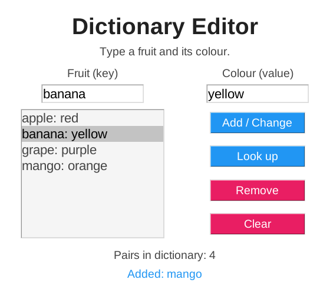
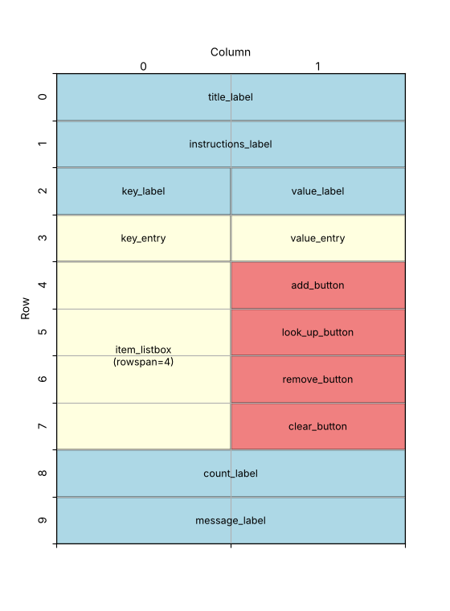

====================================================
Dictionary editor
====================================================

| This app lets the user change a Python **dictionary** by clicking buttons.
| It displays a window with two Entry boxes, a Listbox, four Buttons and six Labels.
| Each fruit is a **key** and its colour is the **value** stored with it.
| The user can **add** a fruit, **change** a colour, **look up** a colour, **remove** a fruit, or **clear** the whole dictionary.
| Every button changes the dictionary first, then redraws the Listbox so it shows what is in the dictionary.

----

How the program is put together
---------------------------------------

The program is built in this order:

#. **Imports**: ``tkinter``.
#. **Constants**: colours and fonts.
#. **The dictionary**: ``fruits``, the dictionary that the app changes.
#. **Functions**:

   - ``show_dict()`` redraws the Listbox so it matches ``fruits``.
   - ``get_selected_key()`` finds the key of the selected line.
   - ``add_pair()``, ``look_up()``, ``remove_pair()`` and ``clear_dict()`` are run by the buttons.
   - ``item_clicked()`` copies the clicked key and value into the Entry boxes.

#. **Main window**: create ``root`` and set its title, size and colour.
#. **Widgets**: create the labels, the two Entry boxes, the Listbox and the four buttons.
#. **Event binding**: run ``item_clicked()`` when a line in the Listbox is selected.
#. **Layout**: share the spare width between the columns, then place each widget with ``grid()``.
#. **Start**: call ``show_dict()`` once, then ``root.mainloop()``.

| The **dictionary** ``fruits`` holds the data. The **Listbox** only shows a copy of it.
| This is why every function changes ``fruits`` and then calls ``show_dict()``.
| This page builds the window, widgets and layout **first**, so you can see the app, then writes the functions and connects them to the buttons.
| In the finished program the functions still sit **above** the window, because a button's ``command=`` needs its function to exist already.

----

Create the main window
--------------------------------

.. code-block:: python

    import tkinter as tk

    # Create the main window
    root = tk.Tk()
    root.title("Dictionary editor")
    root.geometry("560x520")
    root.configure(bg="#ffffff")

    root.mainloop()

----

Define constants for formatting
---------------------------------------

.. code-block:: python

    # Constants
    BG_COLOR = "#ffffff"
    TITLE_COLOR = "#212121"
    TEXT_COLOR = "#444444"
    PRIMARY_COLOR = "#2196f3"  # blue
    SECONDARY_COLOR = "#e91e63"  # pink
    BUTTON_FG_COLOR = "#ffffff"
    LIST_BG_COLOR = "#f5f5f5"
    TITLE_FONT = ("Arial", 28, "bold")
    FONT_STYLE = ("Arial", 14)
    BUTTON_FONT = ("Arial", 14)
    LIST_FONT = ("Arial", 16)

| Blue (``PRIMARY_COLOR``) is used for the buttons that add, change or find a pair. Pink (``SECONDARY_COLOR``) is used for the buttons that take pairs away.
| Update the window colour using the constant:

.. code-block:: python

    root.configure(bg=BG_COLOR)

----

Store the fruits in a dictionary
---------------------------------------

.. code-block:: python

    # The dictionary that the app changes
    # Each key is a fruit and each value is its colour
    fruits = {"apple": "red", "banana": "yellow", "grape": "purple"}

- A **dictionary** stores **key: value pairs** inside curly brackets ``{ }``, separated by commas.
- A **key** is used to find its **value**, the way a word in a real dictionary is used to find its meaning. ``fruits["banana"]`` is ``"yellow"``.
- A list finds an item by its **position** (``items[0]``). A dictionary finds a value by its **key** (``fruits["apple"]``).
- Each key can only appear **once**. Giving a key a new value replaces the old value.
- ``fruits`` is written in lowercase because it is **not** a constant: the program changes it while it runs.

----

Create the widgets
-------------------------

Add the widgets after ``root.configure(bg=BG_COLOR)`` and above ``root.mainloop()``.

.. code-block:: python

    # Create widgets
    title_label = tk.Label(
        root, text="Dictionary Editor",
        bg=BG_COLOR, fg=TITLE_COLOR, font=TITLE_FONT)
    instructions_label = tk.Label(
        root, text="Type a fruit and its colour.",
        bg=BG_COLOR, fg=TEXT_COLOR, font=FONT_STYLE)
    key_label = tk.Label(
        root, text="Fruit (key)",
        bg=BG_COLOR, fg=TEXT_COLOR, font=FONT_STYLE)
    value_label = tk.Label(
        root, text="Colour (value)",
        bg=BG_COLOR, fg=TEXT_COLOR, font=FONT_STYLE)

    key_entry = tk.Entry(root, width=14, font=LIST_FONT)
    value_entry = tk.Entry(root, width=14, font=LIST_FONT)

    # exportselection=False keeps the selected line highlighted
    # when the user clicks in an entry box to type
    item_listbox = tk.Listbox(
        root, width=20, height=8,
        bg=LIST_BG_COLOR, fg=TEXT_COLOR, font=LIST_FONT,
        exportselection=False)

    add_button = tk.Button(
        root, text="Add / Change", width=12,
        bg=PRIMARY_COLOR, fg=BUTTON_FG_COLOR, font=BUTTON_FONT)
    look_up_button = tk.Button(
        root, text="Look up", width=12,
        bg=PRIMARY_COLOR, fg=BUTTON_FG_COLOR, font=BUTTON_FONT)
    remove_button = tk.Button(
        root, text="Remove", width=12,
        bg=SECONDARY_COLOR, fg=BUTTON_FG_COLOR, font=BUTTON_FONT)
    clear_button = tk.Button(
        root, text="Clear", width=12,
        bg=SECONDARY_COLOR, fg=BUTTON_FG_COLOR, font=BUTTON_FONT)

    count_label = tk.Label(
        root, text="",
        bg=BG_COLOR, fg=TEXT_COLOR, font=FONT_STYLE)
    message_label = tk.Label(
        root, text="",
        bg=BG_COLOR, fg=PRIMARY_COLOR, font=FONT_STYLE)

- Each widget is split over lines in the same way: first **what it shows** (text and size), then **how it looks** (colours and font), then any extra setting such as ``command=``. Python lets a line carry on until the bracket is closed.
- ``key_entry`` is where the user types a fruit (the **key**). ``value_entry`` is where the user types its colour (the **value**).
- ``item_listbox`` is a **Listbox**: a box that shows one line per key: value pair. ``height=8`` shows 8 lines.
- ``exportselection=False`` keeps the selected line highlighted when the user clicks or highlights text in an Entry box. Without it, **Remove** would say "Select a fruit first."
- ``width=12`` makes every button the same width, wide enough for "Add / Change".
- ``count_label`` and ``message_label`` start with no text. The functions written later fill them in.
- The buttons have no ``command=`` yet. They are connected to their functions at the end, once the functions have been written.

----

Place the widgets in the window
---------------------------------------

Design the grid positions:

.. code-block:: python

    # Share spare width equally between the 2 columns to keep the widgets centred
    root.columnconfigure(0, weight=1)
    root.columnconfigure(1, weight=1)

    # Place widgets in the window
    title_label.grid(row=0, column=0, columnspan=2, pady=(20, 5))
    instructions_label.grid(row=1, column=0, columnspan=2, pady=(0, 10))
    key_label.grid(row=2, column=0, padx=10)
    value_label.grid(row=2, column=1, padx=10)
    key_entry.grid(row=3, column=0, padx=10, pady=5)
    value_entry.grid(row=3, column=1, padx=10, pady=5)
    item_listbox.grid(row=4, column=0, rowspan=4, padx=10, pady=5)
    add_button.grid(row=4, column=1, padx=10, pady=5)
    look_up_button.grid(row=5, column=1, padx=10, pady=5)
    remove_button.grid(row=6, column=1, padx=10, pady=5)
    clear_button.grid(row=7, column=1, padx=10, pady=5)
    count_label.grid(row=8, column=0, columnspan=2, pady=(10, 0))
    message_label.grid(row=9, column=0, columnspan=2, pady=5)

- Each Entry box sits under its label: the key on the left in column 0, the value on the right in column 1.
- ``rowspan=4`` makes the Listbox stretch **down** across rows 4, 5, 6 and 7, so the four buttons sit beside it.
- ``columnspan=2`` makes the title, instructions and the two bottom labels stretch **across** both columns.

| Run the program now to see the whole layout. The Listbox is empty and the buttons do nothing yet.
| The rest of the page writes the functions that make the app work.

----

Show the dictionary in the Listbox
-------------------------------------------

| Now that the window is built, the functions can be written.
| Functions go near the **top** of the program: put this one after the dictionary and before ``root = tk.Tk()``.

.. code-block:: python

    def show_dict():
        """Redraws the listbox so it matches the fruits dictionary."""
        item_listbox.delete(0, tk.END)
        for key in fruits:
            item_listbox.insert(tk.END, key + ": " + fruits[key])
        count_label.config(text="Pairs in dictionary: " + str(len(fruits)))

- ``item_listbox.delete(0, tk.END)`` removes every line from the Listbox, from line 0 to the end.
- A ``for`` loop over a dictionary goes through its **keys**, one at a time, in the order they were added.
- ``fruits[key]`` looks up the value for that key. ``key + ": " + fruits[key]`` joins them into one line, e.g. ``"apple: red"``.
- ``len(fruits)`` is the number of **pairs** in the dictionary. ``str()`` turns the number into a string so it can be joined to the label text.

Call the function once at the bottom of the program, just above ``root.mainloop()``, so the starting pairs appear when the window opens:

.. code-block:: python

    # Show the starting dictionary
    show_dict()

- ``show_dict()`` is written **above** the widgets but uses ``item_listbox`` and ``count_label``. This works because the function only **runs** when it is called at the bottom of the program, and by then the widgets exist.

----

Find the selected key
-------------------------------

The next functions go after ``show_dict()``. This one finds the key of the selected line, so the other functions do not have to repeat that code.

.. code-block:: python

    def get_selected_key():
        """Returns the key of the selected line, or None if nothing is selected."""
        selection = item_listbox.curselection()
        if len(selection) == 0:
            message_label.config(text="Select a fruit first.")
            return None
        keys = list(fruits)
        return keys[selection[0]]

- ``curselection()`` returns a **tuple** of the selected line numbers, e.g. ``(1,)`` when the second line is selected, or ``()`` when nothing is selected.
- A dictionary has **no index numbers**, so ``fruits[1]`` does not work. ``list(fruits)`` makes a list of the keys, e.g. ``["apple", "banana", "grape"]``.
- The line numbers in the Listbox match the positions in ``list(fruits)``, because ``show_dict()`` adds the pairs in the same order. So ``keys[selection[0]]`` is the key of the selected line.

----

Add or change a pair
-----------------------------

.. code-block:: python

    def add_pair():
        """Adds a new pair, or changes the value of a key already there."""
        key = key_entry.get().strip().lower()
        value = value_entry.get().strip()
        if key == "" or value == "":
            message_label.config(text="Type a fruit and a colour.")
            return
        if key in fruits:
            message_label.config(text="Changed " + key + " to " + value)
        else:
            message_label.config(text="Added: " + key)
        fruits[key] = value
        key_entry.delete(0, tk.END)
        value_entry.delete(0, tk.END)
        show_dict()

- ``.strip()`` removes spaces from the start and end. ``.lower()`` turns the key into lowercase.
- Keys are **case-sensitive**: ``"Apple"`` and ``"apple"`` would be two different keys. Making every key lowercase stops the same fruit being added twice.
- ``key in fruits`` is ``True`` when the key is already in the dictionary. ``in`` checks the **keys**, not the values.
- ``fruits[key] = value`` does **two jobs**. If the key is new, it **adds** the pair. If the key is already there, it **changes** the value.

----

Look up a value
----------------------

.. code-block:: python

    def look_up():
        """Shows the value for the key typed in the key box."""
        key = key_entry.get().strip().lower()
        if key in fruits:
            value_entry.delete(0, tk.END)
            value_entry.insert(0, fruits[key])
            message_label.config(text=key + " is " + fruits[key])
        else:
            message_label.config(text=key + " is not in the dictionary.")

- Looking up a key that is not in the dictionary, e.g. ``fruits["kiwi"]``, causes a ``KeyError``. Checking ``key in fruits`` first stops the program crashing.
- ``value_entry.insert(0, fruits[key])`` puts the colour into the value box.

----

Remove a pair and clear the dictionary
-----------------------------------------------

.. code-block:: python

    def remove_pair():
        """Removes the selected key and its value from the dictionary."""
        key = get_selected_key()
        if key is None:
            return
        del fruits[key]
        message_label.config(text="Removed: " + key)
        show_dict()

    def clear_dict():
        """Removes every key and value from the dictionary."""
        fruits.clear()
        message_label.config(text="Dictionary cleared.")
        show_dict()

- ``if key is None: return`` stops the function when nothing is selected. ``get_selected_key()`` has already shown the message.
- ``del fruits[key]`` removes the key **and** its value.
- ``fruits.clear()`` removes every pair, leaving an empty dictionary ``{}``.

----

Copy the clicked pair into the Entry boxes
---------------------------------------------------

.. code-block:: python

    def item_clicked(event):
        """Copies the clicked key and value into the entry boxes."""
        selection = item_listbox.curselection()
        if len(selection) > 0:
            key = list(fruits)[selection[0]]
            key_entry.delete(0, tk.END)
            key_entry.insert(0, key)
            value_entry.delete(0, tk.END)
            value_entry.insert(0, fruits[key])

- This function is not run by a button. It is **bound** to the Listbox, so it runs when the user selects a line (see the next section).
- A function run by ``bind()`` is given an ``event`` parameter with details about what happened. This function does not use it, but it must still be in the brackets.
- The key and value are copied into the Entry boxes, so the user can type a new colour and click **Add / Change**.

----

Connect the buttons and the click event
------------------------------------------------

Add a ``command=`` to each button so it runs its function when clicked:

.. code-block:: python

    add_button = tk.Button(
        root, text="Add / Change", width=12,
        bg=PRIMARY_COLOR, fg=BUTTON_FG_COLOR, font=BUTTON_FONT,
        command=add_pair)
    look_up_button = tk.Button(
        root, text="Look up", width=12,
        bg=PRIMARY_COLOR, fg=BUTTON_FG_COLOR, font=BUTTON_FONT,
        command=look_up)
    remove_button = tk.Button(
        root, text="Remove", width=12,
        bg=SECONDARY_COLOR, fg=BUTTON_FG_COLOR, font=BUTTON_FONT,
        command=remove_pair)
    clear_button = tk.Button(
        root, text="Clear", width=12,
        bg=SECONDARY_COLOR, fg=BUTTON_FG_COLOR, font=BUTTON_FONT,
        command=clear_dict)

Then add this line straight after the widgets:

.. code-block:: python

    # Run item_clicked() whenever the user selects a line in the listbox
    item_listbox.bind("<<ListboxSelect>>", item_clicked)

- ``command=add_pair`` connects the button to its function, with **no brackets**. With brackets, the function would run once, straight away, while the button is being created.
- ``command=add_pair`` only works if ``add_pair()`` already exists when the button is created. That is why the functions sit **above** ``root = tk.Tk()`` in the program, even though they were written after the widgets.
- ``bind("<<ListboxSelect>>", item_clicked)`` runs ``item_clicked()`` every time the selection in the Listbox changes.

----

Key syntax
-----------------

.. py:function:: dictionary = {key: value}
    :no-index:

    | Syntax: ``fruits = {"apple": "red", "banana": "yellow"}``
    | Description: Makes a dictionary of key: value pairs inside curly brackets. ``{}`` is an empty dictionary.

.. py:function:: dictionary[key]
    :no-index:

    | Syntax: ``colour = fruits["apple"]``
    | Description: Returns the value for that key. Causes a ``KeyError`` if the key is not in the dictionary.

.. py:function:: dictionary[key] = value
    :no-index:

    | Syntax: ``fruits[key] = value``
    | Description: Adds the pair if the key is new, or changes the value if the key is already there.
    | Example: ``fruits["kiwi"] = "green"  # adds kiwi``

.. py:function:: key in dictionary
    :no-index:

    | Syntax: ``if key in fruits:``
    | Description: ``True`` if the key is in the dictionary. It checks the keys, not the values.

.. py:function:: del dictionary[key]
    :no-index:

    | Syntax: ``del fruits[key]``
    | Description: Removes the key and its value.

.. py:function:: dictionary.clear()
    :no-index:

    | Syntax: ``fruits.clear()``
    | Description: Removes every pair, leaving an empty dictionary.

.. py:function:: len(dictionary)
    :no-index:

    | Syntax: ``len(fruits)``
    | Description: Returns the number of key: value pairs.

.. py:function:: for key in dictionary:
    :no-index:

    | Syntax: ``for key in fruits:``
    | Description: Loops through the keys, in the order they were added.

.. py:function:: list(dictionary)
    :no-index:

    | Syntax: ``keys = list(fruits)``
    | Description: Makes a list of the keys, e.g. ``["apple", "banana", "grape"]``.

.. py:function:: string.lower()
    :no-index:

    | Syntax: ``key = key_entry.get().strip().lower()``
    | Description: Returns the string in lowercase. Used so ``"Apple"`` and ``"apple"`` are the same key.

----

Full code
------------

.. code-block:: python

    import tkinter as tk

    # Constants
    BG_COLOR = "#ffffff"
    TITLE_COLOR = "#212121"
    TEXT_COLOR = "#444444"
    PRIMARY_COLOR = "#2196f3"  # blue
    SECONDARY_COLOR = "#e91e63"  # pink
    BUTTON_FG_COLOR = "#ffffff"
    LIST_BG_COLOR = "#f5f5f5"
    TITLE_FONT = ("Arial", 28, "bold")
    FONT_STYLE = ("Arial", 14)
    BUTTON_FONT = ("Arial", 14)
    LIST_FONT = ("Arial", 16)

    # The dictionary that the app changes
    # Each key is a fruit and each value is its colour
    fruits = {"apple": "red", "banana": "yellow", "grape": "purple"}

    def show_dict():
        """Redraws the listbox so it matches the fruits dictionary."""
        item_listbox.delete(0, tk.END)
        for key in fruits:
            item_listbox.insert(tk.END, key + ": " + fruits[key])
        count_label.config(text="Pairs in dictionary: " + str(len(fruits)))

    def get_selected_key():
        """Returns the key of the selected line, or None if nothing is selected."""
        selection = item_listbox.curselection()
        if len(selection) == 0:
            message_label.config(text="Select a fruit first.")
            return None
        keys = list(fruits)
        return keys[selection[0]]

    def add_pair():
        """Adds a new pair, or changes the value of a key already there."""
        key = key_entry.get().strip().lower()
        value = value_entry.get().strip()
        if key == "" or value == "":
            message_label.config(text="Type a fruit and a colour.")
            return
        if key in fruits:
            message_label.config(text="Changed " + key + " to " + value)
        else:
            message_label.config(text="Added: " + key)
        fruits[key] = value
        key_entry.delete(0, tk.END)
        value_entry.delete(0, tk.END)
        show_dict()

    def look_up():
        """Shows the value for the key typed in the key box."""
        key = key_entry.get().strip().lower()
        if key in fruits:
            value_entry.delete(0, tk.END)
            value_entry.insert(0, fruits[key])
            message_label.config(text=key + " is " + fruits[key])
        else:
            message_label.config(text=key + " is not in the dictionary.")

    def remove_pair():
        """Removes the selected key and its value from the dictionary."""
        key = get_selected_key()
        if key is None:
            return
        del fruits[key]
        message_label.config(text="Removed: " + key)
        show_dict()

    def clear_dict():
        """Removes every key and value from the dictionary."""
        fruits.clear()
        message_label.config(text="Dictionary cleared.")
        show_dict()

    def item_clicked(event):
        """Copies the clicked key and value into the entry boxes."""
        selection = item_listbox.curselection()
        if len(selection) > 0:
            key = list(fruits)[selection[0]]
            key_entry.delete(0, tk.END)
            key_entry.insert(0, key)
            value_entry.delete(0, tk.END)
            value_entry.insert(0, fruits[key])

    # Create the main window
    root = tk.Tk()
    root.title("Dictionary editor")
    root.geometry("560x520")
    root.configure(bg=BG_COLOR)

    # Create widgets
    title_label = tk.Label(
        root, text="Dictionary Editor",
        bg=BG_COLOR, fg=TITLE_COLOR, font=TITLE_FONT)
    instructions_label = tk.Label(
        root, text="Type a fruit and its colour.",
        bg=BG_COLOR, fg=TEXT_COLOR, font=FONT_STYLE)
    key_label = tk.Label(
        root, text="Fruit (key)",
        bg=BG_COLOR, fg=TEXT_COLOR, font=FONT_STYLE)
    value_label = tk.Label(
        root, text="Colour (value)",
        bg=BG_COLOR, fg=TEXT_COLOR, font=FONT_STYLE)

    key_entry = tk.Entry(root, width=14, font=LIST_FONT)
    value_entry = tk.Entry(root, width=14, font=LIST_FONT)

    # exportselection=False keeps the selected line highlighted
    # when the user clicks in an entry box to type
    item_listbox = tk.Listbox(
        root, width=20, height=8,
        bg=LIST_BG_COLOR, fg=TEXT_COLOR, font=LIST_FONT,
        exportselection=False)

    add_button = tk.Button(
        root, text="Add / Change", width=12,
        bg=PRIMARY_COLOR, fg=BUTTON_FG_COLOR, font=BUTTON_FONT,
        command=add_pair)
    look_up_button = tk.Button(
        root, text="Look up", width=12,
        bg=PRIMARY_COLOR, fg=BUTTON_FG_COLOR, font=BUTTON_FONT,
        command=look_up)
    remove_button = tk.Button(
        root, text="Remove", width=12,
        bg=SECONDARY_COLOR, fg=BUTTON_FG_COLOR, font=BUTTON_FONT,
        command=remove_pair)
    clear_button = tk.Button(
        root, text="Clear", width=12,
        bg=SECONDARY_COLOR, fg=BUTTON_FG_COLOR, font=BUTTON_FONT,
        command=clear_dict)

    count_label = tk.Label(
        root, text="",
        bg=BG_COLOR, fg=TEXT_COLOR, font=FONT_STYLE)
    message_label = tk.Label(
        root, text="",
        bg=BG_COLOR, fg=PRIMARY_COLOR, font=FONT_STYLE)

    # Run item_clicked() whenever the user selects a line in the listbox
    item_listbox.bind("<<ListboxSelect>>", item_clicked)

    # Share spare width equally between the 2 columns to keep the widgets centred
    root.columnconfigure(0, weight=1)
    root.columnconfigure(1, weight=1)

    # Place widgets in the window
    title_label.grid(row=0, column=0, columnspan=2, pady=(20, 5))
    instructions_label.grid(row=1, column=0, columnspan=2, pady=(0, 10))
    key_label.grid(row=2, column=0, padx=10)
    value_label.grid(row=2, column=1, padx=10)
    key_entry.grid(row=3, column=0, padx=10, pady=5)
    value_entry.grid(row=3, column=1, padx=10, pady=5)
    item_listbox.grid(row=4, column=0, rowspan=4, padx=10, pady=5)
    add_button.grid(row=4, column=1, padx=10, pady=5)
    look_up_button.grid(row=5, column=1, padx=10, pady=5)
    remove_button.grid(row=6, column=1, padx=10, pady=5)
    clear_button.grid(row=7, column=1, padx=10, pady=5)
    count_label.grid(row=8, column=0, columnspan=2, pady=(10, 0))
    message_label.grid(row=9, column=0, columnspan=2, pady=5)

    # Show the starting dictionary
    show_dict()

    # Start the main event loop
    root.mainloop()

----

Dictionary editor test table
---------------------------------

.. list-table:: Test Cases for the Dictionary Editor
   :header-rows: 1
   :widths: 25 50

   * - **Action**
     - **Expected output**
   * - Open the app
     - The Listbox shows apple: red, banana: yellow, grape: purple. "Pairs in dictionary: 3"
   * - Type ``Mango`` and ``orange``, click **Add / Change**
     - mango: orange appears at the bottom, in lowercase. "Added: mango". "Pairs in dictionary: 4"
   * - Click **Add / Change** with the colour box empty
     - Nothing is added. "Type a fruit and a colour."
   * - Click **banana: yellow**
     - The line is highlighted. banana and yellow are copied into the Entry boxes.
   * - Change the colour to ``green``, click **Add / Change**
     - The line changes to banana: green in the same position. "Changed banana to green". Still 4 pairs.
   * - Type ``grape`` in the key box, click **Look up**
     - purple appears in the colour box. "grape is purple"
   * - Type ``kiwi`` in the key box, click **Look up**
     - Nothing changes. "kiwi is not in the dictionary."
   * - Click **Remove** with nothing selected
     - Nothing is removed. "Select a fruit first."
   * - Click **apple: red**, then **Remove**
     - apple: red disappears. "Removed: apple"
   * - Click **Clear**
     - The Listbox is empty. "Pairs in dictionary: 0"

| Changing a value keeps the pair in the **same place**. Only new keys are added at the end.
| The app does not let the same fruit appear twice: adding a key that is already there changes its value instead.

----

.. admonition:: Tasks

    #. Let the user press **Enter** in the colour box to add the pair. Hint: ``value_entry.bind("<Return>", ...)`` runs a function when Enter is pressed. The function needs an ``event`` parameter.
    #. Show the pairs in alphabetical order. Hint: ``for key in sorted(fruits):``. ``get_selected_key()`` and ``item_clicked()`` must use ``sorted(fruits)`` too, or the wrong pair will be selected.
    #. Change **Add / Change** so it only adds new fruits, and add a separate **Change** button that only changes fruits already in the dictionary.
    #. Change the app into a glossary of science words: each key is a word and each value is its meaning.

----

Dictionary Editor - Multiple Choice Quiz
---------------------------------------------

.. mcqgroup::
    :nav_position: both
    :show-instant-feedback:
    :enable-instant-feedback:
    :shuffle_questions:
    :num_questions: 5

    .. multichoice::

        fruits = {"apple": "red", "banana": "yellow"}. What is fruits["banana"]?

        [ ] "banana" | Incorrect. "banana" is the key. The value is what is stored with it.
        [x] "yellow" | Correct. The key "banana" is used to look up its value.
        [ ] "red" | Incorrect. "red" is the value for "apple".
        [ ] An error | Incorrect. "banana" is a key in the dictionary.

    .. multichoice::

        fruits = {"apple": "red"}. Which line adds kiwi with the colour green?

        [ ] fruits.append("kiwi", "green") | Incorrect. Dictionaries do not have an append method.
        [ ] fruits["green"] = "kiwi" | Incorrect. This makes "green" the key and "kiwi" the value.
        [x] fruits["kiwi"] = "green" | Correct. Assigning to a new key adds the pair.
        [ ] fruits = "kiwi": "green" | Incorrect. This is not valid Python.

    .. multichoice::

        fruits = {"apple": "red", "banana": "yellow"}. What is the dictionary after fruits["apple"] = "green"?

        [ ] {"apple": "red", "banana": "yellow", "apple": "green"} | Incorrect. Each key can only appear once.
        [x] {"apple": "green", "banana": "yellow"} | Correct. The key is already there, so its value is changed.
        [ ] {"banana": "yellow", "apple": "green"} | Incorrect. Changing a value keeps the pair in the same position.
        [ ] An error | Incorrect. Assigning to a key that is already there is allowed.

    .. multichoice::

        fruits = {"apple": "red"}. What happens when the program runs print(fruits["kiwi"])?

        [ ] It prints None | Incorrect. Square brackets do not return None for a missing key.
        [ ] It prints an empty string | Incorrect. The key is not in the dictionary.
        [ ] It adds kiwi to the dictionary | Incorrect. Only assigning with = adds a pair.
        [x] It causes a KeyError | Correct. kiwi is not a key, so the program crashes. Check with in first.

    .. multichoice::

        fruits = {"apple": "red"}. What is the value of "red" in fruits?

        [ ] True | Incorrect. in checks the keys, and "red" is a value.
        [x] False | Correct. in only checks the keys of a dictionary.
        [ ] "apple" | Incorrect. in gives True or False.
        [ ] An error | Incorrect. in works on dictionaries.

    .. multichoice::

        Which line removes apple and its colour from the dictionary?

        [x] del fruits["apple"] | Correct. del removes the key and its value.
        [ ] fruits.remove("apple") | Incorrect. Dictionaries do not have a remove method.
        [ ] fruits["apple"] = "" | Incorrect. This keeps apple and changes its value to an empty string.
        [ ] fruits.clear("apple") | Incorrect. clear removes every pair and takes no argument.

    .. multichoice::

        Why does get_selected_key() use list(fruits)?

        [ ] To sort the fruits | Incorrect. sorted() sorts.
        [ ] To copy the values into a list | Incorrect. list(fruits) gives the keys, not the values.
        [x] A dictionary has no index numbers, so the keys are put in a list to find the one at the selected line number | Correct. The Listbox lines are in the same order as the keys.
        [ ] To remove the selected fruit | Incorrect. del removes it.

    .. multichoice::

        Why does add_pair() use .lower() on the key?

        [x] Keys are case-sensitive, so "Apple" and "apple" would be two different keys | Correct. Lowercase keys stop the same fruit appearing twice.
        [ ] Tkinter Entry boxes only accept lowercase | Incorrect. Entry boxes accept any text.
        [ ] Dictionary keys must be lowercase | Incorrect. Keys can contain capital letters.
        [ ] To remove spaces | Incorrect. strip() removes spaces.

    .. multichoice::

        fruits = {"apple": "red", "banana": "yellow", "grape": "purple"}. What does the loop for key in fruits: go through?

        [ ] The values: red, yellow, purple | Incorrect. A for loop over a dictionary gives the keys.
        [x] The keys: apple, banana, grape | Correct. Use fruits[key] to get each value.
        [ ] The pairs as strings: "apple: red" and so on | Incorrect. show_dict() builds those strings itself.
        [ ] The numbers 0, 1, 2 | Incorrect. Dictionaries do not have index numbers.

    .. multichoice::

        Why does every button function call show_dict() at the end?

        [ ] To create the Listbox | Incorrect. The Listbox is created with tk.Listbox.
        [ ] To sort the dictionary | Incorrect. show_dict() does not sort.
        [x] The function changes the fruits dictionary, and show_dict() redraws the Listbox so it shows the change | Correct. The Listbox only shows a copy of the dictionary.
        [ ] Because Tkinter requires it | Incorrect. The name show_dict was chosen by the programmer.

----

Dictionary Editor - Cloze Code Quiz
----------------------------------------

.. clozegroup::
    :nav-position: both
    :num-questions: 3
    :show-instant-feedback:

    .. cloze::
        :instructions: Show every key: value pair in the Listbox.

        def show_dict():
            item_listbox.delete(0, tk.END)
            for key in @@fruits | fruits.values() | range(fruits)@@:
                item_listbox.insert(tk.END, key + ": " + @@fruits[key] | fruits(key) | key[fruits]@@)
            count_label.config(text="Pairs in dictionary: " + str(@@len | count | size@@(fruits)))

    .. cloze::
        :instructions: Add a new pair, or change the value of a key already there.

        def add_pair():
            key = key_entry.get().strip().@@lower | upper | strip@@()
            value = value_entry.get().strip()
            if key @@in | == | is@@ fruits:
                message_label.config(text="Changed " + key)
            @@fruits[key] = value | fruits[value] = key | fruits.append(key, value)@@
            show_dict()

    .. cloze::
        :instructions: Show the colour of the fruit typed in the key box.

        def look_up():
            key = key_entry.get().strip().lower()
            if key in fruits:
                value_entry.@@insert | get | config@@(0, fruits[key])

    .. cloze::
        :instructions: Remove the selected key and its value.

        def remove_pair():
            key = get_selected_key()
            if key is None:
                return
            @@del | remove | pop@@ fruits[key]
            show_dict()

    .. cloze::
        :instructions: Find the key of the selected line.

        def get_selected_key():
            selection = item_listbox.curselection()
            if len(selection) == 0:
                return None
            keys = @@list(fruits) | fruits.values() | len(fruits)@@
            return keys[selection[0]]
