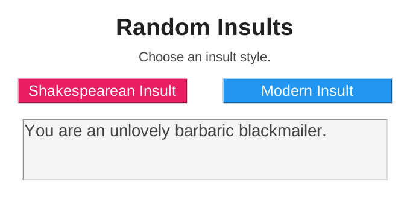
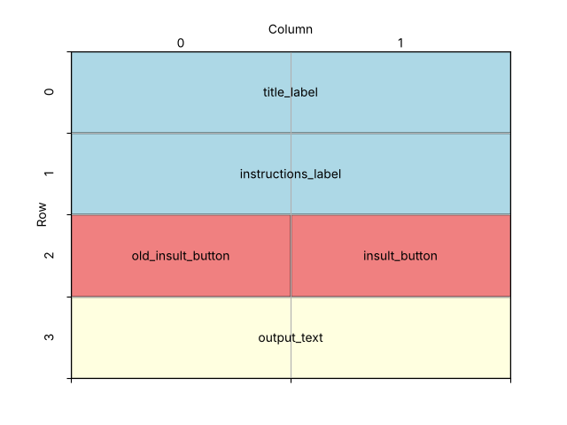

====================================================
Insult generator
====================================================

| This app generates a random insult, in either a Shakespearean or a modern style.
| It is the tkinter version of the Anvil insult generator.
| It displays a window with two Labels, two Buttons and a Text widget.
| Each insult is built by choosing one random word from each of three lists.

----

How the program is put together
---------------------------------------

The program is built in this order:

#. **Imports**: ``tkinter``, and ``choice`` from the ``random`` module.
#. **Constants**: colours and fonts.
#. **Word lists**: three lists for the Shakespearean insult and three for the modern insult.
#. **Functions**:

   - ``show_output()`` puts a message in the output box.
   - ``make_old_insult()`` builds a Shakespearean insult.
   - ``make_insult()`` builds a modern insult.

#. **Main window**: create ``root`` and set its title, size and colour.
#. **Widgets**: create the title, instructions, two buttons and the output box.
#. **Layout**: share the spare width between the columns, then place each widget with ``grid()``.
#. **Event loop**: ``root.mainloop()``.

| The functions are defined **before** the widgets, but they use ``output_text``.
| This works because the functions only **run** when a button is clicked, and by then the widgets exist.

----

Create the main window
--------------------------------

.. code-block:: python

    import tkinter as tk
    from random import choice

    # Create the main window
    root = tk.Tk()
    root.title("Insult generator")
    root.geometry("680x360")
    root.configure(bg="#ffffff")

    root.mainloop()

| ``from random import choice`` imports just the ``choice`` function from Python's ``random`` module, so it can be used as ``choice(...)`` instead of ``random.choice(...)``.

----

Define constants for formatting
---------------------------------------

.. code-block:: python

    # Constants
    BG_COLOR = "#ffffff"
    TITLE_COLOR = "#212121"
    TEXT_COLOR = "#444444"
    PRIMARY_COLOR = "#2196f3"  # blue
    SECONDARY_COLOR = "#e91e63"  # pink
    BUTTON_FG_COLOR = "#ffffff"
    OUTPUT_BG_COLOR = "#f5f5f5"
    TITLE_FONT = ("Arial", 28, "bold")
    FONT_STYLE = ("Arial", 16)
    BUTTON_FONT = ("Arial", 18)
    OUTPUT_FONT = ("Arial", 20)

| ``PRIMARY_COLOR`` (blue) and ``SECONDARY_COLOR`` (pink) match the primary and secondary colours of the Anvil version's buttons.
| A font can have a third item for its style: ``("Arial", 28, "bold")``.
| Update the window colour using the constant:

.. code-block:: python

    root.configure(bg=BG_COLOR)

----

Store the words in lists
-------------------------------

| Each insult is made from three words, so each style needs **three lists**.
| A **list** stores many values in order, inside square brackets ``[ ]``, separated by commas.
| The lists are long, so they are split over many lines. Python knows the list continues until the closing ``]``.
| The start of each Shakespearean list is shown below. The full lists are in the full code.

.. code-block:: python

    # Word lists for the Shakespearean insult
    OLD_INSULT1 = ['artless', 'bawdy', 'beslubbering', 'bootless',
                   # ... more words ...
                   'yeasty']
    OLD_INSULT2 = ['base-court', 'bat-fowling', 'beef-witted',
                   # ... more words ...
                   "unwash'd", 'weather-bitten', 'whoreson']
    OLD_INSULT3 = ['apple-john', 'baggage', 'barnacle', 'Basket-Cockle',
                   # ... more words ...
                   'whey-face']

- The list names are in CAPITALS because the lists are **constants**: the program reads them but never changes them.
- ``"bunch-back'd"`` uses double quotes because the word contains an apostrophe. With single quotes, Python would think the string ended at the apostrophe.
- An item can be a phrase, such as ``'not much to look at'``, because each item is just a string.
- The modern lists, ``MODERN_INSULT1``, ``MODERN_INSULT2`` and ``MODERN_INSULT3``, work the same way.
- A useful tool for formatting long lists is at: `<https://www.xhcode.com/pythonformat/>`_

----

Show a message in the output box
----------------------------------------

.. code-block:: python

    def show_output(message):
        """Replaces the text in the output box with message."""
        output_text.delete(1.0, "end")
        output_text.insert(1.0, message)

- Both insult functions need to clear the output box and insert new text, so that code is written **once**, in its own function.
- ``message`` is a **parameter**: the text to show is passed in when the function is called, e.g. ``show_output("Hello")``.
- ``delete(1.0, "end")`` clears the Text widget from line 1, character 0 to the end. ``insert(1.0, message)`` puts the new message at the start.

----

Make the insults
------------------------

.. code-block:: python

    def make_old_insult():
        """Builds a random Shakespearean insult from one word in each list."""
        insult = ("Thou art a " + choice(OLD_INSULT1) + " " +
                  choice(OLD_INSULT2) + " " + choice(OLD_INSULT3) + ".")
        show_output(insult)

    def make_insult():
        """Builds a random modern insult from one word in each list."""
        insult = ("You are a " + choice(MODERN_INSULT1) + " " +
                  choice(MODERN_INSULT2) + " " + choice(MODERN_INSULT3) + ".")
        show_output(insult)

- ``choice(OLD_INSULT1)`` picks one random item from the list. Each click picks new random words.
- The ``+`` operator **joins** strings together. This is called **concatenation**.
- ``" "`` adds a space between the words, and ``"."`` adds a full stop at the end.
- The whole expression is inside round brackets ``( )`` so it can be split over two lines.
- ``show_output(insult)`` passes the finished insult to the function that displays it.
- The same insult could be built with an f-string:

.. code-block:: python

    insult = f"Thou art a {choice(OLD_INSULT1)} {choice(OLD_INSULT2)} {choice(OLD_INSULT3)}."

----

Create the widgets
-------------------------

.. code-block:: python

    # Create widgets
    title_label = tk.Label(root, text="Random Insults", bg=BG_COLOR,
                           fg=TITLE_COLOR, font=TITLE_FONT)
    instructions_label = tk.Label(root, text="Choose an insult style.", bg=BG_COLOR,
                                  fg=TEXT_COLOR, font=FONT_STYLE)
    old_insult_button = tk.Button(root, text="Shakespearean Insult", width=18,
                                  bg=SECONDARY_COLOR, fg=BUTTON_FG_COLOR,
                                  font=BUTTON_FONT, command=make_old_insult)
    insult_button = tk.Button(root, text="Modern Insult", width=18,
                              bg=PRIMARY_COLOR, fg=BUTTON_FG_COLOR,
                              font=BUTTON_FONT, command=make_insult)
    # Text widget: 3 lines high, 40 characters wide, long text wraps at whole words
    output_text = tk.Text(root, height=3, width=40, wrap="word",
                          bg=OUTPUT_BG_COLOR, fg=TEXT_COLOR, font=OUTPUT_FONT)

- ``title_label`` and ``instructions_label`` display text that the user cannot change.
- ``width=18`` makes both buttons 18 characters wide, so they are the same size.
- ``command=make_old_insult`` connects the button to its function. There are **no brackets** after the function name, so the button runs it each time it is clicked.
- The output is a **Text** widget so a long insult can wrap onto more lines:

  - ``height=3`` gives it 3 lines and ``width=40`` makes it about 40 characters wide.
  - ``wrap="word"`` moves a whole word onto the next line instead of splitting it.

----

Place the widgets in the window
---------------------------------------

Design the grid positions:

.. code-block:: python

    # Share any spare width equally between the 2 columns, so the widgets stay centred
    root.columnconfigure(0, weight=1)
    root.columnconfigure(1, weight=1)

    # Place widgets in the window
    title_label.grid(row=0, column=0, columnspan=2, pady=(20, 5))
    instructions_label.grid(row=1, column=0, columnspan=2, pady=5)
    old_insult_button.grid(row=2, column=0, padx=10, pady=15)
    insult_button.grid(row=2, column=1, padx=10, pady=15)
    output_text.grid(row=3, column=0, columnspan=2, padx=10, pady=10)

- ``root.columnconfigure(0, weight=1)`` gives column 0 a share of any spare width in the window. Giving both columns ``weight=1`` shares the space equally, so the widgets stay centred.
- The title, instructions and output box use ``columnspan=2`` to stretch across both columns.
- The two buttons sit side by side in row 2, in columns 0 and 1.
- ``pady=(20, 5)`` adds 20 pixels of space **above** the title and 5 pixels **below** it. A single number, such as ``pady=5``, adds the same space above and below.

----

Comparing the Anvil and tkinter versions
------------------------------------------------

.. list-table::
   :header-rows: 1
   :widths: 40 40

   * - **Anvil**
     - **tkinter**
   * - Label component named **title**
     - ``title_label = tk.Label(...)``
   * - Button with a **click** event, e.g. ``get_old_insult_click``
     - Button with ``command=make_old_insult``
   * - TextBox named **output**
     - Text widget ``output_text``
   * - ``self.output.text = "..."``
     - ``show_output("...")`` using ``delete`` and ``insert``
   * - Button **role**: primary-color, secondary-color
     - ``bg=PRIMARY_COLOR``, ``bg=SECONDARY_COLOR``
   * - Column panel arranges the components
     - ``grid()`` places the widgets in rows and columns
   * - Functions are methods of ``Form1`` and use ``self``
     - Functions are ordinary functions, so they do not use ``self``

----

Key syntax
-----------------

.. py:function:: random.choice(sequence)

    | Syntax: ``choice(OLD_INSULT1)``
    | Description: Returns one randomly chosen item from a list (or other sequence).
    | Import: ``from random import choice``
    | Example: ``choice(["red", "green", "blue"])  # could return "green"``

.. py:function:: string1 + string2

    | Syntax: ``"Thou art a " + choice(OLD_INSULT1) + "."``
    | Description: Joins strings together (concatenation). Spaces are not added automatically, so they must be included in the strings.
    | Example: ``"Hello" + " " + "world"  # "Hello world"``

.. py:function:: ( long expression )

    | Syntax: ``insult = ("Thou art a " + choice(OLD_INSULT1) + " " +``
    |                    ``choice(OLD_INSULT2) + " " + choice(OLD_INSULT3) + ".")``
    | Description: Code inside round brackets, square brackets or curly brackets can be split over several lines.

.. py:function:: widget.grid(pady=(top, bottom))

    | Syntax: ``title_label.grid(row=0, column=0, columnspan=2, pady=(20, 5))``
    | Description: A tuple of two numbers sets different padding above and below the widget. ``padx=(left, right)`` works the same way.

.. py:function:: root.columnconfigure(index, weight=1)

    | Syntax: ``root.columnconfigure(0, weight=1)``
    | Description: Lets a grid column grow to share any spare space. Columns with a ``weight`` of 0 (the default) do not grow.

----

Full code
------------

.. code-block:: python

    import tkinter as tk
    from random import choice

    # Constants
    BG_COLOR = "#ffffff"
    TITLE_COLOR = "#212121"
    TEXT_COLOR = "#444444"
    PRIMARY_COLOR = "#2196f3"  # blue
    SECONDARY_COLOR = "#e91e63"  # pink
    BUTTON_FG_COLOR = "#ffffff"
    OUTPUT_BG_COLOR = "#f5f5f5"
    TITLE_FONT = ("Arial", 28, "bold")
    FONT_STYLE = ("Arial", 16)
    BUTTON_FONT = ("Arial", 18)
    OUTPUT_FONT = ("Arial", 20)

    # Word lists for the Shakespearean insult
    OLD_INSULT1 = ['artless', 'bawdy', 'beslubbering', 'bootless',
                   'burly-boned', 'caluminous', 'churlish', 'clouted',
                   'cockered', 'craven', 'cullionly', 'currish', 'dankish',
                   'dissembling', 'droning', 'errant', 'fawning', 'fishified',
                   'fobbing', 'frothy', 'froward', 'fusty', 'gleeking',
                   'goatish', 'gorbellied', 'impertinent', 'infectious',
                   'jarring', 'loggerheaded', 'lumpish', 'mammering', 'mangled',
                   'mewling', 'misbegotten', 'odiferous', 'paunchy', 'poisonous',
                   'pribbling', 'puking', 'puny', 'qualling', 'rank', 'reeky',
                   'roguish', 'ruttish', 'saucy', 'spleeny', 'spongy', 'surly',
                   'tottering', 'unmuzzled', 'vain', 'venomed', 'villainous',
                   'warped', 'Wart-necked', 'wayward', 'weedy', 'wimpled',
                   'yeasty']
    OLD_INSULT2 = ['base-court', 'bat-fowling', 'beef-witted',
                   'beetle-headed', 'boil-brained', 'brazen-faced',
                   "bunch-back'd", 'clapper-clawed', 'clay-brained',
                   'common-kissing', 'crook-pated', 'dismal-dreaming',
                   'dizzy-eyed', 'doghearted', 'dread-bolted', 'earth-vexing',
                   'elf-skinned', 'fat-kidneyed', 'fen-sucked', 'flap-mouthed',
                   'fly-bitten', 'folly-fallen', 'fool-born', 'full-gorged',
                   'guts-griping', 'half-faced', 'hasty-witted', 'hedge-born',
                   'hell-hated', 'idle-headed', 'ill-breeding', 'ill-nurtured',
                   'knotty-pated', 'leaden-footed', 'lily-livered',
                   'malmsey-nosed', 'milk-livered', 'motley-minded',
                   'muddy-mettled', 'onion-eyed', "pigeon-liver'd",
                   'plume-plucked', 'pottle-deep', 'pox-marked', 'rampallian',
                   'reeling-ripe', 'rough-hewn', 'rude-growing', 'rump-fed',
                   'scale-sided', 'scurvy-valiant', 'shard-borne',
                   'sheep-biting', 'spur-galled', 'swag-bellied', 'tardy-gaited',
                   'tickle-brained', 'toad-spotted', 'unchin-snouted',
                   "unwash'd", 'weather-bitten', 'whoreson']
    OLD_INSULT3 = ['apple-john', 'baggage', 'barnacle', 'Basket-Cockle',
                   'bladder', 'blind-worm', 'boar-pig', 'bugbear', 'bum-bailey',
                   'canker-blossom', 'clack-dish', 'clotpole', 'codpiece',
                   'coxcomb', 'death-token', 'devil-monk', 'dewberry',
                   'flap-dragon', 'flax-wench', 'flirt-gill', 'foot-licker',
                   'fustilarian', 'giglet', 'gudgeon', 'haggard', 'harpy',
                   'hedge-pig', 'horn-beast', 'hugger-mugger', 'joithead',
                   'jolt-head', 'knave', 'lewdster', 'lout', 'maggot-pie',
                   'malcontent', 'malt-worm', 'mammet', 'measle', 'minnow',
                   'miscreant', 'moldwarp', 'mumble-news', 'nut-hook',
                   'pigeon-egg', 'pignut', 'popinjay', 'pumpion', 'puttock',
                   'rascal', 'ratsbane', 'scullian', 'scut', 'skainsmate',
                   'strumpet', 'toad', 'varlot', 'vassal', 'wagtail',
                   'whey-face']

    # Word lists for the modern insult
    MODERN_INSULT1 = ['animalistic', 'appalling', 'awful', 'bad-looking',
                      'beastly', 'deformed', 'disfigured', 'foul', 'frightful',
                      'grisly', 'gross', 'grotesque', 'hard-featured', 'hideous',
                      'horrid', 'ill-favored', 'loathsome', 'misshapen',
                      'monstrous', 'not much to look at', 'repelling', 'repugnant',
                      'repulsive', 'revolting', 'unbeautiful', 'uncomely',
                      'uninviting', 'unlovely', 'unsightly']
    MODERN_INSULT2 = ['abrupt', 'abusive', 'bad-mannered', 'barbaric',
                      'barbarous', 'blunt', 'boorish', 'brusque', 'brutish',
                      'cheeky', 'churlish', 'coarse', 'crabbed', 'crude', 'curt',
                      'discourteous', 'graceless', 'gross', 'gruff', 'ignorant',
                      'illiterate', 'impertinent', 'impolite', 'impudent',
                      'inconsiderate', 'insolent', 'insulting', 'intrusive',
                      'loutish', 'obscene', 'raw', 'savage', 'scurrilous', 'surly',
                      'uncivil', 'uncivilized', 'uncouth', 'uncultured',
                      'uneducated', 'ungracious', 'unmannerly', 'unpolished',
                      'unrefined', 'vulgar', 'wild']
    MODERN_INSULT3 = ['bad guy', 'bad person', 'baddie', 'baddy',
                      'black marketeer', 'blackmailer', 'blockhead', 'bonehead',
                      'clodpoll', 'con', 'convict', 'cretin', 'crook', 'culprit',
                      'delinquent', 'desperado', 'deuce', 'dimwit', 'dork',
                      'dumbbell', 'dunce', 'evildoer', 'ex-con', 'felon', 'fool',
                      'fugitive', 'gangster', 'guerilla', 'hood', 'hoodlum',
                      'hooligan', 'hustler', 'ignoramus', 'imbecile',
                      'inside person', 'jailbird', 'jerk', 'lawbreaker',
                      'malefactor', 'mobster', 'moron', 'mug', 'muttonhead',
                      'nincompoop', 'ninny', 'nitwit', 'offender', 'outlaw',
                      'pinhead', 'racketeer', 'simpleton', 'sinner', 'slippery eel',
                      'thug', 'tomfool', 'twit', 'wrongdoer', 'yardbird']

    def show_output(message):
        """Replaces the text in the output box with message."""
        output_text.delete(1.0, "end")
        output_text.insert(1.0, message)

    def make_old_insult():
        """Builds a random Shakespearean insult from one word in each list."""
        insult = ("Thou art a " + choice(OLD_INSULT1) + " " +
                  choice(OLD_INSULT2) + " " + choice(OLD_INSULT3) + ".")
        show_output(insult)

    def make_insult():
        """Builds a random modern insult from one word in each list."""
        insult = ("You are a " + choice(MODERN_INSULT1) + " " +
                  choice(MODERN_INSULT2) + " " + choice(MODERN_INSULT3) + ".")
        show_output(insult)

    # Create the main window
    root = tk.Tk()
    root.title("Insult generator")
    root.geometry("680x360")
    root.configure(bg=BG_COLOR)

    # Create widgets
    title_label = tk.Label(root, text="Random Insults", bg=BG_COLOR,
                           fg=TITLE_COLOR, font=TITLE_FONT)
    instructions_label = tk.Label(root, text="Choose an insult style.", bg=BG_COLOR,
                                  fg=TEXT_COLOR, font=FONT_STYLE)
    old_insult_button = tk.Button(root, text="Shakespearean Insult", width=18,
                                  bg=SECONDARY_COLOR, fg=BUTTON_FG_COLOR,
                                  font=BUTTON_FONT, command=make_old_insult)
    insult_button = tk.Button(root, text="Modern Insult", width=18,
                              bg=PRIMARY_COLOR, fg=BUTTON_FG_COLOR,
                              font=BUTTON_FONT, command=make_insult)
    # Text widget: 3 lines high, 40 characters wide, long text wraps at whole words
    output_text = tk.Text(root, height=3, width=40, wrap="word",
                          bg=OUTPUT_BG_COLOR, fg=TEXT_COLOR, font=OUTPUT_FONT)

    # Share any spare width equally between the 2 columns, so the widgets stay centred
    root.columnconfigure(0, weight=1)
    root.columnconfigure(1, weight=1)

    # Place widgets in the window
    title_label.grid(row=0, column=0, columnspan=2, pady=(20, 5))
    instructions_label.grid(row=1, column=0, columnspan=2, pady=5)
    old_insult_button.grid(row=2, column=0, padx=10, pady=15)
    insult_button.grid(row=2, column=1, padx=10, pady=15)
    output_text.grid(row=3, column=0, columnspan=2, padx=10, pady=10)

    # Start the main event loop
    root.mainloop()

----

Insult generator test table
---------------------------------

.. list-table:: Test Cases for the Insult Generator
   :header-rows: 1
   :widths: 25 50

   * - **Action**
     - **Expected output**
   * - Click **Shakespearean Insult**
     - ``Thou art a`` + 3 random words + ``.`` e.g. "Thou art a errant motley-minded maggot-pie."
   * - Click **Shakespearean Insult** again
     - A different insult replaces the first one (it does not add a second line).
   * - Click **Modern Insult**
     - ``You are a`` + 3 random words + ``.`` e.g. "You are a foul uncultured inside person."
   * - Click **Modern Insult** many times
     - Long insults wrap onto the next line at a whole word.

| The program always uses "a", so some insults read "a errant" or "a uncultured" instead of "an".

----

.. admonition:: Tasks

    #. Fix the "a" / "an" problem. Hint: ``word[0].lower() in "aeiou"`` is ``True`` when a word starts with a vowel.
    #. Add a third button that makes a random compliment. Use the lists below as a starting point.

        .. code-block:: python

            term1 = ['affectionate', 'altruistic', 'amiable', 'amicable',
                'beneficent', 'benevolent', 'bounteous', 'charitable',
                'compassionate', 'congenial', 'considerate', 'cordial',
                'courteous', 'friendly', 'gentle', 'good-hearted', 'gracious',
                'humane', 'humanitarian', 'kindhearted', 'kindly', 'loving',
                'neighborly', 'obliging', 'philanthropic', 'softhearted',
                'sympathetic', 'tenderhearted', 'thoughtful', 'tolerant',
                'understanding'
            ]
            term2 = ['able', 'adept', 'agile', 'alert', 'astute',
                'bold', 'brainy', 'bright', 'brilliant', 'brisk', 'canny',
                'clever', 'consummate', 'cool', 'crafty', 'cultivated',
                'effective', 'eggheaded', 'expert', 'fresh', 'genius',
                'gifted', 'good', 'hip', 'ingenious', 'keen', 'knowing',
                'masterly', 'nimble', 'on the ball', 'polished', 'practiced',
                'proficient', 'quick', 'quick-witted', 'ready', 'resourceful',
                'sassy', 'savvy', 'sharp', 'shrewd', 'skillful', 'slick',
                'talented', 'wise', 'wised up', 'with it'
            ]
            term3 = ['academician', 'architect', 'author', 'brain', 'builder',
                'child genius', 'creator', 'designer', 'egghead', 'Einstein',
                'experimenter', 'founder', 'freak', 'genius', 'good egg',
                'good guy', 'good person', 'highbrow', 'innovator',
                'intellect', 'intellectual', 'maker', 'person of his word',
                'person of honor', 'marvel', 'mastermind', 'miracle',
                'moonwalker', 'natural', 'nice guy', 'one in a million',
                'originator', 'phenomenon', 'pioneer', 'polished person',
                'prodigy', 'rarity', 'refined person', 'rocket scientist',
                'sage', 'scholar', 'sensation', 'spectacle', 'star person',
                'stunner', 'talent', 'whiz', 'whiz kid', 'wizard', 'wonder',
                'wonder child', 'wunderkind'
            ]

    #. Add **Bad Santa** and **Nice Santa** buttons that make Christmas-themed insults and compliments. Place the five buttons in two columns, and move the output box below them. Use AI to help create the word lists.

----

Insult Generator - Multiple Choice Quiz
---------------------------------------------

.. mcqgroup::
    :nav_position: both
    :show-instant-feedback:
    :enable-instant-feedback:
    :shuffle_questions:
    :num_questions: 5

    .. multichoice::

        Which line imports the function that picks a random item from a list?

        [ ] import choice | Incorrect. choice is in the random module, so it must be imported from random.
        [x] from random import choice | Correct. This imports choice from Python's random module.
        [ ] from tkinter import choice | Incorrect. choice is not part of tkinter.
        [ ] import random.choice() | Incorrect. Brackets are not used in an import statement.

    .. multichoice::

        What does choice(OLD_INSULT1) return?

        [ ] The first word in the list | Incorrect. That would be OLD_INSULT1[0].
        [ ] The whole list | Incorrect. choice returns a single item.
        [x] One randomly chosen word from the list | Correct. A different word may be picked each time.
        [ ] The number of words in the list | Incorrect. That would be len(OLD_INSULT1).

    .. multichoice::

        What is the value of "Thou art a " + "saucy" + "."?

        [x] Thou art a saucy. | Correct. + joins the strings exactly as they are, including the space after a.
        [ ] Thou art asaucy. | Incorrect. The first string ends with a space.
        [ ] Thou art a saucy . | Incorrect. No space is added before the full stop.
        [ ] An error | Incorrect. Strings can be joined with +.

    .. multichoice::

        Why is "bunch-back'd" written with double quotes?

        [ ] Double quotes make the word bold | Incorrect. Quotes do not change how the text looks.
        [x] The word contains an apostrophe, which would end a string that started with a single quote | Correct. Using double quotes lets the apostrophe be part of the string.
        [ ] Python requires double quotes for words with hyphens | Incorrect. The other hyphenated words use single quotes.
        [ ] It is the last word in the list | Incorrect. It is in the middle of the list.

    .. multichoice::

        Why are the word list names, such as OLD_INSULT1, written in capitals?

        [ ] Python requires list names to be in capitals | Incorrect. Any valid name can be used for a list.
        [x] They are constants: the program reads them but never changes them | Correct. Capitals tell other programmers the values are fixed.
        [ ] It makes the words in the list print in capitals | Incorrect. The words print exactly as they are typed.
        [ ] So choice() can find them | Incorrect. choice() works with any list.

    .. multichoice::

        Why does the program have a separate show_output() function?

        [ ] Tkinter requires a function called show_output | Incorrect. The name was chosen by the programmer.
        [x] Both insult functions need to clear and update the output box, so that code is written once and reused | Correct. This avoids repeating the same lines in each function.
        [ ] To pick the random words | Incorrect. choice() picks the words.
        [ ] To create the output box | Incorrect. The output box is created with tk.Text.

    .. multichoice::

        What does wrap="word" do in the output Text widget?

        [ ] Puts each word on its own line | Incorrect. Words only move down when the line is full.
        [x] Moves a whole word onto the next line instead of splitting it | Correct. Long insults wrap neatly at the spaces.
        [ ] Adds a border around the text | Incorrect. wrap controls line breaks, not borders.
        [ ] Limits the text to one word | Incorrect. The whole insult is shown.

    .. multichoice::

        Why is command=make_old_insult written without brackets?

        [x] So the button stores the function and runs it every time it is clicked | Correct. With brackets the function would run once, when the program starts.
        [ ] Because make_old_insult has no parameters | Incorrect. Brackets would still run the function straight away.
        [ ] Brackets are not allowed in Tkinter | Incorrect. Brackets are used when calling functions, e.g. choice(OLD_INSULT1).
        [ ] To make the button blue | Incorrect. bg sets the colour.

    .. multichoice::

        What does root.columnconfigure(0, weight=1) do?

        [ ] Creates column 0 | Incorrect. Columns are created when widgets are placed in them.
        [x] Lets column 0 grow to share any spare width in the window | Correct. Giving both columns weight=1 shares the space equally and keeps the widgets centred.
        [ ] Makes column 0 one pixel wide | Incorrect. weight is a share of spare space, not a width.
        [ ] Hides column 0 | Incorrect. It changes how the column grows.

    .. multichoice::

        What does pady=(20, 5) do for title_label?

        [ ] Adds 20 pixels left and 5 pixels right | Incorrect. pady is vertical padding; padx is horizontal.
        [x] Adds 20 pixels above and 5 pixels below the label | Correct. A tuple sets the top and bottom padding separately.
        [ ] Places the label at x = 20, y = 5 | Incorrect. padding adds space; it does not set a position.
        [ ] Adds 25 pixels above and below | Incorrect. The two numbers are not added together.

----

Insult Generator - Cloze Code Quiz
----------------------------------------

.. clozegroup::
    :nav-position: both
    :num-questions: 3
    :show-instant-feedback:

    .. cloze::
        :instructions: Import the random choice function and pick a random word.

        import tkinter as tk
        from @@random | tkinter | choice@@ import choice

        word = @@choice | random | pick@@(OLD_INSULT1)

    .. cloze::
        :instructions: Store the first few Shakespearean words in a list.

        OLD_INSULT1 = @@[ | ( | {@@'artless', 'bawdy', 'beslubbering', 'bootless']
        OLD_INSULT2 = ['base-court', 'bat-fowling', @@"bunch-back'd" | 'bunch-back'd' | bunch-back'd@@]

    .. cloze::
        :instructions: Join the words together to make the insult.

        def make_old_insult():
            insult = ("Thou art a " + choice(OLD_INSULT1) @@+ | , | &@@ " " +
                      choice(OLD_INSULT2) + " " + choice(OLD_INSULT3) + ".")
            @@show_output | print | output_text@@(insult)

    .. cloze::
        :instructions: Replace the text in the output box with the message.

        def show_output(@@message | insult() | text=@@):
            output_text.@@delete | clear | remove@@(1.0, "end")
            output_text.insert(1.0, message)

    .. cloze::
        :instructions: Connect the button to its function and let the output wrap at whole words.

        old_insult_button = tk.Button(root, text="Shakespearean Insult", width=18,
                                      bg=SECONDARY_COLOR, fg=BUTTON_FG_COLOR,
                                      font=BUTTON_FONT, @@command=make_old_insult | command=make_old_insult() | onClick=make_old_insult@@)
        output_text = tk.Text(root, height=3, width=40, @@wrap="word" | wrap=True | wordwrap=1@@,
                              bg=OUTPUT_BG_COLOR, fg=TEXT_COLOR, font=OUTPUT_FONT)
