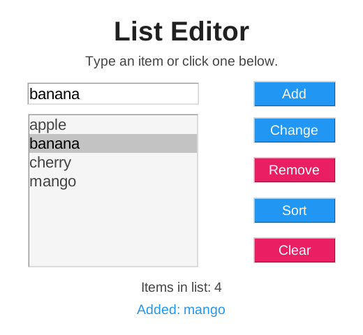
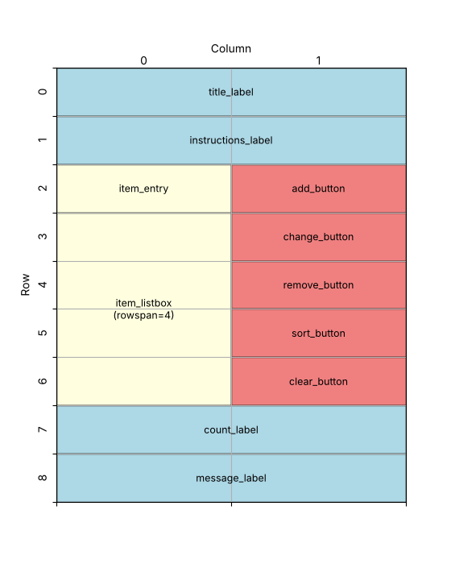

====================================================
List editor
====================================================

| This app lets the user change a Python **list** by clicking buttons.
| It displays a window with an Entry box, a Listbox, five Buttons and four Labels.
| The user can **add**, **change**, **remove** and **sort** items, or **clear** the whole list.
| Every button changes the list first, then redraws the Listbox so it shows what is in the list.

----

How the program is put together
---------------------------------------

The program is built in this order:

#. **Imports**: ``tkinter``.
#. **Constants**: colours and fonts.
#. **The list**: ``items``, the list that the app changes.
#. **Functions**:

   - ``show_list()`` redraws the Listbox so it matches ``items``.
   - ``get_selected_index()`` finds which item is selected.
   - ``add_item()``, ``change_item()``, ``remove_item()``, ``sort_items()`` and ``clear_items()`` are run by the buttons.
   - ``item_clicked()`` copies the clicked item into the Entry box.

#. **Main window**: create ``root`` and set its title, size and colour.
#. **Widgets**: create the labels, the Entry box, the Listbox and the five buttons.
#. **Event binding**: run ``item_clicked()`` when an item in the Listbox is selected.
#. **Layout**: share the spare width between the columns, then place each widget with ``grid()``.
#. **Start**: call ``show_list()`` once, then ``root.mainloop()``.

| The **list** ``items`` holds the data. The **Listbox** only shows a copy of it.
| This is why every function changes ``items`` and then calls ``show_list()``.

----

Create the main window
--------------------------------

.. code-block:: python

    import tkinter as tk

    # Create the main window
    root = tk.Tk()
    root.title("List editor")
    root.geometry("520x480")
    root.configure(bg="#ffffff")

    root.mainloop()

----

Define constants for formatting
---------------------------------------

.. code-block:: python

    # Constants
    BG_COLOR = "#ffffff"
    TITLE_COLOR = "#212121"
    TEXT_COLOR = "#444444"
    PRIMARY_COLOR = "#2196f3"  # blue
    SECONDARY_COLOR = "#e91e63"  # pink
    BUTTON_FG_COLOR = "#ffffff"
    LIST_BG_COLOR = "#f5f5f5"
    TITLE_FONT = ("Arial", 28, "bold")
    FONT_STYLE = ("Arial", 14)
    BUTTON_FONT = ("Arial", 14)
    LIST_FONT = ("Arial", 16)

| Blue (``PRIMARY_COLOR``) is used for the buttons that add or change items. Pink (``SECONDARY_COLOR``) is used for the buttons that take items away.
| Update the window colour using the constant:

.. code-block:: python

    root.configure(bg=BG_COLOR)

----

Store the items in a list
-------------------------------

.. code-block:: python

    # The list that the app changes
    items = ["apple", "banana", "cherry"]

- A **list** stores many values in order, inside square brackets ``[ ]``, separated by commas.
- Each item has an **index**: its position in the list. Counting starts at **0**, so ``items[0]`` is ``"apple"`` and ``items[2]`` is ``"cherry"``.
- ``items`` is written in lowercase because it is **not** a constant: the program changes it while it runs.
- ``items`` is created outside any function, so every function can use it.

----

Show the list in the Listbox
-------------------------------------

.. code-block:: python

    def show_list():
        """Redraws the listbox so it matches the items list."""
        item_listbox.delete(0, tk.END)
        for item in items:
            item_listbox.insert(tk.END, item)
        count_label.config(text="Items in list: " + str(len(items)))

- ``item_listbox.delete(0, tk.END)`` removes every line from the Listbox, from line 0 to the end.
- The ``for`` loop goes through the list one item at a time. ``item_listbox.insert(tk.END, item)`` adds each item to the bottom of the Listbox.
- ``len(items)`` is the number of items in the list. ``str()`` turns the number into a string so it can be joined to the label text.
- Clearing the Listbox and filling it again means it always matches the list exactly.

----

Find the selected item
-------------------------------

.. code-block:: python

    def get_selected_index():
        """Returns the selected index, or None if nothing is selected."""
        selection = item_listbox.curselection()
        if len(selection) == 0:
            message_label.config(text="Select an item first.")
            return None
        return selection[0]

- ``curselection()`` returns a **tuple** of the selected line numbers, e.g. ``(1,)`` when the second line is selected, or ``()`` when nothing is selected.
- If nothing is selected, the function shows a message and returns ``None``. ``None`` is Python's value for "nothing".
- Otherwise it returns ``selection[0]``, the index of the selected item.
- The line numbers in the Listbox match the indexes in ``items``, because ``show_list()`` adds the items in the same order.

----

Add an item
--------------------

.. code-block:: python

    def add_item():
        """Adds the text in the entry box to the end of the list."""
        new_item = item_entry.get().strip()
        if new_item == "":
            message_label.config(text="Type something to add.")
            return
        items.append(new_item)
        item_entry.delete(0, tk.END)
        message_label.config(text="Added: " + new_item)
        show_list()

- ``item_entry.get()`` reads the text in the Entry box. ``.strip()`` removes any spaces at the start and end.
- If the box is empty, a message is shown and ``return`` stops the function, so nothing is added.
- ``items.append(new_item)`` adds the new item to the **end** of the list.
- ``item_entry.delete(0, tk.END)`` clears the Entry box, ready for the next item.

----

Change and remove an item
----------------------------------

.. code-block:: python

    def change_item():
        """Replaces the selected item with the text in the entry box."""
        index = get_selected_index()
        if index is None:
            return
        new_item = item_entry.get().strip()
        if new_item == "":
            message_label.config(text="Type the new value first.")
            return
        old_item = items[index]
        items[index] = new_item
        item_entry.delete(0, tk.END)
        message_label.config(text="Changed " + old_item + " to " + new_item)
        show_list()

    def remove_item():
        """Removes the selected item from the list."""
        index = get_selected_index()
        if index is None:
            return
        removed = items.pop(index)
        message_label.config(text="Removed: " + removed)
        show_list()

- ``if index is None: return`` stops the function when nothing is selected. ``get_selected_index()`` has already shown the message.
- ``items[index] = new_item`` **replaces** the item at that position with a new value.
- ``old_item`` saves the old value first, so the message can say what was changed.
- ``items.pop(index)`` removes the item at that position **and returns it**, so ``removed`` holds the item that was taken out.

----

Sort and clear the list
--------------------------------

.. code-block:: python

    def sort_items():
        """Sorts the list into alphabetical order."""
        items.sort()
        message_label.config(text="List sorted A to Z.")
        show_list()

    def clear_items():
        """Removes every item from the list."""
        items.clear()
        message_label.config(text="List cleared.")
        show_list()

- ``items.sort()`` puts the list into alphabetical order. It changes the list itself.
- Strings are sorted by character code, so capital letters come before lowercase letters: ``"Zebra"`` sorts before ``"apple"``.
- ``items.clear()`` removes every item, leaving an empty list ``[]``.

----

Copy the clicked item into the Entry box
-------------------------------------------------

.. code-block:: python

    def item_clicked(event):
        """Copies the clicked item into the entry box so it can be changed."""
        selection = item_listbox.curselection()
        if len(selection) > 0:
            item_entry.delete(0, tk.END)
            item_entry.insert(0, items[selection[0]])

- This function is not run by a button. It is **bound** to the Listbox, so it runs when the user selects an item (see below).
- A function run by ``bind()`` is given an ``event`` parameter with details about what happened. This function does not use it, but it must still be in the brackets.
- ``item_entry.insert(0, ...)`` puts the selected item into the Entry box, so the user can edit it and click **Change**.

----

Create the widgets
-------------------------

.. code-block:: python

    # Create widgets
    title_label = tk.Label(root, text="List Editor", bg=BG_COLOR,
                           fg=TITLE_COLOR, font=TITLE_FONT)
    instructions_label = tk.Label(root, text="Type an item or click one below.",
                                  bg=BG_COLOR, fg=TEXT_COLOR, font=FONT_STYLE)
    item_entry = tk.Entry(root, width=20, font=LIST_FONT)
    add_button = tk.Button(root, text="Add", width=8, bg=PRIMARY_COLOR,
                           fg=BUTTON_FG_COLOR, font=BUTTON_FONT,
                           command=add_item)
    # exportselection=False keeps the selected item highlighted
    # when the user clicks in the entry box to type
    item_listbox = tk.Listbox(root, width=20, height=8, bg=LIST_BG_COLOR,
                              fg=TEXT_COLOR, font=LIST_FONT,
                              exportselection=False)
    change_button = tk.Button(root, text="Change", width=8, bg=PRIMARY_COLOR,
                              fg=BUTTON_FG_COLOR, font=BUTTON_FONT,
                              command=change_item)
    remove_button = tk.Button(root, text="Remove", width=8, bg=SECONDARY_COLOR,
                              fg=BUTTON_FG_COLOR, font=BUTTON_FONT,
                              command=remove_item)
    sort_button = tk.Button(root, text="Sort", width=8, bg=PRIMARY_COLOR,
                            fg=BUTTON_FG_COLOR, font=BUTTON_FONT,
                            command=sort_items)
    clear_button = tk.Button(root, text="Clear", width=8, bg=SECONDARY_COLOR,
                             fg=BUTTON_FG_COLOR, font=BUTTON_FONT,
                             command=clear_items)
    count_label = tk.Label(root, text="", bg=BG_COLOR, fg=TEXT_COLOR,
                           font=FONT_STYLE)
    message_label = tk.Label(root, text="", bg=BG_COLOR, fg=PRIMARY_COLOR,
                             font=FONT_STYLE)

    # Run item_clicked() whenever the user selects an item in the listbox
    item_listbox.bind("<<ListboxSelect>>", item_clicked)

- ``item_entry`` is an **Entry** widget: a one-line box the user can type in. ``width=20`` makes it about 20 characters wide.
- ``item_listbox`` is a **Listbox**: a box that shows one item per line. ``height=8`` shows 8 lines.
- ``exportselection=False`` is important. Without it, the Listbox loses its selection when the user clicks or highlights text in the Entry box, so **Change** and **Remove** would say "Select an item first."
- ``count_label`` and ``message_label`` start with no text. The functions fill them in.
- ``command=add_item`` connects each button to its function, with **no brackets**.
- ``bind("<<ListboxSelect>>", item_clicked)`` runs ``item_clicked()`` every time the selection in the Listbox changes.

----

Place the widgets in the window
---------------------------------------

Design the grid positions:

.. code-block:: python

    # Share spare width equally between the 2 columns to keep the widgets centred
    root.columnconfigure(0, weight=1)
    root.columnconfigure(1, weight=1)

    # Place widgets in the window
    title_label.grid(row=0, column=0, columnspan=2, pady=(20, 5))
    instructions_label.grid(row=1, column=0, columnspan=2, pady=(0, 10))
    item_entry.grid(row=2, column=0, padx=10, pady=5)
    add_button.grid(row=2, column=1, padx=10, pady=5)
    item_listbox.grid(row=3, column=0, rowspan=4, padx=10, pady=5)
    change_button.grid(row=3, column=1, padx=10, pady=5)
    remove_button.grid(row=4, column=1, padx=10, pady=5)
    sort_button.grid(row=5, column=1, padx=10, pady=5)
    clear_button.grid(row=6, column=1, padx=10, pady=5)
    count_label.grid(row=7, column=0, columnspan=2, pady=(10, 0))
    message_label.grid(row=8, column=0, columnspan=2, pady=5)

    # Show the starting list
    show_list()

- ``rowspan=4`` makes the Listbox stretch **down** across rows 3, 4, 5 and 6, so the four buttons sit beside it.
- ``columnspan=2`` makes the title, instructions and the two bottom labels stretch **across** both columns.
- ``show_list()`` is called once before ``root.mainloop()``, so the starting items appear when the window opens.

----

Key syntax
-----------------

.. py:function:: list.append(item)

    | Syntax: ``items.append(new_item)``
    | Description: Adds an item to the end of the list.
    | Example: ``["a", "b"]`` becomes ``["a", "b", "c"]`` after ``.append("c")``

.. py:function:: list[index] = value

    | Syntax: ``items[index] = new_item``
    | Description: Replaces the item at that index. Indexes start at 0.
    | Example: ``items[0] = "apricot"  # replaces the first item``

.. py:function:: list.pop(index)

    | Syntax: ``removed = items.pop(index)``
    | Description: Removes the item at that index and returns it. ``items.pop()`` with no index removes the last item.

.. py:function:: list.sort()

    | Syntax: ``items.sort()``
    | Description: Sorts the list in place, in alphabetical (or number) order. Capital letters come before lowercase letters.

.. py:function:: list.clear()

    | Syntax: ``items.clear()``
    | Description: Removes every item, leaving an empty list.

.. py:function:: len(list)

    | Syntax: ``len(items)``
    | Description: Returns the number of items in the list.

.. py:function:: listbox.insert(index, text)

    | Syntax: ``item_listbox.insert(tk.END, item)``
    | Description: Adds a line to the Listbox. ``tk.END`` adds it at the bottom.

.. py:function:: listbox.delete(first, last)

    | Syntax: ``item_listbox.delete(0, tk.END)``
    | Description: Removes lines from the Listbox. ``0, tk.END`` removes every line.

.. py:function:: listbox.curselection()

    | Syntax: ``selection = item_listbox.curselection()``
    | Description: Returns a tuple of the selected line numbers, e.g. ``(2,)``, or ``()`` if nothing is selected.

.. py:function:: widget.bind(event, function)

    | Syntax: ``item_listbox.bind("<<ListboxSelect>>", item_clicked)``
    | Description: Runs the function when the event happens. The function must have an ``event`` parameter.

.. py:function:: widget.grid(rowspan=n)

    | Syntax: ``item_listbox.grid(row=3, column=0, rowspan=4)``
    | Description: Makes a widget stretch down across ``n`` rows. ``columnspan`` works the same way across columns.

----

Full code
------------

.. code-block:: python

    import tkinter as tk

    # Constants
    BG_COLOR = "#ffffff"
    TITLE_COLOR = "#212121"
    TEXT_COLOR = "#444444"
    PRIMARY_COLOR = "#2196f3"  # blue
    SECONDARY_COLOR = "#e91e63"  # pink
    BUTTON_FG_COLOR = "#ffffff"
    LIST_BG_COLOR = "#f5f5f5"
    TITLE_FONT = ("Arial", 28, "bold")
    FONT_STYLE = ("Arial", 14)
    BUTTON_FONT = ("Arial", 14)
    LIST_FONT = ("Arial", 16)

    # The list that the app changes
    items = ["apple", "banana", "cherry"]

    def show_list():
        """Redraws the listbox so it matches the items list."""
        item_listbox.delete(0, tk.END)
        for item in items:
            item_listbox.insert(tk.END, item)
        count_label.config(text="Items in list: " + str(len(items)))

    def get_selected_index():
        """Returns the selected index, or None if nothing is selected."""
        selection = item_listbox.curselection()
        if len(selection) == 0:
            message_label.config(text="Select an item first.")
            return None
        return selection[0]

    def add_item():
        """Adds the text in the entry box to the end of the list."""
        new_item = item_entry.get().strip()
        if new_item == "":
            message_label.config(text="Type something to add.")
            return
        items.append(new_item)
        item_entry.delete(0, tk.END)
        message_label.config(text="Added: " + new_item)
        show_list()

    def change_item():
        """Replaces the selected item with the text in the entry box."""
        index = get_selected_index()
        if index is None:
            return
        new_item = item_entry.get().strip()
        if new_item == "":
            message_label.config(text="Type the new value first.")
            return
        old_item = items[index]
        items[index] = new_item
        item_entry.delete(0, tk.END)
        message_label.config(text="Changed " + old_item + " to " + new_item)
        show_list()

    def remove_item():
        """Removes the selected item from the list."""
        index = get_selected_index()
        if index is None:
            return
        removed = items.pop(index)
        message_label.config(text="Removed: " + removed)
        show_list()

    def sort_items():
        """Sorts the list into alphabetical order."""
        items.sort()
        message_label.config(text="List sorted A to Z.")
        show_list()

    def clear_items():
        """Removes every item from the list."""
        items.clear()
        message_label.config(text="List cleared.")
        show_list()

    def item_clicked(event):
        """Copies the clicked item into the entry box so it can be changed."""
        selection = item_listbox.curselection()
        if len(selection) > 0:
            item_entry.delete(0, tk.END)
            item_entry.insert(0, items[selection[0]])

    # Create the main window
    root = tk.Tk()
    root.title("List editor")
    root.geometry("520x480")
    root.configure(bg=BG_COLOR)

    # Create widgets
    title_label = tk.Label(root, text="List Editor", bg=BG_COLOR,
                           fg=TITLE_COLOR, font=TITLE_FONT)
    instructions_label = tk.Label(root, text="Type an item or click one below.",
                                  bg=BG_COLOR, fg=TEXT_COLOR, font=FONT_STYLE)
    item_entry = tk.Entry(root, width=20, font=LIST_FONT)
    add_button = tk.Button(root, text="Add", width=8, bg=PRIMARY_COLOR,
                           fg=BUTTON_FG_COLOR, font=BUTTON_FONT,
                           command=add_item)
    # exportselection=False keeps the selected item highlighted
    # when the user clicks in the entry box to type
    item_listbox = tk.Listbox(root, width=20, height=8, bg=LIST_BG_COLOR,
                              fg=TEXT_COLOR, font=LIST_FONT,
                              exportselection=False)
    change_button = tk.Button(root, text="Change", width=8, bg=PRIMARY_COLOR,
                              fg=BUTTON_FG_COLOR, font=BUTTON_FONT,
                              command=change_item)
    remove_button = tk.Button(root, text="Remove", width=8, bg=SECONDARY_COLOR,
                              fg=BUTTON_FG_COLOR, font=BUTTON_FONT,
                              command=remove_item)
    sort_button = tk.Button(root, text="Sort", width=8, bg=PRIMARY_COLOR,
                            fg=BUTTON_FG_COLOR, font=BUTTON_FONT,
                            command=sort_items)
    clear_button = tk.Button(root, text="Clear", width=8, bg=SECONDARY_COLOR,
                             fg=BUTTON_FG_COLOR, font=BUTTON_FONT,
                             command=clear_items)
    count_label = tk.Label(root, text="", bg=BG_COLOR, fg=TEXT_COLOR,
                           font=FONT_STYLE)
    message_label = tk.Label(root, text="", bg=BG_COLOR, fg=PRIMARY_COLOR,
                             font=FONT_STYLE)

    # Run item_clicked() whenever the user selects an item in the listbox
    item_listbox.bind("<<ListboxSelect>>", item_clicked)

    # Share spare width equally between the 2 columns to keep the widgets centred
    root.columnconfigure(0, weight=1)
    root.columnconfigure(1, weight=1)

    # Place widgets in the window
    title_label.grid(row=0, column=0, columnspan=2, pady=(20, 5))
    instructions_label.grid(row=1, column=0, columnspan=2, pady=(0, 10))
    item_entry.grid(row=2, column=0, padx=10, pady=5)
    add_button.grid(row=2, column=1, padx=10, pady=5)
    item_listbox.grid(row=3, column=0, rowspan=4, padx=10, pady=5)
    change_button.grid(row=3, column=1, padx=10, pady=5)
    remove_button.grid(row=4, column=1, padx=10, pady=5)
    sort_button.grid(row=5, column=1, padx=10, pady=5)
    clear_button.grid(row=6, column=1, padx=10, pady=5)
    count_label.grid(row=7, column=0, columnspan=2, pady=(10, 0))
    message_label.grid(row=8, column=0, columnspan=2, pady=5)

    # Show the starting list
    show_list()

    # Start the main event loop
    root.mainloop()

----

List editor test table
---------------------------------

.. list-table:: Test Cases for the List Editor
   :header-rows: 1
   :widths: 25 50

   * - **Action**
     - **Expected output**
   * - Open the app
     - The Listbox shows apple, banana, cherry. "Items in list: 3"
   * - Type ``mango``, click **Add**
     - mango appears at the bottom. "Added: mango". "Items in list: 4"
   * - Click **Add** with the Entry box empty
     - Nothing is added. "Type something to add."
   * - Click **banana**
     - banana is highlighted and copied into the Entry box.
   * - Change the text to ``blueberry``, click **Change**
     - banana is replaced by blueberry in the same position. "Changed banana to blueberry"
   * - Click **cherry**, then **Remove**
     - cherry disappears. "Removed: cherry"
   * - Click **Remove** with nothing selected
     - Nothing is removed. "Select an item first."
   * - Add ``Zebra``, then click **Sort**
     - The list is sorted, but Zebra comes **first**, before apple.
   * - Click **Clear**
     - The Listbox is empty. "Items in list: 0"

| Capital letters sort before lowercase letters, so ``"Zebra"`` comes before ``"apple"``.
| The app also lets the user add the same item twice.

----

.. admonition:: Tasks

    #. Let the user press **Enter** to add an item. Hint: ``item_entry.bind("<Return>", ...)`` runs a function when Enter is pressed. The function needs an ``event`` parameter.
    #. Stop the user adding an item that is already in the list. Hint: ``new_item in items`` is ``True`` when the item is already in the list.
    #. Make **Sort** ignore capital letters, so ``"Zebra"`` goes last. Hint: ``items.sort(key=str.lower)``.
    #. Add **Move up** and **Move down** buttons that swap the selected item with the one above or below it.

----

List Editor - Multiple Choice Quiz
---------------------------------------------

.. mcqgroup::
    :nav_position: both
    :show-instant-feedback:
    :enable-instant-feedback:
    :shuffle_questions:
    :num_questions: 5

    .. multichoice::

        items = ["apple", "banana", "cherry"]. What is items[1]?

        [ ] apple | Incorrect. apple is items[0], because indexes start at 0.
        [x] banana | Correct. Indexes start at 0, so index 1 is the second item.
        [ ] cherry | Incorrect. cherry is items[2].
        [ ] An error | Incorrect. Index 1 exists in a list of 3 items.

    .. multichoice::

        Which line adds "mango" to the end of the list?

        [x] items.append("mango") | Correct. append adds an item to the end of the list.
        [ ] items.add("mango") | Incorrect. Lists do not have an add method.
        [ ] items[3] = "mango" | Incorrect. Index 3 does not exist yet, so this causes an IndexError.
        [ ] items.insert("mango") | Incorrect. A list's insert method needs an index as well as the item.

    .. multichoice::

        items = ["apple", "banana", "cherry"]. What is the list after items[1] = "kiwi"?

        [ ] ["apple", "banana", "kiwi", "cherry"] | Incorrect. Assigning to an index replaces the item; it does not add one.
        [x] ["apple", "kiwi", "cherry"] | Correct. The item at index 1 is replaced.
        [ ] ["kiwi", "banana", "cherry"] | Incorrect. That would be items[0] = "kiwi".
        [ ] ["apple", "banana", "cherry", "kiwi"] | Incorrect. That would be items.append("kiwi").

    .. multichoice::

        What does removed = items.pop(0) do?

        [ ] Removes the last item | Incorrect. pop() with no index removes the last item; pop(0) removes the first.
        [x] Removes the first item and stores it in removed | Correct. pop removes the item and returns it.
        [ ] Removes every item | Incorrect. clear() removes every item.
        [ ] Stores the first item in removed but leaves it in the list | Incorrect. pop takes the item out of the list.

    .. multichoice::

        Why does every button function call show_list() at the end?

        [ ] To create the Listbox | Incorrect. The Listbox is created with tk.Listbox.
        [x] The function changes the items list, and show_list() redraws the Listbox so it shows the change | Correct. The Listbox only shows a copy of the list.
        [ ] To sort the list | Incorrect. sort_items() sorts the list.
        [ ] Because Tkinter requires it | Incorrect. The name show_list was chosen by the programmer.

    .. multichoice::

        What does item_listbox.curselection() return when nothing is selected?

        [ ] None | Incorrect. It returns an empty tuple.
        [ ] 0 | Incorrect. 0 would be the index of the first line.
        [x] () | Correct. An empty tuple means nothing is selected, so len(selection) is 0.
        [ ] -1 | Incorrect. curselection returns a tuple of line numbers.

    .. multichoice::

        Why is exportselection=False used for the Listbox?

        [ ] It lets the user select more than one item | Incorrect. selectmode controls that.
        [x] It keeps the item selected when the user clicks or highlights text in the Entry box | Correct. Without it, Change and Remove would find nothing selected.
        [ ] It stops the user copying items | Incorrect. It controls whether the selection is shared with other widgets.
        [ ] It makes the Listbox read-only | Incorrect. A Listbox cannot be typed in anyway.

    .. multichoice::

        What does item_listbox.bind("<<ListboxSelect>>", item_clicked) do?

        [ ] Runs item_clicked() once when the program starts | Incorrect. There are no brackets, so the function is stored, not run.
        [x] Runs item_clicked() every time the user selects an item in the Listbox | Correct. bind connects an event to a function.
        [ ] Selects the first item in the Listbox | Incorrect. bind does not change the selection.
        [ ] Creates the Listbox | Incorrect. tk.Listbox creates it.

    .. multichoice::

        After items.sort(), what is the order of ["banana", "Zebra", "apple"]?

        [ ] ["apple", "banana", "Zebra"] | Incorrect. Capital letters sort before lowercase letters.
        [x] ["Zebra", "apple", "banana"] | Correct. "Z" has a smaller character code than "a", so Zebra comes first.
        [ ] ["Zebra", "banana", "apple"] | Incorrect. apple and banana are still in alphabetical order.
        [ ] The list does not change | Incorrect. sort changes the list in place.

    .. multichoice::

        What does rowspan=4 do for item_listbox?

        [ ] Shows 4 items in the Listbox | Incorrect. height sets how many lines are shown.
        [x] Makes the Listbox stretch down across 4 rows of the grid | Correct. The four buttons sit in those rows beside it.
        [ ] Places the Listbox in row 4 | Incorrect. row=3 sets the starting row.
        [ ] Adds 4 pixels of space | Incorrect. pady adds space.

----

List Editor - Cloze Code Quiz
----------------------------------------

.. clozegroup::
    :nav-position: both
    :num-questions: 3
    :show-instant-feedback:

    .. cloze::
        :instructions: Show every item in the list in the Listbox.

        def show_list():
            item_listbox.delete(0, @@tk.END | len(items) | -1@@)
            for item in @@items | item_listbox | range(items)@@:
                item_listbox.insert(tk.END, item)
            count_label.config(text="Items in list: " + @@str | int | len@@(len(items)))

    .. cloze::
        :instructions: Add the text in the Entry box to the end of the list.

        def add_item():
            new_item = item_entry.@@get | read | text@@().strip()
            if new_item == "":
                message_label.config(text="Type something to add.")
                return
            items.@@append | add | insert@@(new_item)
            show_list()

    .. cloze::
        :instructions: Replace the selected item with the new value.

        def change_item():
            index = get_selected_index()
            if index is None:
                return
            new_item = item_entry.get().strip()
            items@@[index] | (index) | .index@@ = new_item
            show_list()

    .. cloze::
        :instructions: Remove the selected item and remember what it was.

        def remove_item():
            index = get_selected_index()
            if index @@is | == "" | in@@ None:
                return
            removed = items.@@pop | remove | delete@@(index)
            message_label.config(text="Removed: " + removed)
            show_list()

    .. cloze::
        :instructions: Keep the selection when typing, and run a function when an item is selected.

        item_listbox = tk.Listbox(root, width=20, height=8, bg=LIST_BG_COLOR,
                                  fg=TEXT_COLOR, font=LIST_FONT, @@exportselection=False | selectmode=False | export=None@@)
        item_listbox.@@bind | command | config@@("<<ListboxSelect>>", item_clicked)
