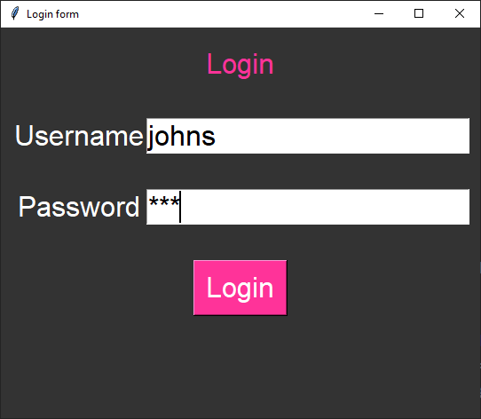

====================================================
Login form
====================================================

| See: `<https://www.youtube.com/watch?v=MeMCBdnhvQs&list=PLs3IFJPw3G9KL3huzPS7g-0PCbS7Auc7I&index=5>`_

| This code outputs a message box in response to attempts to login.
| It displays a window with Label, Entry and Button widgets.
| The widgets are placed within a frame using grid.
| The frame is placed so the widgets appear to be responsive to window resizing, staying centrally aligned.

----

Use summary
-------------------

| Enter the correct username and password to see the success message.

----

Create the Main Window
------------------------------------

| Import the messagebox.
| Create the main window, and set its title, size, and background color.

.. code-block:: python

    import tkinter as tk
    from tkinter import messagebox

    BG_COLOR = "#333333"

    root = tk.Tk()
    root.title("Login form")
    root.geometry("600x440")
    root.configure(bg=BG_COLOR)

    root.mainloop()

----

Define Constants
--------------------------------

Next, define some constants for the GUI. These include background color, font style, and login credentials.

.. code-block:: python

    BG_COLOR = "#333333"
    FG_COLOR = "#FFFFFF"
    FG_BUTTON_COLOR = "#FF3399"
    FONT_STYLE = ("Arial", 24)

    USERNAME = "johns"
    PASSWORD = "123"

----

Create the Login Function
------------------------------------------

| Create a function called `login()` that checks if the entered username and password match the predefined credentials.
| If they do, a success message will be displayed; otherwise, an error message will appear.

.. code-block:: python

    def login():
        entered_username = username_entry.get()
        entered_password = password_entry.get()
        if entered_username == USERNAME and entered_password == PASSWORD:
            messagebox.showinfo("Login", "Logged in successfully!")
        else:
            messagebox.showerror("Login Error", "Invalid login")

----

Create Widgets
------------------------------

| Inside the main window, create a frame to hold the widgets.
| Then create labels, entry fields, and a login button.
| ``show="*"``: The show option specifies how the entered characters should be displayed.
| In this case, it shows an asterisk (*) for each character typed.
| This is commonly used for password fields to hide the actual characters.

.. code-block:: python

    frame = tk.Frame(root, bg=BG_COLOR)
    frame.place(relx=0.5, rely=0.5, anchor='center')  # Centering the frame inside the window

    login_label = tk.Label(frame, text="Login", bg=BG_COLOR,
                        fg=FG_BUTTON_COLOR, font=FONT_STYLE)
    username_label = tk.Label(frame, text="Username",
                            bg=BG_COLOR, fg=FG_COLOR, font=FONT_STYLE)
    password_label = tk.Label(frame, text="Password",
                            bg=BG_COLOR, fg=FG_COLOR, font=FONT_STYLE)
    username_entry = tk.Entry(frame, font=FONT_STYLE)
    password_entry = tk.Entry(frame, show="*", font=FONT_STYLE)
    login_button = tk.Button(frame, text="Login", bg=FG_BUTTON_COLOR,
                            fg=FG_COLOR, font=FONT_STYLE, command=login)

----

Arrange Widgets
------------------------------

| Use the `grid()` method to arrange the widgets within the frame.
| ``columnspan=2``: This parameter indicates that the widget should span across 2 columns so it occupies both the first and second columns.
| ``sticky="news"``: The `sticky` parameter determines how the widget should stick to its cell.
| The value `"news"` means that the widget should expand to fill the entire cell both horizontally and vertically.

| So, the `login_label` widget is positioned in the first row and spans two columns.
| It expands to fill the available space within its cell.
| The vertical padding ensures some spacing around the label.

.. code-block:: python

    login_label.grid(row=0, column=0, columnspan=2, sticky="news", pady=20)
    username_label.grid(row=1, column=0)
    password_label.grid(row=2, column=0)
    username_entry.grid(row=1, column=1, pady=20)
    password_entry.grid(row=2, column=1, pady=20)
    login_button.grid(row=3, column=0, columnspan=2, pady=20)

----

Full code
------------

.. code-block:: python

    # https://www.youtube.com/watch?v=MeMCBdnhvQs&list=PLs3IFJPw3G9KL3huzPS7g-0PCbS7Auc7I&index=5

    import tkinter as tk
    from tkinter import messagebox

    # Constants
    BG_COLOR = "#333333"
    FG_COLOR = "#FFFFFF"
    FG_BUTTON_COLOR = "#FF3399"
    FONT_STYLE = ("Arial", 24)
    USERNAME = "johns"
    PASSWORD = "123"

    def login():
        entered_username = username_entry.get()
        entered_password = password_entry.get()
        if entered_username == USERNAME and entered_password == PASSWORD:
            messagebox.showinfo("Login", "Logged in successfully!")
        else:
            messagebox.showerror("Login Error", "Invalid login")

    # Create the main window
    root = tk.Tk()
    root.title("Login form")
    root.geometry("600x440")
    root.configure(bg=BG_COLOR)

    #  create frame widget for other widgets
    frame = tk.Frame(root, bg=BG_COLOR)
    frame.place(relx=0.5, rely=0.5, anchor='center')

    #  create widgets in frame
    login_label = tk.Label(frame, text="Login", bg=BG_COLOR,
                        fg=FG_BUTTON_COLOR, font=FONT_STYLE)
    username_label = tk.Label(frame, text="Username",
                            bg=BG_COLOR, fg=FG_COLOR, font=FONT_STYLE)
    password_label = tk.Label(frame, text="Password",
                            bg=BG_COLOR, fg=FG_COLOR, font=FONT_STYLE)
    username_entry = tk.Entry(frame, font=FONT_STYLE)
    password_entry = tk.Entry(frame, show="*", font=FONT_STYLE)
    login_button = tk.Button(frame, text="Login", bg=FG_BUTTON_COLOR,
                            fg=FG_COLOR, font=FONT_STYLE, command=login)

    # place widgets in frame
    login_label.grid(row=0, column=0, columnspan=2, sticky="news", pady=20)
    username_label.grid(row=1, column=0)
    password_label.grid(row=2, column=0)
    username_entry.grid(row=1, column=1, pady=20)
    password_entry.grid(row=2, column=1, pady=20)
    login_button.grid(row=3, column=0, columnspan=2, pady=20)

    root.mainloop()

----

Login Form - Multiple Choice Quiz
---------------------------------------

.. mcqgroup::
    :nav_position: both
    :show-instant-feedback:
    :enable-instant-feedback:
    :shuffle_questions:
    :num_questions: 5

    .. multichoice::

        Which line gives the program access to Tkinter's message boxes?

        [ ] import messagebox | Incorrect. messagebox is part of the tkinter package, so it must be imported from tkinter.
        [x] from tkinter import messagebox | Correct. This imports the messagebox module from the tkinter package.
        [ ] import tkinter.msgbox | Incorrect. There is no module called msgbox.
        [ ] from messagebox import tkinter | Incorrect. The package and module names are the wrong way round.

    .. multichoice::

        What does show="*" do in password_entry = tk.Entry(frame, show="*", font=FONT_STYLE)?

        [ ] It adds a star next to the box | Incorrect. show changes how the typed characters are displayed.
        [ ] It makes the password box required | Incorrect. Tkinter Entry boxes have no required option.
        [x] It displays an asterisk for each character typed | Correct. The real characters are hidden, which is common for password fields.
        [ ] It stores the password as asterisks | Incorrect. get() still returns the real characters that were typed.

    .. multichoice::

        Which condition is True only when both the username and the password are correct?

        [ ] entered_username == USERNAME or entered_password == PASSWORD | Incorrect. or is True if just one of them is correct.
        [x] entered_username == USERNAME and entered_password == PASSWORD | Correct. and is only True when both comparisons are True.
        [ ] entered_username = USERNAME and entered_password = PASSWORD | Incorrect. A single = assigns a value and causes a SyntaxError in an if statement.
        [ ] entered_username != USERNAME and entered_password != PASSWORD | Incorrect. != checks that the values are NOT equal.

    .. multichoice::

        What happens if the user types johns as the username and 456 as the password?

        [ ] A message box says "Logged in successfully!" | Incorrect. The password must also match PASSWORD, which is "123".
        [x] An error message box says "Invalid login" | Correct. The and condition is False, so the else branch runs messagebox.showerror().
        [ ] Nothing happens | Incorrect. The else branch always shows a message box.
        [ ] The program crashes | Incorrect. A wrong password is handled by the else branch.

    .. multichoice::

        Which function displays the error message box?

        [ ] messagebox.showinfo() | Incorrect. showinfo() displays an information message, used here for a successful login.
        [x] messagebox.showerror() | Correct. showerror() displays a message box with an error icon.
        [ ] messagebox.error() | Incorrect. The function is called showerror().
        [ ] print() | Incorrect. print() writes to the shell, not to a message box.

    .. multichoice::

        What does sticky="news" do for login_label?

        [ ] It shows the latest news | Incorrect. news stands for compass directions.
        [x] It stretches the label to fill its cell north, east, west and south | Correct. Sticking to all four sides makes the widget fill the whole cell.
        [ ] It aligns the label to the north (top) only | Incorrect. That would be sticky="n".
        [ ] It centres the label in the window | Incorrect. sticky only affects the widget within its grid cell.

    .. multichoice::

        Why are the labels, Entry boxes and button created with frame as their first argument?

        [ ] To make the widgets bigger | Incorrect. The parent does not change the widget size.
        [x] So they are placed inside the frame and can be positioned together as one group | Correct. The frame is the parent, so moving or centring the frame moves all its widgets.
        [ ] Because grid() only works with frames | Incorrect. grid() works with any parent, including root.
        [ ] To give the widgets a border | Incorrect. The frame has no visible border in this app.

    .. multichoice::

        What does frame.place(relx=0.5, rely=0.5, anchor='center') do?

        [ ] Places the frame at pixel 0.5, 0.5 | Incorrect. relx and rely are fractions of the window size, not pixels.
        [ ] Makes the frame half the size of the window | Incorrect. place() positions the frame; it does not resize it.
        [x] Keeps the centre of the frame at the centre of the window, even when the window is resized | Correct. relx=0.5 and rely=0.5 are halfway across and down, and anchor='center' lines up the frame's centre with that point.
        [ ] Places the frame in the top-left corner | Incorrect. That would be relx=0, rely=0.

    .. multichoice::

        What are USERNAME and PASSWORD in this program?

        [ ] Entry widgets | Incorrect. The Entry widgets are username_entry and password_entry.
        [x] Constants holding the correct login details | Correct. They store "johns" and "123", which the typed values are compared with.
        [ ] Functions | Incorrect. They are not called with brackets.
        [ ] Labels shown in the window | Incorrect. They are never displayed.

    .. multichoice::

        Where is login_button placed in the grid?

        [ ] row=0, column=0 | Incorrect. Row 0 holds the Login title label.
        [ ] row=2, column=1 | Incorrect. That position holds password_entry.
        [x] row=3, column=0, spanning 2 columns | Correct. The button is in the bottom row and stretches across both columns.
        [ ] row=3, column=1 | Incorrect. The button starts in column 0 and uses columnspan=2.

----

Login Form - Cloze Code Quiz
----------------------------------

.. clozegroup::
    :nav-position: both
    :num-questions: 3
    :show-instant-feedback:

    .. cloze::
        :instructions: Complete the imports and set the window size.

        import tkinter as tk
        from tkinter import @@messagebox | msgbox | alert@@

        root = tk.Tk()
        root.title("Login form")
        root.@@geometry | size | dimensions@@("600x440")

    .. cloze::
        :instructions: Complete the condition that checks both login details.

        def login():
            entered_username = username_entry.@@get() | read() | text()@@
            entered_password = password_entry.get()
            if entered_username == USERNAME @@and | or | &@@ entered_password == PASSWORD:

    .. cloze::
        :instructions: Choose the correct message box functions for a successful and a failed login.

        if entered_username == USERNAME and entered_password == PASSWORD:
            messagebox.@@showinfo | showerror | print@@("Login", "Logged in successfully!")
        else:
            messagebox.@@showerror | showinfo | error@@("Login Error", "Invalid login")

    .. cloze::
        :instructions: Hide the password characters and connect the button to the login function.

        username_entry = tk.Entry(frame, font=FONT_STYLE)
        password_entry = tk.Entry(frame, @@show="*" | hide="*" | mask="*"@@, font=FONT_STYLE)
        login_button = tk.Button(frame, text="Login", bg=FG_BUTTON_COLOR,
                                 fg=FG_COLOR, font=FONT_STYLE, @@command=login | command=login() | onClick=login@@)

    .. cloze::
        :instructions: Make the title fill its cell across both columns and centre the frame in the window.

        frame.place(relx=@@0.5 | 50 | 1@@, rely=0.5, anchor='center')
        login_label.grid(row=0, column=0, @@columnspan=2 | colspan=2 | span=2@@, sticky="@@news | center | all@@", pady=20)
