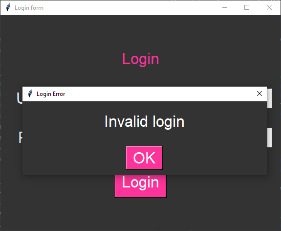

====================================================
Login form: custom message box
====================================================

| This uses the same login form code as displayed on previous pages, but adds a customized messagebox that is centred over the window instead of the screen.



----

Custom top level window for a message box
----------------------------------------------

This section explains how the ``custom_messagebox`` function works, which is used to display a message box aligned precisely over the parent widget in a Tkinter application.

.. code-block:: python

    def custom_messagebox(title, message, parent):
        """Custom messagebox aligned over the parent widget."""
        top = tk.Toplevel(parent)  # Create a new top-level window
        top.title(title)
        top.configure(bg=BG_COLOR)
        top.transient(parent)  # Keep it on top of the parent
        top.attributes('-topmost', True)  # Always stay in front of every other window

        # Center the top-level window over the parent
        parent_x = parent.winfo_rootx()
        parent_y = parent.winfo_rooty()
        parent_width = parent.winfo_width()
        parent_height = parent.winfo_height()

        # Calculate position to center the messagebox over the parent
        top_width = 500
        top_height = 150
        x = parent_x + (parent_width // 2) - (top_width // 2)
        y = parent_y + (parent_height // 2) - (top_height // 2)

        top.geometry(f"{top_width}x{top_height}+{x}+{y}")

        # Create widgets inside the custom messagebox
        message_label = tk.Label(top, text=message, bg=BG_COLOR, fg=FG_COLOR, font=FONT_STYLE)
        ok_button = tk.Button(top, text="OK", bg=FG_BUTTON_COLOR,
                                fg=FG_COLOR, font=FONT_STYLE, command=top.destroy)

        # Layout the widgets
        message_label.pack(expand=True, pady=20)
        ok_button.pack(pady=10)

        # Make it modal once it is on screen
        top.wait_visibility()
        top.grab_set()


Key features
-------------

Creating a Toplevel Window
`````````````````````````````

- ``top = tk.Toplevel(parent)``: This creates a new top-level window, which behaves like a popup.

Making the Window Modal
`````````````````````````````

- ``top.transient(parent)`` links the message box to the main window. On Windows this removes the minimise and maximise buttons and hides the box's own taskbar button. It does **not** keep the box in front of other programs.
- ``top.attributes('-topmost', True)`` keeps the message box in front of every other window until it is closed.
- ``top.grab_set()``: Activates a "grab" on the messagebox, preventing the user from interacting with the main window until the messagebox is closed.
- ``top.wait_visibility()``: Waits until the messagebox is on screen. It is called just before ``top.grab_set()``, because on some computers a window that is not yet visible cannot take the grab.

Positioning the Messagebox over the Parent Window
``````````````````````````````````````````````````````````

- We use the following Tkinter methods to determine the position and size of the parent widget:
- ``winfo_rootx()`` and ``winfo_rooty()``: Get the top-left coordinates of the parent window on the screen.
- ``winfo_width()`` and ``winfo_height()``: Get the width and height of the parent widget.

Calculating the Centered Position
``````````````````````````````````````````````````````````

- We compute the ``x`` and ``y`` coordinates to align the messagebox in the center of the parent:
- ``x = parent_x + (parent_width // 2) - (top_width // 2)``
- ``y = parent_y + (parent_height // 2) - (top_height // 2)``
- The messagebox is then positioned using:
- ``top.geometry(f"{top_width}x{top_height}+{x}+{y}")``

Creating the Messagebox Content
``````````````````````````````````````````````````````````

- A ``Label`` widget is used to display the message:
- ``message_label = tk.Label(top, text=message, bg=BG_COLOR, fg=FG_COLOR, font=FONT_STYLE)``
- A ``Button`` widget is used to close the messagebox:
- ``ok_button = tk.Button(top, text="OK", bg=FG_BUTTON_COLOR, fg=FG_COLOR, font=FONT_STYLE, command=top.destroy)``

Packing the Widgets
`````````````````````````````

- ``message_label.pack(expand=True, pady=20)``: Expands the label to fill available space and adds vertical padding.
- ``ok_button.pack(pady=10)``: Adds the OK button with some vertical padding.

Usage
`````````````````````````````

| This function can be used in any Tkinter application where you need a custom messagebox that is aligned directly over a specific parent widget.
| Here's how you can call the function:

.. code-block:: python

    custom_messagebox("Login", "Logged in successfully!", frame)

| This call creates a messagebox titled "Login" with the message "Logged in successfully!" positioned over the ``frame`` widget.

----

Full code
------------

.. code-block:: python

    import tkinter as tk


    # Constants
    BG_COLOR = "#333333"  # dark grey
    FG_COLOR = "#FFFFFF"   # white
    FG_BUTTON_COLOR = "#FF3399"  # bright pink
    FONT_STYLE = ("Arial", 24)
    USERNAME = "johns"
    PASSWORD = "123"


    def custom_messagebox(title, message, parent):
        """Custom messagebox aligned over the parent widget."""
        top = tk.Toplevel(parent)  # Create a new top-level window
        top.title(title)
        top.configure(bg=BG_COLOR)
        top.transient(parent)  # Keep it on top of the parent
        top.attributes('-topmost', True)  # Always stay in front of every other window

        # Center the top-level window over the parent
        parent_x = parent.winfo_rootx()
        parent_y = parent.winfo_rooty()
        parent_width = parent.winfo_width()
        parent_height = parent.winfo_height()

        # Calculate position to center the messagebox over the parent
        top_width = 500
        top_height = 150
        x = parent_x + (parent_width // 2) - (top_width // 2)
        y = parent_y + (parent_height // 2) - (top_height // 2)

        top.geometry(f"{top_width}x{top_height}+{x}+{y}")

        # Create widgets inside the custom messagebox
        message_label = tk.Label(top, text=message, bg=BG_COLOR, fg=FG_COLOR, font=FONT_STYLE)
        ok_button = tk.Button(top, text="OK", bg=FG_BUTTON_COLOR,
                                fg=FG_COLOR, font=FONT_STYLE, command=top.destroy)

        # Layout the widgets
        message_label.pack(expand=True, pady=20)
        ok_button.pack(pady=10)

        # Make it modal once it is on screen
        top.wait_visibility()
        top.grab_set()


    def login():
        entered_username = username_entry.get()
        entered_password = password_entry.get()
        if entered_username == USERNAME and entered_password == PASSWORD:
            custom_messagebox("Login", "Logged in successfully!", frame)
        else:
            custom_messagebox("Login Error", "Invalid login", frame)


    # Create the main window
    root = tk.Tk()
    root.title("Login form")
    root.geometry("600x440")
    root.configure(bg=BG_COLOR)

    # Create frame widget for other widgets
    frame = tk.Frame(root, bg=BG_COLOR)
    frame.place(relx=0.5, rely=0.5, anchor='center')  # Centering the frame inside the window

    # Create widgets inside the frame
    login_label = tk.Label(frame, text="Login", bg=BG_COLOR, fg=FG_BUTTON_COLOR, font=FONT_STYLE)
    username_label = tk.Label(frame, text="Username", bg=BG_COLOR, fg=FG_COLOR, font=FONT_STYLE)
    password_label = tk.Label(frame, text="Password", bg=BG_COLOR, fg=FG_COLOR, font=FONT_STYLE)
    username_entry = tk.Entry(frame, font=FONT_STYLE)
    password_entry = tk.Entry(frame, show="*", font=FONT_STYLE)
    login_button = tk.Button(frame, text="Login", bg=FG_BUTTON_COLOR,
                                 fg=FG_COLOR, font=FONT_STYLE, command=login)

    # Place widgets in the frame using grid layout
    login_label.grid(row=0, column=0, columnspan=2, sticky="news", pady=20)
    username_label.grid(row=1, column=0, padx=10)
    password_label.grid(row=2, column=0, padx=10)
    username_entry.grid(row=1, column=1, pady=20)
    password_entry.grid(row=2, column=1, pady=20)
    login_button.grid(row=3, column=0, columnspan=2, pady=20)

    root.mainloop()


----

Locked parent version
---------------------------

| This version replaces the ``custom_messagebox`` function with one that **locks** the main window while the message box is open.
| The user cannot click, type in or move the main window until they close the message box.

- ``parent.attributes('-disabled', True)`` locks the main window. ``on_close()`` unlocks it with ``parent.attributes('-disabled', False)``.
- ``-disabled`` only works on Windows, so it is wrapped in ``try`` / ``except tk.TclError`` to stop errors on macOS and Linux.
- ``attributes()`` only works on a window, so ``login()`` must pass ``root`` as the parent, not ``frame``.
- ``top.transient(parent)`` links the message box to the main window. On Windows this removes the minimise and maximise buttons and hides its taskbar button.
- ``top.attributes('-topmost', True)`` keeps the message box in front of every other window until it is closed.
- ``top.resizable(False, False)`` stops the message box being resized.
- ``top.wait_visibility()`` waits until the message box is on screen, then ``top.grab_set()`` makes it **modal**: all clicks and key presses go to the message box.
- ``on_close()`` unlocks the main window, destroys the message box, then brings the main window back to the front with ``parent.focus_force()``.
- ``on_close()`` runs whether the user clicks OK (``command=on_close``), clicks the X (``top.protocol("WM_DELETE_WINDOW", on_close)``) or presses Enter (``top.bind("<Return>", lambda event: on_close())``).
- Without the ``protocol`` line, closing with the X would leave the main window locked.

.. code-block:: python

    def custom_messagebox(title, message, parent):
        """Custom messagebox centred over the parent window, which is locked until it closes."""
        # Lock the parent window (Windows only; other systems rely on grab_set)
        try:
            parent.attributes('-disabled', True)
        except tk.TclError:
            pass

        top = tk.Toplevel(parent)
        top.title(title)
        top.configure(bg=BG_COLOR)
        top.resizable(False, False)
        top.transient(parent)  # Keep it on top of the parent
        top.attributes('-topmost', True)  # Always stay in front of every other window

        # Centre the message box over the parent
        parent_x = parent.winfo_rootx()
        parent_y = parent.winfo_rooty()
        parent_width = parent.winfo_width()
        parent_height = parent.winfo_height()
        top_width = 500
        top_height = 150
        x = parent_x + (parent_width // 2) - (top_width // 2)
        y = parent_y + (parent_height // 2) - (top_height // 2)
        top.geometry(f"{top_width}x{top_height}+{x}+{y}")

        def on_close():
            try:
                parent.attributes('-disabled', False)  # Unlock the parent first
            except tk.TclError:
                pass
            top.destroy()
            parent.focus_force()  # Bring the main window back to the front

        top.protocol("WM_DELETE_WINDOW", on_close)
        top.bind("<Return>", lambda event: on_close())

        message_label = tk.Label(top, text=message, bg=BG_COLOR, fg=FG_COLOR, font=FONT_STYLE)
        ok_button = tk.Button(top, text="OK", bg=FG_BUTTON_COLOR,
                              fg=FG_COLOR, font=FONT_STYLE, command=on_close)
        message_label.pack(expand=True, pady=20)
        ok_button.pack(pady=10)

        # Make it modal once it is on screen
        top.wait_visibility()
        top.grab_set()
        ok_button.focus_set()

| Update ``login()`` so it passes ``root`` instead of ``frame``:

.. code-block:: python

    def login():
        entered_username = username_entry.get()
        entered_password = password_entry.get()
        if entered_username == USERNAME and entered_password == PASSWORD:
            custom_messagebox("Login", "Logged in successfully!", root)
        else:
            custom_messagebox("Login Error", "Invalid login", root)


----

Custom Message Box - Multiple Choice Quiz
-----------------------------------------------

.. mcqgroup::
    :nav_position: both
    :show-instant-feedback:
    :enable-instant-feedback:
    :shuffle_questions:
    :num_questions: 5

    .. multichoice::

        What does top = tk.Toplevel(parent) create?

        [ ] A second main window that replaces root | Incorrect. A program should only have one tk.Tk() main window.
        [x] A new pop-up window that belongs to the parent | Correct. Toplevel creates an extra window, which is used here as the message box.
        [ ] A frame inside the parent | Incorrect. tk.Frame creates a frame; Toplevel creates a separate window.
        [ ] A label at the top of the window | Incorrect. Toplevel is a window, not a label.

    .. multichoice::

        What does top.grab_set() do?

        [ ] Moves the message box to the top of the screen | Incorrect. Its position is set by top.geometry().
        [x] Makes the message box modal, so the user cannot use the main window until it is closed | Correct. The grab sends all input to the message box.
        [ ] Closes the message box | Incorrect. top.destroy closes it.
        [ ] Sets the title of the message box | Incorrect. top.title() sets the title.

    .. multichoice::

        What does top.transient(parent) do?

        [x] Links the message box to the main window, so on Windows it has no minimise or maximise buttons and no taskbar button | Correct. transient() links the box to its parent; it does not keep the box in front of other programs.
        [ ] Keeps the message box in front of every other program | Incorrect. That is done with top.attributes('-topmost', True).
        [ ] Makes the message box transparent | Incorrect. transient is not about transparency.
        [ ] Disables the parent window | Incorrect. That is done with parent.attributes('-disabled', True) in the locked version.

    .. multichoice::

        What does parent.winfo_rootx() return?

        [ ] The width of the parent | Incorrect. winfo_width() returns the width.
        [x] The x-coordinate of the parent's left edge on the screen | Correct. winfo_rootx() and winfo_rooty() give the screen position of the widget's top-left corner.
        [ ] The number of widgets in the parent | Incorrect. winfo_children() lists the widgets.
        [ ] The x-coordinate of the mouse | Incorrect. It gives the position of the widget, not the mouse.

    .. multichoice::

        Why does the code use // in parent_width // 2?

        [ ] To write a comment | Incorrect. Comments in Python start with #.
        [x] It is integer division, so the result is a whole number of pixels | Correct. Screen positions in geometry() need whole numbers.
        [ ] It divides twice | Incorrect. // divides once and rounds down to a whole number.
        [ ] It finds the remainder | Incorrect. % finds the remainder.

    .. multichoice::

        The parent's left edge is at x = 100 and it is 600 pixels wide. The message box is 500 pixels wide. What is x in x = parent_x + (parent_width // 2) - (top_width // 2)?

        [ ] 400 | Incorrect. 100 + 300 = 400, but you still need to subtract 250.
        [x] 150 | Correct. 100 + 300 - 250 = 150.
        [ ] 650 | Incorrect. Half the box width is subtracted, not added.
        [ ] 50 | Incorrect. Check the calculation: 100 + (600 // 2) - (500 // 2).

    .. multichoice::

        What does top.geometry("500x150+150+200") set?

        [x] A width of 500, height of 150, at x = 150 and y = 200 on the screen | Correct. The format is widthxheight+x+y.
        [ ] A width of 150 and height of 200 | Incorrect. The first two numbers are the width and height.
        [ ] The font size of the message | Incorrect. The font is set with FONT_STYLE.
        [ ] The position of the OK button | Incorrect. geometry() sets the size and position of the window.

    .. multichoice::

        What does command=top.destroy do on the OK button?

        [ ] Closes the whole program | Incorrect. Only the message box window is destroyed.
        [x] Closes the message box window when OK is clicked | Correct. destroy removes the Toplevel window.
        [ ] Deletes the message text | Incorrect. The whole window is closed.
        [ ] Runs destroy straight away when the box opens | Incorrect. There are no brackets, so destroy only runs when OK is clicked.

    .. multichoice::

        In the locked parent version, which line stops the user moving or using the main window?

        [ ] top.title(title) | Incorrect. This sets the message box title.
        [x] parent.attributes('-disabled', True) | Correct. This disables the parent window until it is re-enabled in on_close().
        [ ] top.configure(bg=BG_COLOR) | Incorrect. This sets the background colour.
        [ ] ok_button.pack(pady=10) | Incorrect. This places the OK button.

    .. multichoice::

        Why does the locked version use top.protocol("WM_DELETE_WINDOW", on_close)?

        [ ] To stop the message box being closed | Incorrect. The box can still be closed; on_close() runs when it is.
        [x] So clicking the X runs on_close(), which re-enables the parent before closing the box | Correct. Without it, closing with the X would leave the main window disabled.
        [ ] To delete the main window | Incorrect. on_close() only destroys the message box.
        [ ] To centre the message box | Incorrect. Centring is done with geometry().

----

Custom Message Box - Cloze Code Quiz
------------------------------------------


.. clozegroup::
    :nav-position: both
    :num-questions: 3
    :show-instant-feedback:


    .. cloze::
        :instructions: Create the pop-up window, keep it in front, and make it modal once it is on screen.

        def custom_messagebox(title, message, parent):
            top = tk.@@Toplevel | Tk | Frame@@(parent)
            top.title(title)
            top.transient(parent)
            top.attributes('@@-topmost | -ontop | -front@@', True)

            # ... position the box, then create and pack the widgets ...

            top.wait_visibility()
            top.@@grab_set | grab | focus@@()

    .. cloze::
        :instructions: Get the screen position and size of the parent.

        parent_x = parent.@@winfo_rootx | winfo_x | rootx@@()
        parent_y = parent.winfo_rooty()
        parent_width = parent.@@winfo_width | width | winfo_size@@()
        parent_height = parent.winfo_height()

    .. cloze::
        :instructions: Complete the centring calculation and the geometry string.

        x = parent_x + (parent_width @@// | % | **@@ 2) - (top_width // 2)
        y = parent_y + (parent_height // 2) - (top_height // 2)

        top.geometry(f"{top_width}@@x | * | ,@@{top_height}+{x}+{y}")

    .. cloze::
        :instructions: Make the OK button close the message box and lay out the label.

        message_label = tk.Label(top, text=message, bg=BG_COLOR, fg=FG_COLOR, font=FONT_STYLE)
        ok_button = tk.Button(top, text="OK", bg=FG_BUTTON_COLOR,
                              fg=FG_COLOR, font=FONT_STYLE, command=@@top.destroy | top.close | top.exit@@)

        message_label.@@pack | grid | place@@(expand=True, pady=20)
        ok_button.pack(pady=10)

    .. cloze::
        :instructions: In the locked version, disable the parent and run on_close when the X is clicked.

        parent.attributes('-disabled', @@True | False | None@@)

        def on_close():
            parent.attributes('-disabled', False)
            top.destroy()

        top.protocol("@@WM_DELETE_WINDOW | WM_CLOSE | DELETE@@", on_close)
