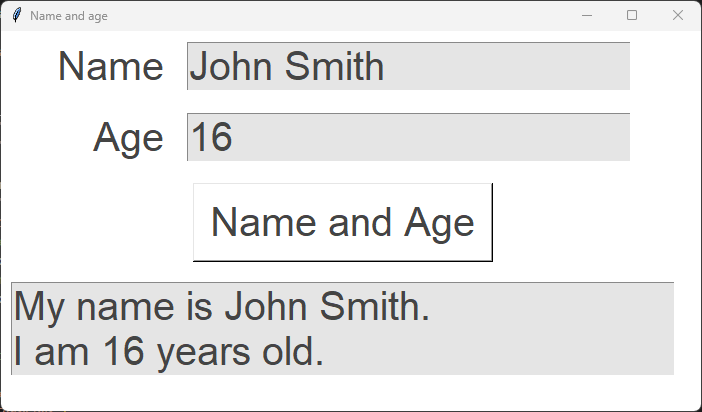
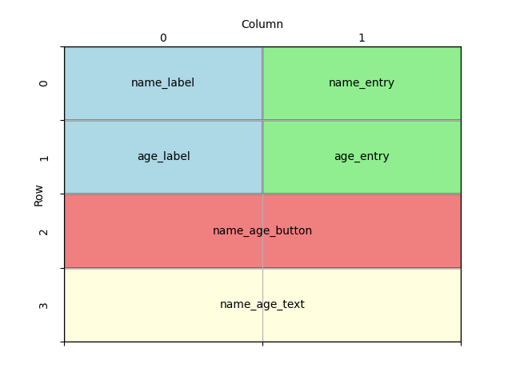

====================================================
Name and age
====================================================

| This code outputs the user name and age in sentence form.
| This code creates a simple GUI application using the Tkinter library.
| It displays a window with Label, Entry, Text and Button widgets

----

Code summary
-------------------

| Overall, this code sets up a simple GUI where users can input their name and age, click a button,
| and see the result displayed in a text widget.

----

Create the main window:
---------------------------------

    - ``root = tk.Tk()`` creates the main application root.
    - ``root.title("Name and age")`` sets the title of the window to "Name and age".
    - ``root.geometry('700x380')`` specifies the initial size of the window (700 pixels wide and 380 pixels tall).
    - ``root.configure(bg="#ffffff")`` sets the background color of the window to white.

    .. code-block:: python

        import tkinter as tk

        root = tk.Tk()
        root.title("Name and age")
        root.geometry("700x380")
        root.configure(bg="#ffffff")

        root.mainloop()

----

Create the widgets
------------------------------

- Define some constants for colors and font style for the GUI.

.. code-block:: python

    BG_COLOR = "#ffffff"
    FG_COLOR = "#444444"
    BG_TEXT_COLOR = "#e5e5e5"
    FONT_STYLE = ("Arial", 30)

Update the window colour using the constant:

.. code-block:: python

    root.configure(bg=BG_COLOR)

- Create several widgets (GUI elements) that will be displayed in the window:
- The Labels ``name_label`` and ``age_label`` display the text "Name" and "Age".
- The Entry fields ``name_entry`` and ``age_entry`` allow users to input their name and age.
- The "Name and Age" button ``name_age_button`` that later, will trigger the ``place_name_age`` function.
- A text widget ``name_age_text`` displays the resulting sentences with the name and age.

.. code-block:: python

    name_label = tk.Label(root, text="Name", bg=BG_COLOR, fg=FG_COLOR, font=FONT_STYLE)
    age_label = tk.Label(root, text="Age", bg=BG_COLOR, fg=FG_COLOR, font=FONT_STYLE)
    name_entry = tk.Entry(root, bg=BG_TEXT_COLOR, fg=FG_COLOR, font=FONT_STYLE)
    age_entry = tk.Entry(root, bg=BG_TEXT_COLOR, fg=FG_COLOR, font=FONT_STYLE)
    name_age_button = tk.Button(root, text="Name and Age", bg=BG_COLOR, fg=FG_COLOR,
                                font=FONT_STYLE)
    name_age_text = tk.Text(root, height=2, width=30, bg=BG_TEXT_COLOR, fg=FG_COLOR, font=FONT_STYLE)

Grid Placement of widgets on the window:
---------------------------------------------------

Design the grid positions:

- Use the `grid` method to place the widgets in rows and columns in the root.
- The `row` and `column` parameters determine the position of each widget.
- The labels and entry fields are placed in rows 0 and 1.
- The button and text widget are placed in row 2 and 3.
- The sticky='e' option specifies that the widget should stick to the east (right) side of its grid cell.
- This means that if the cell is larger than the widget, the widget will be right-aligned within the cell.

.. code-block:: python

    name_label.grid(row=0, column=0, sticky="e", padx=10, pady=10)
    name_entry.grid(row=0, column=1, sticky="w", padx=10, pady=10)
    age_label.grid(row=1, column=0, sticky="e", padx=10, pady=10)
    age_entry.grid(row=1, column=1, sticky="w", padx=10, pady=10)
    name_age_button.grid(row=2, column=0, columnspan=2, padx=10, pady=10)
    name_age_text.grid(row=3, column=0, columnspan=2, padx=10, pady=10)

----

Define the place_name_age function:
-------------------------------------------------

- This function is called when the "Name and Age" button is clicked.
- It retrieves the values entered in the name and age entry fields.
- ``name = name_entry.get()`` uses the ``get()`` method to get the text value of the Entry widget.
- If no name is entered, it defaults to "John Smith". If no age is entered, it defaults to "16".
- It clears the existing text in the ``name_age_text`` widget.
- The delete method of a Text widget requires the line.column as the first argument.
- e.g. line 1, character 0 using ``1.0`` in ``name_age_text.delete(1.0, 'end')``.
- ``tk.END`` or ``'end'`` can be used as the second argument to cause the deletion to go to the end of the widget.
- It inserts a formatted string (f-string) into the ``name_age_text`` widget, displaying the name and age.
- The insert method of a Text widget requires the line.column as the first argument.
- e.g. ``1.0`` in ``name_age_text.insert(1.0, 'new text')``.
- ``f'My name is {name}. \nI am {age} years old.'`` uses ``\n`` for a line break so the 2 sentences are on two lines.

.. code-block:: python

    def place_name_age():
        name = name_entry.get()
        # use a default name if no name is given
        if name == "":
            name = "John Smith"
        # get age
        age = age_entry.get()
        # use a default age if no age is given
        if age == "":
            age = "16"
        name_age_text.delete(1.0, "end")
        name_age_text.insert(1.0, f"My name is {name}. \nI am {age} years old.")

----

Connect the button to the function:
-------------------------------------

The button and the function both exist, but they are not connected.
Add command=place_name_age to the button:

.. code-block:: python

    name_age_button = tk.Button(root, text="Name and Age", bg=BG_COLOR,
                            fg=FG_COLOR, font=FONT_STYLE,
                            command=place_name_age)

----

Full code
------------

.. code-block:: python

    import tkinter as tk

    # Constants
    BG_COLOR = "#FFFFFF"
    FG_COLOR = "#444444"
    BG_TEXT_COLOR = "#e5e5e5"
    FONT_STYLE = ("Arial", 30)

    def place_name_age():
        """
        Retrieves the name and age from the respective entry widgets and displays them
        in a formatted message within the text widget. If no name or age is provided,
        default values are used.

        The function performs the following steps:
        1. Retrieves the name from the name_entry widget. If empty, defaults to "John Smith".
        2. Retrieves the age from the age_entry widget. If empty, defaults to "16".
        3. Clears the content of the name_age_text widget.
        4. Inserts a formatted message into the name_age_text widget, displaying the name and age.

        Example output:
        "My name is John Smith.
        I am 16 years old."
        """
        # get name
        name = name_entry.get()
        # use a default name if no name is given
        if name == "":
            name = "John Smith"
        # get age
        age = age_entry.get()
        # use a default age if no age is given
        if age == "":
            age = "16"
        # clear name_age_text 1.0 represents line.column or line 1 character 0, tk.END or 'end' can be used.
        name_age_text.delete(1.0, "end")
        # insert name age using f string, \n is a line break;
        name_age_text.insert(1.0, f"My name is {name}. \nI am {age} years old.")

    # Create the main window
    root = tk.Tk()
    root.title("Name and age")
    root.geometry("700x380")
    root.configure(bg=BG_COLOR)

    #  create widgets
    name_label = tk.Label(root, text="Name", bg=BG_COLOR, fg=FG_COLOR, font=FONT_STYLE)
    age_label = tk.Label(root, text="Age", bg=BG_COLOR, fg=FG_COLOR, font=FONT_STYLE)
    name_entry = tk.Entry(root, bg=BG_TEXT_COLOR, fg=FG_COLOR, font=FONT_STYLE)
    age_entry = tk.Entry(root, bg=BG_TEXT_COLOR, fg=FG_COLOR, font=FONT_STYLE)
    name_age_button = tk.Button(root, text="Name and Age", bg=BG_COLOR,
                                fg=FG_COLOR, font=FONT_STYLE, command=place_name_age)
    # Text widget height=2 where height is in text rows.
    name_age_text = tk.Text(root, height=2, width=30, bg=BG_TEXT_COLOR, fg=FG_COLOR, font=FONT_STYLE)

    # place widgets on window
    name_label.grid(row=0, column=0, sticky="e", padx=10, pady=10)
    name_entry.grid(row=0, column=1, sticky="w", padx=10, pady=10)
    age_label.grid(row=1, column=0, sticky="e", padx=10, pady=10)
    age_entry.grid(row=1, column=1, sticky="w", padx=10, pady=10)
    name_age_button.grid(row=2, column=0, columnspan=2, padx=10, pady=10)
    name_age_text.grid(row=3, column=0, columnspan=2, padx=10, pady=10)

    # Start the main event loop
    root.mainloop()

----

Test Table
------------------------------------

| What user inputs should be tested?
| What user inputs would be regarded as invalid, yet still result in text being displayed?
| Where in the code would it be best to make changes in order to indicate to the user that that have not made a valid entry.

----

Name and Age - Multiple Choice Quiz
----------------------------------------

.. mcqgroup::
    :nav_position: both
    :show-instant-feedback:
    :enable-instant-feedback:
    :shuffle_questions:
    :num_questions: 5

    .. multichoice::

        Which method gets the text that the user typed into name_entry?

        [ ] name_entry.read() | Incorrect. Entry widgets do not have a read() method.
        [x] name_entry.get() | Correct. get() returns the contents of the Entry widget as a string.
        [ ] name_entry.text() | Incorrect. Entry widgets do not have a text() method.
        [ ] name_entry.input() | Incorrect. input() is used in the shell, not with Entry widgets.

    .. multichoice::

        What is displayed if the Name box is left empty, 15 is typed in the Age box and the button is clicked?

        [x] My name is John Smith. I am 15 years old. | Correct. An empty name is replaced by the default "John Smith", and the typed age of 15 is used.
        [ ] My name is . I am 15 years old. | Incorrect. The if statement replaces an empty name with "John Smith".
        [ ] My name is John Smith. I am 16 years old. | Incorrect. The default age of 16 is only used when the Age box is empty.
        [ ] Nothing is displayed. | Incorrect. The function always inserts a message into name_age_text.

    .. multichoice::

        What does \n do in f"My name is {name}. \nI am {age} years old."?

        [ ] It inserts the letter n | Incorrect. The backslash makes \n a special escape sequence.
        [ ] It adds a tab space | Incorrect. \t is the escape sequence for a tab.
        [x] It starts a new line | Correct. \n is the newline character, so the second sentence appears on a new line.
        [ ] It ends the program | Incorrect. \n only affects how the text is displayed.

    .. multichoice::

        Which line correctly checks whether the user left the Name box empty?

        [ ] if name = "": | Incorrect. A single = assigns a value; it causes a SyntaxError in an if statement.
        [x] if name == "": | Correct. == compares name with an empty string "".
        [ ] if name == " ": | Incorrect. " " contains a space, so it is not an empty string.
        [ ] if name is empty: | Incorrect. empty is not a Python keyword or value.

    .. multichoice::

        Why does name_age_text use height=2?

        [ ] It makes the text twice as big | Incorrect. Font size is set by FONT_STYLE.
        [x] The message has two sentences on two lines | Correct. A Text widget's height is measured in lines of text, and \n puts the second sentence on line 2.
        [ ] It sets the height to 2 pixels | Incorrect. Text widget height is measured in lines, not pixels.
        [ ] It allows only two characters | Incorrect. width sets the number of characters per line.

    .. multichoice::

        Which widgets use columnspan=2 in the grid layout?

        [ ] name_label and age_label | Incorrect. The labels sit in column 0 only.
        [ ] name_entry and age_entry | Incorrect. The Entry boxes sit in column 1 only.
        [x] name_age_button and name_age_text | Correct. The button (row 2) and the text box (row 3) stretch across both columns.
        [ ] All of the widgets | Incorrect. Only the button and the text box span two columns.

    .. multichoice::

        What data type does age_entry.get() return?

        [ ] int | Incorrect. get() never converts the input to a whole number.
        [ ] float | Incorrect. get() never converts the input to a decimal number.
        [x] str | Correct. Text typed into an Entry widget is always returned as a string.
        [ ] bool | Incorrect. get() returns the text that was typed, not True or False.

    .. multichoice::

        What is displayed if the user types Sam for the name and abc for the age?

        [ ] Invalid input. | Incorrect. The code does not check whether the age is a number.
        [ ] The program crashes with a ValueError | Incorrect. The age is never converted to a number, so no ValueError occurs.
        [ ] My name is Sam. I am 16 years old. | Incorrect. The default age is only used when the Age box is empty.
        [x] My name is Sam. I am abc years old. | Correct. The age is used as text, so any input is accepted, even invalid input.

    .. multichoice::

        Where is age_entry placed in the grid?

        [ ] row=0, column=1 | Incorrect. That position holds name_entry.
        [x] row=1, column=1 | Correct. age_entry is in the second row, in the right-hand column.
        [ ] row=1, column=0 | Incorrect. That position holds age_label.
        [ ] row=2, column=1 | Incorrect. Row 2 holds the button, which spans both columns.

    .. multichoice::

        Why is name_age_text.delete(1.0, "end") called before insert()?

        [ ] To close the window | Incorrect. delete() only removes text from the widget.
        [ ] To delete the Name and Age entries | Incorrect. It only clears the name_age_text widget.
        [x] To clear the previous message so new messages do not pile up | Correct. delete() removes everything from line 1, character 0 to the end before the new message is inserted.
        [ ] To check the age is a number | Incorrect. delete() does not check the input.

----

Name and Age - Cloze Code Quiz
-----------------------------------

.. clozegroup::
    :nav-position: both
    :num-questions: 3
    :show-instant-feedback:

    .. cloze::
        :instructions: Complete the code to create the main window and set its size.

        import tkinter as tk

        root = tk.@@Tk | Window | App@@()
        root.title("Name and age")
        root.@@geometry | size | dimensions@@("700x380")

        root.mainloop()

    .. cloze::
        :instructions: Choose the correct widget type for the Name input box and the setting that shows two lines in the output box.

        name_label = tk.Label(root, text="Name", bg=BG_COLOR, fg=FG_COLOR, font=FONT_STYLE)
        name_entry = tk.@@Entry | Label | Text@@(root, bg=BG_TEXT_COLOR, fg=FG_COLOR, font=FONT_STYLE)
        name_age_text = tk.Text(root, @@height=2 | lines=2 | rows=2@@, width=30, bg=BG_TEXT_COLOR, fg=FG_COLOR, font=FONT_STYLE)

    .. cloze::
        :instructions: Complete the grid placement for the Age label and the output text box.

        name_label.grid(row=0, column=0, sticky="e", padx=10, pady=10)
        name_entry.grid(row=0, column=1, sticky="w", padx=10, pady=10)
        age_label.grid(row=@@1 | 0 | 2@@, column=0, sticky="e", padx=10, pady=10)
        age_entry.grid(row=1, column=1, sticky="w", padx=10, pady=10)
        name_age_text.grid(row=3, column=0, @@columnspan=2 | colspan=2 | span=2@@, padx=10, pady=10)

    .. cloze::
        :instructions: Complete the code that reads the name and uses a default name if the box is empty.

        def place_name_age():
            name = name_entry.@@get() | read() | text()@@
            if name @@== | = | !=@@ "":
                name = "John Smith"

    .. cloze::
        :instructions: Clear the output box, put the second sentence on a new line and connect the button to the function.

        name_age_text.@@delete | clear | remove@@(1.0, "end")
        name_age_text.insert(1.0, f"My name is {name}. @@\n | \t | /n@@I am {age} years old.")

        name_age_button = tk.Button(root, text="Name and Age", @@command=place_name_age | command=place_name_age() | onClick=place_name_age@@)
