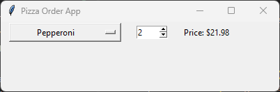
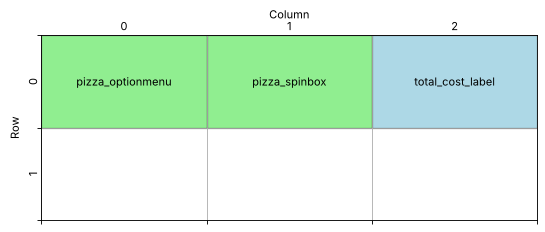

====================================================
Pizza cost
====================================================

| This code works out the cost of a pizza order.
| It displays a window with an OptionMenu, a Spinbox and a Label.
| Users choose a pizza from the drop-down menu, choose how many with the Spinbox arrows, and see the price straight away.
| There is no button: the price updates whenever the pizza or the number changes.

----

How the program is put together
---------------------------------------

The program is built in this order:

#. **Import** ``tkinter``.
#. **Data**: a dictionary that stores each pizza's name and price.
#. **Function**: ``calculate_total_cost()`` works out and displays the price.
#. **Main window**: create ``root`` and set its title and size.
#. **Widgets**: create each widget and place it with ``grid()`` straight away.

   - ``pizza_optionmenu`` with its ``pizza_var`` to choose the pizza.
   - ``pizza_spinbox`` to choose the number of pizzas.
   - ``total_cost_label`` to show the price.

#. **Event loop**: ``root.mainloop()``.

| The function is defined **before** the widgets, but it uses ``pizza_var``, ``pizza_spinbox`` and ``total_cost_label``.
| This works because the function only **runs** when the user changes the pizza or the number, and by then the widgets exist.

----

Store the pizza prices in a dictionary
---------------------------------------------

| A **dictionary** stores pairs of **keys** and **values**. Here each key is a pizza name and each value is its price.
| ``pizza_prices["Supreme"]`` gives ``11.99``.
| ``pizza_prices.keys()`` gives all the pizza names. These are used to fill the drop-down menu.
| Keeping the prices in one place means you only change the dictionary to add a pizza or change a price.

.. code-block:: python

    import tkinter as tk

    # Dictionary of pizza names and costs
    pizza_prices = {
        "Margherita": 8.99,
        "Pepperoni": 10.99,
        "Vegetarian": 9.49,
        "Supreme": 11.99,
    }

----

Create the main window
--------------------------------

.. code-block:: python

    root = tk.Tk()
    root.title("Pizza Order App")
    root.geometry("400x100")

    root.mainloop()

| The window is only 100 pixels tall because all the widgets sit in a single row.

----

Choose a pizza: StringVar and OptionMenu
------------------------------------------------

.. code-block:: python

    # Pizza selection
    pizza_var = tk.StringVar(root)
    pizza_var.set("Margherita")  # Default pizza
    pizza_optionmenu = tk.OptionMenu(root,
                                     pizza_var,
                                     *pizza_prices.keys(),
                                     command=calculate_total_cost)
    pizza_optionmenu.config(width=20)
    pizza_optionmenu.grid(row=0, column=0, padx=10)

- ``tk.StringVar(root)`` creates a special Tkinter variable that holds text. The OptionMenu stores the chosen pizza in it.
- ``pizza_var.set("Margherita")`` sets the pizza shown when the app starts. ``pizza_var.get()`` reads the current choice.
- ``tk.OptionMenu`` creates a drop-down menu. Its arguments are:

  - ``root``: the parent window.
  - ``pizza_var``: the variable that stores the choice.
  - ``*pizza_prices.keys()``: the menu options. The ``*`` **unpacks** the keys so each pizza name becomes a separate option.
  - ``command=calculate_total_cost``: the function to run when a pizza is chosen. The OptionMenu passes the chosen pizza to the function as an argument.

- The long call is split over several lines inside the brackets to make it easier to read.
- ``pizza_optionmenu.config(width=20)`` makes the menu 20 characters wide, so it does not change size when a longer name is chosen.

----

Choose the number of pizzas: Spinbox
---------------------------------------------

.. code-block:: python

    # Number of pizzas
    pizza_spinbox = tk.Spinbox(root, from_=1, to=10, width=5, command=calculate_total_cost)
    pizza_spinbox.grid(row=0, column=1, padx=10)
    pizza_spinbox.delete(0, "end")  # Clear the default value
    pizza_spinbox.insert(0, "0")  # Set initial value to 1

- A **Spinbox** is a box with up and down arrows for choosing a number.
- ``from_=1, to=10`` sets the range for the arrows. ``from`` is a Python keyword, so Tkinter uses ``from_``.
- ``width=5`` makes the box 5 characters wide.
- ``command=calculate_total_cost`` runs the function each time an arrow is clicked. The Spinbox does **not** pass any arguments.
- A Spinbox starts by showing its ``from_`` value. ``delete(0, "end")`` clears it and ``insert(0, "0")`` puts ``0`` in the box, so the price starts at $0.00.
- A Spinbox has one line, so it uses ``0`` for the start position, like an Entry box, not ``1.0`` like a Text box.

----

Show the price: Label
-----------------------------

.. code-block:: python

    # Total cost label
    total_cost_label = tk.Label(root, text="Price: $0.00")
    total_cost_label.grid(row=0, column=2, padx=10)

| The label starts at ``$0.00`` to match the ``0`` in the Spinbox.

Design the grid positions:

| All three widgets are in row 0, in columns 0, 1 and 2.
| ``padx=10`` adds 10 pixels of space on the left and right of each widget.

----

Calculate the total cost
--------------------------------

.. code-block:: python

    def calculate_total_cost(*args):
        selected_pizza = pizza_var.get()
        num_pizzas = int(pizza_spinbox.get())
        pizza_cost = pizza_prices.get(selected_pizza, 0)
        total_cost = pizza_cost * num_pizzas
        total_cost_label.config(text=f"Price: ${total_cost:.2f}")

- ``*args`` lets the function accept any number of arguments. The OptionMenu sends one argument and the Spinbox sends none, so the same function works for both.
- ``pizza_var.get()`` gets the name of the chosen pizza.
- ``pizza_spinbox.get()`` returns the number as a **string**, so ``int()`` converts it to a whole number.
- ``pizza_prices.get(selected_pizza, 0)`` looks up the price. If the name is not in the dictionary it returns ``0`` instead of crashing.
- ``total_cost = pizza_cost * num_pizzas`` works out the price of the order.
- ``total_cost_label.config(text=...)`` changes the text of the label that already exists.
- ``f"Price: ${total_cost:.2f}"``: the ``$`` is just a dollar sign in the text, ``{total_cost:.2f}`` inserts the cost with 2 decimal places.

----

Key syntax
-----------------

.. py:function:: dictionary.get(key, default)

    | Syntax: ``pizza_prices.get(selected_pizza, 0)``
    | Description: Returns the value for ``key``. If the key is not in the dictionary, it returns ``default`` instead of causing a ``KeyError``.
    | Example: ``pizza_prices.get("Pepperoni", 0)  # 10.99``; ``pizza_prices.get("Hawaiian", 0)  # 0``

.. py:function:: def function_name(*args)

    | Syntax: ``def calculate_total_cost(*args):``
    | Description: The ``*`` lets the function accept **any number** of arguments. They are collected into a tuple called ``args``.
    | Why it is needed here: the OptionMenu calls the function with **one** argument (the pizza that was chosen), but the Spinbox calls it with **no** arguments. ``*args`` lets the same function work for both. The function never uses ``args`` itself.

.. py:function:: *iterable

    | Syntax: ``tk.OptionMenu(root, pizza_var, *pizza_prices.keys(), command=calculate_total_cost)``
    | Description: A ``*`` in front of a list or other iterable **unpacks** it, so each item is passed as a separate argument.
    | Example: ``*pizza_prices.keys()`` is the same as typing ``"Margherita", "Pepperoni", "Vegetarian", "Supreme"``.

.. py:function:: tk.Spinbox(master, from_=1, to=10)

    | Syntax: ``tk.Spinbox(root, from_=1, to=10, width=5, command=calculate_total_cost)``
    | Description: A box holding a number, with up and down arrows to change it between ``from_`` and ``to``.
    | Note: ``from`` is a Python keyword (as in ``from tkinter import messagebox``), so Tkinter uses ``from_`` with an underscore instead.

.. py:function:: widget.config(option=value)

    | Syntax: ``total_cost_label.config(text=f"Price: ${total_cost:.2f}")``
    | Description: Changes an option of a widget that already exists, such as its ``text`` or ``width``.

----

Full code
------------

.. code-block:: python

    import tkinter as tk

    # Dictionary of pizza names and costs
    pizza_prices = {
        "Margherita": 8.99,
        "Pepperoni": 10.99,
        "Vegetarian": 9.49,
        "Supreme": 11.99,
    }

    def calculate_total_cost(*args):
        selected_pizza = pizza_var.get()
        num_pizzas = int(pizza_spinbox.get())
        pizza_cost = pizza_prices.get(selected_pizza, 0)
        total_cost = pizza_cost * num_pizzas
        total_cost_label.config(text=f"Price: ${total_cost:.2f}")

    root = tk.Tk()
    root.title("Pizza Order App")
    root.geometry("400x100")

    # Pizza selection
    pizza_var = tk.StringVar(root)
    pizza_var.set("Margherita")  # Default pizza
    pizza_optionmenu = tk.OptionMenu(root,
                                     pizza_var,
                                     *pizza_prices.keys(),
                                     command=calculate_total_cost)
    pizza_optionmenu.config(width=20)
    pizza_optionmenu.grid(row=0, column=0, padx=10)

    # Number of pizzas
    pizza_spinbox = tk.Spinbox(root, from_=1, to=10, width=5, command=calculate_total_cost)
    pizza_spinbox.grid(row=0, column=1, padx=10)
    pizza_spinbox.delete(0, "end")  # Clear the default value
    pizza_spinbox.insert(0, "0")  # Set initial value to 1

    # Total cost label
    total_cost_label = tk.Label(root, text="Price: $0.00")
    total_cost_label.grid(row=0, column=2, padx=10)

    root.mainloop()

----

Pizza cost test table
---------------------------

.. list-table:: Test Cases for the Pizza Cost App
   :header-rows: 1
   :widths: 20 15 20

   * - **Pizza**
     - **Number**
     - **Expected price**
   * - Margherita (when the app starts)
     - 0
     - $0.00
   * - Margherita
     - 2
     - $17.98
   * - Pepperoni
     - 3
     - $32.97
   * - Vegetarian
     - 1
     - $9.49
   * - Supreme
     - 10
     - $119.90

| The price only updates when the pizza or the arrows are changed. Typing a number into the Spinbox does not run the function.
| If the Spinbox contains text that is not a whole number, ``int()`` raises a ``ValueError`` and the price does not update.

.. admonition:: Tasks

    #. Add a ``try`` / ``except ValueError`` block so the label shows "Invalid number." if the Spinbox does not contain a whole number.
    #. Add a fifth pizza to the dictionary. Which other lines of code need to change?

----

Pizza Cost - Multiple Choice Quiz
---------------------------------------

.. mcqgroup::
    :nav_position: both
    :show-instant-feedback:
    :enable-instant-feedback:
    :shuffle_questions:
    :num_questions: 5

    .. multichoice::

        What does pizza_prices.get("Supreme", 0) return?

        [ ] 0 | Incorrect. 0 is only returned if the key is not in the dictionary.
        [x] 11.99 | Correct. get() returns the value stored for the key "Supreme".
        [ ] "Supreme" | Incorrect. get() returns the value, not the key.
        [ ] A KeyError | Incorrect. get() returns the default instead of raising a KeyError.

    .. multichoice::

        What does pizza_prices.get("Hawaiian", 0) return?

        [x] 0 | Correct. "Hawaiian" is not a key, so get() returns the default value 0.
        [ ] None | Incorrect. A default of 0 was given, so 0 is returned.
        [ ] A KeyError | Incorrect. pizza_prices["Hawaiian"] would raise a KeyError, but get() does not.
        [ ] 11.99 | Incorrect. Only "Supreme" costs 11.99.

    .. multichoice::

        Why does calculate_total_cost have *args in its definition?

        [ ] To make the function run faster | Incorrect. *args is about the number of arguments, not speed.
        [x] The OptionMenu passes one argument and the Spinbox passes none, so the function must accept any number | Correct. *args collects however many arguments are passed.
        [ ] To multiply the arguments together | Incorrect. The * is not multiplication here.
        [ ] Because every function needs *args | Incorrect. Most functions do not use *args.

    .. multichoice::

        What does the * do in *pizza_prices.keys()?

        [ ] Multiplies the prices | Incorrect. Here * is used for unpacking, not multiplication.
        [x] Unpacks the pizza names so each one is a separate option in the menu | Correct. It is the same as typing each name as a separate argument.
        [ ] Selects all the prices | Incorrect. keys() gives the names, not the prices.
        [ ] Makes the names bold | Incorrect. * does not change how the text looks.

    .. multichoice::

        Why does tk.Spinbox use from_ with an underscore?

        [ ] It is a spelling mistake | Incorrect. It is deliberate.
        [x] from is a Python keyword, so it cannot be used as an argument name | Correct. from is used in statements like from tkinter import messagebox.
        [ ] The underscore makes the number negative | Incorrect. The underscore is just part of the name.
        [ ] It means the value is optional | Incorrect. The underscore is only there to avoid the keyword.

    .. multichoice::

        Why is int() used on pizza_spinbox.get()?

        [ ] To round the price | Incorrect. The price is formatted with :.2f.
        [x] get() returns a string, which must be converted to a whole number before multiplying | Correct. A Spinbox stores its value as text.
        [ ] To stop the user choosing more than 10 | Incorrect. to=10 limits the arrows.
        [ ] To clear the Spinbox | Incorrect. delete() clears it.

    .. multichoice::

        What is shown if Pepperoni is chosen and the Spinbox shows 3?

        [ ] Price: $10.99 | Incorrect. This is the price of one Pepperoni pizza.
        [x] Price: $32.97 | Correct. 10.99 * 3 = 32.97.
        [ ] Price: $32.970 | Incorrect. :.2f shows exactly 2 decimal places.
        [ ] Price: $13.99 | Incorrect. The price is multiplied by 3, not increased by 3.

    .. multichoice::

        What does total_cost_label.config(text=...) do?

        [ ] Creates a new label | Incorrect. config() changes a widget that already exists.
        [x] Changes the text of the existing label | Correct. config() updates a widget's options.
        [ ] Deletes the label | Incorrect. destroy() would remove it.
        [ ] Moves the label to a new row | Incorrect. grid() sets the position.

    .. multichoice::

        What does pizza_var.set("Margherita") do?

        [x] Makes Margherita the pizza shown when the app starts | Correct. The OptionMenu displays the value stored in pizza_var.
        [ ] Adds Margherita to the dictionary | Incorrect. The dictionary is not changed.
        [ ] Sets the price of Margherita | Incorrect. Prices are stored in pizza_prices.
        [ ] Removes the other pizzas from the menu | Incorrect. All the pizzas stay in the menu.

    .. multichoice::

        Why does the price not change when the user types a number into the Spinbox?

        [ ] Spinboxes do not allow typing | Incorrect. You can type into a Spinbox.
        [ ] The dictionary is read-only | Incorrect. The dictionary has nothing to do with it.
        [x] The command only runs when an arrow is clicked, not when text is typed | Correct. Typing does not call calculate_total_cost.
        [ ] The label can only be changed once | Incorrect. config() can change it any number of times.

----

Pizza Cost - Cloze Code Quiz
----------------------------------

.. clozegroup::
    :nav-position: both
    :num-questions: 3
    :show-instant-feedback:

    .. cloze::
        :instructions: Complete the dictionary and look up the price of the chosen pizza.

        pizza_prices = @@{ | [ | (@@
            "Margherita": 8.99,
            "Pepperoni": 10.99,
        }

        pizza_cost = pizza_prices.@@get | find | value@@(selected_pizza, 0)

    .. cloze::
        :instructions: Let the function accept any number of arguments and convert the Spinbox value to a whole number.

        def calculate_total_cost(@@*args | args | *@@):
            selected_pizza = pizza_var.get()
            num_pizzas = @@int | str | float@@(pizza_spinbox.get())

    .. cloze::
        :instructions: Create the variable that stores the chosen pizza and fill the menu with the pizza names.

        pizza_var = tk.@@StringVar | IntVar | BooleanVar@@(root)
        pizza_var.set("Margherita")
        pizza_optionmenu = tk.OptionMenu(root,
                                         pizza_var,
                                         @@*pizza_prices.keys() | pizza_prices.keys() | *pizza_prices.values()@@,
                                         command=calculate_total_cost)

    .. cloze::
        :instructions: Set the range of the Spinbox and start it at 0.

        pizza_spinbox = tk.Spinbox(root, @@from_ | from | start@@=1, to=10, width=5, command=calculate_total_cost)
        pizza_spinbox.delete(0, "end")
        pizza_spinbox.@@insert | set | config@@(0, "0")

    .. cloze::
        :instructions: Update the label to show the price with 2 decimal places.

        total_cost = pizza_cost * num_pizzas
        total_cost_label.@@config | update | set@@(text=f"Price: ${total_cost:@@.2f | 2f | .2d@@}")
