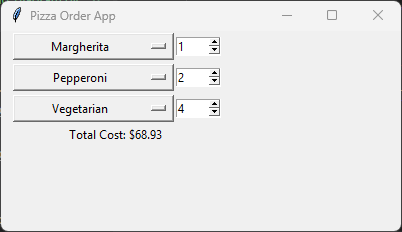
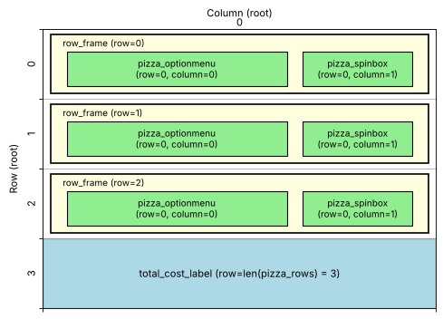

====================================================
Pizza cost: three pizzas
====================================================



| This code works out the total cost of an order of up to three kinds of pizza.
| It builds on the single pizza app: each row has an OptionMenu and a Spinbox, and one Label shows the total.
| Instead of writing the code for each row three times, a ``for`` loop creates the rows.
| The total updates whenever any pizza or number is changed.

----

How the program is put together
---------------------------------------

The program is built in this order:

#. **Import** ``tkinter``.
#. **Data**: a dictionary that stores each pizza's name and price.
#. **Function**: ``calculate_total_cost()`` loops through every row and adds up the total.
#. **Main window**: create ``root`` and set its title and size.
#. **Rows**: a ``for`` loop creates three rows. Each row has:

   - a ``row_frame`` to hold the row's widgets.
   - a ``pizza_var`` and ``pizza_optionmenu`` to choose the pizza.
   - a ``pizza_spinbox`` to choose the number.
   - a small dictionary, added to the ``pizza_rows`` list, so the function can find the row's widgets later.

#. **Total**: ``total_cost_label`` shows the total cost below the rows.
#. **Event loop**: ``root.mainloop()``.

| The function is defined **before** the rows are created, but it uses ``pizza_rows`` and ``total_cost_label``.
| This works because the function only **runs** when the user changes a pizza or a number, and by then everything exists.

----

Store the pizza prices in a dictionary
---------------------------------------------

| This is the same dictionary as in the single pizza app.
| ``pizza_prices.keys()`` gives all the pizza names, which fill each drop-down menu.

.. code-block:: python

    import tkinter as tk

    # Dictionary of pizza names and costs
    pizza_prices = {
        "Margherita": 8.99,
        "Pepperoni": 10.99,
        "Vegetarian": 9.49,
        "Supreme": 11.99,
    }

----

Create the main window
--------------------------------

.. code-block:: python

    root = tk.Tk()
    root.title("Pizza Order App")
    root.geometry("400x200")

    root.mainloop()

| The window is 200 pixels tall to fit three rows and the total.

----

Create the rows with a loop
----------------------------------

.. code-block:: python

    # Create three rows of pizza selection
    pizza_rows = []
    for i, pizza_name in enumerate(["Margherita", "Pepperoni", "Vegetarian"]):
        row_frame = tk.Frame(root)
        row_frame.grid(row=i, column=0, padx=10)

        pizza_var = tk.StringVar(row_frame)
        pizza_var.set(pizza_name)  # Default pizza
        pizza_optionmenu = tk.OptionMenu(row_frame,
                                         pizza_var,
                                         *pizza_prices.keys(),
                                         command=calculate_total_cost)
        pizza_optionmenu.config(width=20)
        pizza_optionmenu.grid(row=0, column=0)

        pizza_spinbox = tk.Spinbox(row_frame,
                                   from_=1,
                                   to=10,
                                   width=5,
                                   command=calculate_total_cost)
        pizza_spinbox.grid(row=0, column=1)
        pizza_spinbox.delete(0, "end")  # Clear the default value
        pizza_spinbox.insert(0, "0")  # Set initial value to 1

        pizza_rows.append({"var": pizza_var, "spinbox": pizza_spinbox})

The loop
```````````

- ``pizza_rows = []`` creates an empty list before the loop. Each row will be added to it.
- ``enumerate([...])`` gives a counter ``i`` and a value ``pizza_name`` each time round the loop:

  - 1st time: ``i = 0``, ``pizza_name = "Margherita"``
  - 2nd time: ``i = 1``, ``pizza_name = "Pepperoni"``
  - 3rd time: ``i = 2``, ``pizza_name = "Vegetarian"``

- ``i`` is used as the row number, so the rows are placed one under another.
- ``pizza_name`` is used as the starting pizza for that row.

A frame for each row
```````````````````````````

- ``row_frame = tk.Frame(root)`` creates an invisible container for the row, placed in row ``i`` of the window.
- The OptionMenu and Spinbox are created **inside** the frame (``row_frame`` is their parent).
- Each frame has **its own grid**. That is why every OptionMenu is at ``row=0, column=0`` and every Spinbox is at ``row=0, column=1``: those positions are inside their own frame, not in the window.

The widgets
`````````````````

- These work the same way as in the single pizza app:

  - ``tk.StringVar`` stores the chosen pizza, and ``set(pizza_name)`` sets the starting pizza.
  - ``*pizza_prices.keys()`` unpacks the pizza names into the menu options.
  - ``from_=1, to=10`` sets the range of the Spinbox, and ``delete`` / ``insert`` start it at ``0``.

- Every OptionMenu and Spinbox uses ``command=calculate_total_cost``, so changing any row updates the total.

Remembering the widgets
`````````````````````````````

- Each time round the loop, the names ``pizza_var`` and ``pizza_spinbox`` are **reused** for the new row. After the loop they only refer to the last row.
- ``pizza_rows.append({"var": pizza_var, "spinbox": pizza_spinbox})`` stores each row's widgets in a dictionary and adds it to the list before they are replaced.
- After the loop, ``pizza_rows`` holds three dictionaries, one for each row:

.. code-block:: text

    [{"var": <Margherita row variable>, "spinbox": <Margherita row Spinbox>},
     {"var": <Pepperoni row variable>, "spinbox": <Pepperoni row Spinbox>},
     {"var": <Vegetarian row variable>, "spinbox": <Vegetarian row Spinbox>}]

----

Show the total: Label
-----------------------------

.. code-block:: python

    # Total cost label
    total_cost_label = tk.Label(root, text="Total Cost: $0.00")
    total_cost_label.grid(row=len(pizza_rows), column=0, padx=10)

| ``len(pizza_rows)`` is ``3``, so the label goes in row 3, directly under the three rows.
| If the loop made more rows, the label would still go underneath them without changing this line.

Design the grid positions:



----

Calculate the total cost
--------------------------------

.. code-block:: python

    def calculate_total_cost(*args):
        total_cost = 0
        for pizza_row in pizza_rows:
            selected_pizza = pizza_row["var"].get()
            num_pizzas = int(pizza_row["spinbox"].get())
            pizza_cost = pizza_prices.get(selected_pizza, 0)
            total_cost += pizza_cost * num_pizzas
        total_cost_label.config(text=f"Total Cost: ${total_cost:.2f}")

- ``*args`` lets the function accept any number of arguments. The OptionMenus send one argument and the Spinboxes send none.
- ``total_cost = 0`` starts the running total at zero.
- ``for pizza_row in pizza_rows:`` visits each row's dictionary in turn.
- ``pizza_row["var"].get()`` gets the pizza chosen in that row. ``pizza_row["spinbox"].get()`` gets that row's number, which ``int()`` converts to a whole number.
- ``total_cost += pizza_cost * num_pizzas`` adds the cost of that row to the running total. ``+=`` is short for ``total_cost = total_cost + ...``.
- After the loop, ``config(text=...)`` shows the total with 2 decimal places.

----

Key syntax
-----------------

.. py:function:: enumerate(iterable, start=0)

    | Syntax: ``for i, pizza_name in enumerate(["Margherita", "Pepperoni", "Vegetarian"]):``
    | Description: Adds a counter to each item, so the loop gets both the position and the value.
    | Example: ``for i, name in enumerate(["a", "b"]): print(i, name)  # Outputs: 0 a, 1 b``

.. py:function:: list.append(item)

    | Syntax: ``pizza_rows.append({"var": pizza_var, "spinbox": pizza_spinbox})``
    | Description: Adds an item to the end of a list. Here each item is a dictionary.

.. py:function:: list_of_dictionaries[index][key]

    | Syntax: ``pizza_rows[0]["spinbox"]``
    | Description: Gets one dictionary from the list by its position, then one value from that dictionary by its key.
    | Example: ``pizza_rows[1]["var"].get()  # The pizza chosen in the 2nd row``

.. py:function:: total += value

    | Syntax: ``total_cost += pizza_cost * num_pizzas``
    | Description: Adds ``value`` to ``total`` and stores the result back in ``total``. Used to keep a running total in a loop.

.. py:function:: dictionary.get(key, default)

    | Syntax: ``pizza_prices.get(selected_pizza, 0)``
    | Description: Returns the value for ``key``. If the key is not in the dictionary, it returns ``default`` instead of causing a ``KeyError``.
    | Example: ``pizza_prices.get("Pepperoni", 0)  # 10.99``; ``pizza_prices.get("Hawaiian", 0)  # 0``

.. py:function:: def function_name(*args)

    | Syntax: ``def calculate_total_cost(*args):``
    | Description: The ``*`` lets the function accept **any number** of arguments. They are collected into a tuple called ``args``.
    | Why it is needed here: the OptionMenu calls the function with **one** argument (the pizza that was chosen), but the Spinbox calls it with **no** arguments. ``*args`` lets the same function work for both. The function never uses ``args`` itself.

.. py:function:: *iterable

    | Syntax: ``tk.OptionMenu(root, pizza_var, *pizza_prices.keys(), command=calculate_total_cost)``
    | Description: A ``*`` in front of a list or other iterable **unpacks** it, so each item is passed as a separate argument.
    | Example: ``*pizza_prices.keys()`` is the same as typing ``"Margherita", "Pepperoni", "Vegetarian", "Supreme"``.

.. py:function:: tk.Spinbox(master, from_=1, to=10)

    | Syntax: ``tk.Spinbox(root, from_=1, to=10, width=5, command=calculate_total_cost)``
    | Description: A box holding a number, with up and down arrows to change it between ``from_`` and ``to``.
    | Note: ``from`` is a Python keyword (as in ``from tkinter import messagebox``), so Tkinter uses ``from_`` with an underscore instead.

.. py:function:: widget.config(option=value)

    | Syntax: ``total_cost_label.config(text=f"Price: ${total_cost:.2f}")``
    | Description: Changes an option of a widget that already exists, such as its ``text`` or ``width``.

----

Full code
------------

.. code-block:: python

    import tkinter as tk

    # Dictionary of pizza names and costs
    pizza_prices = {
        "Margherita": 8.99,
        "Pepperoni": 10.99,
        "Vegetarian": 9.49,
        "Supreme": 11.99,
    }

    def calculate_total_cost(*args):
        total_cost = 0
        for pizza_row in pizza_rows:
            selected_pizza = pizza_row["var"].get()
            num_pizzas = int(pizza_row["spinbox"].get())
            pizza_cost = pizza_prices.get(selected_pizza, 0)
            total_cost += pizza_cost * num_pizzas
        total_cost_label.config(text=f"Total Cost: ${total_cost:.2f}")

    root = tk.Tk()
    root.title("Pizza Order App")
    root.geometry("400x200")

    # Create three rows of pizza selection
    pizza_rows = []
    for i, pizza_name in enumerate(["Margherita", "Pepperoni", "Vegetarian"]):
        row_frame = tk.Frame(root)
        row_frame.grid(row=i, column=0, padx=10)

        pizza_var = tk.StringVar(row_frame)
        pizza_var.set(pizza_name)  # Default pizza
        pizza_optionmenu = tk.OptionMenu(row_frame,
                                         pizza_var,
                                         *pizza_prices.keys(),
                                         command=calculate_total_cost)
        pizza_optionmenu.config(width=20)
        pizza_optionmenu.grid(row=0, column=0)

        pizza_spinbox = tk.Spinbox(row_frame,
                                   from_=1,
                                   to=10,
                                   width=5,
                                   command=calculate_total_cost)
        pizza_spinbox.grid(row=0, column=1)
        pizza_spinbox.delete(0, "end")  # Clear the default value
        pizza_spinbox.insert(0, "0")  # Set initial value to 1

        pizza_rows.append({"var": pizza_var, "spinbox": pizza_spinbox})

    # Total cost label
    total_cost_label = tk.Label(root, text="Total Cost: $0.00")
    total_cost_label.grid(row=len(pizza_rows), column=0, padx=10)

    root.mainloop()

----

Pizza cost test table
---------------------------

.. list-table:: Test Cases for the Three Pizza App
   :header-rows: 1
   :widths: 25 25 25 15

   * - **Row 1**
     - **Row 2**
     - **Row 3**
     - **Expected total**
   * - Margherita x 0
     - Pepperoni x 0
     - Vegetarian x 0
     - $0.00
   * - Margherita x 1
     - Pepperoni x 2
     - Vegetarian x 1
     - $40.46
   * - Supreme x 3
     - Supreme x 2
     - Margherita x 1
     - $68.94

| The total only updates when a pizza or an arrow is changed. Typing a number into a Spinbox does not run the function.
| If any Spinbox contains text that is not a whole number, ``int()`` raises a ``ValueError`` and the total does not update.

.. admonition:: Tasks

    #. Change the list in the ``for`` loop so the app has four rows. Which other lines need to change?
    #. Change the label so it also shows the total number of pizzas ordered.

----

Three Pizza Cost - Multiple Choice Quiz
---------------------------------------------

.. mcqgroup::
    :nav_position: both
    :show-instant-feedback:
    :enable-instant-feedback:
    :shuffle_questions:
    :num_questions: 5

    .. multichoice::

        What values do i and pizza_name have the second time round the loop?

        [ ] i = 2, pizza_name = "Pepperoni" | Incorrect. enumerate starts counting at 0.
        [x] i = 1, pizza_name = "Pepperoni" | Correct. The counter starts at 0, so the second item has i = 1.
        [ ] i = 1, pizza_name = "Margherita" | Incorrect. Margherita is the first item.
        [ ] i = 0, pizza_name = "Pepperoni" | Incorrect. i = 0 goes with the first item.

    .. multichoice::

        Why is every OptionMenu placed at row=0, column=0?

        [ ] So all the menus sit on top of each other | Incorrect. They appear in different rows of the window.
        [x] Each OptionMenu is inside its own row_frame, which has its own grid | Correct. The position is inside the frame; the frame itself is placed in row i of the window.
        [ ] Because grid() ignores the row number | Incorrect. grid() uses the row number.
        [ ] It is a mistake that hides two of the menus | Incorrect. All three menus are visible.

    .. multichoice::

        Why does each row's variable and Spinbox get added to pizza_rows?

        [x] The names pizza_var and pizza_spinbox are reused each time round the loop, so the list keeps every row | Correct. After the loop the names only refer to the last row.
        [ ] To make the widgets appear in the window | Incorrect. grid() makes them appear.
        [ ] To set the starting pizza | Incorrect. pizza_var.set() does that.
        [ ] Lists are required by Tkinter | Incorrect. The list is for the program's own use.

    .. multichoice::

        What does pizza_rows[2]["spinbox"] refer to?

        [ ] The second row's Spinbox | Incorrect. Lists start at index 0, so index 2 is the third row.
        [x] The third row's Spinbox | Correct. Index 2 is the third dictionary, and "spinbox" gets its Spinbox.
        [ ] The number 2 | Incorrect. It refers to a widget.
        [ ] The third pizza price | Incorrect. Prices are in pizza_prices.

    .. multichoice::

        What does total_cost += pizza_cost * num_pizzas do?

        [ ] Replaces the total with the cost of this row | Incorrect. That would be total_cost = pizza_cost * num_pizzas.
        [x] Adds the cost of this row to the running total | Correct. += adds to the value already stored.
        [ ] Multiplies the total by the number of pizzas | Incorrect. The row's cost is added, not multiplied in.
        [ ] Checks the total is positive | Incorrect. += does not check anything.

    .. multichoice::

        Why is total_cost = 0 set before the loop in calculate_total_cost?

        [ ] To reset the Spinboxes | Incorrect. The Spinboxes are not changed.
        [x] The running total must start at zero each time the function adds up the rows | Correct. Otherwise += would have nothing to add to.
        [ ] To stop the loop | Incorrect. The loop stops after the last row.
        [ ] Because Python requires it for all functions | Incorrect. It is needed for this running total.

    .. multichoice::

        Which row of the window is total_cost_label placed in?

        [ ] Row 0 | Incorrect. Rows 0 to 2 hold the pizza rows.
        [ ] Row 2 | Incorrect. That is the last pizza row.
        [x] Row 3, because len(pizza_rows) is 3 | Correct. The label goes directly under the three rows.
        [ ] Row 4 | Incorrect. len(pizza_rows) is 3.

    .. multichoice::

        Row 1 is Margherita x 1, row 2 is Pepperoni x 2 and row 3 is Vegetarian x 1. What total is shown?

        [ ] Total Cost: $29.47 | Incorrect. This adds one of each pizza; Pepperoni is ordered twice.
        [x] Total Cost: $40.46 | Correct. 8.99 + 2 x 10.99 + 9.49 = 40.46.
        [ ] Total Cost: $21.98 | Incorrect. This is only the Pepperoni.
        [ ] Total Cost: $9.49 | Incorrect. This is only the last row.

    .. multichoice::

        Why does calculate_total_cost have *args in its definition?

        [ ] To loop through the rows | Incorrect. The for loop does that.
        [x] The OptionMenus pass one argument and the Spinboxes pass none, so the function must accept any number | Correct. *args collects however many arguments are passed.
        [ ] To multiply the arguments together | Incorrect. The * is not multiplication here.
        [ ] To store the rows | Incorrect. pizza_rows stores the rows.

    .. multichoice::

        What would you change to make the app show four rows?

        [ ] Change root.mainloop() | Incorrect. mainloop() just starts the event loop.
        [x] Add a fourth pizza name to the list in the for loop | Correct. The loop makes one row for each name, and the label moves down automatically. The window height may also need increasing.
        [ ] Change pizza_rows = [] to pizza_rows = [4] | Incorrect. That would add the number 4 to the list.
        [ ] Change row=0 to row=4 for the OptionMenu | Incorrect. That position is inside the frame.

----

Three Pizza Cost - Cloze Code Quiz
----------------------------------------


.. clozegroup::
    :nav-position: both
    :num-questions: 3
    :show-instant-feedback:


    .. cloze::
        :instructions: Loop through three pizza names, getting a counter and a name each time.

        pizza_rows = @@[] | {} | ()@@
        for i, pizza_name in @@enumerate | range | zip@@(["Margherita", "Pepperoni", "Vegetarian"]):
            row_frame = tk.Frame(root)
            row_frame.grid(row=@@i | 0 | pizza_name@@, column=0, padx=10)

    .. cloze::
        :instructions: Create the row's variable and menu inside the row's frame.

        pizza_var = tk.StringVar(row_frame)
        pizza_var.@@set | get | config@@(pizza_name)
        pizza_optionmenu = tk.OptionMenu(@@row_frame | root | pizza_rows@@,
                                         pizza_var,
                                         *pizza_prices.keys(),
                                         command=calculate_total_cost)

    .. cloze::
        :instructions: Store the row's widgets so the function can find them later.

        pizza_rows.@@append | add | insert@@({"var": pizza_var, "spinbox": pizza_spinbox})

    .. cloze::
        :instructions: Add up the cost of every row.

        def calculate_total_cost(*args):
            total_cost = @@0 | 1 | ""@@
            for pizza_row in pizza_rows:
                selected_pizza = pizza_row["var"].get()
                num_pizzas = int(pizza_row[@@"spinbox" | "var" | spinbox@@].get())
                pizza_cost = pizza_prices.get(selected_pizza, 0)
                total_cost @@+= | = | *=@@ pizza_cost * num_pizzas

    .. cloze::
        :instructions: Place the total label under the rows and show the total with 2 decimal places.

        total_cost_label = tk.Label(root, text="Total Cost: $0.00")
        total_cost_label.grid(row=@@len(pizza_rows) | pizza_rows | len(pizza_rows) + 1@@, column=0, padx=10)

        total_cost_label.config(text=f"Total Cost: ${total_cost:@@.2f | 2f | .2d@@}")
