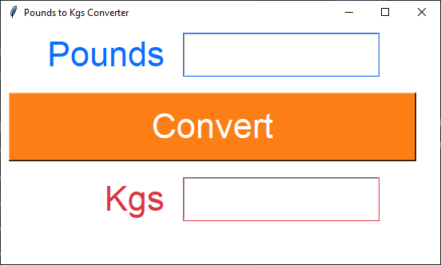
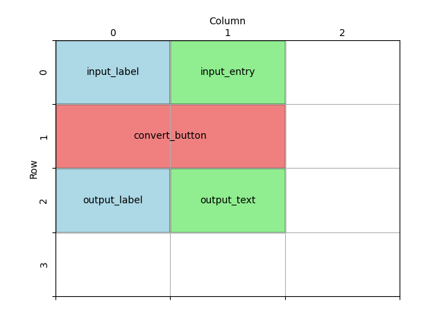

====================================================
Pounds to kgs
====================================================

| This code converts pounds to kgs.
| This code creates a simple GUI application using the Tkinter library.
| It displays a window with Label, Entry, Text and Button widgets
| Users can input pounds, click the "Convert" button, and see the corresponding kilograms displayed.

----

Create the Main Window
----------------------------------------

Create the main application window using `tk.Tk()`. Set the window title, size, and background color:

.. code-block:: python

    import tkinter as tk

    # Create the main window
    root = tk.Tk()
    root.title("Pounds to Kgs Converter")
    root.geometry("550x300")
    root.configure(bg="#ffffff")

    root.mainloop()

----

Define Formatting Constants
------------------------------------

| Next, define some constants for colors, and font style.
| You can customize these values as needed:

.. code-block:: python

    # Constants
    WINDOW_BG_COLOR = "#ffffff"
    INPUT_BG_COLOR = "#ffffff"
    INPUT_FG_COLOR = "#0d6efd"
    BUTTON_BG_COLOR = "#fd7e14"
    BUTTON_FG_COLOR = "#ffffff"
    OUTPUT_BG_COLOR = "#ffffff"
    OUTPUT_FG_COLOR = "#dc3545"
    FONT_STYLE = ("Arial", 32)

Update the window colour:

.. code-block:: python

    root.configure(bg=WINDOW_BG_COLOR)

----

Create Widgets
--------------------------------

| Now create the widgets (GUI elements) that will be displayed in the window:
| **highlightcolor**, **highlightbackground** and **highlightthickness** are used to colour the entry and text widget borders the same colour as their text colour.
| **highlightbackground** is applied when not clicking in the widget.
| **highlightcolor** is applied when clicking in the widget.

.. code-block:: python

    # Create widgets
    input_label = tk.Label(root, text="Pounds", bg=INPUT_BG_COLOR, fg=INPUT_FG_COLOR, font=FONT_STYLE)
    input_entry = tk.Entry(root, width=10, bg=INPUT_BG_COLOR, fg=INPUT_FG_COLOR, highlightcolor=INPUT_FG_COLOR,
                            highlightbackground=INPUT_FG_COLOR, highlightthickness=1, font=FONT_STYLE)
    output_label = tk.Label(root, text="Kgs", bg=OUTPUT_BG_COLOR, fg=OUTPUT_FG_COLOR, font=FONT_STYLE)
    output_text = tk.Text(root, height=1, width=10, fg=OUTPUT_FG_COLOR, highlightcolor=OUTPUT_FG_COLOR,
                            highlightbackground=OUTPUT_FG_COLOR, highlightthickness=1, font=FONT_STYLE)
    convert_button = tk.Button(root, text="Convert", width=20, bg=BUTTON_BG_COLOR,
                            fg=BUTTON_FG_COLOR, font=FONT_STYLE)

----

Place Widgets in the Window
-------------------------------------------------

Design the grid positions:

Position the widgets using the `grid()` method:

.. code-block:: python

    # Place widgets in the window
    input_label.grid(row=0, column=0, sticky="e", padx=10, pady=10)
    input_entry.grid(row=0, column=1, sticky="w", padx=10, pady=10)
    output_label.grid(row=2, column=0, sticky="e", padx=10, pady=10)
    output_text.grid(row=2, column=1, sticky="w", padx=10, pady=10)
    convert_button.grid(row=1, column=0, columnspan=2, padx=10, pady=10)

----

Define the Conversion Function
----------------------------------------------

| Create a function called ``convert()`` that performs the conversion and updates the result in the ``output_text`` widget.
| ``convert()`` uses a try and except block to catch errors due to non numeric entries.
| See: `<https://www.w3schools.com/python/python_try_except.asp>`_
| The delete method of a Text widget requires the line.column as the first argument. e.g. ``1.0`` in ``output_text.delete(1.0, 'end')``
| ``tk.END`` or ``'end'`` can be used as the second argument to cause the deletion to go to the end of the widget.
| The insert method of a Text widget requires the line.column as the first argument. e.g. ``1.0`` in ``output_text.insert(1.0, f'{kilograms:.2f}')``
| ``output_text.insert(1.0, f'{kilograms:.2f}')`` uses ``:.2f`` to format the kilograms float to 2 decimal places.
| For string formatting see: `<https://www.w3schools.com/python/ref_string_format.asp>`_

.. code-block:: python

    def convert():
        try:
            pounds = float(input_entry.get())
            kilograms = pounds * 0.45359237
            output_text.delete(1.0, "end")  # Clear any previous result
            output_text.insert(1.0, f"{kilograms:.2f}")
        except ValueError:
            output_text.delete(1.0, "end")
            output_text.insert(1.0, "Invalid input.")

----

Connect the Button to the Function
---------------------------------------------

.. code-block:: python

    convert_button = tk.Button(root, text="Convert", width=20, bg=BUTTON_BG_COLOR,
                            fg=BUTTON_FG_COLOR, font=FONT_STYLE, command=convert)

----

Full code
------------

.. code-block:: python

    import tkinter as tk

    # Constants
    WINDOW_BG_COLOR = "#ffffff"
    INPUT_BG_COLOR = "#ffffff"
    INPUT_FG_COLOR = "#0d6efd"
    BUTTON_BG_COLOR = "#fd7e14"
    BUTTON_FG_COLOR = "#ffffff"
    OUTPUT_BG_COLOR = "#ffffff"
    OUTPUT_FG_COLOR = "#dc3545"
    FONT_STYLE = ("Arial", 32)

    def convert():
        """
        Converts Pounds to Kgs and displays the result in the GUI.

        Reads the Pounds value from the input field, performs the conversion,
        and updates the result in the output text widget.

        Raises:
            ValueError: If the input is not a valid float.
        """
        try:
            pounds = float(input_entry.get())
            kilograms = pounds * 0.45359237
            output_text.delete(1.0, "end")  # Clear any previous result
            output_text.insert(1.0, f"{kilograms:.2f}")
        except ValueError:
            output_text.delete(1.0, "end")
            output_text.insert(1.0, "Invalid input.")

    # Create the main window
    root = tk.Tk()
    root.title("Pounds to Kgs Converter")
    root.geometry("550x300")
    root.configure(bg=WINDOW_BG_COLOR)

    # Create widgets
    input_label = tk.Label(root, text="Pounds", bg=INPUT_BG_COLOR, fg=INPUT_FG_COLOR, font=FONT_STYLE)
    input_entry = tk.Entry(root, width=10, bg=INPUT_BG_COLOR, fg=INPUT_FG_COLOR,
    highlightcolor=INPUT_FG_COLOR, highlightbackground=INPUT_FG_COLOR, highlightthickness=1, font=FONT_STYLE)
    output_label = tk.Label(root, text="Kgs", bg=OUTPUT_BG_COLOR, fg=OUTPUT_FG_COLOR, font=FONT_STYLE)
    output_text = tk.Text(root, height=1, width=10, fg=OUTPUT_FG_COLOR, highlightcolor=OUTPUT_FG_COLOR, highlightbackground=OUTPUT_FG_COLOR, highlightthickness=1, font=FONT_STYLE)
    convert_button = tk.Button(root, text="Convert", width=20, bg=BUTTON_BG_COLOR,
                            fg=BUTTON_FG_COLOR, font=FONT_STYLE, command=convert)

    # Place widgets on window
    input_label.grid(row=0, column=0, sticky="e", padx=10, pady=10)
    input_entry.grid(row=0, column=1, sticky="w", padx=10, pady=10)
    output_label.grid(row=2, column=0, sticky="e", padx=10, pady=10)
    output_text.grid(row=2, column=1, sticky="w", padx=10, pady=10)
    convert_button.grid(row=1, column=0, columnspan=2, padx=10, pady=10)

    # Start the main event loop
    root.mainloop()

----

Lbs-to-Kg Test Table
---------------------------------------

.. list-table:: Test Cases for Lbs-to-Kg Converter
   :header-rows: 1
   :widths: 20 25

   * - **Weight (lbs)**
     - **Expected Output (kg)**
   * - 0
     - 0.00
   * - 1
     - 0.45
   * - 2.2
     - 1.00
   * - "one"
     - Invalid input.

----

Pounds to Kgs Converter - Multiple Choice Quiz
----------------------------------------------------

.. mcqgroup::
    :nav_position: both
    :show-instant-feedback:
    :enable-instant-feedback:
    :shuffle_questions:
    :num_questions: 5

    .. multichoice::

        Which conversion factor does the code use to convert pounds to kilograms?

        [ ] 2.2 | Incorrect. There are about 2.2 pounds in 1 kg, so you would divide by 2.2, not multiply.
        [x] 0.45359237 | Correct. 1 pound is exactly 0.45359237 kg, so kilograms = pounds * 0.45359237.
        [ ] 2.54 | Incorrect. 2.54 converts inches to centimetres.
        [ ] 1.8 | Incorrect. 1.8 is used in Fahrenheit to Celsius conversions.

    .. multichoice::

        What does the app display when 10 is entered and Convert is clicked?

        [ ] 4.5359237 | Incorrect. The :.2f format shows only 2 decimal places.
        [x] 4.54 | Correct. 10 * 0.45359237 = 4.5359..., which rounds to 4.54.
        [ ] 22.05 | Incorrect. This would come from multiplying by 2.205.
        [ ] 4.53 | Incorrect. :.2f rounds 4.5359... up to 4.54.

    .. multichoice::

        What does the app display when 2.2 is entered?

        [x] 1.00 | Correct. 2.2 * 0.45359237 = 0.9979..., which rounds to 1.00.
        [ ] 0.99 | Incorrect. :.2f rounds 0.9979... up, not down.
        [ ] 1 | Incorrect. :.2f always shows 2 decimal places.
        [ ] 4.84 | Incorrect. This would come from multiplying by 2.2.

    .. multichoice::

        What does highlightthickness=1 do on input_entry?

        [ ] Makes the text bold | Incorrect. Bold text would be set in the font.
        [x] Draws a 1-pixel highlight border around the widget | Correct. The border is then coloured with highlightcolor and highlightbackground.
        [ ] Allows only 1 character to be typed | Incorrect. It does not limit the input.
        [ ] Makes the box 1 line high | Incorrect. Entry boxes are always one line high.

    .. multichoice::

        When is the highlightcolor border colour used?

        [x] When the user has clicked in the widget (it has focus) | Correct. highlightcolor is used when the widget has focus.
        [ ] When the user has not clicked in the widget | Incorrect. That is highlightbackground.
        [ ] When the input is invalid | Incorrect. The border colour does not change for invalid input.
        [ ] Only when the button is clicked | Incorrect. It depends on whether the widget has focus.

    .. multichoice::

        What is displayed if the user types "ten" and clicks Convert?

        [ ] 4.54 | Incorrect. float() cannot convert the word "ten" into a number.
        [ ] The program crashes | Incorrect. The try...except block catches the error.
        [ ] ValueError | Incorrect. ValueError is the exception type, not the message shown.
        [x] Invalid input. | Correct. float("ten") raises a ValueError, and the except block inserts "Invalid input.".

    .. multichoice::

        What does :.2f do in f"{kilograms:.2f}"?

        [ ] Multiplies the number by 2 | Incorrect. Format specifiers change how the number is displayed, not its value.
        [x] Formats the number as a float with 2 decimal places | Correct. .2 sets two decimal places and f means fixed-point float.
        [ ] Shows the first 2 digits | Incorrect. It controls decimal places, not the number of digits.
        [ ] Rounds to the nearest 2 | Incorrect. It rounds to 2 decimal places.

    .. multichoice::

        Why is float() used on input_entry.get()?

        [x] get() returns a string, which must be converted to a number before multiplying | Correct. Text typed into an Entry is always a string.
        [ ] To round the answer to 2 decimal places | Incorrect. Rounding for display is done by :.2f.
        [ ] To clear the Entry box | Incorrect. float() does not change the widget.
        [ ] To check the weight is positive | Incorrect. float() accepts negative numbers too.

    .. multichoice::

        What does height=1 mean for output_text?

        [ ] 1 pixel high | Incorrect. Text widget height is measured in lines.
        [x] 1 line of text high | Correct. A Text widget's height is the number of text lines.
        [ ] 1 character wide | Incorrect. width sets the number of characters.
        [ ] 1 centimetre high | Incorrect. Text widgets do not use centimetres.

    .. multichoice::

        Which line correctly connects the button to the convert function?

        [x] command=convert | Correct. Without brackets the button stores the function and runs it each time it is clicked.
        [ ] command=convert() | Incorrect. With brackets the function runs once when the program starts, and clicking does nothing.
        [ ] command="convert" | Incorrect. This is a string, not the function.
        [ ] onClick=convert | Incorrect. Tkinter buttons use command, not onClick.

----

Pounds to Kgs Converter - Cloze Code Quiz
-----------------------------------------------

.. clozegroup::
    :nav-position: both
    :num-questions: 3
    :show-instant-feedback:

    .. cloze::
        :instructions: Complete the code to create the main window and set its size.

        import tkinter as tk

        root = tk.@@Tk | Window | App@@()
        root.title("Pounds to Kgs Converter")
        root.@@geometry | size | dimensions@@("550x300")

    .. cloze::
        :instructions: Give the Entry box a coloured border that is 1 pixel thick.

        input_entry = tk.Entry(root, width=10, bg=INPUT_BG_COLOR, fg=INPUT_FG_COLOR,
                               highlightcolor=INPUT_FG_COLOR,
                               @@highlightbackground | highlightborder | bordercolor@@=INPUT_FG_COLOR,
                               @@highlightthickness | thickness | borderpixels@@=1, font=FONT_STYLE)

    .. cloze::
        :instructions: Complete the conversion and format the result to 2 decimal places.

        pounds = float(input_entry.get())
        kilograms = pounds @@* | / | +@@ 0.45359237
        output_text.delete(1.0, "end")
        output_text.insert(1.0, f"{kilograms:@@.2f | 2f | .2d@@}")

    .. cloze::
        :instructions: Catch non-numeric input and clear the output box.

        try:
            pounds = float(input_entry.get())
        except @@ValueError | TypeError | NameError@@:
            output_text.@@delete | clear | remove@@(1.0, "end")
            output_text.insert(1.0, "Invalid input.")

    .. cloze::
        :instructions: Connect the button to the function and stretch it across both columns.

        convert_button = tk.Button(root, text="Convert", width=20, bg=BUTTON_BG_COLOR,
                                   fg=BUTTON_FG_COLOR, font=FONT_STYLE, @@command=convert | command=convert() | onClick=convert@@)
        convert_button.grid(row=1, column=0, @@columnspan=2 | colspan=2 | span=2@@, padx=10, pady=10)
