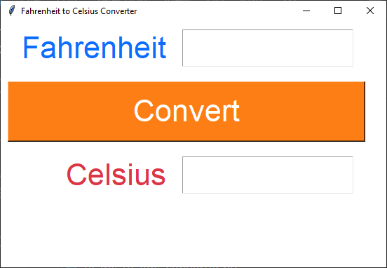
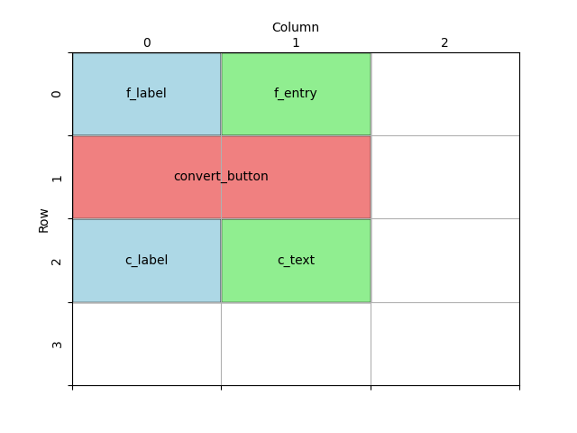

====================================================
Fahrenheit to Celsius
====================================================

| This code converts Fahrenheit to Celsius temperatures.
| This code creates a simple GUI application using the Tkinter library.
| It displays a window with Label, Entry, Text and Button widgets

This tutorial will guide you through developing a Fahrenheit to Celsius converter using Tkinter in Python. We'll start with a basic setup and gradually add components to build the final application.

----

Basic window setup
-------------------

Start with the basic setup of the Tkinter window and start the main event loop.

.. code-block:: python

    import tkinter as tk

    # Create the main window
    root = tk.Tk()
    root.title("Fahrenheit to Celsius Converter")
    root.geometry("550x350")
    root.configure(bg="#ffffff")

    # Start the main event loop
    root.mainloop()

----

Create Widgets
----------------------

Add the widgets for the input and output fields, and the convert button.

.. code-block:: python

    # Create widgets
    f_label = tk.Label(root, text="Fahrenheit")
    f_entry = tk.Entry(root, width=10)
    c_label = tk.Label(root, text="Celsius")
    c_text = tk.Text(root, height=1, width=10)
    convert_button = tk.Button(root, text="Convert", width=20)

----

Position the Widgets
-----------------------

Design the grid positions:

Now, place the widgets on the window using the grid layout.

.. code-block:: python

    # Place widgets on window
    f_label.grid(row=0, column=0, sticky="e", padx=10, pady=10)
    f_entry.grid(row=0, column=1, sticky="w", padx=10, pady=10)
    c_label.grid(row=2, column=0, sticky="e", padx=10, pady=10)
    c_text.grid(row=2, column=1, sticky="w", padx=10, pady=10)
    convert_button.grid(row=1, column=0, columnspan=2, padx=10, pady=10)

----

Add Widget formatting
------------------------------------

Next, add formatting to the widgets, storing colours and font settings in constants for reuse.

.. code-block:: python

    # Constants
    WINDOW_BG_COLOR = "#ffffff"
    INPUT_BG_COLOR = "#ffffff"
    INPUT_FG_COLOR = "#0d6efd"
    BUTTON_BG_COLOR = "#fd7e14"
    BUTTON_FG_COLOR = "#ffffff"
    OUTPUT_BG_COLOR = "#ffffff"
    OUTPUT_FG_COLOR = "#dc3545"
    FONT_STYLE = ("Arial", 32)

    # Create widgets
    f_label = tk.Label(root, text="Fahrenheit", bg=INPUT_BG_COLOR, fg=INPUT_FG_COLOR, font=FONT_STYLE)
    f_entry = tk.Entry(root, width=10, bg=INPUT_BG_COLOR, fg=INPUT_FG_COLOR, font=FONT_STYLE)
    c_label = tk.Label(root, text="Celsius", bg=OUTPUT_BG_COLOR, fg=OUTPUT_FG_COLOR, font=FONT_STYLE)
    c_text = tk.Text(root, height=1, width=10, bg=OUTPUT_BG_COLOR, fg=OUTPUT_FG_COLOR, font=FONT_STYLE)
    convert_button = tk.Button(root, text="Convert", width=20, bg=BUTTON_BG_COLOR,
                                fg=BUTTON_FG_COLOR, font=FONT_STYLE)

Update the window colour:

.. code-block:: python

    root.configure(bg=WINDOW_BG_COLOR)

----

Define the Conversion Function
--------------------------------------

Next, we'll add the function to convert Fahrenheit to Celsius.

.. code-block:: python

    def convert_f_to_c():
        """
        Converts Fahrenheit to Celsius and displays the result in the GUI.

        Reads the Fahrenheit value from the input field, performs the conversion,
        and updates the result in the output text widget.

        Raises:
            ValueError: If the input is not a valid float.
        """
        try:
            fahrenheit = float(f_entry.get())
            celsius = (fahrenheit - 32) / 1.8
            c_text.delete(1.0, "end")  # Clear any previous result
            c_text.insert(1.0, f"{celsius:.1f}")
        except ValueError:
            c_text.delete(1.0, "end")
            c_text.insert(1.0, "Invalid input.")

| ``convert_f_to_c()`` uses a try and except block to catch errors due to non numeric entries.
| See: `<https://www.w3schools.com/python/python_try_except.asp>`_
| The delete method of a Text widget requires the line.column as the first argument. e.g. ``1.0`` in ``c_text.delete(1.0, 'end')``
| ``tk.END`` or ``'end'`` can be used as the second argument to cause the deletion to go to the end of the widget.
| The insert method of a Text widget requires the line.column as the first argument. e.g. ``1.0`` in ``c_text.insert(1.0, f'{celsius:.1f}')``
| ``c_text.insert(1.0, f'{celsius:.1f}')`` uses ``:.1f`` to format the celsius float with 1 decimal place.
| For string formatting see: `<https://www.w3schools.com/python/ref_string_format.asp>`_

----

Connect the Button to the Function
-----------------------------------------------

Finally, we'll connect the convert button to the `convert_f_to_c` function.

.. code-block:: python

    convert_button = tk.Button(root, text="Convert", width=20, bg=BUTTON_BG_COLOR,
                                fg=BUTTON_FG_COLOR, font=FONT_STYLE, command=convert_f_to_c)

----

Full Code
----------------

.. code-block:: python

    import tkinter as tk

    # Constants
    WINDOW_BG_COLOR = "#ffffff"
    INPUT_BG_COLOR = "#ffffff"
    INPUT_FG_COLOR = "#0d6efd"
    BUTTON_BG_COLOR = "#fd7e14"
    BUTTON_FG_COLOR = "#ffffff"
    OUTPUT_BG_COLOR = "#ffffff"
    OUTPUT_FG_COLOR = "#dc3545"
    FONT_STYLE = ("Arial", 32)

    def convert_f_to_c():
        """
        Converts Fahrenheit to Celsius and displays the result in the GUI.

        Reads the Fahrenheit value from the input field, performs the conversion,
        and updates the result in the output text widget.

        Raises:
            ValueError: If the input is not a valid float.
        """
        try:
            fahrenheit = float(f_entry.get())
            celsius = (fahrenheit - 32) / 1.8
            c_text.delete(1.0, "end")  # Clear any previous result
            c_text.insert(1.0, f"{celsius:.1f}")
        except ValueError:
            c_text.delete(1.0, "end")
            c_text.insert(1.0, "Invalid input.")

    # Create the main window
    root = tk.Tk()
    root.title("Fahrenheit to Celsius Converter")
    root.geometry("550x350")
    root.configure(bg=WINDOW_BG_COLOR)

    # Create widgets
    f_label = tk.Label(root, text="Fahrenheit", bg=INPUT_BG_COLOR, fg=INPUT_FG_COLOR, font=FONT_STYLE)
    f_entry = tk.Entry(root, width=10, bg=INPUT_BG_COLOR, fg=INPUT_FG_COLOR, font=FONT_STYLE)
    c_label = tk.Label(root, text="Celsius", bg=OUTPUT_BG_COLOR, fg=OUTPUT_FG_COLOR, font=FONT_STYLE)
    c_text = tk.Text(root, height=1, width=10, bg=OUTPUT_BG_COLOR, fg=OUTPUT_FG_COLOR, font=FONT_STYLE)
    convert_button = tk.Button(root, text="Convert", width=20, bg=BUTTON_BG_COLOR,
                                fg=BUTTON_FG_COLOR, font=FONT_STYLE, command=convert_f_to_c)

    # Place widgets on window
    f_label.grid(row=0, column=0, sticky="e", padx=10, pady=10)
    f_entry.grid(row=0, column=1, sticky="w", padx=10, pady=10)
    c_label.grid(row=2, column=0, sticky="e", padx=10, pady=10)
    c_text.grid(row=2, column=1, sticky="w", padx=10, pady=10)
    convert_button.grid(row=1, column=0, columnspan=2, padx=10, pady=10)

    # Start the main event loop
    root.mainloop()

----

Fahrenheit to Celsius Test Table
---------------------------------------

.. list-table:: Test Cases for Fahrenheit-to-Celsius Converter
   :header-rows: 1
   :widths: 20 25

   * - **Fahrenheit (°F)**
     - **Expected Output (°C)**
   * - 32
     - 0
   * - 212
     - 100
   * - 0
     - -17.78
   * - -459.67 (absolute zero)
     - -273.15
   * - one
     - Invalid input

| The code rounds to 1 decimal place so its accuracy is limited by that.
| The text fields have limited width so can't handle numbers with more that 9 digits.

----

Fahrenheit to Celsius Converter - Multiple Choice Quiz
---------------------------------------------------------

.. mcqgroup::
    :nav_position: both
    :show-instant-feedback:
    :enable-instant-feedback:
    :shuffle_questions:
    :num_questions: 5

    .. multichoice::

        Which formula does convert_f_to_c() use to convert Fahrenheit to Celsius?

        [ ] celsius = fahrenheit * 1.8 + 32 | Incorrect. This formula converts Celsius to Fahrenheit.
        [x] celsius = (fahrenheit - 32) / 1.8 | Correct. Subtract 32, then divide by 1.8 (which is the same as multiplying by 5/9).
        [ ] celsius = fahrenheit - 32 / 1.8 | Incorrect. Without brackets, Python divides 32 by 1.8 first, giving the wrong answer.
        [ ] celsius = (fahrenheit + 32) / 1.8 | Incorrect. 32 must be subtracted, not added.

    .. multichoice::

        Why are brackets needed around fahrenheit - 32 in the conversion formula?

        [ ] Brackets turn the result into a float | Incorrect. Brackets only change the order of operations.
        [x] Division is done before subtraction unless brackets are used | Correct. Python follows the order of operations, so brackets make the subtraction happen first.
        [ ] Brackets are needed to call a function | Incorrect. Here the brackets group part of a calculation, not a function call.
        [ ] Python cannot subtract without brackets | Incorrect. Python can subtract without brackets, but the order of operations would be wrong.

    .. multichoice::

        What does the app display in c_text when 212 is entered and Convert is clicked?

        [ ] 100 | Incorrect. The :.1f format always shows 1 decimal place.
        [x] 100.0 | Correct. (212 - 32) / 1.8 = 100, formatted with :.1f as 100.0.
        [ ] 212.0 | Incorrect. 212 °F is the boiling point of water, which is 100 °C.
        [ ] 194.2 | Incorrect. This comes from the formula without brackets: 212 - 32 / 1.8.

    .. multichoice::

        What does the format specifier :.1f do in f"{celsius:.1f}"?

        [ ] Rounds the number to a whole number | Incorrect. :.0f would round to a whole number.
        [ ] Shows the first digit only | Incorrect. :.1f controls decimal places, not the number of digits.
        [x] Formats the float with 1 decimal place | Correct. The .1 sets one decimal place and f means fixed-point float.
        [ ] Multiplies the number by 1.0 | Incorrect. Format specifiers change how a number is displayed, not its value.

    .. multichoice::

        Which method reads the text the user typed into f_entry?

        [ ] f_entry.read() | Incorrect. Entry widgets do not have a read() method.
        [ ] f_entry.text() | Incorrect. Entry widgets do not have a text() method.
        [x] f_entry.get() | Correct. get() returns the contents of the Entry widget as a string.
        [ ] f_entry.input() | Incorrect. input() is used in the shell, not with Entry widgets.

    .. multichoice::

        Why is float() used on the value returned by f_entry.get()?

        [x] get() returns a string, which must be converted to a number before doing maths | Correct. Text typed into an Entry is always a string, so float() converts it to a decimal number.
        [ ] float() rounds the number to 1 decimal place | Incorrect. Rounding for display is done by :.1f.
        [ ] float() checks that the temperature is above absolute zero | Incorrect. float() only converts text to a number.
        [ ] float() clears the Entry widget | Incorrect. float() does not change the widget.

    .. multichoice::

        What is displayed if the user types "hot" into the Fahrenheit box and clicks Convert?

        [ ] 0.0 | Incorrect. Non-numeric input is not converted to zero.
        [ ] ValueError | Incorrect. ValueError is the exception type, not the message shown to the user.
        [ ] The program crashes | Incorrect. The try...except block catches the error so the program keeps running.
        [x] Invalid input. | Correct. float("hot") raises a ValueError, and the except block inserts "Invalid input.".

    .. multichoice::

        In the grid layout, which row and column is c_text placed in?

        [ ] row=0, column=1 | Incorrect. That position holds f_entry.
        [ ] row=1, column=0 | Incorrect. Row 1 holds the convert_button, which spans both columns.
        [x] row=2, column=1 | Correct. c_text is in the bottom row, in the right-hand column.
        [ ] row=2, column=0 | Incorrect. That position holds c_label.

    .. multichoice::

        What does sticky="e" do in f_label.grid(row=0, column=0, sticky="e", padx=10, pady=10)?

        [ ] Makes the label editable | Incorrect. sticky only affects position within the grid cell.
        [x] Aligns the label to the east (right) side of its grid cell | Correct. sticky uses compass points, so "e" pushes the label right, next to the Entry box.
        [ ] Adds 10 pixels of space to the east | Incorrect. padx adds the horizontal space.
        [ ] Makes the label stretch across the whole window | Incorrect. sticky="ew" would stretch it across its cell, not the window.

    .. multichoice::

        What does root.geometry("550x350") set?

        [ ] The window position on the screen | Incorrect. Position would be set with extra values such as "550x350+100+50".
        [ ] The font size of the widgets | Incorrect. Font size is set with FONT_STYLE.
        [x] The window width (550 pixels) and height (350 pixels) | Correct. geometry() takes a "widthxheight" string in pixels.
        [ ] The number of rows and columns in the grid | Incorrect. The grid size depends on where widgets are placed.

----

Fahrenheit to Celsius Converter - Cloze Code Quiz
----------------------------------------------------

.. clozegroup::
    :nav-position: both
    :num-questions: 3
    :show-instant-feedback:

    .. cloze::
        :instructions: Complete the code to create the main window and set its title and size.

        import tkinter as tk

        root = tk.@@Tk | Window | App@@()
        root.@@title | name | caption@@("Fahrenheit to Celsius Converter")
        root.geometry("@@550x350 | 550,350 | 550*350@@")

        root.mainloop()

    .. cloze::
        :instructions: Choose the correct widget types for the Fahrenheit input box and the Celsius output box.

        f_label = tk.Label(root, text="Fahrenheit")
        f_entry = tk.@@Entry | Label | Button@@(root, width=10)
        c_label = tk.Label(root, text="Celsius")
        c_text = tk.@@Text | Entry | Label@@(root, height=1, width=10)

    .. cloze::
        :instructions: Complete the grid placement so the labels align right and the button spans both columns.

        f_label.grid(row=0, column=0, sticky="@@e | w | n@@", padx=10, pady=10)
        f_entry.grid(row=0, column=1, sticky="w", padx=10, pady=10)
        convert_button.grid(row=@@1 | 0 | 2@@, column=0, columnspan=2, padx=10, pady=10)

    .. cloze::
        :instructions: Complete the conversion formula and format the result to 1 decimal place.

        def convert_f_to_c():
            try:
                fahrenheit = float(f_entry.get())
                celsius = @@(fahrenheit - 32) / 1.8 | fahrenheit - 32 / 1.8 | (fahrenheit + 32) / 1.8@@
                c_text.delete(1.0, "end")
                c_text.insert(1.0, f"{celsius:@@.1f | 1f | .1d@@}")
            except ValueError:
                c_text.delete(1.0, "end")
                c_text.insert(1.0, "Invalid input.")

    .. cloze::
        :instructions: Choose the method that clears the output box and the option that connects the button to the function.

        def convert_f_to_c():
            try:
                fahrenheit = float(f_entry.get())
                celsius = (fahrenheit - 32) / 1.8
                c_text.@@delete | clear | remove@@(1.0, "end")
                c_text.insert(1.0, f"{celsius:.1f}")
            except ValueError:
                c_text.delete(1.0, "end")
                c_text.insert(1.0, "Invalid input.")

        convert_button = tk.Button(root, text="Convert", @@command=convert_f_to_c | onClick=convert_f_to_c | command=convert_f_to_c()@@)
