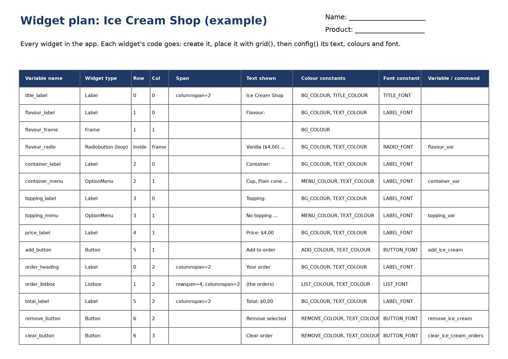

================================================
Plan the app and create the window
================================================

.. image:: images/icecream_08.png
    :scale: 50

| *The app you will build.*

- **Objective**: Plan the layout of the app and set out the code in the right order.
- **Content**:

  - What the app does.
  - The planning grid.
  - The five sections of the code.
  - How to group the code for widgets and variables.
  - Creating the window.

----

What the app does
--------------------------------

| The Ice Cream Shop app lets a user build an order of ice creams.
| The user:

#. picks a **flavour** using radio buttons,
#. picks a **container** (cup or cone) using a drop-down menu,
#. picks a **topping** using a drop-down menu,
#. sees the **price** of that ice cream,
#. clicks **Add to order** to put it in the order list,
#. can **remove** one ice cream or **clear** the whole order.

----

The planning grid
--------------------------------

| Before writing any code, programmers plan where each widget will go.
| Tkinter's ``grid()`` places widgets in **rows** and **columns**, like the cells of a table.
| Row 0 is the top row. Column 0 is the left column.
| Some widgets cover more than one cell. ``columnspan=2`` makes a widget two columns wide. ``rowspan=4`` makes it four rows tall.

.. image:: images/icecream_grid.png
    :scale: 67

| The widget plan lists every widget, its position, its text and the colours and fonts it uses.

----

The five sections of the code
--------------------------------

| Good programs are set out in a clear order, so that anyone can find things quickly.
| Every program in this tutorial uses these five sections, **in this order**:

#. **Imports** go at the very top.
#. **1. DATA DICTIONARIES & LISTS**: the dictionaries of choices and prices, and the orders list.
#. **2. CONSTANTS**: colours and fonts.
#. **3. DEFINITIONS**: the functions, made with ``def``.
#. **4. TKINTER WIDGETS**: the window and every widget.
#. **5. MAIN CODE**: the lines that start the app.

| Definitions must come **before** the widgets, because a button's ``command=`` needs its function to exist already.

----

How to group the code
------------------------------------------

| The code is kept in small groups, and each group is written in the same order every time.
| There are two kinds of group: one for **widgets** and one for **variables**.

Widgets: create, position, configure, command
~~~~~~~~~~~~~~~~~~~~~~~~~~~~~~~~~~~~~~~~~~~~~~~~

| A **widget** is something you can see in the window, such as a label, a drop-down menu or a button.

#. **Create** the widget.
#. **Position** it with ``grid()`` (or ``pack()``).
#. **Configure** its text, colour and font with ``config()``.
#. **Command**: for a button, tell it which function to run when it is clicked, with ``config(command=...)``.

| Step 4 is only for buttons. Labels do nothing when clicked, so they stop at step 3.

Variables: make, set, bind
~~~~~~~~~~~~~~~~~~~~~~~~~~~~~~~~~~~~~~~~~~

| A **Tkinter variable** remembers what the user picked, e.g. which topping.
| The drop-down menu is linked to the variable, so when the user picks a topping, the **variable** changes.
| **Binding** tells Python which function to run whenever that variable changes.

#. **Make** the variable.
#. **Set** its starting value.
#. **Bind** it to a function with ``trace_add()``.

| The binding line goes straight after the lines that make the variable.

----

Example: the topping drop-down
------------------------------------------

| Here is the code for the **topping** drop-down from the finished app. It has three groups.
| You will type it in :doc:`icecream_lesson05`. For now, just look for the pattern.

.. code-block::
   :class: no-copybutton

    # Topping (drop-down menu)

    # WIDGET: the label "Topping:"
    topping_label = tk.Label(root)                                       # 1. create
    topping_label.grid(row=3, column=0, padx=10, pady=5, sticky="e")     # 2. position
    topping_label.config(text="Topping:", font=LABEL_FONT,
                         bg=BG_COLOUR, fg=TEXT_COLOUR)                   # 3. configure

    # VARIABLE: remembers which topping the user picked
    topping_var = tk.StringVar(root)                                     # 1. make
    topping_var.set("No topping")                                        # 2. set
    topping_var.trace_add("write", update_ice_cream_price)               # 3. bind

    # WIDGET: the drop-down menu, linked to topping_var
    topping_menu = tk.OptionMenu(root, topping_var, "No topping")        # 1. create
    topping_menu.grid(row=3, column=1, padx=10, pady=5, sticky="w")      # 2. position
    topping_menu.config(font=LABEL_FONT, bg=MENU_COLOUR, fg=TEXT_COLOUR) # 3. configure

| In :doc:`icecream_lesson05` you will also add a loop that puts every topping into the menu.

.. list-table::
    :header-rows: 1
    :widths: 18 18 64

    * - Group
      - Step
      - What it does
    * - Widget
      - 1. Create
      - ``tk.Label(root)`` makes the widget inside the window ``root``.
    * - Widget
      - 2. Position
      - ``.grid(row=3, column=0)`` puts the widget in a cell of the planning grid.
    * - Widget
      - 3. Configure
      - ``.config(text=..., font=..., bg=..., fg=...)`` sets the words, font and colours.
    * - Variable
      - 1. Make
      - ``tk.StringVar(root)`` makes a variable that holds a string.
    * - Variable
      - 2. Set
      - ``.set("No topping")`` chooses the starting value.
    * - Variable
      - 3. Bind
      - ``.trace_add("write", update_ice_cream_price)`` runs ``update_ice_cream_price`` every time the variable changes.

| Follow what happens when the user picks Sprinkles:

#. The user picks **Sprinkles** in the drop-down menu (the widget).
#. The menu sets ``topping_var`` to ``"Sprinkles"`` (the variable).
#. The binding sees the change and runs ``update_ice_cream_price``, which shows the new price.

| The **variable** group comes **before** the drop-down menu, because the menu needs ``topping_var`` when it is created.

----

Example: the Add to order button
------------------------------------------

| A button uses all four widget steps. You will type this in :doc:`icecream_lesson07`.

.. code-block::
   :class: no-copybutton

    # WIDGET: the Add to order button
    add_button = tk.Button(root)                                              # 1. create
    add_button.grid(row=5, column=1, padx=10, pady=10, ipady=4, sticky="w")   # 2. position
    add_button.config(text="Add to order", font=BUTTON_FONT,
                      bg=ADD_COLOUR, fg=TEXT_COLOUR)                          # 3. configure
    add_button.config(command=add_ice_cream)                                  # 4. command

.. list-table::
    :header-rows: 1
    :widths: 18 18 64

    * - Group
      - Step
      - What it does
    * - Widget
      - 4. Command
      - ``.config(command=add_ice_cream)`` runs ``add_ice_cream`` each time the button is clicked. There are no brackets after the function name.

| Compare the two ways of reacting to the user:

- A **button** has a **command**. Clicking it runs the function straight away.
- A **drop-down menu** or **radio button** changes a **variable**. The variable's **binding** runs the function.

----

Creating the window
--------------------------------

| Open a new Python file and save it as ``icecream_orders.py``.
| Type in the code below. The comments show where each section will go.

.. code-block:: python

    import tkinter as tk

    # 1. DATA DICTIONARIES & LISTS

    # 2. CONSTANTS

    # 3. DEFINITIONS

    # 4. TKINTER WIDGETS
    # Main window
    root = tk.Tk()
    root.title("Ice Cream Shop")
    root.geometry("940x520")

    # 5. MAIN CODE
    root.mainloop()

- ``import tkinter as tk``: loads the Tkinter library. We can now write ``tk`` instead of ``tkinter``.
- ``root = tk.Tk()``: creates the main window. We call it ``root``.
- ``root.title("Ice Cream Shop")``: puts the words "Ice Cream Shop" in the window's title bar.
- ``root.geometry("940x520")``: makes the window 940 pixels wide and 520 pixels tall.
- ``root.mainloop()``: starts the app. It keeps the window open and waits for the user to click things.

| Run the code. An empty window called "Ice Cream Shop" should appear.

----

Quiz
--------------------------------

.. mcqgroup::
    :nav_position: both
    :show-instant-feedback:
    :enable-instant-feedback:
    :shuffle_questions:
    :num_questions: 6

    .. multichoice::

        Which part of the code goes at the very top?

        [x] The imports | Correct. Imports always come first, so the rest of the code can use tkinter.
        [ ] The data dictionaries | Incorrect. Dictionaries come straight after the imports.
        [ ] The constants | Incorrect. Constants come after the dictionaries.
        [ ] The widgets | Incorrect. Widgets come near the end, after the definitions.

    .. multichoice::

        Which order is correct?

        [ ] Imports, constants, dictionaries, widgets, definitions | Incorrect. Dictionaries come before constants, and definitions come before widgets.
        [x] Imports, dictionaries, constants, definitions, widgets | Correct. This is the order used in every program in this tutorial.
        [ ] Imports, widgets, definitions, constants, dictionaries | Incorrect. Widgets come last, just before the main code.
        [ ] Dictionaries, imports, constants, widgets, definitions | Incorrect. Imports always come first.

    .. multichoice::

        Why must definitions come before the widgets?

        [ ] Python reads the file from the bottom up | Incorrect. Python reads the file from the top down.
        [x] A button's command= needs its function to exist already | Correct. A function must be defined before a widget can use it.
        [ ] Definitions make the window appear | Incorrect. tk.Tk() makes the window.
        [ ] Widgets cannot be placed with grid() otherwise | Incorrect. grid() does not depend on the definitions.

    .. multichoice::

        In the planning grid, where is row 0, column 0?

        [x] The top left cell | Correct. Rows count down from the top and columns count across from the left, starting at 0.
        [ ] The bottom left cell | Incorrect. Row 0 is the top row.
        [ ] The top right cell | Incorrect. Column 0 is the left column.
        [ ] The centre of the window | Incorrect. Counting starts at the top left corner.

    .. multichoice::

        What is the correct order of code for a button?

        [ ] Command, create, position, configure | Incorrect. A button must be created before it can be given a command.
        [ ] Position, create, configure, command | Incorrect. A button must be created before it can be positioned.
        [x] Create, position, configure, command | Correct. Create the button, place it with grid(), set its text, colour and font, then give it its command.
        [ ] Create, configure, command | Incorrect. The button also needs to be positioned, or it will not appear.

    .. multichoice::

        Where does topping_var.trace_add("write", update_ice_cream_price) go?

        [x] Straight after the lines that make and set topping_var | Correct. The binding goes at the end of the variable's group.
        [ ] Straight after the topping label | Incorrect. The label does not use topping_var.
        [ ] At the very end of the program | Incorrect. Keep it next to the variable it binds, so it is easy to find.
        [ ] Before topping_var is made | Incorrect. The variable must exist before it can be bound.
