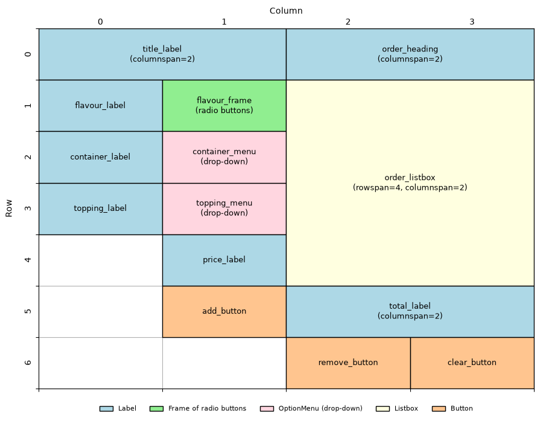

================================================
Plan the app and create the window
================================================

.. image:: images/icecream_08.png
    :scale: 50

| *The app you will build.*

- **Objective**: Plan the app and make an empty window.

----

What the app does
--------------------------------

#. Pick a **flavour** (radio buttons).
#. Pick a **container** and a **topping** (drop-down menus).
#. See the **price**.
#. **Add**, **remove** or **clear** ice creams in the order.

----

The planning grid
--------------------------------

| ``grid()`` puts widgets in **rows** and **columns**, like a table.
| Row 0 is the top. Column 0 is the left.

----

The five sections
--------------------------------

| Every program in this tutorial uses these sections, **in this order**:

#. **Imports**
#. **Data**: dictionaries and lists
#. **Constants**: colours and fonts
#. **Definitions**: functions made with ``def``
#. **Widgets**: the window and everything in it
#. **Main code**: starts the app

| Definitions come before widgets, because buttons need their function to exist first.

----

The widget pattern
--------------------------------

| Every widget uses the same three lines:

.. code-block:: python
   :class: no-copybutton

    topping_label = tk.Label(root)                       # 1. create
    topping_label.grid(row=3, column=0)                  # 2. position
    topping_label.config(text="Topping:")                # 3. configure

| A **button** has a fourth line, the **command**: the function it runs when clicked.

.. code-block:: python
   :class: no-copybutton

    add_button.config(command=add_ice_cream)             # 4. command

----

Step 1: Create the window
--------------------------------

| Make a new file called ``icecream_orders.py``. Paste in this code.

.. code-block:: python

    import tkinter as tk

    # 1. DATA DICTIONARIES & LISTS

    # 2. CONSTANTS

    # 3. DEFINITIONS

    # 4. TKINTER WIDGETS
    # Main window
    root = tk.Tk()
    root.title("Ice Cream Shop")
    root.geometry("940x520")

    # 5. MAIN CODE
    root.mainloop()

- ``root = tk.Tk()`` makes the window.
- ``title`` and ``geometry`` set its name and size.
- ``mainloop()`` keeps the window open.

| **Run it.** An empty window called "Ice Cream Shop" appears.

----

Quiz
--------------------------------

.. mcqgroup::
    :nav_position: both
    :show-instant-feedback:
    :enable-instant-feedback:
    :shuffle_questions:
    :num_questions: 4

    .. multichoice::

        Which part of the code goes at the very top?

        [x] The imports | Correct. Imports always come first.
        [ ] The widgets | Incorrect. Widgets come near the end.
        [ ] The constants | Incorrect. Constants come after the data.

    .. multichoice::

        Which order is correct?

        [x] Imports, data, constants, definitions, widgets | Correct.
        [ ] Imports, widgets, constants, data, definitions | Incorrect. Widgets come last.
        [ ] Data, imports, constants, widgets, definitions | Incorrect. Imports come first.

    .. multichoice::

        In the planning grid, where is row 0, column 0?

        [x] Top left | Correct. Counting starts at the top left.
        [ ] Bottom left | Incorrect. Row 0 is the top row.
        [ ] Top right | Incorrect. Column 0 is the left column.

    .. multichoice::

        What is the order of code for a button?

        [x] Create, position, configure, command | Correct.
        [ ] Command, create, position, configure | Incorrect. Create it first.
        [ ] Position, create, configure, command | Incorrect. Create it first.
