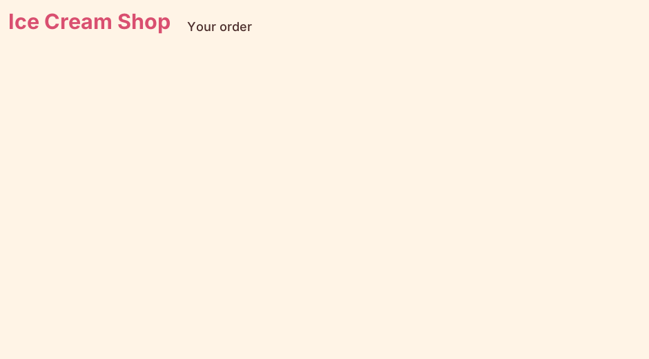

================================================
Constants: colours and fonts
================================================

- **Objective**: Add colours and fonts, then make the title and order heading.

----

What is a constant?
--------------------------------

- A **constant** is a value that doesn't change, written in **CAPITALS**.
- Colours are hex codes: ``"#ffffff"`` is white.
- Fonts are (name, size, style): ``("Segoe UI", 22, "bold")``.

----

Step 1: Add the constants
--------------------------------

| Replace ``# D`` with Block D.

.. code-block:: python
   :caption: Block D

    # Colours
    BG_COLOUR = "#fff4e6"        # cream background
    TITLE_COLOUR = "#d94f70"     # strawberry pink title
    TEXT_COLOUR = "#4a2c2a"      # chocolate brown text
    MENU_COLOUR = "#ffd6e0"      # pale pink drop-down menus
    LIST_COLOUR = "#ffffff"      # white order list
    ADD_COLOUR = "#c8f0c8"       # pale green add button
    REMOVE_COLOUR = "#ffd6d6"    # pale red remove and clear buttons

    # Fonts
    TITLE_FONT = ("Segoe UI", 22, "bold")
    LABEL_FONT = ("Segoe UI", 13, "normal")
    RADIO_FONT = ("Segoe UI", 12, "normal")
    LIST_FONT = ("Segoe UI", 12, "normal")
    BUTTON_FONT = ("Segoe UI", 12, "bold")

----

Step 2: Colour the window
--------------------------------

| Replace ``# E`` with Block E.

.. code-block:: python
   :caption: Block E

    root.config(bg=BG_COLOUR)

- ``bg`` means **background**.

----

Step 3: Add the title
--------------------------------

| Replace ``# F`` with Block F.

.. code-block:: python
   :caption: Block F

    # --- LEFT SIDE: ICE CREAM CHOICES ---

    # Title
    title_label = tk.Label(root)  # 1. create
    title_label.grid(row=0, column=0, columnspan=2, padx=10, pady=10, sticky="w")  # 2. position
    title_label.config(text="Ice Cream Shop", font=TITLE_FONT, bg=BG_COLOUR, fg=TITLE_COLOUR)  # 3. configure

- ``columnspan=2`` makes it cover two columns.
- ``sticky="w"`` pushes it to the left (west).
- ``fg`` means the **text colour**.

----

Step 4: Add the order heading
--------------------------------

| Replace ``# G`` with Block G.

.. code-block:: python
   :caption: Block G

    # --- RIGHT SIDE: THE ORDER ---

    # Order heading
    order_heading = tk.Label(root)  # 1. create
    order_heading.grid(row=0, column=2, columnspan=2, padx=10, pady=10, sticky="sw")  # 2. position
    order_heading.config(text="Your order", font=LABEL_FONT, bg=BG_COLOUR, fg=TEXT_COLOUR)  # 3. configure

| **Run it.** The title and heading appear on a cream background.

----

Quiz
--------------------------------

.. mcqgroup::
    :nav_position: both
    :show-instant-feedback:
    :enable-instant-feedback:
    :shuffle_questions:
    :num_questions: 4

    .. multichoice::

        Why are constant names written in CAPITALS?

        [x] To show they are constants that don't change | Correct.
        [ ] Python needs capitals for colours | Incorrect. It is just a naming habit.
        [ ] To make the text bigger | Incorrect. The font size does that.

    .. multichoice::

        What does fg=TITLE_COLOUR change?

        [x] The text colour | Correct. fg means foreground.
        [ ] The background colour | Incorrect. bg does that.
        [ ] The font | Incorrect. font= does that.

    .. multichoice::

        In ("Segoe UI", 22, "bold"), what is 22?

        [x] The text size | Correct.
        [ ] The colour | Incorrect. Colours are hex codes.
        [ ] The row number | Incorrect. grid() sets the row.

    .. multichoice::

        What does columnspan=2 do?

        [x] Makes the widget cover two columns | Correct.
        [ ] Puts the widget in column 2 | Incorrect. column=2 does that.
        [ ] Adds 2 pixels of space | Incorrect. padx and pady add space.

----

Fill in the gaps
--------------------------------

.. clozegroup::
    :nav-position: both
    :num-questions: 1
    :show-instant-feedback:

    .. cloze::
        :instructions: Create, position and configure the title.

        title_label = tk.@@Label | Button | Title@@(root)
        title_label.@@grid | config | place@@(row=0, column=0, columnspan=2, padx=10, pady=10, sticky="w")
        title_label.@@config | grid | text@@(text="Ice Cream Shop", font=TITLE_FONT, bg=BG_COLOUR, fg=TITLE_COLOUR)
