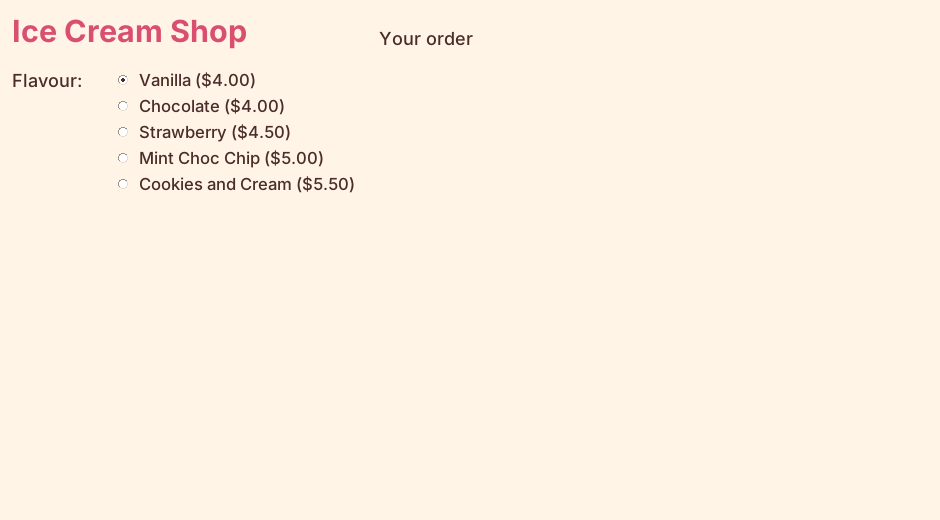

================================================
Radio buttons for flavours
================================================

- **Objective**: Make one radio button for each flavour in the ``flavours`` dictionary.
- **Content**:

  - What radio buttons are.
  - The flavour label and frame.
  - Using a ``StringVar`` to remember the choice.
  - Making the radio buttons with a loop.

----

What are radio buttons?
--------------------------------

| **Radio buttons** let the user pick **one** choice from a group.
| When the user clicks one, any other button in the group is switched off.
| This suits flavours, because each ice cream has one flavour.

----

Adding the flavour radio buttons
--------------------------------------

| Place the following code below the title code in Section "4. TKINTER WIDGETS", above the "RIGHT SIDE" comment.

.. code-block:: python

    # Flavour (radio buttons)
    flavour_label = tk.Label(root)  # 1. create
    flavour_label.grid(row=1, column=0, padx=10, pady=5, sticky="ne")  # 2. position
    flavour_label.config(text="Flavour:", font=LABEL_FONT, bg=BG_COLOUR, fg=TEXT_COLOUR)  # 3. configure

    flavour_frame = tk.Frame(root)  # 1. create
    flavour_frame.grid(row=1, column=1, padx=10, pady=5, sticky="w")  # 2. position
    flavour_frame.config(bg=BG_COLOUR)  # 3. configure

    flavour_var = tk.StringVar(root)  # A. make
    flavour_var.set("Vanilla")  # B. set

    for flavour in flavours.keys():
        flavour_radio = tk.Radiobutton(flavour_frame, variable=flavour_var, value=flavour)  # 1. create
        flavour_radio.pack(anchor="w")  # 2. position
        flavour_radio.config(text=f"{flavour} (${flavours[flavour]:.2f})", font=RADIO_FONT,
                             bg=BG_COLOUR, fg=TEXT_COLOUR, activebackground=BG_COLOUR,
                             highlightthickness=0)  # 3. configure

1. **The label**:

   - "Flavour:" goes in row 1, column 0.
   - ``sticky="ne"`` pushes it to the **north-east** (top right) of its cell, so it lines up with the first radio button.

2. **The frame**:

   - A ``Frame`` is an invisible box that holds other widgets.
   - All the radio buttons go inside ``flavour_frame``, and the frame goes in row 1, column 1.

3. **The variable**:

   - ``flavour_var = tk.StringVar(root)`` makes a special Tkinter variable that holds a string.
   - ``flavour_var.set("Vanilla")`` chooses Vanilla when the app starts. It must be spelt exactly like a key in ``flavours``.
   - Every radio button is linked to ``flavour_var``, so it always holds the flavour the user picked.

4. **The loop**:

   - ``for flavour in flavours.keys():`` repeats once for **each key** in the dictionary.
   - ``tk.Radiobutton(flavour_frame, variable=flavour_var, value=flavour)`` makes a radio button. When it is clicked, ``flavour_var`` is set to that flavour.
   - ``pack(anchor="w")`` stacks the radio buttons down the frame, lined up on the left.
   - ``config(text=...)`` shows the flavour and its price, e.g. "Strawberry ($4.50)".

----

Showing prices with an f-string
--------------------------------------

| ``f"{flavour} (${flavours[flavour]:.2f})"`` is an **f-string**. Python fills in the parts inside ``{ }``.

- ``{flavour}`` is replaced by the flavour, e.g. ``Strawberry``.
- ``{flavours[flavour]:.2f}`` looks up the price in the dictionary and shows it with **2 decimal places**, e.g. ``4.50``.
- The ``$`` outside the curly brackets is printed as a normal dollar sign.

----

Why use the dictionary for the loop?
--------------------------------------

| The radio buttons are made from the **keys of the dictionary**, not typed in one by one.
| If you add a new flavour to ``flavours``, a new radio button appears by itself. Try it:

.. code-block::
   :class: no-copybutton

    "Salted Caramel": 5.50,

| If this line was added to the ``flavours`` dictionary, the app would make a new radio button for it.

----

Quiz
--------------------------------

.. mcqgroup::
    :nav_position: both
    :show-instant-feedback:
    :enable-instant-feedback:
    :shuffle_questions:
    :num_questions: 5

    .. multichoice::

        How many flavours can the user pick at once with these radio buttons?

        [x] One | Correct. Radio buttons in a group let the user pick only one choice.
        [ ] Two | Incorrect. Clicking a second radio button switches the first one off.
        [ ] As many as they like | Incorrect. That is how checkbuttons work, not radio buttons.
        [ ] None | Incorrect. One flavour is always chosen.

    .. multichoice::

        What does flavour_var hold?

        [ ] The price of the flavour | Incorrect. The price is in the flavours dictionary.
        [x] The name of the flavour that is chosen | Correct. Each radio button sets flavour_var to its value.
        [ ] Every flavour in the dictionary | Incorrect. It holds only one flavour at a time.
        [ ] The number of radio buttons | Incorrect. It holds a string, the chosen flavour.

    .. multichoice::

        How many radio buttons does the loop make?

        [ ] Always 3 | Incorrect. The number depends on the dictionary.
        [x] One for each key in flavours | Correct. The loop runs once for each key.
        [ ] One for each value in flavours | Incorrect. Two flavours can have the same price, but each key gets its own button.
        [ ] Only one | Incorrect. The loop runs more than once.

    .. multichoice::

        What does :.2f do in an f-string?

        [ ] Adds 2 to the number | Incorrect. It does not change the number's value.
        [x] Shows the number with 2 decimal places | Correct. 4.5 is shown as 4.50.
        [ ] Makes the number a whole number | Incorrect. It keeps 2 decimal places.
        [ ] Shows the number twice | Incorrect. The number is shown once.

    .. multichoice::

        Why are the radio buttons placed inside flavour_frame?

        [ ] Radio buttons cannot go in the window | Incorrect. They can, but a frame keeps them together.
        [x] So the whole group fits in one grid cell | Correct. The frame sits in row 1, column 1, and the buttons are packed inside it.
        [ ] To give them a price | Incorrect. The price comes from the dictionary.
        [ ] To make them bigger | Incorrect. The font sets the size of the text.

----

Fill in the gaps
--------------------------------

.. clozegroup::
    :nav-position: both
    :num-questions: 1
    :show-instant-feedback:

    .. cloze::
        :instructions: Make one radio button for each flavour in the dictionary.

        flavour_var = tk.@@StringVar | IntVar | Label@@(root)
        flavour_var.@@set | get | config@@("Vanilla")

        for flavour in flavours.@@keys | values | items@@():
            flavour_radio = tk.Radiobutton(flavour_frame, variable=@@flavour_var | flavour | flavours@@, value=flavour)
            flavour_radio.@@pack | grid | set@@(anchor="w")
