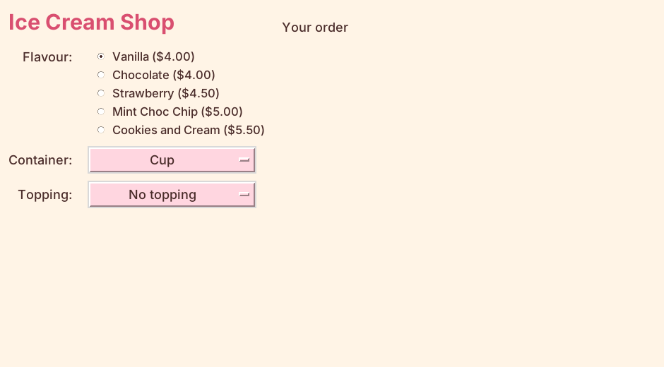

================================================
Drop-down menus for containers and toppings
================================================

- **Objective**: Add drop-down menus for the container and topping.

----

What is a drop-down menu?
--------------------------------

- A **drop-down menu** shows one choice. Click it to see the rest.
- In Tkinter it is called an ``OptionMenu``.
- A loop adds one choice for each key in the dictionary.

----

Step 1: Add the container label and variable
-----------------------------------------------

| Replace ``# J`` with Block J.

.. code-block:: python
   :caption: Block J

    # Container (drop-down menu)
    container_label = tk.Label(root)  # 1. create
    container_label.grid(row=2, column=0, padx=10, pady=5, sticky="e")  # 2. position
    container_label.config(text="Container:", font=LABEL_FONT, bg=BG_COLOUR, fg=TEXT_COLOUR)  # 3. configure

    container_var = tk.StringVar(root)  # A. make
    container_var.set("Cup")  # B. set

- Make the **variable** before the menu, because the menu needs it.

----

Step 2: Add the container menu
--------------------------------------

| Replace ``# K`` with Block K.

.. code-block:: python
   :caption: Block K

    container_menu = tk.OptionMenu(root, container_var, "Cup")  # 1. create
    container_menu.grid(row=2, column=1, padx=10, pady=5, sticky="w")  # 2. position
    container_menu.config(width=16, font=LABEL_FONT, bg=MENU_COLOUR, fg=TEXT_COLOUR,
                          activebackground=MENU_COLOUR)  # 3. configure

    container_choices = container_menu["menu"]
    container_choices.config(font=LABEL_FONT, bg=MENU_COLOUR, fg=TEXT_COLOUR)
    container_choices.delete(0)   # remove the starting choice
    for container in containers.keys():
        container_choices.add_radiobutton(label=container, variable=container_var, value=container)

- ``delete(0)`` removes "Cup" so the loop doesn't add it twice.
- The loop adds one choice for each container.

----

Step 3: Add the topping label and variable
---------------------------------------------

| Same pattern again. Replace ``# L`` with Block L.

.. code-block:: python
   :caption: Block L

    # Topping (drop-down menu)
    topping_label = tk.Label(root)  # 1. create
    topping_label.grid(row=3, column=0, padx=10, pady=5, sticky="e")  # 2. position
    topping_label.config(text="Topping:", font=LABEL_FONT, bg=BG_COLOUR, fg=TEXT_COLOUR)  # 3. configure

    topping_var = tk.StringVar(root)  # A. make
    topping_var.set("No topping")  # B. set

----

Step 4: Add the topping menu
--------------------------------------

| Replace ``# M`` with Block M.

.. code-block:: python
   :caption: Block M

    topping_menu = tk.OptionMenu(root, topping_var, "No topping")  # 1. create
    topping_menu.grid(row=3, column=1, padx=10, pady=5, sticky="w")  # 2. position
    topping_menu.config(width=16, font=LABEL_FONT, bg=MENU_COLOUR, fg=TEXT_COLOUR,
                        activebackground=MENU_COLOUR)  # 3. configure

    topping_choices = topping_menu["menu"]
    topping_choices.config(font=LABEL_FONT, bg=MENU_COLOUR, fg=TEXT_COLOUR)
    topping_choices.delete(0)   # remove the starting choice
    for topping in toppings.keys():
        topping_choices.add_radiobutton(label=topping, variable=topping_var, value=topping)

| **Run it.** Click each drop-down and check all the choices are there.

----

Quiz
--------------------------------

.. mcqgroup::
    :nav_position: both
    :show-instant-feedback:
    :enable-instant-feedback:
    :shuffle_questions:
    :num_questions: 4

    .. multichoice::

        What is a drop-down menu called in Tkinter?

        [x] OptionMenu | Correct.
        [ ] Radiobutton | Incorrect. That shows every choice at once.
        [ ] Listbox | Incorrect. That shows a list of lines.

    .. multichoice::

        Where do the container choices come from?

        [x] The keys of the containers dictionary | Correct.
        [ ] The values of the containers dictionary | Incorrect. Those are the prices.
        [ ] The flavours dictionary | Incorrect. Flavours are radio buttons.

    .. multichoice::

        Why is container_var made before container_menu?

        [x] The menu needs the variable when it is created | Correct.
        [ ] It makes the menu pink | Incorrect. MENU_COLOUR does that.
        [ ] It doesn't matter | Incorrect. Python would give an error.

    .. multichoice::

        A new container is added to the dictionary. What happens?

        [x] It appears in the menu | Correct. The loop reads the dictionary.
        [ ] Nothing | Incorrect. The loop adds every key.
        [ ] The program crashes | Incorrect.

----

Fill in the gaps
--------------------------------

.. clozegroup::
    :nav-position: both
    :num-questions: 1
    :show-instant-feedback:

    .. cloze::
        :instructions: Make the topping drop-down and add its choices.

        topping_menu = tk.@@OptionMenu | Radiobutton | Listbox@@(root, @@topping_var | toppings | topping_menu@@, "No topping")

        topping_choices = topping_menu["menu"]
        topping_choices.@@delete | clear | remove@@(0)
        for topping in toppings.@@keys | values | set@@():
            topping_choices.add_radiobutton(label=topping, variable=topping_var, value=topping)
