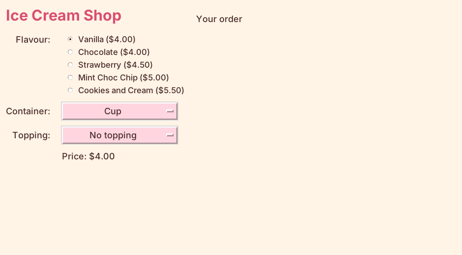

================================================
Showing the price
================================================

- **Objective**: Work out the price of the chosen ice cream and show it. Update the price whenever the user changes a choice.
- **Content**:

  - The price label.
  - Working out the price with the dictionaries.
  - Showing the price.
  - Binding the choices to the price.
  - Starting the app with the right price.

----

Adding the price label
--------------------------------

| Place the following code below the topping drop-down in Section "4. TKINTER WIDGETS".

.. code-block:: python

    # Price of the chosen ice cream
    price_label = tk.Label(root)  # 1. create
    price_label.grid(row=4, column=1, padx=10, pady=5, sticky="w")  # 2. position
    price_label.config(text="Price: $0.00", font=LABEL_FONT, bg=BG_COLOUR, fg=TEXT_COLOUR)  # 3. configure

- The price label goes in row 4, column 1, under the drop-down menus.
- It starts with the text "Price: $0.00". The program will change this text.

----

Working out the price
--------------------------------

| Place the following code in Section "3. DEFINITIONS".

.. code-block:: python

    def get_ice_cream_price():
        """Adds up the flavour, container and topping prices for one ice cream."""
        flavour = flavour_var.get()
        container = container_var.get()
        topping = topping_var.get()
        price = flavours[flavour] + containers[container] + toppings[topping]
        return price

- ``def get_ice_cream_price():`` starts a **definition** (a function). Its code runs each time the function is called.
- The text inside ``""" """`` is a **docstring**. It says what the function does.
- ``flavour_var.get()`` gets the flavour that is chosen right now, e.g. ``"Strawberry"``.
- ``flavours[flavour]`` uses that flavour as a key to look up its price in the dictionary.
- The three prices are added together.
- ``return price`` sends the answer back to the code that called the function.

| For example, Strawberry in a Waffle cone with Sprinkles is:

.. code-block::
   :class: no-copybutton

    flavours["Strawberry"] + containers["Waffle cone"] + toppings["Sprinkles"]
    # 4.50 + 1.50 + 0.50 = 6.50

----

Showing the price
--------------------------------

| Place the following code in Section "3. DEFINITIONS", below ``get_ice_cream_price``.

.. code-block:: python

    def update_ice_cream_price(*args):
        """Shows the price of the ice cream that is chosen right now."""
        price = get_ice_cream_price()
        price_label.config(text=f"Price: ${price:.2f}")

- ``price = get_ice_cream_price()`` calls the first function and stores its answer.
- ``price_label.config(text=...)`` changes the text of the price label.
- ``*args`` lets the function accept the extra information that Tkinter sends when a variable changes. We do not use it, but the function needs to accept it.

----

Binding the choices to the price
--------------------------------------

| The price must change **every time** the user picks a different flavour, container or topping.
| ``trace_add`` **binds** a variable to a function: when the variable changes, the function runs.
| Each binding line goes **straight after** the lines that make its variable.

| Add this line directly below ``flavour_var.set("Vanilla")``:

.. code-block:: python

    flavour_var.trace_add("write", update_ice_cream_price)  # C. bind

| Add this line directly below ``container_var.set("Cup")``:

.. code-block:: python

    container_var.trace_add("write", update_ice_cream_price)  # C. bind

| Add this line directly below ``topping_var.set("No topping")``:

.. code-block:: python

    topping_var.trace_add("write", update_ice_cream_price)  # C. bind

- ``"write"`` means "when a new value is written into the variable".

----

Starting with the right price
--------------------------------------

| When the app first opens, nothing has changed yet, so the price would still say $0.00.
| Add this line in Section "5. MAIN CODE", above ``root.mainloop()``.

.. code-block:: python

    update_ice_cream_price()

| Run the code. The price should say $4.00 for a Vanilla cup with no topping, and change each time you pick something new.

----

Quiz
--------------------------------

.. mcqgroup::
    :nav_position: both
    :show-instant-feedback:
    :enable-instant-feedback:
    :shuffle_questions:
    :num_questions: 6

    .. multichoice::

        What does flavour_var.get() give?

        [x] The flavour that is chosen right now | Correct. get() reads the value stored in the variable.
        [ ] The price of the flavour | Incorrect. The price is looked up in the flavours dictionary.
        [ ] Every flavour | Incorrect. The variable holds one flavour.
        [ ] The radio button widget | Incorrect. It gives a string, such as "Vanilla".

    .. multichoice::

        What is the price of Mint Choc Chip in a Plain cone with Chocolate sauce?

        [ ] $5.00 | Incorrect. This is only the flavour price.
        [ ] $6.00 | Incorrect. Remember to add the plain cone as well.
        [x] $6.50 | Correct. 5.00 + 0.50 + 1.00 = 6.50.
        [ ] $7.50 | Incorrect. A plain cone costs 0.50, not 1.50.

    .. multichoice::

        What does return price do?

        [ ] Prints the price in the shell | Incorrect. print() does that.
        [x] Sends the price back to the code that called the function | Correct. The caller can then store or use it.
        [ ] Shows the price in the window | Incorrect. update_ice_cream_price changes the label.
        [ ] Resets the price to 0 | Incorrect. It does not change the price.

    .. multichoice::

        What does flavour_var.trace_add("write", update_ice_cream_price) do?

        [ ] Runs update_ice_cream_price once, straight away | Incorrect. It sets up the function to run later.
        [x] Runs update_ice_cream_price every time flavour_var changes | Correct. This binds the variable to the function.
        [ ] Writes the price into flavour_var | Incorrect. "write" means the trace runs when the variable is written to.
        [ ] Adds a new flavour | Incorrect. The dictionary does not change.

    .. multichoice::

        Where should the trace_add line for container_var go?

        [x] Straight after container_var.set("Cup") | Correct. The binding follows the lines that make the variable.
        [ ] At the very top of the program | Incorrect. container_var does not exist yet at the top.
        [ ] Inside the flavours dictionary | Incorrect. Dictionaries only hold data.
        [ ] After root.mainloop() | Incorrect. Code after mainloop() does not run until the window closes.

    .. multichoice::

        Why is update_ice_cream_price() also called in the main code?

        [ ] To close the app | Incorrect. It does not close anything.
        [ ] To add an ice cream to the order | Incorrect. add_ice_cream does that.
        [x] To show the correct price when the app first opens | Correct. No choice has changed yet, so the trace has not run.
        [ ] It is not needed | Incorrect. Without it the label would say $0.00 at the start.

----

Fill in the gaps
--------------------------------

.. clozegroup::
    :nav-position: both
    :num-questions: 2
    :show-instant-feedback:

    .. cloze::
        :instructions: Work out the price of one ice cream.

        def get_ice_cream_price():
            flavour = flavour_var.@@get | set | trace_add@@()
            container = container_var.get()
            topping = topping_var.get()
            price = flavours[@@flavour | container | topping@@] + containers[container] + toppings[topping]
            @@return | print | def@@ price

    .. cloze::
        :instructions: Bind the topping choice to the price.

        topping_var = tk.StringVar(root)
        topping_var.set("No topping")
        topping_var.@@trace_add | config | get@@("@@write | read | click@@", update_ice_cream_price)
