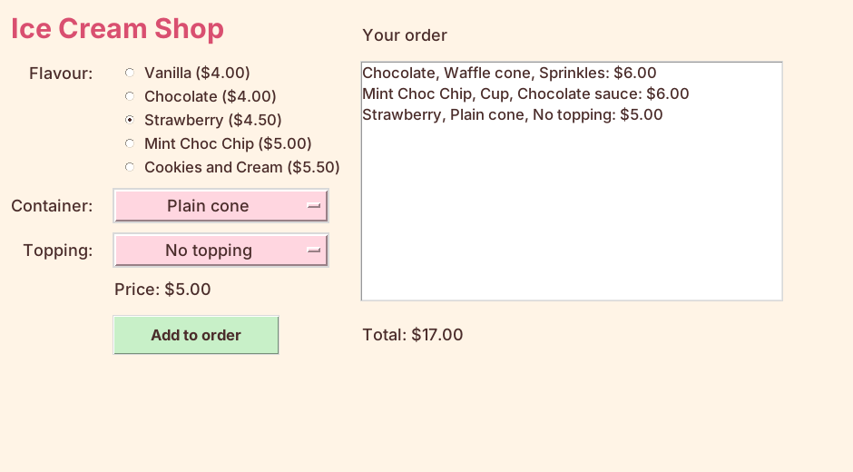

================================================
Adding ice creams to the order
================================================

- **Objective**: Add ice creams to the order and show the total.

----

How it works
--------------------------------

- Each ice cream is stored as a small **dictionary**.
- Each dictionary is added to the ``orders`` **list**.
- A **Listbox** shows the list in the window.

.. code-block::
   :class: no-copybutton

    {"flavour": "Strawberry", "container": "Waffle cone", "topping": "Sprinkles", "price": 6.50}

----

Step 1: Add the order functions
--------------------------------------

| Paste this under ``# 3. DEFINITIONS``, below ``update_ice_cream_price``.

.. code-block:: python

    def show_ice_cream_orders():
        """Redraws the order list and the total so they match the orders list."""
        order_listbox.delete(0, tk.END)
        total = 0
        for ice_cream in orders:
            flavour = ice_cream["flavour"]
            container = ice_cream["container"]
            topping = ice_cream["topping"]
            price = ice_cream["price"]
            order_listbox.insert(tk.END, f"{flavour}, {container}, {topping}: ${price:.2f}")
            total = total + price
        total_label.config(text=f"Total: ${total:.2f}")

    def add_ice_cream():
        """Adds the chosen ice cream to the orders list."""
        ice_cream = {
            "flavour": flavour_var.get(),
            "container": container_var.get(),
            "topping": topping_var.get(),
            "price": get_ice_cream_price(),
        }
        orders.append(ice_cream)
        show_ice_cream_orders()

- ``show_ice_cream_orders`` clears the Listbox, then adds a line for each ice cream and adds up the total.
- ``add_ice_cream`` stores the choices, appends them to ``orders``, then redraws.

----

Step 2: Add the Add to order button
--------------------------------------

| Paste this below the price label code, above ``# --- RIGHT SIDE``.

.. code-block:: python

    # Add to order button
    add_button = tk.Button(root)  # 1. create
    add_button.grid(row=5, column=1, padx=10, pady=10, ipady=4, sticky="w")  # 2. position
    add_button.config(text="Add to order", width=14, font=BUTTON_FONT, bg=ADD_COLOUR, fg=TEXT_COLOUR)  # 3. configure
    add_button.config(command=add_ice_cream)  # 4. command

- Step 4, **command**, runs ``add_ice_cream`` when clicked. No brackets after the name.

----

Step 3: Add the order list and total
--------------------------------------

| Paste this below the order heading code.

.. code-block:: python

    # Order list
    order_listbox = tk.Listbox(root)  # 1. create
    order_listbox.grid(row=1, column=2, rowspan=4, columnspan=2, padx=10, pady=5, sticky="nsew")  # 2. position
    order_listbox.config(width=42, height=10, font=LIST_FONT, bg=LIST_COLOUR, fg=TEXT_COLOUR)  # 3. configure

    # Total cost of the order
    total_label = tk.Label(root)  # 1. create
    total_label.grid(row=5, column=2, columnspan=2, padx=10, pady=5, sticky="w")  # 2. position
    total_label.config(text="Total: $0.00", font=LABEL_FONT, bg=BG_COLOUR, fg=TEXT_COLOUR)  # 3. configure

- ``rowspan=4`` makes the Listbox cover 4 rows.

----

Step 4: Show the order at the start
--------------------------------------

| Paste this under ``# 5. MAIN CODE``, below ``update_ice_cream_price()``.

.. code-block:: python

    show_ice_cream_orders()

| **Run it.** Add three ice creams. Check each price and the total.

----

Quiz
--------------------------------

.. mcqgroup::
    :nav_position: both
    :show-instant-feedback:
    :enable-instant-feedback:
    :shuffle_questions:
    :num_questions: 4

    .. multichoice::

        What happens when Add to order is clicked?

        [x] add_ice_cream runs | Correct. command= links the button to it.
        [ ] The app closes | Incorrect.
        [ ] A new flavour is added | Incorrect.

    .. multichoice::

        What is stored in the orders list?

        [x] One dictionary for each ice cream | Correct.
        [ ] Only the prices | Incorrect. The choices are stored too.
        [ ] The radio buttons | Incorrect. The list holds data.

    .. multichoice::

        Two ice creams cost $6.50 and $4.00. What is the total?

        [x] $10.50 | Correct.
        [ ] $6.50 | Incorrect. That is only one.
        [ ] $0.00 | Incorrect.

    .. multichoice::

        Why does show_ice_cream_orders clear the Listbox first?

        [x] So ice creams don't appear twice | Correct.
        [ ] To delete the orders list | Incorrect. Only the Listbox is cleared.
        [ ] To close the Listbox | Incorrect.

----

Fill in the gaps
--------------------------------

.. clozegroup::
    :nav-position: both
    :num-questions: 1
    :show-instant-feedback:

    .. cloze::
        :instructions: Add the chosen ice cream to the orders list.

        def add_ice_cream():
            ice_cream = {
                "flavour": flavour_var.get(),
                "container": container_var.get(),
                "topping": topping_var.get(),
                "price": @@get_ice_cream_price() | update_ice_cream_price() | price_label@@,
            }
            orders.@@append | insert | clear@@(ice_cream)
            show_ice_cream_orders()
