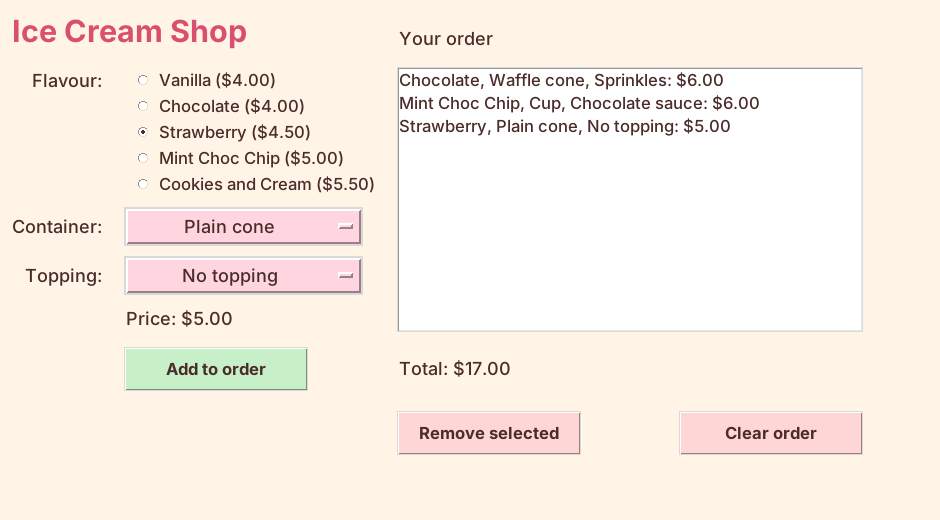

================================================
Removing and clearing the order
================================================

- **Objective**: Let the user remove one ice cream or clear the whole order.
- **Content**:

  - Importing messagebox.
  - The Remove selected and Clear order buttons.
  - Removing the selected ice cream from the list.
  - Clearing the list.
  - Final testing.

----

Importing messagebox
--------------------------------

| A **messagebox** is a small pop-up window with a message and an OK button.
| Add this import at the top of the code, directly below ``import tkinter as tk``.

.. code-block:: python

    from tkinter import messagebox

----

Adding the buttons
--------------------------------

| Place the following code below the total label code in Section "4. TKINTER WIDGETS".

.. code-block:: python

    # Remove selected button
    remove_button = tk.Button(root)  # 1. create
    remove_button.grid(row=6, column=2, padx=10, pady=10, ipady=4, sticky="w")  # 2. position
    remove_button.config(text="Remove selected", width=14, font=BUTTON_FONT, bg=REMOVE_COLOUR, fg=TEXT_COLOUR)  # 3. configure
    remove_button.config(command=remove_ice_cream)  # 4. command

    # Clear order button
    clear_button = tk.Button(root)  # 1. create
    clear_button.grid(row=6, column=3, padx=10, pady=10, ipady=4, sticky="e")  # 2. position
    clear_button.config(text="Clear order", width=14, font=BUTTON_FONT, bg=REMOVE_COLOUR, fg=TEXT_COLOUR)  # 3. configure
    clear_button.config(command=clear_ice_cream_orders)  # 4. command

- Both buttons go in row 6, under the order list.
- ``sticky="e"`` pushes the Clear order button to the **east** (right) side, lining it up with the right edge of the Listbox.
- Both buttons use ``REMOVE_COLOUR``, a pale red, so the user can tell they take things away.
- The last line of each group is step 4, the **command**: ``remove_ice_cream`` or ``clear_ice_cream_orders`` runs when the button is clicked.

----

Removing the selected ice cream
--------------------------------------

| Place the following code in Section "3. DEFINITIONS", below ``add_ice_cream``.

.. code-block:: python

    def remove_ice_cream():
        """Removes the ice cream that is selected in the order list."""
        selection = order_listbox.curselection()
        if not selection:
            messagebox.showinfo("Remove", "Click an ice cream in the order list first.")
        else:
            line_number = selection[0]
            del orders[line_number]
            show_ice_cream_orders()

- ``order_listbox.curselection()`` finds which line the user clicked. It gives the line number inside brackets, e.g. ``(1,)``. If nothing is clicked, it gives ``()``, which is empty.
- ``if not selection:`` is True when nothing is selected. A messagebox tells the user what to do.
- ``selection[0]`` gets the line number out of the brackets.
- Line 0 of the Listbox shows ``orders[0]``, line 1 shows ``orders[1]``, and so on. So the line number is also the index in the list.
- ``del orders[line_number]`` deletes that ice cream from the list.
- ``show_ice_cream_orders()`` redraws the Listbox and the total.

----

Clearing the order
--------------------------------------

| Place the following code in Section "3. DEFINITIONS", below ``remove_ice_cream``.

.. code-block:: python

    def clear_ice_cream_orders():
        """Removes every ice cream from the orders list."""
        orders.clear()
        show_ice_cream_orders()

- ``orders.clear()`` removes every item from the list, leaving ``[]``.
- ``show_ice_cream_orders()`` redraws the now empty Listbox, and the total goes back to $0.00.

:download:`icecream_orders_08.py <python/icecream_orders_08.py>`

----

Final testing
--------------------------------------

| Test every part of the app. Tick each test when it works.

.. list-table::
    :header-rows: 1
    :widths: 60 40

    * - Test
      - Expected result
    * - Click each flavour radio button.
      - Only one is chosen. The price changes.
    * - Pick each container and each topping.
      - The price changes each time.
    * - Pick Strawberry, Waffle cone, Sprinkles.
      - Price: $6.50
    * - Click **Add to order** three times with different choices.
      - Three lines appear. The total is correct.
    * - Click the second line, then **Remove selected**.
      - Only that line is removed. The total goes down.
    * - Click **Remove selected** with nothing selected.
      - A message asks you to click an ice cream first.
    * - Click **Clear order**.
      - The list is empty. Total: $0.00

----

Quiz
--------------------------------

.. mcqgroup::
    :nav_position: both
    :show-instant-feedback:
    :enable-instant-feedback:
    :shuffle_questions:
    :num_questions: 5

    .. multichoice::

        Why is from tkinter import messagebox needed?

        [x] So the app can show a pop-up message | Correct. messagebox.showinfo needs this import.
        [ ] So the buttons can be clicked | Incorrect. Buttons work without it.
        [ ] So the Listbox can show lines | Incorrect. The Listbox is part of tkinter already.
        [ ] It is not needed | Incorrect. Without it, messagebox.showinfo would cause an error.

    .. multichoice::

        The user clicks the third line in the order list. What does order_listbox.curselection() give?

        [ ] (3,) | Incorrect. Line numbers start at 0.
        [x] (2,) | Correct. The first line is 0, so the third line is 2.
        [ ] () | Incorrect. An empty result means nothing is selected.
        [ ] The ice cream's price | Incorrect. It gives the line number.

    .. multichoice::

        What does del orders[line_number] do?

        [ ] Deletes the whole orders list | Incorrect. orders.clear() empties the whole list.
        [x] Deletes one ice cream from the orders list | Correct. It removes the item at that index.
        [ ] Deletes one line from the Listbox only | Incorrect. It changes the list. The Listbox is then redrawn.
        [ ] Deletes a flavour from the dictionary | Incorrect. The dictionaries do not change.

    .. multichoice::

        What does orders.clear() leave behind?

        [x] An empty list, [] | Correct. clear() removes every item.
        [ ] Nothing, the list is deleted | Incorrect. The list still exists; it is just empty.
        [ ] The first ice cream | Incorrect. Every item is removed.
        [ ] The total | Incorrect. The total is worked out again by show_ice_cream_orders.

    .. multichoice::

        Why do remove_ice_cream and clear_ice_cream_orders both call show_ice_cream_orders()?

        [ ] To add a new ice cream | Incorrect. add_ice_cream does that.
        [x] So the Listbox and total match the list again | Correct. The list has changed, so the display must be redrawn.
        [ ] To show a messagebox | Incorrect. show_ice_cream_orders only redraws the Listbox and total.
        [ ] It is not needed | Incorrect. Without it, the old lines would stay on the screen.

----

Fill in the gaps
--------------------------------

.. clozegroup::
    :nav-position: both
    :num-questions: 1
    :show-instant-feedback:

    .. cloze::
        :instructions: Remove the selected ice cream, or clear the whole order.

        def remove_ice_cream():
            selection = order_listbox.@@curselection | get | delete@@()
            if not selection:
                messagebox.showinfo("Remove", "Click an ice cream in the order list first.")
            else:
                line_number = selection[@@0 | 1 | -1@@]
                @@del | clear | remove@@ orders[line_number]
                show_ice_cream_orders()

        def clear_ice_cream_orders():
            orders.@@clear | delete | append@@()
            show_ice_cream_orders()
