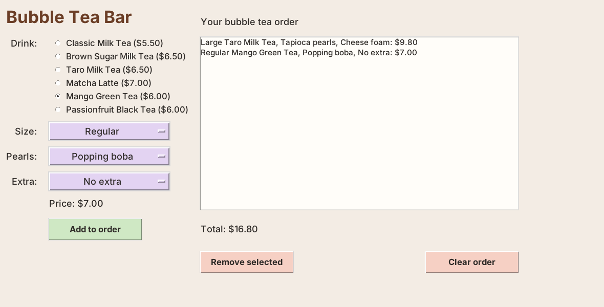
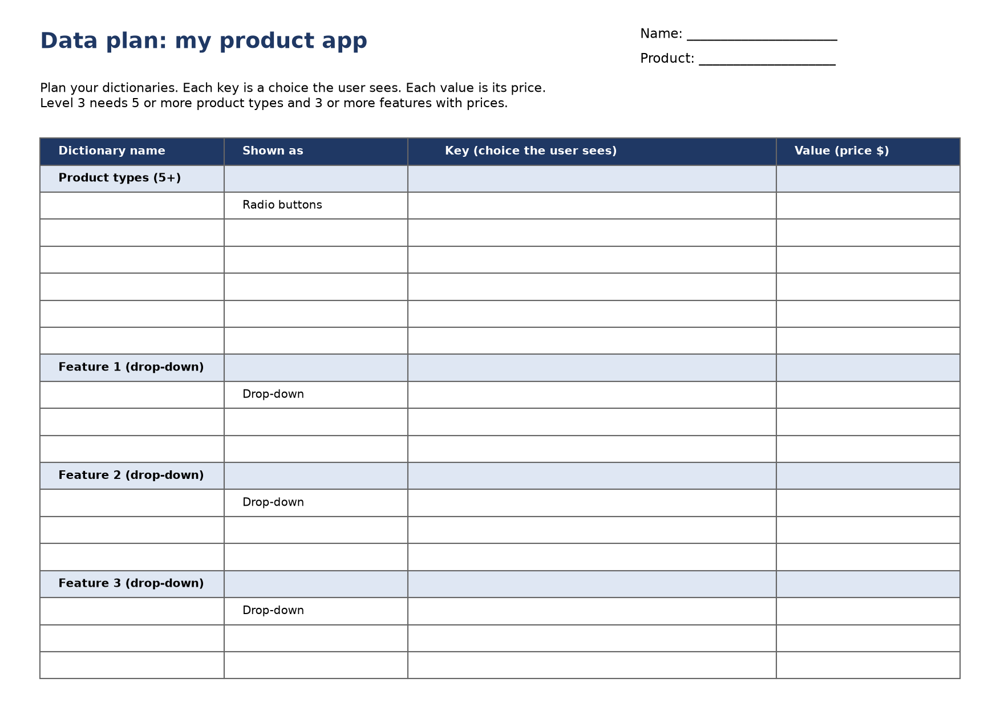
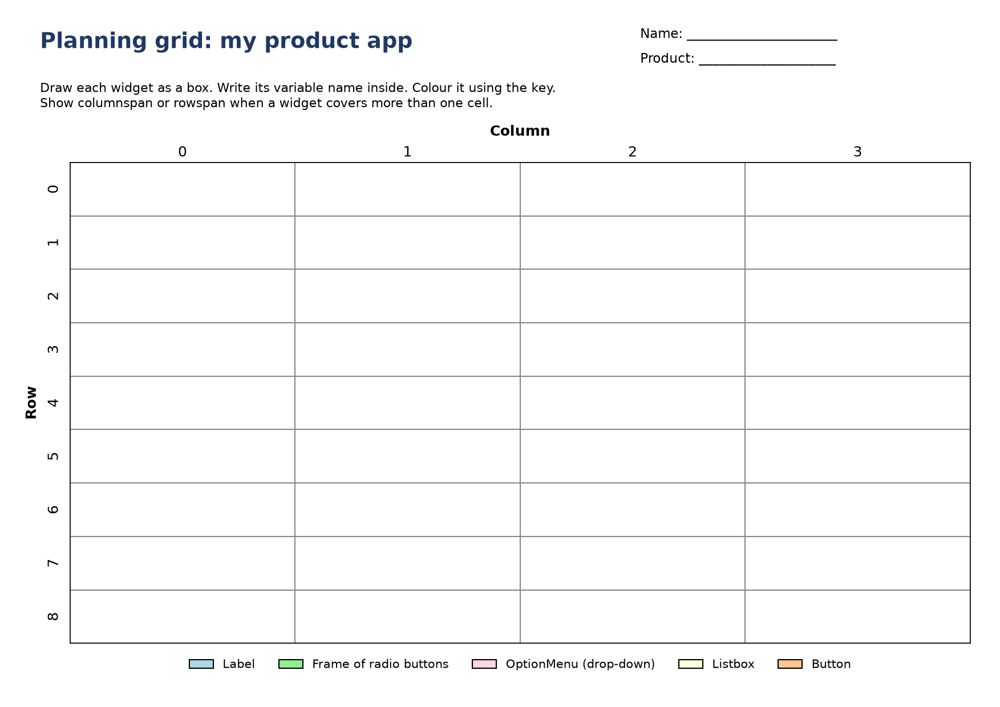
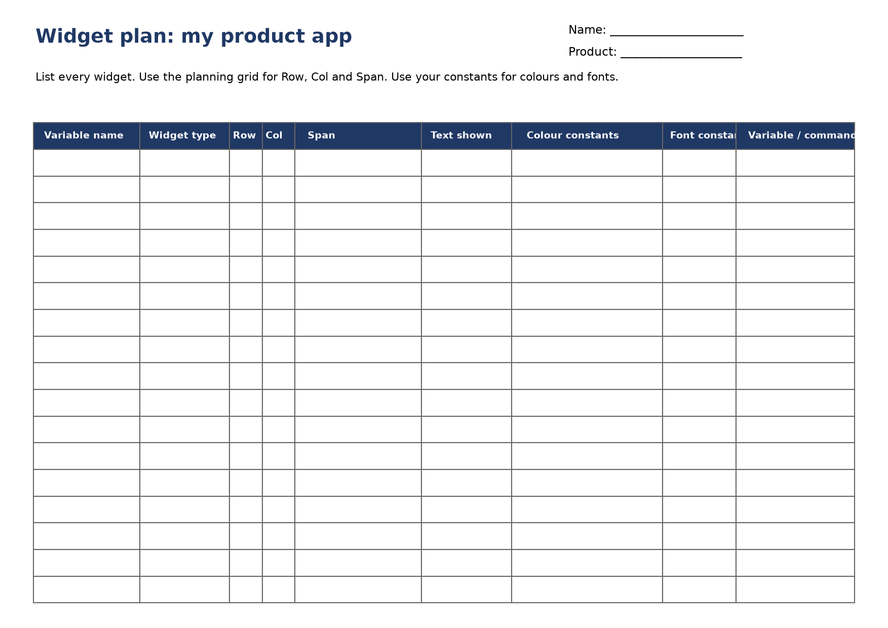
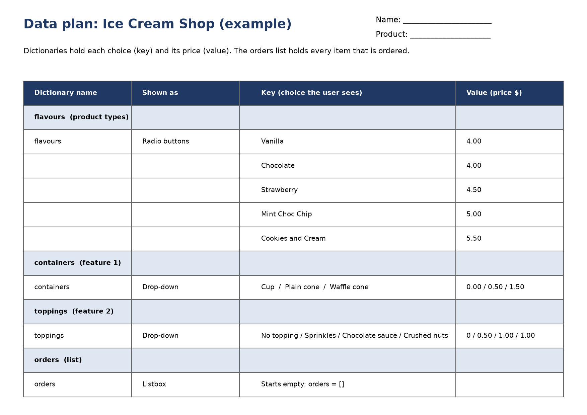
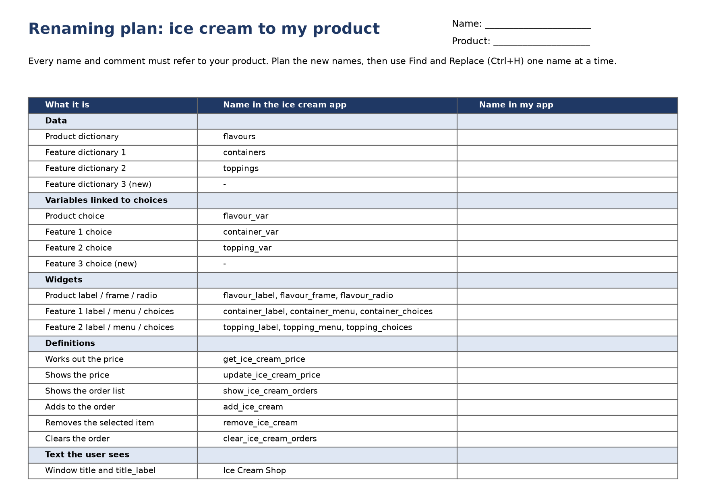

================================================
Project: make it your own
================================================

| *Example: the Ice Cream Shop changed into a Bubble Tea Bar.*

- **Objective**: Change the app to sell a product you choose.

----

The project brief
--------------------------------

| Your app must let the user:

- pick a **product type** (radio buttons),
- pick **features** (drop-down menus),
- see the **price** and the **total**,
- **add**, **remove** and **clear** the order.

.. list-table::
    :widths: 33 33 34

    * - Bubble tea
      - Burgers
      - Pizza
    * - Smoothies
      - Sushi
      - Phone cases
    * - Sneakers
      - Birthday cakes
      - Tacos
    * - Pet grooming
      - Coffee
      - Skateboards

----

The marking rubric
--------------------------------

.. list-table::
    :header-rows: 1
    :widths: 16 28 28 28

    * - Criteria
      - Level 1
      - Level 2
      - Level 3
    * - Code order
      - Imports are placed at the top of the code, followed by data dictionaries.
      - Constants are placed after dictionaries.
      - Definitions are placed after constants, before any tkinter widgets.
    * - Code grouping for widgets
      - Positioning of each widget using grid or pack methods follows the code lines for each widget creation.
      - Code for configuration of text and colour of a widget follows positioning code.
      - Event binding of user interactions to a widget via variables follows the code lines for the variable.
    * - Variable naming and comments
      - Variables are renamed appropriately based on the product.
      - All variables and comments refer to the product.
      - Definitions renamed to refer to the product.
    * - Data dictionary
      - The data dictionary has 1 to 2 product types and 1 to 2 features with their prices.
      - The data dictionary has 3 to 4 product types and 2 to 3 features with their prices.
      - The data dictionary has 5 or more product types and 3 or more features with their prices.
    * - Product choices
      - Window and product labels refer to the product.
      - Radio buttons display product choices.
      - Drop-downs provide choice to the user.
    * - Customisation
      - A few colour constants have been modified.
      - Modified font constants.
      - Widget colours and fonts have been customised such that the design is visually consistent and engaging.
    * - Functionality
      - Radio buttons function as expected.
      - Drop-downs function as expected.
      - Order buttons and the order list function as expected.

----

Step 1: Plan
--------------------------------

| Fill in the planning sheets **before** changing any code.

#. **Data plan**: product types and features, each with a price.
#. **Planning grid**: where each widget goes.
#. **Widget plan**: each widget's row, column, text, colours and font.

| Example:

----

Step 2: Copy and rename
--------------------------------

#. Save a copy of ``icecream_orders.py`` with a new name, e.g. ``bubble_tea_orders.py``.
#. Fill in the **renaming plan**.

3. Use **Find and Replace** (Ctrl+H) for **one name at a time**. Run the app after each one.
4. Replace **longer names first**, e.g. ``flavour_var`` before ``flavour``.
5. Change the comments and function names too.

.. list-table::
    :header-rows: 1
    :widths: 50 50

    * - Ice cream app
      - Bubble tea app
    * - ``flavours``
      - ``drinks``
    * - ``flavour_var``
      - ``drink_var``
    * - ``containers``
      - ``sizes``
    * - ``get_ice_cream_price``
      - ``get_drink_price``
    * - ``add_ice_cream``
      - ``add_drink``

----

Step 3: Change the data
--------------------------------

- Change the dictionaries to match your data plan.
- Change each ``.set(...)`` so it matches a key **exactly**.
- Change the window title, title label and order heading.

----

Step 4: Change the look
--------------------------------

- Change the colour and font constants to suit your product.
- Keep text dark on a light background so it is easy to read.
- Fonts to try: ``"Segoe UI"``, ``"Trebuchet MS"``, ``"Verdana"``, ``"Georgia"``.

----

Step 5: Test and check
--------------------------------

| Use the tests from :doc:`icecream_lesson08`. Then tick off each check.

.. list-table::
    :header-rows: 1
    :widths: 80 20

    * - Check
      - Done
    * - Code order: imports, data, constants, definitions, widgets.
      -
    * - Each widget: create, position, configure (and command for buttons).
      -
    * - Each ``trace_add`` line comes straight after its variable.
      -
    * - No "ice cream", "flavour", "container" or "topping" left (Ctrl+F).
      -
    * - 5 or more product types and 3 or more features, each with a price.
      -
    * - Colours and fonts changed and look consistent.
      -
    * - Everything works: buttons, drop-downs, price, order list, total.
      -

----

Extension: add a third feature
--------------------------------

| Level 3 needs **3 or more** features. The bubble tea example adds ``extras``.

**1.** Add a new dictionary under ``# 1. DATA DICTIONARIES & LISTS``.

.. code-block:: python

    # Extras and their extra cost
    extras = {
        "No extra": 0.00,
        "Cheese foam": 1.50,
        "Pudding": 1.20,
    }

**2.** Add the drop-down below your last drop-down.

.. code-block:: python

    # Extra (drop-down menu)
    extra_label = tk.Label(root)  # 1. create
    extra_label.grid(row=4, column=0, padx=10, pady=5, sticky="e")  # 2. position
    extra_label.config(text="Extra:", font=LABEL_FONT, bg=BG_COLOUR, fg=TEXT_COLOUR)  # 3. configure

    extra_var = tk.StringVar(root)  # A. make
    extra_var.set("No extra")  # B. set
    extra_var.trace_add("write", update_drink_price)  # C. bind

    extra_menu = tk.OptionMenu(root, extra_var, "No extra")  # 1. create
    extra_menu.grid(row=4, column=1, padx=10, pady=5, sticky="w")  # 2. position
    extra_menu.config(width=16, font=LABEL_FONT, bg=MENU_COLOUR, fg=TEXT_COLOUR,
                      activebackground=MENU_COLOUR)  # 3. configure

    extra_choices = extra_menu["menu"]
    extra_choices.config(font=LABEL_FONT, bg=MENU_COLOUR, fg=TEXT_COLOUR)
    extra_choices.delete(0)   # remove the starting choice
    for extra in extras.keys():
        extra_choices.add_radiobutton(label=extra, variable=extra_var, value=extra)

**3.** Move the widgets below it down: add 1 to each ``row=`` and change the Listbox to ``rowspan=5``.

**4.** In the price function, add the new price.

.. code-block::
   :class: no-copybutton

    extra = extra_var.get()
    price = drinks[drink] + sizes[size] + pearls[pearl] + extras[extra]

**5.** In ``add_drink``, store the new choice. Show it in the Listbox line too.

.. code-block::
   :class: no-copybutton

    "extra": extra_var.get(),
