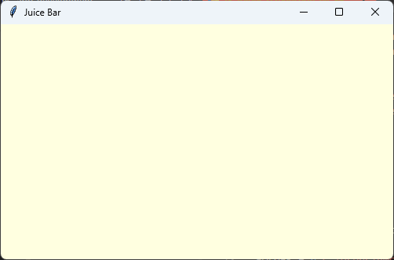
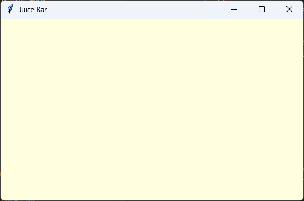

================================================
1. The window and the code sections
================================================

- **Objective**: Make a window and set out a program in five sections, in the right order.
- **Skills for the ice cream app**: ``import tkinter as tk``, ``tk.Tk()``, ``title()``, ``geometry()``, ``config(bg=...)``, ``mainloop()``.

----

Making a window
--------------------------------

| Every Tkinter app starts the same way. Type this code into a new file called ``juice_bar.py`` and run it.

.. code-block:: python

    import tkinter as tk

    root = tk.Tk()
    root.title("Juice Bar")
    root.geometry("500x300")
    root.config(bg="lightyellow")

    root.mainloop()

- ``import tkinter as tk`` loads the Tkinter library. We can now write ``tk`` instead of ``tkinter``.
- ``root = tk.Tk()`` makes the main window. We call it ``root``.
- ``root.title("Juice Bar")`` puts words in the window's title bar.
- ``root.geometry("500x300")`` makes the window 500 pixels wide and 300 pixels tall. Use a small ``x``, with no spaces.
- ``root.config(bg="lightyellow")`` colours the background. ``bg`` means **background**.
- ``root.mainloop()`` keeps the window open and waits for the user to click things. It always goes **last**.

----

The five sections
--------------------------------

| Bigger programs are easier to read when every part has its own place.
| The ice cream app uses these sections, **in this order**:

.. list-table::
    :header-rows: 1
    :widths: 35 65

    * - Section
      - What goes in it
    * - Imports
      - ``import tkinter as tk``, at the very top.
    * - 1. DATA DICTIONARIES & LISTS
      - The choices and their prices.
    * - 2. CONSTANTS
      - Colours and fonts.
    * - 3. DEFINITIONS
      - The functions, made with ``def``.
    * - 4. TKINTER WIDGETS
      - The window and everything in it.
    * - 5. MAIN CODE
      - The lines that start the app, ending with ``root.mainloop()``.

| Here is the same window, set out in the five sections. The empty sections will be filled in later lessons.

.. code-block:: python

    import tkinter as tk

    # 1. DATA DICTIONARIES & LISTS

    # 2. CONSTANTS

    # 3. DEFINITIONS

    # 4. TKINTER WIDGETS
    # Main window
    root = tk.Tk()
    root.title("Juice Bar")
    root.geometry("500x300")
    root.config(bg="lightyellow")

    # 5. MAIN CODE
    root.mainloop()

- Lines that start with ``#`` are **comments**. Python ignores them. They help people find their way around the code.
- Python reads the file from the **top down**. Something must be made before it can be used.

----

.. admonition:: Tasks

    #. Make a window titled "Taco Truck" that is 500 pixels wide and 350 pixels tall.
    #. Give the Taco Truck window a ``"lightgreen"`` background.
    #. Set out your Taco Truck program in the five sections, with a comment for each one.
    #. This code has two mistakes. Find and fix them.

       .. code-block::
          :class: no-copybutton

          import tkinter as tk
          root = tk.Tk()
          root.title("Pet Shop")
          root.geometry("300 x 200")

    .. dropdown::
        :icon: codescan
        :color: primary
        :class-container: sd-dropdown-container

        .. tab-set::

            .. tab-item:: Q1

                .. code-block:: python

                    import tkinter as tk

                    root = tk.Tk()
                    root.title("Taco Truck")
                    root.geometry("500x350")

                    root.mainloop()

                .. image:: images/skills01_task1_answer.png
                    :align: center

            .. tab-item:: Q2

                .. code-block:: python

                    import tkinter as tk

                    root = tk.Tk()
                    root.title("Taco Truck")
                    root.geometry("500x350")
                    root.config(bg="lightgreen")

                    root.mainloop()

                .. image:: images/skills01_task2_answer.png
                    :align: center

            .. tab-item:: Q3

                .. code-block:: python

                    import tkinter as tk

                    # 1. DATA DICTIONARIES & LISTS

                    # 2. CONSTANTS

                    # 3. DEFINITIONS

                    # 4. TKINTER WIDGETS
                    # Main window
                    root = tk.Tk()
                    root.title("Taco Truck")
                    root.geometry("500x350")
                    root.config(bg="lightgreen")

                    # 5. MAIN CODE
                    root.mainloop()

                .. image:: images/skills01_task3_answer.png
                    :align: center

            .. tab-item:: Q4

                | ``"300 x 200"`` must have no spaces: ``"300x200"``.
                | ``root.mainloop()`` is missing from the end, so the window closes straight away.

                .. code-block:: python

                    import tkinter as tk
                    root = tk.Tk()
                    root.title("Pet Shop")
                    root.geometry("300x200")
                    root.mainloop()

                .. image:: images/skills01_task4_answer.png
                    :align: center

----

Quiz
--------------------------------

.. mcqgroup::
    :nav_position: both
    :show-instant-feedback:
    :enable-instant-feedback:
    :shuffle_questions:
    :num_questions: 6

    .. multichoice::

        What does root = tk.Tk() do?

        [x] Makes the main window | Correct. The window is called root.
        [ ] Opens the window and keeps it open | Incorrect. mainloop() keeps it open.
        [ ] Loads the tkinter library | Incorrect. import tkinter as tk does that.
        [ ] Sets the window size | Incorrect. geometry() sets the size.

    .. multichoice::

        Which line makes a window 600 pixels wide and 400 pixels tall?

        [ ] root.geometry("400x600") | Incorrect. The width comes first.
        [x] root.geometry("600x400") | Correct. Width, then a small x, then height.
        [ ] root.geometry(600, 400) | Incorrect. geometry needs one string.
        [ ] root.size("600x400") | Incorrect. The method is geometry.

    .. multichoice::

        Where does root.mainloop() go?

        [ ] At the very top | Incorrect. The window must be made first.
        [ ] Straight after import | Incorrect. It goes last.
        [x] At the very end | Correct. It keeps the window open once everything is made.
        [ ] It is not needed | Incorrect. Without it the window closes straight away.

    .. multichoice::

        Which order of sections is correct?

        [x] Imports, data, constants, definitions, widgets, main code | Correct. This is the order used in the ice cream app.
        [ ] Imports, widgets, constants, data, definitions, main code | Incorrect. Widgets come after definitions.
        [ ] Data, imports, constants, definitions, widgets, main code | Incorrect. Imports always come first.
        [ ] Imports, data, definitions, constants, main code, widgets | Incorrect. Constants come before definitions, and the main code is last.

    .. multichoice::

        What does root.config(bg="pink") do?

        [ ] Makes the title pink | Incorrect. It changes the background.
        [x] Makes the window background pink | Correct. bg means background.
        [ ] Makes the window bigger | Incorrect. geometry() sets the size.
        [ ] Makes all the words pink | Incorrect. fg is the word colour.

    .. multichoice::

        What does Python do with a line that starts with #?

        [ ] Runs it first | Incorrect. It is a comment.
        [ ] Shows an error | Incorrect. Comments are allowed.
        [x] Ignores it, because it is a comment | Correct. Comments are notes for people.
        [ ] Prints it | Incorrect. Comments are not printed.

----

Fill in the gaps
--------------------------------

.. clozegroup::
    :nav-position: both
    :num-questions: 2
    :show-instant-feedback:

    .. cloze::
        :instructions: Make a Juice Bar window, 400 wide and 300 tall.

        import @@tkinter | tk | window@@ as tk

        root = tk.@@Tk | Window | Label@@()
        root.@@title | name | text@@("Juice Bar")
        root.geometry("@@400x300 | 300x400 | 400 x 300@@")
        root.@@mainloop | start | loop@@()

    .. cloze::
        :instructions: Put the sections in the right order.

        import tkinter as tk

        # 1. @@DATA DICTIONARIES & LISTS | CONSTANTS | DEFINITIONS@@

        # 2. @@CONSTANTS | MAIN CODE | TKINTER WIDGETS@@

        # 3. DEFINITIONS

        # 4. @@TKINTER WIDGETS | DATA DICTIONARIES & LISTS | IMPORTS@@
        root = tk.Tk()

        # 5. MAIN CODE
        root.mainloop()
