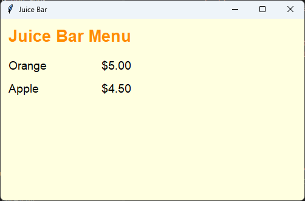

================================================
2. Labels and the grid
================================================

- **Objective**: Make labels with the **create, position, configure** pattern and place them with ``grid()``.
- **Skills for the orders app**: ``tk.Label(root)``, ``grid(row=, column=, columnspan=, padx=, pady=, sticky=)``, ``config(text=, bg=, fg=, font=)``.

----

Create, position, configure
--------------------------------

| A **label** shows words in the window. The ice cream app makes every widget with the same three lines:

.. code-block::
   :class: no-copybutton

    title_label = tk.Label(root)                       # 1. create
    title_label.grid(row=0, column=0)                  # 2. position
    title_label.config(text="Juice Bar")               # 3. configure

#. **Create**: ``tk.Label(root)`` makes a label inside the window ``root``.
#. **Position**: ``grid(row=0, column=0)`` puts it in a cell of the grid. Without this line, the label does not appear.
#. **Configure**: ``config(...)`` sets its text, colours and font.

----

The grid
--------------------------------

| ``grid()`` places widgets in **rows** and **columns**, like the cells of a table.
| Row 0 is the **top** row. Column 0 is the **left** column.

.. list-table::
    :widths: 33 33 34

    * - row=0, column=0
      - row=0, column=1
      - row=0, column=2
    * - row=1, column=0
      - row=1, column=1
      - row=1, column=2
    * - row=2, column=0
      - row=2, column=1
      - row=2, column=2

| This Juice Bar menu board has a title in row 0, then one juice and its price in each row.

.. code-block:: python

    import tkinter as tk

    root = tk.Tk()
    root.title("Juice Bar")
    root.geometry("500x300")
    root.config(bg="lightyellow")

    # Title
    title_label = tk.Label(root)  # 1. create
    title_label.grid(row=0, column=0, columnspan=2, padx=10, pady=10, sticky="w")  # 2. position
    title_label.config(text="Juice Bar Menu", font=("Arial", 20, "bold"), bg="lightyellow", fg="darkorange")  # 3. configure

    # Orange
    orange_label = tk.Label(root)  # 1. create
    orange_label.grid(row=1, column=0, padx=10, pady=5, sticky="w")  # 2. position
    orange_label.config(text="Orange", font=("Arial", 14), bg="lightyellow")  # 3. configure

    orange_price = tk.Label(root)  # 1. create
    orange_price.grid(row=1, column=1, padx=10, pady=5, sticky="e")  # 2. position
    orange_price.config(text="$5.00", font=("Arial", 14), bg="lightyellow")  # 3. configure

    # Apple
    apple_label = tk.Label(root)  # 1. create
    apple_label.grid(row=2, column=0, padx=10, pady=5, sticky="w")  # 2. position
    apple_label.config(text="Apple", font=("Arial", 14), bg="lightyellow")  # 3. configure

    apple_price = tk.Label(root)  # 1. create
    apple_price.grid(row=2, column=1, padx=10, pady=5, sticky="e")  # 2. position
    apple_price.config(text="$4.50", font=("Arial", 14), bg="lightyellow")  # 3. configure

    root.mainloop()

----

The grid options
--------------------------------

.. list-table::
    :header-rows: 1
    :widths: 30 70

    * - Option
      - What it does
    * - ``row=1, column=0``
      - Puts the widget in row 1, column 0.
    * - ``columnspan=2``
      - Makes the widget cover **two** columns, e.g. a title across the top.
    * - ``rowspan=4``
      - Makes the widget cover **four** rows, e.g. a tall list.
    * - ``padx=10``, ``pady=5``
      - Leaves space around the widget: 10 pixels left and right, 5 pixels above and below.
    * - ``sticky="w"``
      - Pushes the widget to one side of its cell, using compass letters.

| The compass letters for ``sticky`` are:

- ``"n"`` north (top), ``"s"`` south (bottom), ``"e"`` east (right), ``"w"`` west (left).
- Join them up: ``"ne"`` is the top right, ``"sw"`` is the bottom left.
- ``"nsew"`` stretches the widget to fill the whole cell.

----

The configure options
--------------------------------

.. list-table::
    :header-rows: 1
    :widths: 30 70

    * - Option
      - What it does
    * - ``text="Orange"``
      - The words on the label.
    * - ``bg="lightyellow"``
      - The **background** colour.
    * - ``fg="darkorange"``
      - The **foreground** colour, which is the colour of the words.
    * - ``font=("Arial", 14)``
      - The font name and size. Add ``"bold"`` to make it bold.

| Give each label the same ``bg`` as the window, so the labels blend in.

----

.. admonition:: Tasks

    #. Add a third juice, "Mango" for "$6.00", in row 3 of the Juice Bar menu.
    #. Make a "Taco Truck" window with a title label that covers 2 columns, then 2 rows of tacos and prices: "Beef taco" "$4.00" and "Fish taco" "$5.50".
    #. Make the prices in your Taco Truck menu line up on the right of their cells.
    #. This label does not appear. Why? Fix it.

       .. code-block::
          :class: no-copybutton

          drink_label = tk.Label(root)
          drink_label.config(text="Drinks")

    .. dropdown::
        :icon: codescan
        :color: primary
        :class-container: sd-dropdown-container

        .. tab-set::

            .. tab-item:: Q1

                | Add this code before ``root.mainloop()``.

                .. code-block:: python

                    # Mango
                    mango_label = tk.Label(root)  # 1. create
                    mango_label.grid(row=3, column=0, padx=10, pady=5, sticky="w")  # 2. position
                    mango_label.config(text="Mango", font=("Arial", 14), bg="lightyellow")  # 3. configure

                    mango_price = tk.Label(root)  # 1. create
                    mango_price.grid(row=3, column=1, padx=10, pady=5, sticky="e")  # 2. position
                    mango_price.config(text="$6.00", font=("Arial", 14), bg="lightyellow")  # 3. configure

                .. image:: images/skills02_task1_answer.png
                    :align: center

            .. tab-item:: Q2 and Q3

                | ``sticky="e"`` on the price labels lines them up on the right.

                .. code-block:: python

                    import tkinter as tk

                    root = tk.Tk()
                    root.title("Taco Truck")
                    root.geometry("500x300")

                    title_label = tk.Label(root)  # 1. create
                    title_label.grid(row=0, column=0, columnspan=2, padx=10, pady=10, sticky="w")  # 2. position
                    title_label.config(text="Taco Truck", font=("Arial", 20, "bold"))  # 3. configure

                    beef_label = tk.Label(root)  # 1. create
                    beef_label.grid(row=1, column=0, padx=10, pady=5, sticky="w")  # 2. position
                    beef_label.config(text="Beef taco", font=("Arial", 14))  # 3. configure

                    beef_price = tk.Label(root)  # 1. create
                    beef_price.grid(row=1, column=1, padx=10, pady=5, sticky="e")  # 2. position
                    beef_price.config(text="$4.00", font=("Arial", 14))  # 3. configure

                    fish_label = tk.Label(root)  # 1. create
                    fish_label.grid(row=2, column=0, padx=10, pady=5, sticky="w")  # 2. position
                    fish_label.config(text="Fish taco", font=("Arial", 14))  # 3. configure

                    fish_price = tk.Label(root)  # 1. create
                    fish_price.grid(row=2, column=1, padx=10, pady=5, sticky="e")  # 2. position
                    fish_price.config(text="$5.50", font=("Arial", 14))  # 3. configure

                    root.mainloop()

                .. image:: images/skills02_task2_3_answer.png
                    :align: center

            .. tab-item:: Q4

                | The label is never **positioned**, so it does not appear. Add a ``grid()`` line after it is created.

                .. code-block::
                   :class: no-copybutton

                    drink_label = tk.Label(root)                 # 1. create
                    drink_label.grid(row=0, column=0)            # 2. position
                    drink_label.config(text="Drinks")            # 3. configure

----

Quiz
--------------------------------

.. mcqgroup::
    :nav_position: both
    :show-instant-feedback:
    :enable-instant-feedback:
    :shuffle_questions:
    :num_questions: 6

    .. multichoice::

        What is the order of the three lines for a label?

        [x] Create, position, configure | Correct. Make it, place it, then set its text and colours.
        [ ] Configure, create, position | Incorrect. It must be created first.
        [ ] Position, create, configure | Incorrect. It must be created first.
        [ ] Create, configure | Incorrect. Without positioning it does not appear.

    .. multichoice::

        Where is row=0, column=0?

        [ ] Bottom left | Incorrect. Row 0 is the top.
        [x] Top left | Correct. Counting starts at the top left.
        [ ] Top right | Incorrect. Column 0 is the left.
        [ ] The centre | Incorrect. It is the top left corner.

    .. multichoice::

        What does columnspan=2 do?

        [ ] Puts the widget in column 2 | Incorrect. column=2 does that.
        [ ] Adds 2 pixels of space | Incorrect. padx adds space.
        [x] Makes the widget cover two columns | Correct. Titles often span the columns below them.
        [ ] Makes two copies of the widget | Incorrect. It makes one widget wider.

    .. multichoice::

        What does sticky="e" do?

        [ ] Makes the label sticky to click | Incorrect. It is about position.
        [ ] Pushes the label to the left of its cell | Incorrect. That is "w".
        [x] Pushes the label to the right of its cell | Correct. e means east, the right.
        [ ] Pushes the label to the top of its cell | Incorrect. That is "n".

    .. multichoice::

        Which option sets the colour of the words?

        [ ] bg | Incorrect. bg is the background.
        [x] fg | Correct. fg means foreground, the word colour.
        [ ] colour | Incorrect. colour is not an option.
        [ ] text | Incorrect. text sets the words themselves.

    .. multichoice::

        What does padx=10 do?

        [x] Leaves 10 pixels of space on the left and right of the widget | Correct. pady does the same above and below.
        [ ] Moves the widget to column 10 | Incorrect. column sets the column.
        [ ] Makes the words 10 points big | Incorrect. font sets the size.
        [ ] Makes the widget 10 characters wide | Incorrect. width does that.

----

Fill in the gaps
--------------------------------

.. clozegroup::
    :nav-position: both
    :num-questions: 2
    :show-instant-feedback:

    .. cloze::
        :instructions: Make a title label across two columns at the top.

        title_label = tk.@@Label | Button | Tk@@(root)
        title_label.@@grid | config | pack@@(row=@@0 | 1 | 2@@, column=0, @@columnspan | rowspan | span@@=2)
        title_label.@@config | grid | title@@(text="Juice Bar")

    .. cloze::
        :instructions: Make a price label on the right of row 1, column 1, with orange words.

        price_label = tk.Label(root)
        price_label.grid(row=1, column=1, padx=10, @@sticky | anchor | side@@="@@e | w | n@@")
        price_label.config(text="$5.00", @@fg | bg | colour@@="darkorange")
