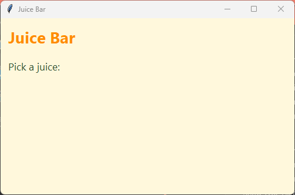

================================================
3. Constants: colours and fonts
================================================

- **Objective**: Store colours and fonts as constants, so the look of the whole app can be changed in one place.
- **Skills for the ice cream app**: ``BG_COLOUR = "#fff4e6"``, ``TITLE_FONT = ("Segoe UI", 22, "bold")``, using constants in ``config()``.

----

What is a constant?
--------------------------------

| A **constant** is a variable whose value does not change while the program runs.
| Constant names are written in **CAPITAL LETTERS**, with ``_`` between words, so they are easy to spot.

.. code-block::
   :class: no-copybutton

    BG_COLOUR = "lightyellow"
    TITLE_FONT = ("Arial", 20, "bold")

| If the same colour is typed into 10 labels, changing it means 10 changes.
| With a constant, you change **one** line and every label changes.

----

Colour codes
--------------------------------

| Colours can be names like ``"orange"``, or **hex codes** like ``"#ffa500"``.
| A hex code starts with ``#`` and has six characters: two for **red**, two for **green** and two for **blue**.
| Each pair goes from ``00`` (none) to ``ff`` (full).

.. list-table::
    :header-rows: 1
    :widths: 30 30 40

    * - Hex code
      - Colour
      - Why
    * - ``"#ffffff"``
      - White
      - Full red, green and blue.
    * - ``"#000000"``
      - Black
      - No red, green or blue.
    * - ``"#ff0000"``
      - Red
      - Full red only.
    * - ``"#fff8dc"``
      - Pale cream
      - Lots of red and green, a bit less blue.

| Search for "colour picker" online to find the hex code for any colour.

----

Font tuples
--------------------------------

| A font is written as a **tuple**: values inside round brackets, separated by commas.

.. code-block::
   :class: no-copybutton

    TITLE_FONT = ("Segoe UI", 22, "bold")
    #             font name   size  style

- The **style** is ``"normal"`` or ``"bold"``. It can also be ``"italic"``.
- Fonts on most school computers include ``"Segoe UI"``, ``"Arial"``, ``"Verdana"`` and ``"Georgia"``.

----

Using constants
--------------------------------

| The constants go in **Section 2**. The widgets in **Section 4** use them.

.. code-block:: python

    import tkinter as tk

    # 1. DATA DICTIONARIES & LISTS

    # 2. CONSTANTS
    # Colours
    BG_COLOUR = "#fff8dc"        # pale cream background
    TITLE_COLOUR = "#ff8c00"     # orange title
    TEXT_COLOUR = "#2f4f2f"      # dark green text

    # Fonts
    TITLE_FONT = ("Segoe UI", 20, "bold")
    LABEL_FONT = ("Segoe UI", 13, "normal")

    # 3. DEFINITIONS

    # 4. TKINTER WIDGETS
    # Main window
    root = tk.Tk()
    root.title("Juice Bar")
    root.geometry("500x300")
    root.config(bg=BG_COLOUR)

    # Title
    title_label = tk.Label(root)  # 1. create
    title_label.grid(row=0, column=0, columnspan=2, padx=10, pady=10, sticky="w")  # 2. position
    title_label.config(text="Juice Bar", font=TITLE_FONT, bg=BG_COLOUR, fg=TITLE_COLOUR)  # 3. configure

    # Juice heading
    juice_label = tk.Label(root)  # 1. create
    juice_label.grid(row=1, column=0, padx=10, pady=5, sticky="w")  # 2. position
    juice_label.config(text="Pick a juice:", font=LABEL_FONT, bg=BG_COLOUR, fg=TEXT_COLOUR)  # 3. configure

    # 5. MAIN CODE
    root.mainloop()

- Constants have **no** quotation marks around their names when they are used: ``bg=BG_COLOUR``, not ``bg="BG_COLOUR"``.
- The comments after each colour say what it is for, so you know which one to change.

----

.. admonition:: Tasks

    #. Change the Juice Bar to a pale green background and a dark blue title, by changing **only** the constants.
    #. Add a constant ``SMALL_FONT`` that is ``"Verdana"``, size 10, ``"italic"``. Use it for a new label in row 2 that says "Fresh every day".
    #. Write the hex code for full green only.
    #. This line shows an error. Why? Fix it.

       .. code-block::
          :class: no-copybutton

          title_label.config(text="Juice Bar", bg="BG_COLOUR")

    .. dropdown::
        :icon: codescan
        :color: primary
        :class-container: sd-dropdown-container

        .. tab-set::

            .. tab-item:: Q1

                .. code-block:: python

                    BG_COLOUR = "#e0ffe0"        # pale green background
                    TITLE_COLOUR = "#000080"     # dark blue title
                    TEXT_COLOUR = "#2f4f2f"      # dark green text

                .. image:: images/skills03_task1_answer.png
                    :align: center

            .. tab-item:: Q2

                .. code-block:: python

                    # In Section 2
                    SMALL_FONT = ("Verdana", 10, "italic")

                    # In Section 4
                    fresh_label = tk.Label(root)  # 1. create
                    fresh_label.grid(row=2, column=0, padx=10, pady=5, sticky="w")  # 2. position
                    fresh_label.config(text="Fresh every day", font=SMALL_FONT, bg=BG_COLOUR, fg=TEXT_COLOUR)  # 3. configure

                .. image:: images/skills03_task2_answer.png
                    :align: center

            .. tab-item:: Q3

                | ``"#00ff00"``: no red, full green, no blue.

            .. tab-item:: Q4

                | ``"BG_COLOUR"`` in quotation marks is a string, not the constant. Tkinter does not know a colour called BG_COLOUR.

                .. code-block::
                   :class: no-copybutton

                    title_label.config(text="Juice Bar", bg=BG_COLOUR)

----

Quiz
--------------------------------

.. mcqgroup::
    :nav_position: both
    :show-instant-feedback:
    :enable-instant-feedback:
    :shuffle_questions:
    :num_questions: 6

    .. multichoice::

        How are constant names written?

        [ ] in lower case | Incorrect. Lower case is used for normal variables.
        [x] IN CAPITAL LETTERS | Correct. Capitals show the value should not change.
        [ ] With a # at the start | Incorrect. # starts a comment.
        [ ] Inside quotation marks | Incorrect. Names do not go in quotation marks.

    .. multichoice::

        Why use a constant for a colour that is used many times?

        [x] Changing one line changes every widget that uses it | Correct. The look of the app is changed in one place.
        [ ] Constants make the app run faster | Incorrect. They make it easier to change.
        [ ] Tkinter only accepts constants | Incorrect. It accepts colours too.
        [ ] Constants can change while the app runs | Incorrect. Constants stay the same.

    .. multichoice::

        What colour is "#000000"?

        [ ] White | Incorrect. White is "#ffffff".
        [x] Black | Correct. No red, green or blue.
        [ ] Red | Incorrect. Red is "#ff0000".
        [ ] Grey | Incorrect. Grey has some of each colour.

    .. multichoice::

        In ("Arial", 14, "bold"), what is 14?

        [ ] The font name | Incorrect. "Arial" is the name.
        [x] The size | Correct. The size comes second.
        [ ] The colour | Incorrect. Colours are set with fg.
        [ ] The style | Incorrect. "bold" is the style.

    .. multichoice::

        Which line uses the constant correctly?

        [ ] label.config(bg="BG_COLOUR") | Incorrect. In quotation marks it is just text.
        [x] label.config(bg=BG_COLOUR) | Correct. Use the name with no quotation marks.
        [ ] label.config(BG_COLOUR) | Incorrect. Say which option it is for: bg=.
        [ ] label.config(bg=bg_colour) | Incorrect. Python names are case sensitive.

    .. multichoice::

        In which section do the constants go?

        [ ] 1\. DATA DICTIONARIES & LISTS | Incorrect. That section holds the choices and prices.
        [x] 2\. CONSTANTS | Correct. Constants come after the data and before the definitions.
        [ ] 4\. TKINTER WIDGETS | Incorrect. Widgets use the constants, so they must be made first.
        [ ] 5\. MAIN CODE | Incorrect. That is too late.

----

Fill in the gaps
--------------------------------

.. clozegroup::
    :nav-position: both
    :num-questions: 2
    :show-instant-feedback:

    .. cloze::
        :instructions: Make colour and font constants.

        @@BG_COLOUR | bg_colour | "BG_COLOUR"@@ = "#fff8dc"
        TITLE_FONT = @@("Segoe UI" | ["Segoe UI" | {"Segoe UI"@@, 20, "@@bold | big | thick@@")

    .. cloze::
        :instructions: Use the constants on a label.

        title_label.config(text="Juice Bar", font=@@TITLE_FONT | "TITLE_FONT" | title_font@@, bg=@@BG_COLOUR | "BG_COLOUR" | BG@@)
