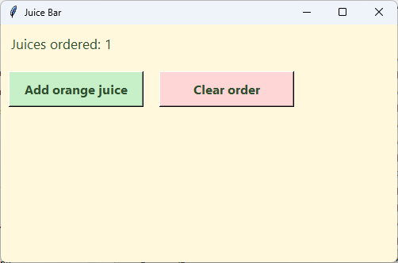

================================================
8. Buttons and commands
================================================

- **Objective**: Make buttons that run a function when they are clicked, and change a label from inside a function.
- **Skills for the orders app**: ``tk.Button(root)``, the 4th step ``config(command=add_ice_cream)``, ``label.config(text=...)`` inside a function.

----

Create, position, configure, command
------------------------------------------

| A button uses the same three steps as a label, plus a fourth step: the **command**.

.. code-block::
   :class: no-copybutton

    add_button = tk.Button(root)                         # 1. create
    add_button.grid(row=1, column=0)                     # 2. position
    add_button.config(text="Add orange juice")           # 3. configure
    add_button.config(command=add_orange)                # 4. command

- ``command=add_orange`` tells the button which function to run when it is clicked.
- There are **no brackets** after the function name. ``command=add_orange()`` would run the function straight away, once, before anything is clicked.

----

A juice counter
--------------------------------

| This app counts the juices in an order. It uses a list from :doc:`skills06_lists` and functions from :doc:`skills07_functions`.

.. code-block:: python

    import tkinter as tk

    # 1. DATA DICTIONARIES & LISTS
    # List that stores every juice in the order
    orders = []

    # 2. CONSTANTS
    BG_COLOUR = "#fff8dc"        # pale cream background
    TEXT_COLOUR = "#2f4f2f"      # dark green text
    ADD_COLOUR = "#c8f0c8"       # pale green add button
    REMOVE_COLOUR = "#ffd6d6"    # pale red clear button

    LABEL_FONT = ("Segoe UI", 13, "normal")
    BUTTON_FONT = ("Segoe UI", 12, "bold")

    # 3. DEFINITIONS
    def show_juice_count():
        """Shows how many juices are in the order."""
        count_label.config(text=f"Juices ordered: {len(orders)}")

    def add_orange():
        """Adds an orange juice to the order."""
        orders.append("Orange")
        show_juice_count()

    def clear_juice_orders():
        """Removes every juice from the order."""
        orders.clear()
        show_juice_count()

    # 4. TKINTER WIDGETS
    # Main window
    root = tk.Tk()
    root.title("Juice Bar")
    root.geometry("500x300")
    root.config(bg=BG_COLOUR)

    # Count of juices
    count_label = tk.Label(root)  # 1. create
    count_label.grid(row=0, column=0, columnspan=2, padx=10, pady=10, sticky="w")  # 2. position
    count_label.config(text="Juices ordered: 0", font=LABEL_FONT, bg=BG_COLOUR, fg=TEXT_COLOUR)  # 3. configure

    # Add button
    add_button = tk.Button(root)  # 1. create
    add_button.grid(row=1, column=0, padx=10, pady=10, ipady=4, sticky="w")  # 2. position
    add_button.config(text="Add orange juice", width=16, font=BUTTON_FONT, bg=ADD_COLOUR, fg=TEXT_COLOUR)  # 3. configure
    add_button.config(command=add_orange)  # 4. command

    # Clear button
    clear_button = tk.Button(root)  # 1. create
    clear_button.grid(row=1, column=1, padx=10, pady=10, ipady=4, sticky="w")  # 2. position
    clear_button.config(text="Clear order", width=16, font=BUTTON_FONT, bg=REMOVE_COLOUR, fg=TEXT_COLOUR)  # 3. configure
    clear_button.config(command=clear_juice_orders)  # 4. command

    # 5. MAIN CODE
    show_juice_count()
    root.mainloop()

| Run it. Click **Add orange juice** a few times, then **Clear order**.

----

How it works
--------------------------------

#. The user clicks **Add orange juice**.
#. The button's command runs ``add_orange``, which appends ``"Orange"`` to the ``orders`` list.
#. ``add_orange`` then calls ``show_juice_count``, which changes the label's text with ``config(text=...)``.

- ``width=16`` makes the button 16 characters wide, so both buttons are the same size.
- ``ipady=4`` adds 4 pixels of space **inside** the button, making it taller and easier to click.
- ``show_juice_count`` uses ``count_label``, which is made later in Section 4. That is fine, because the function is only **called** after the label exists.
- ``show_juice_count()`` in Section 5 sets the label correctly when the app starts.

----

.. admonition:: Tasks

    #. Add a third button, **Add apple juice**, in row 2. It runs a new function ``add_apple`` that appends ``"Apple"``.
    #. Add a label in row 3 that shows the last juice added, e.g. "Last juice: Apple". Change it inside ``show_juice_count``. Hint: ``orders[-1]`` is the last item, but only when the list is not empty.
    #. This button runs once when the app starts, then never again. Why? Fix it.

       .. code-block::
          :class: no-copybutton

          add_button.config(command=add_orange())

    .. dropdown::
        :icon: codescan
        :color: primary
        :class-container: sd-dropdown-container

        .. tab-set::

            .. tab-item:: Q1

                .. code-block:: python

                    # In Section 3
                    def add_apple():
                        """Adds an apple juice to the order."""
                        orders.append("Apple")
                        show_juice_count()

                    # In Section 4
                    apple_button = tk.Button(root)  # 1. create
                    apple_button.grid(row=2, column=0, padx=10, pady=10, ipady=4, sticky="w")  # 2. position
                    apple_button.config(text="Add apple juice", width=16, font=BUTTON_FONT, bg=ADD_COLOUR, fg=TEXT_COLOUR)  # 3. configure
                    apple_button.config(command=add_apple)  # 4. command

                .. image:: images/skills08_task1_answer.png
                    :align: center

            .. tab-item:: Q2

                .. code-block:: python

                    # In Section 3
                    def show_juice_count():
                        """Shows how many juices are in the order, and the last one added."""
                        count_label.config(text=f"Juices ordered: {len(orders)}")
                        if len(orders) > 0:
                            last_label.config(text=f"Last juice: {orders[-1]}")
                        else:
                            last_label.config(text="Last juice: none")

                    # In Section 4
                    last_label = tk.Label(root)  # 1. create
                    last_label.grid(row=3, column=0, columnspan=2, padx=10, pady=5, sticky="w")  # 2. position
                    last_label.config(text="Last juice: none", font=LABEL_FONT, bg=BG_COLOUR, fg=TEXT_COLOUR)  # 3. configure

                .. image:: images/skills08_task2_answer.png
                    :align: center

            .. tab-item:: Q3

                | The brackets in ``add_orange()`` run the function straight away. Leave them off.

                .. code-block::
                   :class: no-copybutton

                    add_button.config(command=add_orange)

----

Quiz
--------------------------------

.. mcqgroup::
    :nav_position: top
    :show-instant-feedback:
    :enable-instant-feedback:
    :shuffle_questions:
    :num_questions: 6

    .. multichoice::

        What is the order of the four lines for a button?

        [x] Create, position, configure, command | Correct. The command is the last step.
        [ ] Command, create, position, configure | Incorrect. The button must be created first.
        [ ] Create, command, position, configure | Incorrect. The command comes after configure.
        [ ] Position, create, configure, command | Incorrect. It must be created first.

    .. multichoice::

        Which line links a button to the function add_orange?

        [ ] add_button.config(command=add_orange()) | Incorrect. The brackets run it straight away.
        [x] add_button.config(command=add_orange) | Correct. No brackets after the name.
        [ ] add_button.config(command="add_orange") | Incorrect. A string is not a function.
        [ ] add_button.add_orange() | Incorrect. Buttons do not work like this.

    .. multichoice::

        What happens when the Add orange juice button is clicked?

        [x] add_orange runs, adds "Orange" to the list and updates the label | Correct. The command runs the function.
        [ ] The label is deleted | Incorrect. Its text is changed.
        [ ] The app closes | Incorrect. Nothing closes the app.
        [ ] Nothing, because the function has no return | Incorrect. A command does not need return.

    .. multichoice::

        Which line changes the text of count_label?

        [x] count_label.config(text="Juices ordered: 3") | Correct. config changes an option after the widget is made.
        [ ] count_label.text = "Juices ordered: 3" | Incorrect. Use config.
        [ ] count_label("Juices ordered: 3") | Incorrect. Widgets are not called like functions.
        [ ] config(count_label, "Juices ordered: 3") | Incorrect. config goes after the widget name.

    .. multichoice::

        What does ipady=4 do in a button's grid()?

        [ ] Moves it 4 rows down | Incorrect. row sets the row.
        [x] Adds 4 pixels of space inside the button, making it taller | Correct. The i means inside.
        [ ] Adds 4 pixels of space outside the button | Incorrect. pady adds space outside.
        [ ] Makes the words size 4 | Incorrect. font sets the size.

    .. multichoice::

        len(orders) is 3. What does f"Juices ordered: {len(orders)}" show?

        [ ] Juices ordered: {len(orders)} | Incorrect. The f-string fills in the brackets.
        [ ] Juices ordered: len(orders) | Incorrect. The brackets are filled in with the answer.
        [x] Juices ordered: 3 | Correct. len counts the items in the list.
        [ ] Juices ordered: Orange | Incorrect. len gives a number.

----

Fill in the gaps
--------------------------------

.. clozegroup::
    :nav-position: top
    :num-questions: 2
    :show-instant-feedback:

    .. cloze::
        :instructions: Make an Add button that runs add_orange.

        add_button = tk.@@Button | Label | Tk@@(root)
        add_button.@@grid | config | command@@(row=1, column=0, padx=10, pady=10)
        add_button.config(text="Add orange juice", bg=ADD_COLOUR)
        add_button.config(@@command | click | run@@=@@add_orange | add_orange() | "add_orange"@@)

    .. cloze::
        :instructions: Add a juice, then show how many there are.

        def add_orange():
            """Adds an orange juice to the order."""
            orders.@@append | add | insert@@("Orange")
            count_label.@@config | grid | text@@(text=f"Juices ordered: {@@len | count | size@@(orders)}")
