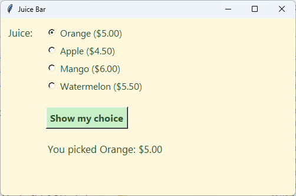

================================================
9. StringVar and radio buttons
================================================

- **Objective**: Use a ``StringVar`` to remember the user's choice, and make one radio button for each key in a dictionary.
- **Skills for the orders app**: ``tk.StringVar(root)``, ``set()``, ``get()``, ``tk.Frame``, ``tk.Radiobutton(frame, variable=, value=)``, a loop over ``.keys()``.

----

Tkinter variables
--------------------------------

| A normal Python variable cannot tell a widget when it changes. A **Tkinter variable** can.
| ``tk.StringVar`` holds a string, such as the name of the juice the user picked.
| The orders app sets up each Tkinter variable in a group of lines: **make**, **set**, then (in :doc:`skills11_trace_add`) **bind**.

.. code-block::
   :class: no-copybutton

    juice_var = tk.StringVar(root)       # A. make
    juice_var.set("Orange")              # B. set

    juice = juice_var.get()              # read it, e.g. "Orange"

- ``tk.StringVar(root)`` makes the variable. It must come **after** ``root = tk.Tk()``.
- ``set("Orange")`` gives it a starting value.
- ``get()`` reads the value that is in it right now.

----

Radio buttons
--------------------------------

| **Radio buttons** let the user pick **one** choice from a group. Clicking one switches the others off.
| Every radio button in a group shares the **same variable**. Each one has a different **value**.
| When a radio button is clicked, its value is put into the variable.

.. code-block:: python

    import tkinter as tk

    # 1. DATA DICTIONARIES & LISTS
    # Juices and the price of a regular cup
    juices = {
        "Orange": 5.00,
        "Apple": 4.50,
        "Mango": 6.00,
        "Watermelon": 5.50,
    }

    # 2. CONSTANTS
    BG_COLOUR = "#fff8dc"        # pale cream background
    TEXT_COLOUR = "#2f4f2f"      # dark green text
    ADD_COLOUR = "#c8f0c8"       # pale green button

    LABEL_FONT = ("Segoe UI", 13, "normal")
    RADIO_FONT = ("Segoe UI", 12, "normal")
    BUTTON_FONT = ("Segoe UI", 12, "bold")

    # 3. DEFINITIONS
    def show_juice_choice():
        """Shows the juice that is picked and its price."""
        juice = juice_var.get()
        choice_label.config(text=f"You picked {juice}: ${juices[juice]:.2f}")

    # 4. TKINTER WIDGETS
    # Main window
    root = tk.Tk()
    root.title("Juice Bar")
    root.geometry("500x300")
    root.config(bg=BG_COLOUR)

    # Juice (radio buttons)
    juice_label = tk.Label(root)  # 1. create
    juice_label.grid(row=0, column=0, padx=10, pady=10, sticky="ne")  # 2. position
    juice_label.config(text="Juice:", font=LABEL_FONT, bg=BG_COLOUR, fg=TEXT_COLOUR)  # 3. configure

    juice_frame = tk.Frame(root)  # 1. create
    juice_frame.grid(row=0, column=1, padx=10, pady=10, sticky="w")  # 2. position
    juice_frame.config(bg=BG_COLOUR)  # 3. configure

    juice_var = tk.StringVar(root)  # A. make
    juice_var.set("Orange")  # B. set

    for juice in juices.keys():
        juice_radio = tk.Radiobutton(juice_frame, variable=juice_var, value=juice)  # 1. create
        juice_radio.pack(anchor="w")  # 2. position
        juice_radio.config(text=f"{juice} (${juices[juice]:.2f})", font=RADIO_FONT,
                           bg=BG_COLOUR, fg=TEXT_COLOUR, activebackground=BG_COLOUR,
                           highlightthickness=0)  # 3. configure

    # Show button
    show_button = tk.Button(root)  # 1. create
    show_button.grid(row=1, column=1, padx=10, pady=10, sticky="w")  # 2. position
    show_button.config(text="Show my choice", font=BUTTON_FONT, bg=ADD_COLOUR, fg=TEXT_COLOUR)  # 3. configure
    show_button.config(command=show_juice_choice)  # 4. command

    # Choice
    choice_label = tk.Label(root)  # 1. create
    choice_label.grid(row=2, column=1, padx=10, pady=10, sticky="w")  # 2. position
    choice_label.config(text="", font=LABEL_FONT, bg=BG_COLOUR, fg=TEXT_COLOUR)  # 3. configure

    # 5. MAIN CODE
    root.mainloop()

| Run it. Pick a juice, then click **Show my choice**.

----

How it works
--------------------------------

#. **The frame**: ``juice_frame`` is an invisible box that holds the radio buttons. The frame goes in row 0, column 1 of the grid.
#. **The variable**: ``juice_var.set("Orange")`` picks Orange when the app starts. It must be spelt exactly like a key in ``juices``.
#. **The loop**: ``for juice in juices.keys():`` makes one radio button for each juice.

   - ``variable=juice_var`` puts every radio button in the same group.
   - ``value=juice`` is what goes into ``juice_var`` when this button is clicked.
   - ``pack(anchor="w")`` stacks the buttons down the frame, lined up on the left. The frame uses ``pack`` inside it, while the window uses ``grid``. That is allowed because they are different containers.
   - ``config(text=...)`` uses an f-string from :doc:`skills05_fstrings` to show the juice and its price.

#. **The label**: ``sticky="ne"`` pushes "Juice:" to the top right of its cell, so it lines up with the first radio button.

- ``activebackground=BG_COLOUR`` stops the button turning grey when the mouse is over it.
- ``highlightthickness=0`` removes a thin outline around each button.
- Add ``"Kiwi": 5.00`` to the dictionary and run the app again. A new radio button appears by itself.

----

.. admonition:: Tasks

    #. Add "Pineapple" for 5.50 to the ``juices`` dictionary. Check that a new radio button appears.
    #. Make Mango the juice that is picked when the app starts.
    #. Make a Taco Truck app with one radio button for each taco in ``tacos = {"Beef": 4.00, "Chicken": 4.50, "Fish": 5.50}``, and a button that shows the chosen taco and its price.
    #. This app shows a ``KeyError`` when **Show my choice** is clicked straight away. Why? Fix it.

       .. code-block::
          :class: no-copybutton

          juice_var.set("orange")

    .. dropdown::
        :icon: codescan
        :color: primary
        :class-container: sd-dropdown-container

        .. tab-set::

            .. tab-item:: Q1

                .. code-block:: python

                    juices = {
                        "Orange": 5.00,
                        "Apple": 4.50,
                        "Mango": 6.00,
                        "Watermelon": 5.50,
                        "Pineapple": 5.50,
                    }

                .. image:: images/skills09_task1_answer.png
                    :align: center

            .. tab-item:: Q2

                .. code-block:: python

                    juice_var.set("Mango")  # B. set

                .. image:: images/skills09_task2_answer.png
                    :align: center

            .. tab-item:: Q3

                .. code-block:: python

                    import tkinter as tk

                    # 1. DATA DICTIONARIES & LISTS
                    tacos = {"Beef": 4.00, "Chicken": 4.50, "Fish": 5.50}

                    # 2. CONSTANTS
                    BG_COLOUR = "#fff0d9"
                    TEXT_COLOUR = "#5a2d0c"
                    LABEL_FONT = ("Segoe UI", 13, "normal")

                    # 3. DEFINITIONS
                    def show_taco_choice():
                        """Shows the taco that is picked and its price."""
                        taco = taco_var.get()
                        choice_label.config(text=f"You picked {taco}: ${tacos[taco]:.2f}")

                    # 4. TKINTER WIDGETS
                    root = tk.Tk()
                    root.title("Taco Truck")
                    root.geometry("500x300")
                    root.config(bg=BG_COLOUR)

                    taco_label = tk.Label(root)  # 1. create
                    taco_label.grid(row=0, column=0, padx=10, pady=10, sticky="ne")  # 2. position
                    taco_label.config(text="Taco:", font=LABEL_FONT, bg=BG_COLOUR, fg=TEXT_COLOUR)  # 3. configure

                    taco_frame = tk.Frame(root)  # 1. create
                    taco_frame.grid(row=0, column=1, padx=10, pady=10, sticky="w")  # 2. position
                    taco_frame.config(bg=BG_COLOUR)  # 3. configure

                    taco_var = tk.StringVar(root)  # A. make
                    taco_var.set("Beef")  # B. set

                    for taco in tacos.keys():
                        taco_radio = tk.Radiobutton(taco_frame, variable=taco_var, value=taco)  # 1. create
                        taco_radio.pack(anchor="w")  # 2. position
                        taco_radio.config(text=f"{taco} (${tacos[taco]:.2f})", font=LABEL_FONT,
                                          bg=BG_COLOUR, fg=TEXT_COLOUR, activebackground=BG_COLOUR,
                                          highlightthickness=0)  # 3. configure

                    show_button = tk.Button(root)  # 1. create
                    show_button.grid(row=1, column=1, padx=10, pady=10, sticky="w")  # 2. position
                    show_button.config(text="Show my choice", font=LABEL_FONT)  # 3. configure
                    show_button.config(command=show_taco_choice)  # 4. command

                    choice_label = tk.Label(root)  # 1. create
                    choice_label.grid(row=2, column=1, padx=10, pady=10, sticky="w")  # 2. position
                    choice_label.config(text="", font=LABEL_FONT, bg=BG_COLOUR, fg=TEXT_COLOUR)  # 3. configure

                    # 5. MAIN CODE
                    root.mainloop()

                .. image:: images/skills09_task3_answer.png
                    :align: center

            .. tab-item:: Q4

                | ``"orange"`` has a small o, so no radio button is picked and ``juices["orange"]`` is not a key. Spell it exactly like the key.

                .. code-block::
                   :class: no-copybutton

                    juice_var.set("Orange")

----

Quiz
--------------------------------

.. mcqgroup::
    :nav_position: top
    :show-instant-feedback:
    :enable-instant-feedback:
    :shuffle_questions:
    :num_questions: 6

    .. multichoice::

        What does juice_var = tk.StringVar(root) make?

        [x] A Tkinter variable that holds a string | Correct. It remembers the user's choice.
        [ ] A label | Incorrect. tk.Label makes a label.
        [ ] A radio button | Incorrect. tk.Radiobutton makes a radio button.
        [ ] A dictionary | Incorrect. Dictionaries use curly brackets.

    .. multichoice::

        Which line reads the juice that is picked right now?

        [ ] juice_var.set() | Incorrect. set puts a value in.
        [x] juice_var.get() | Correct. get reads the value.
        [ ] juice_var.read() | Incorrect. The method is get.
        [ ] juice_var | Incorrect. That is the variable, not its value.

    .. multichoice::

        What puts radio buttons in the same group?

        [ ] They are next to each other | Incorrect. Position does not matter.
        [ ] They have the same value | Incorrect. Each value must be different.
        [x] They share the same variable | Correct. One variable for the whole group.
        [ ] They are in a loop | Incorrect. The loop just makes them.

    .. multichoice::

        What goes into juice_var when the Mango radio button is clicked?

        [x] Its value, "Mango" | Correct. value=juice is "Mango" for that button.
        [ ] Its text, "Mango ($6.00)" | Incorrect. The text is only what the user sees.
        [ ] 6.00 | Incorrect. The value is the key, not the price.
        [ ] True | Incorrect. It stores the value.

    .. multichoice::

        Why are the radio buttons made with for juice in juices.keys():?

        [ ] Radio buttons can only be made in a loop | Incorrect. They can be typed one by one.
        [x] Adding a juice to the dictionary makes a new button by itself | Correct. The buttons come from the data.
        [ ] It makes the app faster | Incorrect. It makes it easier to change.
        [ ] It sorts the juices | Incorrect. It keeps the dictionary's order.

    .. multichoice::

        Why do the radio buttons go in juice_frame?

        [ ] Radio buttons cannot go in root | Incorrect. They can.
        [x] The frame holds them all in one grid cell, stacked with pack | Correct. The frame goes in row 0, column 1.
        [ ] The frame makes them work | Incorrect. The variable makes them work.
        [ ] The frame colours them | Incorrect. config colours them.

----

Fill in the gaps
--------------------------------

.. clozegroup::
    :nav-position: top
    :num-questions: 2
    :show-instant-feedback:

    .. cloze::
        :instructions: Make the variable and pick Orange at the start.

        juice_var = tk.@@StringVar | IntVar | Label@@(root)
        juice_var.@@set | get | config@@("Orange")

    .. cloze::
        :instructions: Make one radio button for each juice.

        for juice in juices.@@keys | values | items@@():
            juice_radio = tk.@@Radiobutton | Checkbutton | Button@@(juice_frame, @@variable | value | text@@=juice_var, value=@@juice | juices | "juice"@@)
            juice_radio.@@pack | grid | place@@(anchor="w")
