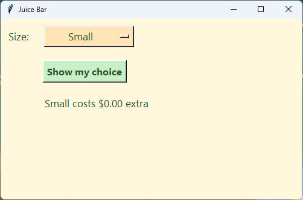

================================================
10. Drop-down menus
================================================

- **Objective**: Make a drop-down menu whose choices come from a dictionary.
- **Skills for the ice cream app**: ``tk.OptionMenu(root, size_var, "Small")``, ``size_menu["menu"]``, ``delete(0)``, ``add_radiobutton(label=, variable=, value=)``.

----

What is a drop-down menu?
--------------------------------

| A **drop-down menu** shows one choice. When it is clicked, a list of choices drops down.
| It takes up less space than radio buttons. In Tkinter it is called an ``OptionMenu``.
| Like radio buttons, it puts the user's choice into a ``StringVar``.

----

A size drop-down
--------------------------------

.. code-block:: python

    import tkinter as tk

    # 1. DATA DICTIONARIES & LISTS
    # Sizes and their extra cost
    sizes = {
        "Small": 0.00,
        "Regular": 1.00,
        "Large": 2.00,
    }

    # 2. CONSTANTS
    BG_COLOUR = "#fff8dc"        # pale cream background
    TEXT_COLOUR = "#2f4f2f"      # dark green text
    MENU_COLOUR = "#ffe4b5"      # pale orange drop-down menu
    ADD_COLOUR = "#c8f0c8"       # pale green button

    LABEL_FONT = ("Segoe UI", 13, "normal")
    BUTTON_FONT = ("Segoe UI", 12, "bold")

    # 3. DEFINITIONS
    def show_size_choice():
        """Shows the size that is picked and its extra cost."""
        size = size_var.get()
        choice_label.config(text=f"{size} costs ${sizes[size]:.2f} extra")

    # 4. TKINTER WIDGETS
    # Main window
    root = tk.Tk()
    root.title("Juice Bar")
    root.geometry("500x300")
    root.config(bg=BG_COLOUR)

    # Size (drop-down menu)
    size_label = tk.Label(root)  # 1. create
    size_label.grid(row=0, column=0, padx=10, pady=10, sticky="e")  # 2. position
    size_label.config(text="Size:", font=LABEL_FONT, bg=BG_COLOUR, fg=TEXT_COLOUR)  # 3. configure

    size_var = tk.StringVar(root)  # A. make
    size_var.set("Small")  # B. set

    size_menu = tk.OptionMenu(root, size_var, "Small")  # 1. create
    size_menu.grid(row=0, column=1, padx=10, pady=10, sticky="w")  # 2. position
    size_menu.config(width=12, font=LABEL_FONT, bg=MENU_COLOUR, fg=TEXT_COLOUR,
                     activebackground=MENU_COLOUR)  # 3. configure

    size_choices = size_menu["menu"]
    size_choices.config(font=LABEL_FONT, bg=MENU_COLOUR, fg=TEXT_COLOUR)
    size_choices.delete(0)   # remove the starting choice
    for size in sizes.keys():
        size_choices.add_radiobutton(label=size, variable=size_var, value=size)

    # Show button
    show_button = tk.Button(root)  # 1. create
    show_button.grid(row=1, column=1, padx=10, pady=10, sticky="w")  # 2. position
    show_button.config(text="Show my choice", font=BUTTON_FONT, bg=ADD_COLOUR, fg=TEXT_COLOUR)  # 3. configure
    show_button.config(command=show_size_choice)  # 4. command

    # Choice
    choice_label = tk.Label(root)  # 1. create
    choice_label.grid(row=2, column=1, padx=10, pady=10, sticky="w")  # 2. position
    choice_label.config(text="", font=LABEL_FONT, bg=BG_COLOUR, fg=TEXT_COLOUR)  # 3. configure

    # 5. MAIN CODE
    root.mainloop()

| Run it. Pick a size from the drop-down, then click **Show my choice**.

----

How it works
--------------------------------

#. **The variable** is made and set **before** the drop-down, because the drop-down needs it.
#. **The drop-down**:

   - ``tk.OptionMenu(root, size_var, "Small")`` makes the menu. It must be given **one** choice to start with.
   - ``width=12`` keeps it 12 characters wide, so it does not change size when a longer choice is picked.
   - ``activebackground`` is the colour when the mouse is over it.

#. **The list of choices** that drops down:

   - ``size_choices = size_menu["menu"]`` gets the list, and gives it a short name.
   - ``size_choices.config(...)`` colours the list.
   - ``size_choices.delete(0)`` removes the starting choice (line 0). The loop adds it back with the others.

#. **The loop**: ``for size in sizes.keys():`` adds one choice for each key.

   - ``label=size`` is the words the user sees.
   - ``variable=size_var, value=size`` puts this size into ``size_var`` when it is picked.

| This is the same idea as the radio buttons in :doc:`skills09_radiobuttons`: the choices come from the **dictionary**, so adding a size to ``sizes`` adds it to the menu as well.

----

.. admonition:: Tasks

    #. Add "Jumbo" for 3.00 to the ``sizes`` dictionary. Check that it appears in the drop-down.
    #. Add a second drop-down for ``ice = {"No ice": 0.00, "Some ice": 0.00, "Lots of ice": 0.00}`` in row 1, and move the button and the label down one row. Show both choices in the label.
    #. Make a Taco Truck drop-down for ``extras = {"No extra": 0.00, "Cheese": 1.00, "Guacamole": 1.50}``.
    #. The drop-down shows "Small" twice. Which line is missing?

    .. dropdown::
        :icon: codescan
        :color: primary
        :class-container: sd-dropdown-container

        .. tab-set::

            .. tab-item:: Q1

                .. code-block:: python

                    sizes = {
                        "Small": 0.00,
                        "Regular": 1.00,
                        "Large": 2.00,
                        "Jumbo": 3.00,
                    }

                .. image:: images/skills10_task1_answer.png
                    :align: center

            .. tab-item:: Q2

                .. code-block:: python

                    # In Section 1
                    ice = {"No ice": 0.00, "Some ice": 0.00, "Lots of ice": 0.00}

                    # In Section 3
                    def show_size_choice():
                        """Shows the size and ice that are picked."""
                        size = size_var.get()
                        ice_choice = ice_var.get()
                        choice_label.config(text=f"{size}, {ice_choice}: ${sizes[size]:.2f} extra")

                    # In Section 4, below the size drop-down
                    ice_label = tk.Label(root)  # 1. create
                    ice_label.grid(row=1, column=0, padx=10, pady=10, sticky="e")  # 2. position
                    ice_label.config(text="Ice:", font=LABEL_FONT, bg=BG_COLOUR, fg=TEXT_COLOUR)  # 3. configure

                    ice_var = tk.StringVar(root)  # A. make
                    ice_var.set("No ice")  # B. set

                    ice_menu = tk.OptionMenu(root, ice_var, "No ice")  # 1. create
                    ice_menu.grid(row=1, column=1, padx=10, pady=10, sticky="w")  # 2. position
                    ice_menu.config(width=12, font=LABEL_FONT, bg=MENU_COLOUR, fg=TEXT_COLOUR,
                                    activebackground=MENU_COLOUR)  # 3. configure

                    ice_choices = ice_menu["menu"]
                    ice_choices.config(font=LABEL_FONT, bg=MENU_COLOUR, fg=TEXT_COLOUR)
                    ice_choices.delete(0)   # remove the starting choice
                    for ice_choice in ice.keys():
                        ice_choices.add_radiobutton(label=ice_choice, variable=ice_var, value=ice_choice)

                    # Then change the button to row=2 and the choice label to row=3.

                .. image:: images/skills10_task2_answer.png
                    :align: center

            .. tab-item:: Q3

                .. code-block:: python

                    extra_label = tk.Label(root)  # 1. create
                    extra_label.grid(row=0, column=0, padx=10, pady=10, sticky="e")  # 2. position
                    extra_label.config(text="Extra:", font=LABEL_FONT)  # 3. configure

                    extra_var = tk.StringVar(root)  # A. make
                    extra_var.set("No extra")  # B. set

                    extra_menu = tk.OptionMenu(root, extra_var, "No extra")  # 1. create
                    extra_menu.grid(row=0, column=1, padx=10, pady=10, sticky="w")  # 2. position
                    extra_menu.config(width=12, font=LABEL_FONT)  # 3. configure

                    extra_choices = extra_menu["menu"]
                    extra_choices.delete(0)   # remove the starting choice
                    for extra in extras.keys():
                        extra_choices.add_radiobutton(label=extra, variable=extra_var, value=extra)

                .. image:: images/skills10_task3_answer.png
                    :align: center

            .. tab-item:: Q4

                | ``size_choices.delete(0)`` is missing. Without it, the starting choice stays in the list, and the loop adds "Small" again.

----

Quiz
--------------------------------

.. mcqgroup::
    :nav_position: both
    :show-instant-feedback:
    :enable-instant-feedback:
    :shuffle_questions:
    :num_questions: 6

    .. multichoice::

        What is a drop-down menu called in Tkinter?

        [ ] tk.Dropdown | Incorrect. There is no Dropdown widget.
        [x] tk.OptionMenu | Correct. It shows one choice and drops down a list.
        [ ] tk.Menu | Incorrect. Menu is used for menu bars.
        [ ] tk.Listbox | Incorrect. A Listbox shows every line at once.

    .. multichoice::

        Why is size_var made before size_menu?

        [ ] Python makes variables faster | Incorrect. It is about order.
        [x] The OptionMenu needs the variable when it is created | Correct. tk.OptionMenu(root, size_var, "Small") uses it.
        [ ] So the menu appears on the left | Incorrect. grid sets the position.
        [ ] It does not matter | Incorrect. Using it before it exists causes an error.

    .. multichoice::

        What does size_menu["menu"] give?

        [x] The list of choices that drops down | Correct. Its choices can then be changed.
        [ ] The chosen size | Incorrect. size_var.get() gives that.
        [ ] The sizes dictionary | Incorrect. It gives part of the widget.
        [ ] A new window | Incorrect. It gives the drop-down list.

    .. multichoice::

        What does size_choices.delete(0) do?

        [ ] Deletes the whole drop-down | Incorrect. It deletes one line.
        [x] Removes the starting choice, so the loop can add every choice once | Correct. Line 0 is the starting choice.
        [ ] Sets the size to 0 | Incorrect. It removes a line from the list.
        [ ] Deletes the Small key from the dictionary | Incorrect. The dictionary does not change.

    .. multichoice::

        In add_radiobutton(label=size, variable=size_var, value=size), what does value=size do?

        [ ] Sets the words the user sees | Incorrect. label does that.
        [x] Puts this size into size_var when it is picked | Correct. Just like a radio button's value.
        [ ] Sets the price | Incorrect. The price is looked up in the dictionary.
        [ ] Adds the size to the dictionary | Incorrect. The dictionary does not change.

    .. multichoice::

        Why use a drop-down menu instead of radio buttons?

        [x] It takes up less space, which helps when there are many choices | Correct. Only one choice shows until it is clicked.
        [ ] It lets the user pick many choices | Incorrect. It picks one, like radio buttons.
        [ ] It does not need a variable | Incorrect. It needs one too.
        [ ] It shows the prices automatically | Incorrect. Prices come from the dictionary.

----

Fill in the gaps
--------------------------------

.. clozegroup::
    :nav-position: both
    :num-questions: 2
    :show-instant-feedback:

    .. cloze::
        :instructions: Make the size variable and the drop-down.

        size_var = tk.StringVar(root)
        size_var.@@set | get | add@@("Small")

        size_menu = tk.@@OptionMenu | Radiobutton | Menu@@(root, @@size_var | sizes | "size_var"@@, "Small")
        size_menu.grid(row=0, column=1, sticky="w")

    .. cloze::
        :instructions: Put every size into the drop-down.

        size_choices = size_menu[@@"menu" | "list" | menu@@]
        size_choices.@@delete | clear | remove@@(0)
        for size in sizes.keys():
            size_choices.@@add_radiobutton | add_command | append@@(label=size, variable=size_var, value=size)
