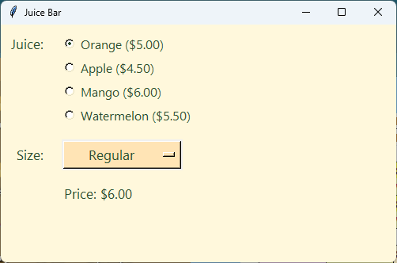

================================================
11. Binding: updating the price by itself
================================================

- **Objective**: Make the price change by itself whenever the user picks a different juice or size.
- **Skills for the orders app**: ``trace_add("write", update_ice_cream_price)``, ``def update_ice_cream_price(*args):``, calling the update function once at the start.

----

Make, set, bind
--------------------------------

| In :doc:`skills09_radiobuttons` and :doc:`skills10_optionmenu`, the user had to click a button to see their choice.
| **Binding** a variable to a function makes the function run **every time the variable changes**. No button is needed.

.. code-block::
   :class: no-copybutton

    juice_var = tk.StringVar(root)                       # A. make
    juice_var.set("Orange")                              # B. set
    juice_var.trace_add("write", update_juice_price)     # C. bind

- ``trace_add`` watches the variable.
- ``"write"`` means "when a new value is written into the variable".
- ``update_juice_price`` is the function to run. Like ``command=``, there are **no brackets** after its name.
- The bind line goes **straight after** set. If it came before set, the price function would run before the price label exists.

----

The ``*args`` parameter
--------------------------------

| When a variable changes, Tkinter sends some extra information to the function.
| The function must accept it, or Python shows a ``TypeError``. ``*args`` accepts it, and we do not use it.

.. code-block::
   :class: no-copybutton

    def update_juice_price(*args):
        """Shows the price of the juice that is chosen right now."""
        price = get_juice_price()
        price_label.config(text=f"Price: ${price:.2f}")

----

A price that updates by itself
--------------------------------

| This app puts the radio buttons from :doc:`skills09_radiobuttons` and the drop-down from :doc:`skills10_optionmenu` together.

.. code-block:: python

    import tkinter as tk

    # 1. DATA DICTIONARIES & LISTS
    # Juices and the price of a small cup
    juices = {
        "Orange": 5.00,
        "Apple": 4.50,
        "Mango": 6.00,
        "Watermelon": 5.50,
    }

    # Sizes and their extra cost
    sizes = {
        "Small": 0.00,
        "Regular": 1.00,
        "Large": 2.00,
    }

    # 2. CONSTANTS
    BG_COLOUR = "#fff8dc"        # pale cream background
    TEXT_COLOUR = "#2f4f2f"      # dark green text
    MENU_COLOUR = "#ffe4b5"      # pale orange drop-down menu

    LABEL_FONT = ("Segoe UI", 13, "normal")
    RADIO_FONT = ("Segoe UI", 12, "normal")

    # 3. DEFINITIONS
    def get_juice_price():
        """Adds up the juice and size prices for one juice."""
        juice = juice_var.get()
        size = size_var.get()
        price = juices[juice] + sizes[size]
        return price

    def update_juice_price(*args):
        """Shows the price of the juice that is chosen right now."""
        price = get_juice_price()
        price_label.config(text=f"Price: ${price:.2f}")

    # 4. TKINTER WIDGETS
    # Main window
    root = tk.Tk()
    root.title("Juice Bar")
    root.geometry("500x300")
    root.config(bg=BG_COLOUR)

    # Juice (radio buttons)
    juice_label = tk.Label(root)  # 1. create
    juice_label.grid(row=0, column=0, padx=10, pady=10, sticky="ne")  # 2. position
    juice_label.config(text="Juice:", font=LABEL_FONT, bg=BG_COLOUR, fg=TEXT_COLOUR)  # 3. configure

    juice_frame = tk.Frame(root)  # 1. create
    juice_frame.grid(row=0, column=1, padx=10, pady=10, sticky="w")  # 2. position
    juice_frame.config(bg=BG_COLOUR)  # 3. configure

    juice_var = tk.StringVar(root)  # A. make
    juice_var.set("Orange")  # B. set
    juice_var.trace_add("write", update_juice_price)  # C. bind

    for juice in juices.keys():
        juice_radio = tk.Radiobutton(juice_frame, variable=juice_var, value=juice)  # 1. create
        juice_radio.pack(anchor="w")  # 2. position
        juice_radio.config(text=f"{juice} (${juices[juice]:.2f})", font=RADIO_FONT,
                           bg=BG_COLOUR, fg=TEXT_COLOUR, activebackground=BG_COLOUR,
                           highlightthickness=0)  # 3. configure

    # Size (drop-down menu)
    size_label = tk.Label(root)  # 1. create
    size_label.grid(row=1, column=0, padx=10, pady=5, sticky="e")  # 2. position
    size_label.config(text="Size:", font=LABEL_FONT, bg=BG_COLOUR, fg=TEXT_COLOUR)  # 3. configure

    size_var = tk.StringVar(root)  # A. make
    size_var.set("Small")  # B. set
    size_var.trace_add("write", update_juice_price)  # C. bind

    size_menu = tk.OptionMenu(root, size_var, "Small")  # 1. create
    size_menu.grid(row=1, column=1, padx=10, pady=5, sticky="w")  # 2. position
    size_menu.config(width=12, font=LABEL_FONT, bg=MENU_COLOUR, fg=TEXT_COLOUR,
                     activebackground=MENU_COLOUR)  # 3. configure

    size_choices = size_menu["menu"]
    size_choices.config(font=LABEL_FONT, bg=MENU_COLOUR, fg=TEXT_COLOUR)
    size_choices.delete(0)   # remove the starting choice
    for size in sizes.keys():
        size_choices.add_radiobutton(label=size, variable=size_var, value=size)

    # Price of the chosen juice
    price_label = tk.Label(root)  # 1. create
    price_label.grid(row=2, column=1, padx=10, pady=10, sticky="w")  # 2. position
    price_label.config(text="Price: $0.00", font=LABEL_FONT, bg=BG_COLOUR, fg=TEXT_COLOUR)  # 3. configure

    # 5. MAIN CODE
    update_juice_price()
    root.mainloop()

| Run it. Change the juice and the size. The price changes straight away.

----

How it works
--------------------------------

#. The user picks **Large** in the drop-down.
#. The drop-down writes ``"Large"`` into ``size_var``.
#. The binding sees the change and runs ``update_juice_price``.
#. ``update_juice_price`` calls ``get_juice_price``, which looks up both prices and adds them.
#. The price label shows the new price.

- ``update_juice_price()`` in Section 5 shows the right price when the app first opens. Without it, the label would say $0.00 until the user changes something.

| Two ways to react to the user:

.. list-table::
    :header-rows: 1
    :widths: 30 35 35

    * - Widget
      - How it runs a function
      - Code
    * - Button
      - A **command** runs when it is clicked.
      - ``add_button.config(command=add_juice)``
    * - Radio button or drop-down
      - It changes a **variable**. The variable's **binding** runs the function.
      - ``juice_var.trace_add("write", update_juice_price)``

----

.. admonition:: Tasks

    #. Add an ``extras`` dictionary, ``{"No extra": 0.00, "Chia seeds": 1.00, "Protein": 2.00}``, with its own drop-down in row 2. Bind its variable to ``update_juice_price``, add its price in ``get_juice_price``, and move the price label to row 3.
    #. Remove ``update_juice_price()`` from Section 5 and run the app. What does the price say? Put it back.
    #. This app shows ``TypeError: update_juice_price() takes 0 positional arguments`` when a choice is changed. Why? Fix it.

       .. code-block::
          :class: no-copybutton

          def update_juice_price():
              price = get_juice_price()
              price_label.config(text=f"Price: ${price:.2f}")

    .. dropdown::
        :icon: codescan
        :color: primary
        :class-container: sd-dropdown-container

        .. tab-set::

            .. tab-item:: Q1

                .. code-block:: python

                    # In Section 1
                    extras = {
                        "No extra": 0.00,
                        "Chia seeds": 1.00,
                        "Protein": 2.00,
                    }

                    # In Section 3
                    def get_juice_price():
                        """Adds up the juice, size and extra prices for one juice."""
                        juice = juice_var.get()
                        size = size_var.get()
                        extra = extra_var.get()
                        price = juices[juice] + sizes[size] + extras[extra]
                        return price

                    # In Section 4, below the size drop-down
                    extra_label = tk.Label(root)  # 1. create
                    extra_label.grid(row=2, column=0, padx=10, pady=5, sticky="e")  # 2. position
                    extra_label.config(text="Extra:", font=LABEL_FONT, bg=BG_COLOUR, fg=TEXT_COLOUR)  # 3. configure

                    extra_var = tk.StringVar(root)  # A. make
                    extra_var.set("No extra")  # B. set
                    extra_var.trace_add("write", update_juice_price)  # C. bind

                    extra_menu = tk.OptionMenu(root, extra_var, "No extra")  # 1. create
                    extra_menu.grid(row=2, column=1, padx=10, pady=5, sticky="w")  # 2. position
                    extra_menu.config(width=12, font=LABEL_FONT, bg=MENU_COLOUR, fg=TEXT_COLOUR,
                                      activebackground=MENU_COLOUR)  # 3. configure

                    extra_choices = extra_menu["menu"]
                    extra_choices.config(font=LABEL_FONT, bg=MENU_COLOUR, fg=TEXT_COLOUR)
                    extra_choices.delete(0)   # remove the starting choice
                    for extra in extras.keys():
                        extra_choices.add_radiobutton(label=extra, variable=extra_var, value=extra)

                    # Then change the price label to row=3.

                .. image:: images/skills11_task1_answer.png
                    :align: center

            .. tab-item:: Q2

                | The price says $0.00 until a choice is changed, because ``update_juice_price`` has not run yet.

            .. tab-item:: Q3

                | Tkinter sends extra information to the function when the variable changes. Add ``*args`` so it can accept it.

                .. code-block::
                   :class: no-copybutton

                    def update_juice_price(*args):
                        price = get_juice_price()
                        price_label.config(text=f"Price: ${price:.2f}")

----

Quiz
--------------------------------

.. mcqgroup::
    :nav_position: top
    :show-instant-feedback:
    :enable-instant-feedback:
    :shuffle_questions:
    :num_questions: 6

    .. multichoice::

        What does juice_var.trace_add("write", update_juice_price) do?

        [x] Runs update_juice_price every time juice_var changes | Correct. This is called binding.
        [ ] Runs update_juice_price once, straight away | Incorrect. It runs when the variable changes.
        [ ] Writes the price into juice_var | Incorrect. "write" means when the variable is written to.
        [ ] Makes a new radio button | Incorrect. The loop makes radio buttons.

    .. multichoice::

        What is the order of lines for a Tkinter variable in the orders app?

        [ ] Bind, make, set | Incorrect. The variable must be made first.
        [ ] Make, bind, set | Incorrect. Set comes before bind.
        [x] Make, set, bind | Correct. Bind straight after set.
        [ ] Set, make, bind | Incorrect. It must be made before it can be set.

    .. multichoice::

        Why does update_juice_price have \*args?

        [ ] To add up the prices | Incorrect. get_juice_price adds the prices.
        [x] Tkinter sends extra information when the variable changes, and the function must accept it | Correct. Without it Python shows a TypeError.
        [ ] To make it run faster | Incorrect. It is about accepting information.
        [ ] It is a typing mistake | Incorrect. It is needed.

    .. multichoice::

        Why is update_juice_price() called in Section 5?

        [ ] To close the app | Incorrect. It shows the price.
        [x] So the right price shows when the app first opens | Correct. Otherwise it says $0.00 until a choice changes.
        [ ] So the binding works | Incorrect. The binding works without it.
        [ ] To make the window | Incorrect. tk.Tk() makes the window.

    .. multichoice::

        How does a button run a function?

        [x] With command= | Correct. The command runs when the button is clicked.
        [ ] With trace_add | Incorrect. trace_add is for variables.
        [ ] With set | Incorrect. set gives a variable a value.
        [ ] With get | Incorrect. get reads a variable.

    .. multichoice::

        The user picks Large. Which function adds up the prices?

        [ ] update_juice_price | Incorrect. It shows the price, after calling another function.
        [x] get_juice_price | Correct. It looks up both prices and returns the total.
        [ ] size_var | Incorrect. size_var is a variable, not a function.
        [ ] trace_add | Incorrect. trace_add only runs the update function.

----

Fill in the gaps
--------------------------------

.. clozegroup::
    :nav-position: top
    :num-questions: 2
    :show-instant-feedback:

    .. cloze::
        :instructions: Make, set and bind the size variable.

        size_var = tk.StringVar(root)
        size_var.set("Small")
        size_var.@@trace_add | command | bind_var@@("@@write | read | change@@", @@update_juice_price | update_juice_price() | "update_juice_price"@@)

    .. cloze::
        :instructions: Show the price whenever a choice changes.

        def update_juice_price(@@*args | args | event@@):
            """Shows the price of the juice that is chosen right now."""
            price = @@get_juice_price() | get_juice_price | juice_var.get()@@
            price_label.@@config | set | grid@@(text=f"Price: ${price:.2f}")
