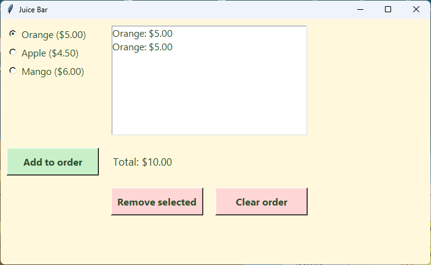

================================================
12. Listbox and messagebox: showing the order
================================================

- **Objective**: Show the ``orders`` list in a Listbox with a total, remove the selected line, and show a pop-up message.
- **Skills for the orders app**: ``tk.Listbox``, ``insert(tk.END, ...)``, ``delete(0, tk.END)``, ``curselection()``, ``if not selection:``, ``del orders[line_number]``, ``messagebox.showinfo()``.

----

The Listbox
--------------------------------

| A **Listbox** shows lines of text, one under another. The user can click a line to select it.

.. list-table::
    :header-rows: 1
    :widths: 45 55

    * - Code
      - What it does
    * - ``order_listbox.insert(tk.END, "Mango: $6.00")``
      - Adds a line to the end.
    * - ``order_listbox.delete(0, tk.END)``
      - Clears every line, from line 0 to the end.
    * - ``order_listbox.curselection()``
      - Gives the selected line number in brackets, e.g. ``(1,)``, or ``()`` if nothing is selected.

| ``tk.END`` means "the end". Line numbers start at 0, just like a list's index.

----

The list holds the data, the Listbox shows it
------------------------------------------------

| The ``orders`` **list** from :doc:`skills06_lists` holds the order. The **Listbox** only shows a copy of it.
| So every time the list changes, one function **clears** the Listbox and **redraws** it from the list. It works out the total at the same time.

.. code-block::
   :class: no-copybutton

    def show_juice_orders():
        """Redraws the order list and the total so they match the orders list."""
        order_listbox.delete(0, tk.END)
        total = 0
        for juice in orders:
            order_listbox.insert(tk.END, f"{juice['juice']}: ${juice['price']:.2f}")
            total = total + juice["price"]
        total_label.config(text=f"Total: ${total:.2f}")

| Line 0 of the Listbox shows ``orders[0]``, line 1 shows ``orders[1]``, and so on. So the selected line number is also the index in the list.

----

Messagebox
--------------------------------

| A **messagebox** is a small pop-up window with a message and an OK button. It needs its own import.

.. code-block::
   :class: no-copybutton

    from tkinter import messagebox

    messagebox.showinfo("Remove", "Click a juice in the order list first.")

- The first string is the pop-up's title. The second is the message.

----

A juice order list
--------------------------------

.. code-block:: python

    import tkinter as tk
    from tkinter import messagebox

    # 1. DATA DICTIONARIES & LISTS
    # Juices and their prices
    juices = {
        "Orange": 5.00,
        "Apple": 4.50,
        "Mango": 6.00,
    }

    # List that stores every juice in the order
    orders = []

    # 2. CONSTANTS
    BG_COLOUR = "#fff8dc"        # pale cream background
    TEXT_COLOUR = "#2f4f2f"      # dark green text
    LIST_COLOUR = "#ffffff"      # white order list
    ADD_COLOUR = "#c8f0c8"       # pale green add button
    REMOVE_COLOUR = "#ffd6d6"    # pale red remove and clear buttons

    LABEL_FONT = ("Segoe UI", 13, "normal")
    RADIO_FONT = ("Segoe UI", 12, "normal")
    LIST_FONT = ("Segoe UI", 12, "normal")
    BUTTON_FONT = ("Segoe UI", 12, "bold")

    # 3. DEFINITIONS
    def show_juice_orders():
        """Redraws the order list and the total so they match the orders list."""
        order_listbox.delete(0, tk.END)
        total = 0
        for juice in orders:
            order_listbox.insert(tk.END, f"{juice['juice']}: ${juice['price']:.2f}")
            total = total + juice["price"]
        total_label.config(text=f"Total: ${total:.2f}")

    def add_juice():
        """Adds the chosen juice to the orders list."""
        juice = {
            "juice": juice_var.get(),
            "price": juices[juice_var.get()],
        }
        orders.append(juice)
        show_juice_orders()

    def remove_juice():
        """Removes the juice that is selected in the order list."""
        selection = order_listbox.curselection()
        if not selection:
            messagebox.showinfo("Remove", "Click a juice in the order list first.")
        else:
            line_number = selection[0]
            del orders[line_number]
            show_juice_orders()

    def clear_juice_orders():
        """Removes every juice from the orders list."""
        orders.clear()
        show_juice_orders()

    # 4. TKINTER WIDGETS
    # Main window
    root = tk.Tk()
    root.title("Juice Bar")
    root.geometry("700x400")
    root.config(bg=BG_COLOUR)

    # --- LEFT SIDE: JUICE CHOICE ---

    # Juice (radio buttons)
    juice_frame = tk.Frame(root)  # 1. create
    juice_frame.grid(row=0, column=0, padx=10, pady=10, sticky="nw")  # 2. position
    juice_frame.config(bg=BG_COLOUR)  # 3. configure

    juice_var = tk.StringVar(root)  # A. make
    juice_var.set("Orange")  # B. set

    for juice in juices.keys():
        juice_radio = tk.Radiobutton(juice_frame, variable=juice_var, value=juice)  # 1. create
        juice_radio.pack(anchor="w")  # 2. position
        juice_radio.config(text=f"{juice} (${juices[juice]:.2f})", font=RADIO_FONT,
                           bg=BG_COLOUR, fg=TEXT_COLOUR, activebackground=BG_COLOUR,
                           highlightthickness=0)  # 3. configure

    # Add to order button
    add_button = tk.Button(root)  # 1. create
    add_button.grid(row=1, column=0, padx=10, pady=10, ipady=4, sticky="w")  # 2. position
    add_button.config(text="Add to order", width=14, font=BUTTON_FONT, bg=ADD_COLOUR, fg=TEXT_COLOUR)  # 3. configure
    add_button.config(command=add_juice)  # 4. command

    # --- RIGHT SIDE: THE ORDER ---

    # Order list
    order_listbox = tk.Listbox(root)  # 1. create
    order_listbox.grid(row=0, column=1, columnspan=2, padx=10, pady=10, sticky="nsew")  # 2. position
    order_listbox.config(width=30, height=8, font=LIST_FONT, bg=LIST_COLOUR, fg=TEXT_COLOUR)  # 3. configure

    # Total cost of the order
    total_label = tk.Label(root)  # 1. create
    total_label.grid(row=1, column=1, columnspan=2, padx=10, pady=5, sticky="w")  # 2. position
    total_label.config(text="Total: $0.00", font=LABEL_FONT, bg=BG_COLOUR, fg=TEXT_COLOUR)  # 3. configure

    # Remove selected button
    remove_button = tk.Button(root)  # 1. create
    remove_button.grid(row=2, column=1, padx=10, pady=10, ipady=4, sticky="w")  # 2. position
    remove_button.config(text="Remove selected", width=14, font=BUTTON_FONT, bg=REMOVE_COLOUR, fg=TEXT_COLOUR)  # 3. configure
    remove_button.config(command=remove_juice)  # 4. command

    # Clear order button
    clear_button = tk.Button(root)  # 1. create
    clear_button.grid(row=2, column=2, padx=10, pady=10, ipady=4, sticky="e")  # 2. position
    clear_button.config(text="Clear order", width=14, font=BUTTON_FONT, bg=REMOVE_COLOUR, fg=TEXT_COLOUR)  # 3. configure
    clear_button.config(command=clear_juice_orders)  # 4. command

    # 5. MAIN CODE
    show_juice_orders()
    root.mainloop()

| Run it. Add three juices, select one and click **Remove selected**, then click **Clear order**.
| Click **Remove selected** with nothing selected to see the messagebox.

----

How it works
--------------------------------

- ``add_juice`` makes a **dictionary** for the chosen juice and appends it to ``orders``.
- ``remove_juice``:

  - ``order_listbox.curselection()`` finds the selected line, e.g. ``(1,)``.
  - ``if not selection:`` is True when nothing is selected, so a messagebox tells the user what to do.
  - ``selection[0]`` gets the line number out of the brackets.
  - ``del orders[line_number]`` deletes that juice from the **list**.

- ``clear_juice_orders`` empties the list with ``orders.clear()``.
- All three then call ``show_juice_orders()`` to redraw the Listbox and the total from the list.
- ``sticky="nsew"`` stretches the Listbox to fill its cells.

----

.. admonition:: Tasks

    #. Add "Watermelon" for 5.50 to ``juices`` and check you can add it to the order.
    #. Show a messagebox when **Clear order** is clicked and the order is already empty. Hint: ``if not orders:``.
    #. Add a label under the total that shows how many juices are in the order, e.g. "Juices: 3". Update it in ``show_juice_orders``.
    #. Why does ``show_juice_orders`` clear the Listbox before adding the lines? What would happen without ``order_listbox.delete(0, tk.END)``?

    .. dropdown::
        :icon: codescan
        :color: primary
        :class-container: sd-dropdown-container

        .. tab-set::

            .. tab-item:: Q1

                .. code-block:: python

                    juices = {
                        "Orange": 5.00,
                        "Apple": 4.50,
                        "Mango": 6.00,
                        "Watermelon": 5.50,
                    }

                .. image:: images/skills12_task1_answer.png
                    :align: center

            .. tab-item:: Q2

                .. code-block:: python

                    def clear_juice_orders():
                        """Removes every juice from the orders list."""
                        if not orders:
                            messagebox.showinfo("Clear", "The order is already empty.")
                        else:
                            orders.clear()
                            show_juice_orders()

                .. image:: images/skills12_task2_answer.png
                    :align: center

            .. tab-item:: Q3

                .. code-block:: python

                    # In Section 3
                    def show_juice_orders():
                        """Redraws the order list, the total and the count."""
                        order_listbox.delete(0, tk.END)
                        total = 0
                        for juice in orders:
                            order_listbox.insert(tk.END, f"{juice['juice']}: ${juice['price']:.2f}")
                            total = total + juice["price"]
                        total_label.config(text=f"Total: ${total:.2f}")
                        count_label.config(text=f"Juices: {len(orders)}")

                    # In Section 4, below the total label
                    count_label = tk.Label(root)  # 1. create
                    count_label.grid(row=3, column=1, columnspan=2, padx=10, pady=5, sticky="w")  # 2. position
                    count_label.config(text="Juices: 0", font=LABEL_FONT, bg=BG_COLOUR, fg=TEXT_COLOUR)  # 3. configure

                .. image:: images/skills12_task3_answer.png
                    :align: center

            .. tab-item:: Q4

                | The Listbox would keep its old lines, so every juice would appear again each time the order changes.
                | Clearing it first means it always shows exactly what is in the ``orders`` list.

----

Quiz
--------------------------------

.. mcqgroup::
    :nav_position: top
    :show-instant-feedback:
    :enable-instant-feedback:
    :shuffle_questions:
    :num_questions: 6

    .. multichoice::

        Which line adds a line to the end of a Listbox?

        [x] order_listbox.insert(tk.END, "Mango: $6.00") | Correct. tk.END means the end.
        [ ] order_listbox.append("Mango: $6.00") | Incorrect. append is for lists.
        [ ] order_listbox.add("Mango: $6.00") | Incorrect. The method is insert.
        [ ] order_listbox.config(text="Mango: $6.00") | Incorrect. A Listbox does not use text.

    .. multichoice::

        What does order_listbox.delete(0, tk.END) do?

        [ ] Deletes the orders list | Incorrect. It only clears the Listbox.
        [ ] Deletes the first line | Incorrect. It deletes from line 0 to the end.
        [x] Clears every line in the Listbox | Correct. From the first line to the end.
        [ ] Closes the Listbox | Incorrect. The Listbox stays in the window.

    .. multichoice::

        What does curselection() give when nothing is selected?

        [ ] 0 | Incorrect. 0 would mean the first line is selected.
        [x] () which is empty | Correct. So if not selection: is True.
        [ ] An error | Incorrect. It gives empty brackets.
        [ ] The last line | Incorrect. Nothing is selected.

    .. multichoice::

        The user selects line 2 of the Listbox. Which juice does del orders[2] remove?

        [ ] The second juice | Incorrect. The second juice is index 1.
        [x] The third juice, the one on line 2 | Correct. Line numbers match the list index.
        [ ] Every juice | Incorrect. clear() does that.
        [ ] The last juice | Incorrect. Only if there are exactly three.

    .. multichoice::

        Which import is needed for messagebox?

        [ ] import messagebox | Incorrect. messagebox is part of tkinter.
        [x] from tkinter import messagebox | Correct. It goes below import tkinter as tk.
        [ ] import tkinter.messagebox as tk | Incorrect. That would replace tk.
        [ ] No import is needed | Incorrect. It must be imported.

    .. multichoice::

        Why is the Listbox redrawn from the orders list each time?

        [x] The list holds the data, and the Listbox only shows a copy | Correct. Redrawing keeps them the same.
        [ ] The Listbox forgets its lines | Incorrect. It keeps them until they are deleted.
        [ ] It makes the app faster | Incorrect. It keeps the display correct.
        [ ] Listboxes can only show one line | Incorrect. They show many lines.

----

Fill in the gaps
--------------------------------

.. clozegroup::
    :nav-position: top
    :num-questions: 2
    :show-instant-feedback:

    .. cloze::
        :instructions: Redraw the order list and the total.

        order_listbox.@@delete | clear | remove@@(0, tk.END)
        total = 0
        for juice in orders:
            order_listbox.@@insert | append | add@@(tk.@@END | LAST | START@@, f"{juice['juice']}: ${juice['price']:.2f}")
            total = total + juice["price"]

    .. cloze::
        :instructions: Remove the selected juice, or show a message.

        selection = order_listbox.@@curselection | get | select@@()
        if @@not | no | empty@@ selection:
            messagebox.@@showinfo | print | show@@("Remove", "Click a juice first.")
        else:
            line_number = selection[0]
            @@del | delete | remove@@ orders[line_number]
