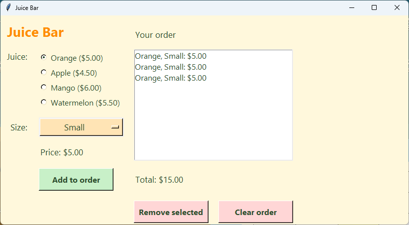

================================================
13. Project: the Juice Bar ordering app
================================================

- **Objective**: Put every skill together to build a small ordering app, then test it and add to it.
- **Skills for the orders app**: all of them. The orders app has the same parts, plus one more drop-down.

----

What the app does
--------------------------------

#. Pick a **juice** with radio buttons.
#. Pick a **size** with a drop-down menu.
#. See the **price**, which changes by itself.
#. Click **Add to order** to put the juice in the order list.
#. See the **total**, **remove** one juice, or **clear** the order.

----

The planning grid
--------------------------------

.. list-table::
    :header-rows: 1
    :widths: 10 22 22 23 23

    * - Row
      - Column 0
      - Column 1
      - Column 2
      - Column 3
    * - 0
      - title_label (columnspan=2)
      -
      - order_heading (columnspan=2)
      -
    * - 1
      - juice_label
      - juice_frame (radio buttons)
      - order_listbox (rowspan=3, columnspan=2)
      -
    * - 2
      - size_label
      - size_menu
      - (order_listbox)
      -
    * - 3
      -
      - price_label
      - (order_listbox)
      -
    * - 4
      -
      - add_button
      - total_label (columnspan=2)
      -
    * - 5
      -
      -
      - remove_button
      - clear_button

----

The full code
--------------------------------

| Make a new file called ``juice_bar_orders.py``. Type in the code one section at a time, and run it after each section of widgets.
| Each part comes from an earlier lesson:

- Sections and the window: :doc:`skills01_window`
- Labels and the grid: :doc:`skills02_labels_grid`
- Constants: :doc:`skills03_constants`
- Dictionaries and the orders list: :doc:`skills04_dictionaries` and :doc:`skills06_lists`
- The price functions: :doc:`skills07_functions` and :doc:`skills11_trace_add`
- The radio buttons and drop-down: :doc:`skills09_radiobuttons` and :doc:`skills10_optionmenu`
- The buttons, Listbox and messagebox: :doc:`skills08_buttons` and :doc:`skills12_listbox`

.. code-block:: python

    import tkinter as tk
    from tkinter import messagebox

    # 1. DATA DICTIONARIES & LISTS
    # Juices and the price of a small cup
    juices = {
        "Orange": 5.00,
        "Apple": 4.50,
        "Mango": 6.00,
        "Watermelon": 5.50,
    }

    # Sizes and their extra cost
    sizes = {
        "Small": 0.00,
        "Regular": 1.00,
        "Large": 2.00,
    }

    # List that stores every juice in the order
    orders = []

    # 2. CONSTANTS
    # Colours
    BG_COLOUR = "#fff8dc"        # pale cream background
    TITLE_COLOUR = "#ff8c00"     # orange title
    TEXT_COLOUR = "#2f4f2f"      # dark green text
    MENU_COLOUR = "#ffe4b5"      # pale orange drop-down menu
    LIST_COLOUR = "#ffffff"      # white order list
    ADD_COLOUR = "#c8f0c8"       # pale green add button
    REMOVE_COLOUR = "#ffd6d6"    # pale red remove and clear buttons

    # Fonts
    TITLE_FONT = ("Segoe UI", 20, "bold")
    LABEL_FONT = ("Segoe UI", 13, "normal")
    RADIO_FONT = ("Segoe UI", 12, "normal")
    LIST_FONT = ("Segoe UI", 12, "normal")
    BUTTON_FONT = ("Segoe UI", 12, "bold")

    # 3. DEFINITIONS
    def get_juice_price():
        """Adds up the juice and size prices for one juice."""
        juice = juice_var.get()
        size = size_var.get()
        price = juices[juice] + sizes[size]
        return price

    def update_juice_price(*args):
        """Shows the price of the juice that is chosen right now."""
        price = get_juice_price()
        price_label.config(text=f"Price: ${price:.2f}")

    def show_juice_orders():
        """Redraws the order list and the total so they match the orders list."""
        order_listbox.delete(0, tk.END)
        total = 0
        for juice in orders:
            order_listbox.insert(tk.END, f"{juice['juice']}, {juice['size']}: ${juice['price']:.2f}")
            total = total + juice["price"]
        total_label.config(text=f"Total: ${total:.2f}")

    def add_juice():
        """Adds the chosen juice to the orders list."""
        juice = {
            "juice": juice_var.get(),
            "size": size_var.get(),
            "price": get_juice_price(),
        }
        orders.append(juice)
        show_juice_orders()

    def remove_juice():
        """Removes the juice that is selected in the order list."""
        selection = order_listbox.curselection()
        if not selection:
            messagebox.showinfo("Remove", "Click a juice in the order list first.")
        else:
            line_number = selection[0]
            del orders[line_number]
            show_juice_orders()

    def clear_juice_orders():
        """Removes every juice from the orders list."""
        orders.clear()
        show_juice_orders()

    # 4. TKINTER WIDGETS
    # Main window
    root = tk.Tk()
    root.title("Juice Bar")
    root.geometry("820x420")
    root.config(bg=BG_COLOUR)

    # --- LEFT SIDE: JUICE CHOICES ---

    # Title
    title_label = tk.Label(root)  # 1. create
    title_label.grid(row=0, column=0, columnspan=2, padx=10, pady=10, sticky="w")  # 2. position
    title_label.config(text="Juice Bar", font=TITLE_FONT, bg=BG_COLOUR, fg=TITLE_COLOUR)  # 3. configure

    # Juice (radio buttons)
    juice_label = tk.Label(root)  # 1. create
    juice_label.grid(row=1, column=0, padx=10, pady=5, sticky="ne")  # 2. position
    juice_label.config(text="Juice:", font=LABEL_FONT, bg=BG_COLOUR, fg=TEXT_COLOUR)  # 3. configure

    juice_frame = tk.Frame(root)  # 1. create
    juice_frame.grid(row=1, column=1, padx=10, pady=5, sticky="w")  # 2. position
    juice_frame.config(bg=BG_COLOUR)  # 3. configure

    juice_var = tk.StringVar(root)  # A. make
    juice_var.set("Orange")  # B. set
    juice_var.trace_add("write", update_juice_price)  # C. bind

    for juice in juices.keys():
        juice_radio = tk.Radiobutton(juice_frame, variable=juice_var, value=juice)  # 1. create
        juice_radio.pack(anchor="w")  # 2. position
        juice_radio.config(text=f"{juice} (${juices[juice]:.2f})", font=RADIO_FONT,
                           bg=BG_COLOUR, fg=TEXT_COLOUR, activebackground=BG_COLOUR,
                           highlightthickness=0)  # 3. configure

    # Size (drop-down menu)
    size_label = tk.Label(root)  # 1. create
    size_label.grid(row=2, column=0, padx=10, pady=5, sticky="e")  # 2. position
    size_label.config(text="Size:", font=LABEL_FONT, bg=BG_COLOUR, fg=TEXT_COLOUR)  # 3. configure

    size_var = tk.StringVar(root)  # A. make
    size_var.set("Small")  # B. set
    size_var.trace_add("write", update_juice_price)  # C. bind

    size_menu = tk.OptionMenu(root, size_var, "Small")  # 1. create
    size_menu.grid(row=2, column=1, padx=10, pady=5, sticky="w")  # 2. position
    size_menu.config(width=14, font=LABEL_FONT, bg=MENU_COLOUR, fg=TEXT_COLOUR,
                     activebackground=MENU_COLOUR)  # 3. configure

    size_choices = size_menu["menu"]
    size_choices.config(font=LABEL_FONT, bg=MENU_COLOUR, fg=TEXT_COLOUR)
    size_choices.delete(0)   # remove the starting choice
    for size in sizes.keys():
        size_choices.add_radiobutton(label=size, variable=size_var, value=size)

    # Price of the chosen juice
    price_label = tk.Label(root)  # 1. create
    price_label.grid(row=3, column=1, padx=10, pady=5, sticky="w")  # 2. position
    price_label.config(text="Price: $0.00", font=LABEL_FONT, bg=BG_COLOUR, fg=TEXT_COLOUR)  # 3. configure

    # Add to order button
    add_button = tk.Button(root)  # 1. create
    add_button.grid(row=4, column=1, padx=10, pady=10, ipady=4, sticky="w")  # 2. position
    add_button.config(text="Add to order", width=14, font=BUTTON_FONT, bg=ADD_COLOUR, fg=TEXT_COLOUR)  # 3. configure
    add_button.config(command=add_juice)  # 4. command

    # --- RIGHT SIDE: THE ORDER ---

    # Order heading
    order_heading = tk.Label(root)  # 1. create
    order_heading.grid(row=0, column=2, columnspan=2, padx=10, pady=10, sticky="sw")  # 2. position
    order_heading.config(text="Your order", font=LABEL_FONT, bg=BG_COLOUR, fg=TEXT_COLOUR)  # 3. configure

    # Order list
    order_listbox = tk.Listbox(root)  # 1. create
    order_listbox.grid(row=1, column=2, rowspan=3, columnspan=2, padx=10, pady=5, sticky="nsew")  # 2. position
    order_listbox.config(width=34, height=10, font=LIST_FONT, bg=LIST_COLOUR, fg=TEXT_COLOUR)  # 3. configure

    # Total cost of the order
    total_label = tk.Label(root)  # 1. create
    total_label.grid(row=4, column=2, columnspan=2, padx=10, pady=5, sticky="w")  # 2. position
    total_label.config(text="Total: $0.00", font=LABEL_FONT, bg=BG_COLOUR, fg=TEXT_COLOUR)  # 3. configure

    # Remove selected button
    remove_button = tk.Button(root)  # 1. create
    remove_button.grid(row=5, column=2, padx=10, pady=10, ipady=4, sticky="w")  # 2. position
    remove_button.config(text="Remove selected", width=14, font=BUTTON_FONT, bg=REMOVE_COLOUR, fg=TEXT_COLOUR)  # 3. configure
    remove_button.config(command=remove_juice)  # 4. command

    # Clear order button
    clear_button = tk.Button(root)  # 1. create
    clear_button.grid(row=5, column=3, padx=10, pady=10, ipady=4, sticky="e")  # 2. position
    clear_button.config(text="Clear order", width=14, font=BUTTON_FONT, bg=REMOVE_COLOUR, fg=TEXT_COLOUR)  # 3. configure
    clear_button.config(command=clear_juice_orders)  # 4. command

    # 5. MAIN CODE
    update_juice_price()
    show_juice_orders()
    root.mainloop()

----

Testing
--------------------------------

.. list-table::
    :header-rows: 1
    :widths: 60 40

    * - Test
      - Expected result
    * - Open the app.
      - Orange and Small are picked. Price: $5.00
    * - Pick Mango, then Large.
      - Price: $8.00
    * - Click **Add to order** three times with different choices.
      - Three lines appear. The total is correct.
    * - Click the second line, then **Remove selected**.
      - Only that line is removed. The total goes down.
    * - Click **Remove selected** with nothing selected.
      - A message asks you to click a juice first.
    * - Click **Clear order**.
      - The list is empty. Total: $0.00

----

.. admonition:: Tasks

    #. Check your code against the rules. Every widget is created, then positioned, then configured. Every button's command comes last. Every ``trace_add`` comes straight after its variable is set.
    #. Add a second feature drop-down for ``extras = {"No extra": 0.00, "Chia seeds": 1.00, "Protein": 2.00}``. Change the code in **five** places: the dictionary, a new drop-down block in row 3, moving the rows below it down one, the price function, and the dictionary made in ``add_juice`` and shown in ``show_juice_orders``.
    #. Change the colours and fonts to a new look by changing **only** the constants.
    #. Save a copy as ``taco_truck_orders.py`` and change it to sell tacos. Rename every ``juice`` name to ``taco``, one name at a time, and run the app after each change.

    .. dropdown::
        :icon: codescan
        :color: primary
        :class-container: sd-dropdown-container

        .. tab-set::

            .. tab-item:: Q2

                .. code-block:: python

                    # 1. Section 1: the new dictionary
                    # Extras and their extra cost
                    extras = {
                        "No extra": 0.00,
                        "Chia seeds": 1.00,
                        "Protein": 2.00,
                    }

                    # 2. Section 4: the new drop-down, below the size drop-down
                    # Extra (drop-down menu)
                    extra_label = tk.Label(root)  # 1. create
                    extra_label.grid(row=3, column=0, padx=10, pady=5, sticky="e")  # 2. position
                    extra_label.config(text="Extra:", font=LABEL_FONT, bg=BG_COLOUR, fg=TEXT_COLOUR)  # 3. configure

                    extra_var = tk.StringVar(root)  # A. make
                    extra_var.set("No extra")  # B. set
                    extra_var.trace_add("write", update_juice_price)  # C. bind

                    extra_menu = tk.OptionMenu(root, extra_var, "No extra")  # 1. create
                    extra_menu.grid(row=3, column=1, padx=10, pady=5, sticky="w")  # 2. position
                    extra_menu.config(width=14, font=LABEL_FONT, bg=MENU_COLOUR, fg=TEXT_COLOUR,
                                      activebackground=MENU_COLOUR)  # 3. configure

                    extra_choices = extra_menu["menu"]
                    extra_choices.config(font=LABEL_FONT, bg=MENU_COLOUR, fg=TEXT_COLOUR)
                    extra_choices.delete(0)   # remove the starting choice
                    for extra in extras.keys():
                        extra_choices.add_radiobutton(label=extra, variable=extra_var, value=extra)

                    # 3. Section 4: add 1 to the row= of price_label, add_button, total_label,
                    #    remove_button and clear_button, and change the Listbox to rowspan=4.

                    # 4. The price function
                    def get_juice_price():
                        """Adds up the juice, size and extra prices for one juice."""
                        juice = juice_var.get()
                        size = size_var.get()
                        extra = extra_var.get()
                        price = juices[juice] + sizes[size] + extras[extra]
                        return price

                    # 5. The add and show functions
                    def show_juice_orders():
                        """Redraws the order list and the total so they match the orders list."""
                        order_listbox.delete(0, tk.END)
                        total = 0
                        for juice in orders:
                            order_listbox.insert(tk.END, f"{juice['juice']}, {juice['size']}, {juice['extra']}: ${juice['price']:.2f}")
                            total = total + juice["price"]
                        total_label.config(text=f"Total: ${total:.2f}")

                    def add_juice():
                        """Adds the chosen juice to the orders list."""
                        juice = {
                            "juice": juice_var.get(),
                            "size": size_var.get(),
                            "extra": extra_var.get(),
                            "price": get_juice_price(),
                        }
                        orders.append(juice)
                        show_juice_orders()

                .. image:: images/skills13_task2_answer.png
                    :align: center

            .. tab-item:: Q4

                | Replace the longer names first, so the shorter names do not break them. For example:

                .. list-table::
                    :header-rows: 1
                    :widths: 50 50

                    * - Juice Bar
                      - Taco Truck
                    * - ``juice_var``, ``juice_frame``, ``juice_radio``, ``juice_label``
                      - ``taco_var``, ``taco_frame``, ``taco_radio``, ``taco_label``
                    * - ``get_juice_price``, ``update_juice_price``
                      - ``get_taco_price``, ``update_taco_price``
                    * - ``add_juice``, ``remove_juice``
                      - ``add_taco``, ``remove_taco``
                    * - ``show_juice_orders``, ``clear_juice_orders``
                      - ``show_taco_orders``, ``clear_taco_orders``
                    * - ``juices``
                      - ``tacos``
                    * - ``sizes``, ``size_var``, ``size_menu``
                      - ``extras``, ``extra_var``, ``extra_menu``

----

Next steps
--------------------------------

| You now have every skill needed for the :doc:`../tk_icecream_orders_tutorial/icecream_orders` tutorial.
| The Ice cream Shop works the same way as the Juice Bar, with flavours instead of juices and **two** drop-downs: containers and toppings.

----

Quiz
--------------------------------

.. mcqgroup::
    :nav_position: top
    :show-instant-feedback:
    :enable-instant-feedback:
    :shuffle_questions:
    :num_questions: 6

    .. multichoice::

        In which section do get_juice_price and add_juice go?

        [ ] 1\. DATA DICTIONARIES & LISTS | Incorrect. That holds the dictionaries and the orders list.
        [ ] 2\. CONSTANTS | Incorrect. That holds colours and fonts.
        [x] 3\. DEFINITIONS | Correct. Functions go before the widgets that use them.
        [ ] 5\. MAIN CODE | Incorrect. The main code calls functions; it does not define them.

    .. multichoice::

        The user picks Watermelon and Regular. What does the price label show?

        [ ] Price: $5.50 | Incorrect. That is Watermelon without the size.
        [x] Price: $6.50 | Correct. 5.50 + 1.00 = 6.50.
        [ ] Price: $1.00 | Incorrect. That is only the size.
        [ ] Price: $0.00 | Incorrect. The binding updates the price.

    .. multichoice::

        What is stored in orders after one juice is added?

        [x] One dictionary with the juice, size and price | Correct. add_juice makes it and appends it.
        [ ] The text of the Listbox line | Incorrect. The Listbox shows text made from the list.
        [ ] Only the price | Incorrect. The choices are stored too.
        [ ] The radio buttons | Incorrect. The list holds data, not widgets.

    .. multichoice::

        Why does the Listbox use rowspan=3?

        [ ] To show 3 lines | Incorrect. height sets the number of lines.
        [x] To cover rows 1, 2 and 3 of the grid | Correct. It sits beside the juice, size and price rows.
        [ ] To put it in row 3 | Incorrect. row=1 is its starting row.
        [ ] To add 3 pixels of space | Incorrect. padx and pady add space.

    .. multichoice::

        Which part of the app uses a binding instead of a command?

        [ ] The Add to order button | Incorrect. Buttons use command.
        [ ] The Clear order button | Incorrect. Buttons use command.
        [x] The radio buttons and the size drop-down | Correct. They change variables, and the variables are bound to update_juice_price.
        [ ] The Listbox | Incorrect. It is redrawn by show_juice_orders.

    .. multichoice::

        Why are both update_juice_price() and show_juice_orders() called in Section 5?

        [x] So the price and the total are correct when the app first opens | Correct. Otherwise they only update after the first change.
        [ ] So the buttons work | Incorrect. Buttons work through their commands.
        [ ] To add a juice to the order | Incorrect. Only add_juice does that.
        [ ] They are not needed | Incorrect. The labels would not show the right values at the start.

----

Fill in the gaps
--------------------------------

.. clozegroup::
    :nav-position: top
    :num-questions: 2
    :show-instant-feedback:

    .. cloze::
        :instructions: Store the chosen juice in the order.

        def add_juice():
            """Adds the chosen juice to the orders list."""
            juice = @@{ | [ | (@@
                "juice": juice_var.@@get | set | value@@(),
                "size": size_var.get(),
                "price": @@get_juice_price() | update_juice_price() | price@@,
            }
            orders.@@append | add | insert@@(juice)
            show_juice_orders()

    .. cloze::
        :instructions: Put the code for the size drop-down in the right order.

        size_var = tk.@@StringVar | OptionMenu | Label@@(root)
        size_var.set("Small")
        size_var.@@trace_add | config | grid@@("write", update_juice_price)

        size_menu = tk.@@OptionMenu | StringVar | Listbox@@(root, size_var, "Small")
        size_menu.@@grid | trace_add | pack@@(row=2, column=1, padx=10, pady=5, sticky="w")
        size_menu.config(width=14, font=LABEL_FONT)
