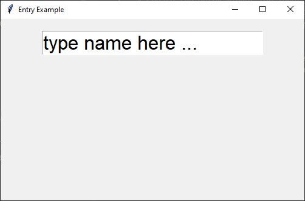

====================================================
tk Entry
====================================================

| See: `<https://docs.python.org/3/library/tkinter.html#tkinter.Entry>`_
| See: `<https://www.geeksforgeeks.org/python-tkinter-entry-widget/>`_

----

Usage
---------------

| The `tkinter.Entry` widget provides a single-line input field.
| The Entry widget is great for simple, single-line inputs such as usernames or passwords.
| Use a Text widget for longer text such as comments or descriptions.
| To create an entry widget the general syntax is (assuming import via "import tkinter as tk")

.. py:function:: entry_widget  = tk.Entry(parent, option=value)

    | `parent` is the window or frame object.
    | Options can be passed as parameters separated by commas.
    | The Entry widget is initially empty.

----

Entry example
----------------------------------------------------

| The font and width are the options used in the entry widget below.

.. code-block:: python

    import tkinter as tk

    # Create the main window
    root = tk.Tk()
    root.geometry("500x300")  # Set window size
    root.title("Entry Example")  # Set window title

    # Create the entry widget for input
    name_entry = tk.Entry(root, font=('Arial', 24), width=20)
    name_entry.pack(pady=20)  # Add some padding to the top

    # Run the main event loop
    root.mainloop()

----

.. admonition:: Tasks

    #. Create a Tkinter application with a window size of 400x300, an `Entry` widget using the `Comic Sans MS` font size 20, a background color of `#fafafa`, a foreground color of `#2f2f2f`, a borderwidth of 2 with a sunken relief style, left-aligned text, and a width of 20 characters, with the widget displayed inside the window using padding of 20 in both directions and internal y padding of 5.

        .. image:: images/entry_question.png
            :scale: 67

    #. Create a Tkinter application with a window size of 400x300 containing a **password Entry** widget. Use the `Comic Sans MS` font size 20, a background color of `#fafafa`, a foreground color of `#2f2f2f`, a borderwidth of 2 with a sunken relief style, left-aligned text, a width of 20 characters, and display `*` characters instead of the typed password. Display the widget with padding of 20 in both directions and internal y padding of 5.

        .. image:: images/entry_question2.png
            :scale: 67

    .. dropdown::
        :icon: codescan
        :color: primary
        :class-container: sd-dropdown-container

        .. tab-set::

            .. tab-item:: Q1

                Create a Tkinter window with an entry widget.

                .. code-block:: python

                    import tkinter as tk

                    # Create the main window
                    root = tk.Tk()
                    root.title("Entry Alphabet Example")
                    root.geometry("400x300")

                    # Define the custom font
                    custom_font=("Comic Sans MS", 20)

                    # First Entry widget
                    entry = tk.Entry(
                        root,
                        font=custom_font,
                        bg="#fafafa",
                        fg="#2f2f2f",
                        borderwidth=2,
                        relief="sunken",
                        justify="left",
                        width=20
                    )
                    entry.pack(padx=20, pady=20, ipady=5)

                    # Run the Tkinter event loop
                    root.mainloop()

            .. tab-item:: Q2

                Create a Tkinter window with a password Entry widget.

                .. code-block:: python

                    import tkinter as tk

                    # Create the main window
                    root = tk.Tk()
                    root.title("Password Entry Example")
                    root.geometry("400x300")

                    # Define the custom font
                    custom_font = ("Comic Sans MS", 20)

                    # Create the password Entry widget
                    entry = tk.Entry(
                        root,
                        font=custom_font,
                        bg="#fafafa",
                        fg="#2f2f2f",
                        borderwidth=2,
                        relief="sunken",
                        justify="left",
                        width=20,
                        show="*"
                    )
                    entry.pack(padx=20, pady=20, ipady=5)

                    # Run the Tkinter event loop
                    root.mainloop()

----

Entry methods
----------------------------------------------------

| Retrieve the text using ``text = entry_widget.get()``.
| Clear the text using ``entry_widget.delete(0, tk.END)``.
| Insert text using ``entry_widget.insert(0, "text")``.
| Give the Entry widget keyboard focus using ``entry_widget.focus_set()``.
| Select all text using ``entry_widget.select_range(0, tk.END)``.

.. py:function:: text = entry_widget.get()

    | Retrieves the current text from the Entry widget.
    | Returns the text as a string.

.. py:function:: entry_widget.delete(first, last=None)

    | Deletes characters from the Entry widget.
    | Use ``entry_widget.delete(0, tk.END)`` to clear all text.

.. py:function:: entry_widget.insert(index, text)

    | Inserts ``text`` at the specified ``index``.
    | Use ``entry_widget.insert(0, "text")`` to insert text at the beginning.

.. py:function:: entry_widget.focus_set()

    | Gives the Entry widget keyboard focus.
    | The insertion cursor is placed in the widget ready for typing.

.. py:function:: entry_widget.select_range(start, end)

    | Selects the text between ``start`` and ``end``.
    | Use ``entry_widget.select_range(0, tk.END)`` to select all text.

----

Entry method examples
----------------------------------------------------

get example
~~~~~~~~~~~~~~~~~~

| ``get()`` reads what the user has typed. The result is always a string.

.. code-block:: python

    import tkinter as tk

    def say_hello():
        name = name_entry.get()  # Read the typed text
        result_label.config(text=f"Hello, {name}!")

    root = tk.Tk()
    root.geometry("300x200")
    root.title("Entry get")

    name_entry = tk.Entry(root, font=("Arial", 16), width=15)
    name_entry.pack(pady=10)

    button = tk.Button(root, text="Say hello", font=("Arial", 14), command=say_hello)
    button.pack()

    result_label = tk.Label(root, text="", font=("Arial", 16))
    result_label.pack(pady=10)

    root.mainloop()

Numbers from an Entry
~~~~~~~~~~~~~~~~~~~~~~~~~~

| ``get()`` returns text, so use ``float()`` or ``int()`` to turn it into a number before doing any maths.
| ``try`` and ``except ValueError`` stop the program from crashing if the user types something that is not a number.

.. code-block:: python

    import tkinter as tk

    def convert():
        try:
            inches = float(inches_entry.get())  # Text -> number
            cm = inches * 2.54
            result_label.config(text=f"{cm:.2f} cm", fg="black")
        except ValueError:
            result_label.config(text="Please enter a number", fg="red")

    root = tk.Tk()
    root.geometry("300x200")
    root.title("Inches to cm")

    inches_entry = tk.Entry(root, font=("Arial", 16), width=10)
    inches_entry.pack(pady=10)

    button = tk.Button(root, text="Convert", font=("Arial", 14), command=convert)
    button.pack()

    result_label = tk.Label(root, text="", font=("Arial", 16))
    result_label.pack(pady=10)

    root.mainloop()

insert and delete example
~~~~~~~~~~~~~~~~~~~~~~~~~~~~~~

| ``insert(0, "text")`` puts text into the Entry, e.g. a starting value.
| ``delete(0, tk.END)`` removes everything from the first character (0) to the end.
| To replace the text, delete first and then insert.

.. code-block:: python

    import tkinter as tk

    def clear():
        word_entry.delete(0, tk.END)  # Remove all text

    def reset():
        word_entry.delete(0, tk.END)  # Remove all text ...
        word_entry.insert(0, "hello")  # ... then put the starting text back

    root = tk.Tk()
    root.geometry("300x200")
    root.title("Entry insert and delete")

    word_entry = tk.Entry(root, font=("Arial", 16), width=15)
    word_entry.insert(0, "hello")  # Starting text
    word_entry.pack(pady=10)

    clear_button = tk.Button(root, text="Clear", font=("Arial", 14), command=clear)
    clear_button.pack(pady=5)

    reset_button = tk.Button(root, text="Reset", font=("Arial", 14), command=reset)
    reset_button.pack(pady=5)

    root.mainloop()

focus_set and select_range example
~~~~~~~~~~~~~~~~~~~~~~~~~~~~~~~~~~~~~~~~~

| ``focus_set()`` puts the typing cursor in the Entry so the user can type straight away without clicking.
| ``select_range(0, tk.END)`` highlights all the text, so the next thing typed replaces it.

.. code-block:: python

    import tkinter as tk

    def check_answer():
        if answer_entry.get() == "12":
            result_label.config(text="Correct!", fg="green")
        else:
            result_label.config(text="Try again", fg="red")
            answer_entry.focus_set()  # Put the cursor back in the Entry
            answer_entry.select_range(0, tk.END)  # Highlight the wrong answer

    root = tk.Tk()
    root.geometry("300x200")
    root.title("Entry focus")

    question_label = tk.Label(root, text="What is 3 x 4?", font=("Arial", 16))
    question_label.pack(pady=5)

    answer_entry = tk.Entry(root, font=("Arial", 16), width=10)
    answer_entry.pack(pady=5)
    answer_entry.focus_set()  # Ready to type as soon as the window opens

    button = tk.Button(root, text="Check", font=("Arial", 14), command=check_answer)
    button.pack(pady=5)

    result_label = tk.Label(root, text="", font=("Arial", 16))
    result_label.pack()

    root.mainloop()

Using the Enter key
~~~~~~~~~~~~~~~~~~~~~~~~

| ``bind("<Return>", function)`` runs a function when the Enter key is pressed in the Entry.
| A function called by ``bind`` is given an ``event`` value, so the function needs an ``event`` parameter.
| Using ``event=None`` lets the same function also be used by a button.

.. code-block:: python

    import tkinter as tk

    def double_it(event=None):
        try:
            number = float(number_entry.get())
            result_label.config(text=f"Double: {number * 2}")
        except ValueError:
            result_label.config(text="Please enter a number")

    root = tk.Tk()
    root.geometry("300x200")
    root.title("Entry Enter key")

    number_entry = tk.Entry(root, font=("Arial", 16), width=10)
    number_entry.pack(pady=10)
    number_entry.bind("<Return>", double_it)  # Press Enter to run double_it

    button = tk.Button(root, text="Double", font=("Arial", 14), command=double_it)
    button.pack()

    result_label = tk.Label(root, text="", font=("Arial", 16))
    result_label.pack(pady=10)

    root.mainloop()

textvariable example
~~~~~~~~~~~~~~~~~~~~~~~~~

| A ``StringVar`` can be linked to an Entry with ``textvariable``.
| ``.get()`` on the variable reads the Entry text and ``.set()`` changes it.

.. code-block:: python

    import tkinter as tk

    def shout():
        message.set(message.get().upper())  # Read, change, and put back

    root = tk.Tk()
    root.geometry("300x200")
    root.title("Entry textvariable")

    message = tk.StringVar(value="hello there")

    message_entry = tk.Entry(root, textvariable=message, font=("Arial", 16), width=15)
    message_entry.pack(pady=10)

    button = tk.Button(root, text="Shout", font=("Arial", 14), command=shout)
    button.pack()

    root.mainloop()

state example
~~~~~~~~~~~~~~~~~~

| ``state="readonly"`` shows text that can be selected and copied but not changed. It is useful for showing an answer.
| ``state="disabled"`` greys the Entry out completely.
| A program cannot ``insert`` or ``delete`` while the Entry is readonly or disabled, so set ``state="normal"`` first, change the text, then set the state back.

.. code-block:: python

    import tkinter as tk

    def calculate():
        try:
            side = float(side_entry.get())
            area = side * side
        except ValueError:
            area = "?"
        area_entry.config(state="normal")  # Unlock
        area_entry.delete(0, tk.END)
        area_entry.insert(0, area)
        area_entry.config(state="readonly")  # Lock again

    root = tk.Tk()
    root.geometry("300x220")
    root.title("Entry state")

    tk.Label(root, text="Side length", font=("Arial", 14)).pack()
    side_entry = tk.Entry(root, font=("Arial", 16), width=10)
    side_entry.pack(pady=5)

    button = tk.Button(root, text="Area of square", font=("Arial", 14), command=calculate)
    button.pack(pady=5)

    area_entry = tk.Entry(root, font=("Arial", 16), width=10, state="readonly")
    area_entry.pack(pady=5)

    root.mainloop()

----

Option details
--------------------

.. py:function:: entry_widget = tk.Entry(parent, option=value)

    | parent is the window or frame object.
    | Options can be passed as parameters separated by commas.

    **Parameters:**

    .. py:attribute:: background
    .. py:attribute:: bg

        | Syntax: ``entry_widget = tk.Entry(parent, bg="color")``
        | Description: Sets the background color of the entry field.
        | Default: SystemWindow RGB: (255, 255, 255)
        | Example: ``entry_widget = tk.Entry(root, bg="lightgrey")``

    .. py:attribute:: bd
    .. py:attribute:: borderwidth

        | Syntax: ``entry_widget = tk.Entry(parent, borderwidth=width)``
        | Description: Sets the width of the border around the entry field.
        | Default: ``2``
        | Example: ``entry_widget = tk.Entry(root, borderwidth=5)``

    .. py:attribute:: cursor

        | Syntax: ``entry_widget = tk.Entry(parent, cursor="cursor_type")``
        | Description: Changes the cursor when hovering over the entry field.
        | Default: ``None``
        | Example: ``entry_widget = tk.Entry(root, cursor="xterm")``
        | Possible values include:

            - **"arrow"**: Standard arrow cursor.
            - **"xterm"**: I-beam cursor for text selection.
            - **"hand2"**: Hand cursor.
            - **"cross"**: Crosshair cursor.
            - **"plus"**: Plus sign cursor.
            - **"wait"**: Hourglass cursor.

    .. py:attribute:: disabledbackground

        | Syntax: ``entry_widget = tk.Entry(parent, disabledbackground="color")``
        | Description: Sets the background color when the entry is disabled.
        | Default: SystemDisabled RGB: (240, 240, 240)
        | Example: ``entry_widget = tk.Entry(root, disabledbackground="lightgrey")``

    .. py:attribute:: disabledforeground

        | Syntax: ``entry_widget = tk.Entry(parent, disabledforeground="color")``
        | Description: Sets the text color when the entry is disabled.
        | Default: SystemDisabledText RGB: (109, 109, 109)
        | Example: ``entry_widget = tk.Entry(root, disabledforeground="darkgrey")``

    .. py:attribute:: exportselection

        | Syntax: ``entry_widget = tk.Entry(parent, exportselection=boolean)``
        | Description: Determines if the text selection is exported to the clipboard.
        | Default: ``1``
        | Example: ``entry_widget = tk.Entry(root, exportselection=False)``

    .. py:attribute:: font

        | Syntax: ``entry_widget = tk.Entry(parent, font=("font_name", size))``
        | Description: Sets the font type and size of the entry text.
        | Default: System font and size
        | Example: ``entry_widget = tk.Entry(root, font=("Arial", 12))``

    .. py:attribute:: foreground
    .. py:attribute:: fg

        | Syntax: ``entry_widget = tk.Entry(parent, fg="color")``
        | Description: Sets the text color of the entry field.
        | Default: SystemWindowText RGB: (0, 0, 0)
        | Example: ``entry_widget = tk.Entry(root, fg="blue")``

    .. py:attribute:: highlightbackground

        | Syntax: ``entry_widget = tk.Entry(parent, highlightbackground="color")``
        | Description: Sets the color of the highlight when the entry does not have focus.
        | Default: SystemButtonFace RGB: (240, 240, 240)
        | Example: ``entry_widget = tk.Entry(root, highlightbackground="grey")``

    .. py:attribute:: highlightcolor

        | Syntax: ``entry_widget = tk.Entry(parent, highlightcolor="color")``
        | Description: Sets the color of the highlight when the entry has focus.
        | Default: SystemHighlight RGB: (100, 100, 100)
        | Example: ``entry_widget = tk.Entry(root, highlightcolor="blue")``

    .. py:attribute:: highlightthickness

        | Syntax: ``entry_widget = tk.Entry(parent, highlightthickness=thickness)``
        | Description: Sets the thickness of the focus highlight border.
        | Default: ``1``
        | Example: ``entry_widget = tk.Entry(root, highlightthickness=2)``

    .. py:attribute:: insertbackground

        | Syntax: ``entry_widget = tk.Entry(parent, insertbackground="color")``
        | Description: Sets the color of the insertion cursor (caret).
        | Default: SystemWindowText RGB: (0, 0, 0)
        | Example: ``entry_widget = tk.Entry(root, insertbackground="red")``

    .. py:attribute:: insertborderwidth

        | Syntax: ``entry_widget = tk.Entry(parent, insertborderwidth=width)``
        | Description: Sets the width of the insertion cursor's border.
        | Default: ``0``
        | Example: ``entry_widget = tk.Entry(root, insertborderwidth=1)``

    .. py:attribute:: insertofftime

        | Syntax: ``entry_widget = tk.Entry(parent, insertofftime=milliseconds)``
        | Description: Sets the time the insertion cursor is off per blink in milliseconds.
        | Default: ``300``
        | Example: ``entry_widget = tk.Entry(root, insertofftime=500)``

    .. py:attribute:: insertontime

        | Syntax: ``entry_widget = tk.Entry(parent, insertontime=milliseconds)``
        | Description: Sets the time the insertion cursor is on per blink in milliseconds.
        | Default: ``600``
        | Example: ``entry_widget = tk.Entry(root, insertontime=500)``

    .. py:attribute:: insertwidth

        | Syntax: ``entry_widget = tk.Entry(parent, insertwidth=width)``
        | Description: Sets the width of the insertion cursor.
        | Default: ``2``
        | Example: ``entry_widget = tk.Entry(root, insertwidth=3)``

    .. py:attribute:: justify

        | Syntax: ``entry_widget = tk.Entry(parent, justify="alignment")``
        | Description: Specifies how the text is aligned within the entry field.
        | It doesn't change where insertion starts.
        | Default: ``left``
        | Example: ``entry_widget = tk.Entry(root, justify="center")``
        | Possible values include:

            - **"left"**: Aligns text to the left.
            - **"center"**: Centers text within the field.
            - **"right"**: Aligns text to the right.

    .. py:attribute:: relief

        | Syntax: ``entry_widget = tk.Entry(parent, relief="relief_type")``
        | Description: Sets the border style of the entry field.
        | Default: ``flat``
        | Example: ``entry_widget = tk.Entry(root, relief="sunken")``
        | Possible values include:

            - **"flat"**
            - **"raised"**
            - **"sunken"**
            - **"groove"**
            - **"ridge"**
            - **"solid"**

    .. py:attribute:: show

        | Syntax: ``entry_widget = tk.Entry(parent, show="character")``
        | Description: Masks characters, often used for passwords.
        | Default: ``""``
        | Example: ``entry_widget = tk.Entry(root, show="*")``

    .. py:attribute:: state

        | Syntax: ``entry_widget = tk.Entry(parent, state="state")``
        | Description: Sets the state of the entry field.
        | Default: ``normal``
        | Example: ``entry_widget = tk.Entry(root, state="disabled")``
        | Possible values include:

            - **"normal"**
            - **"disabled"**
            - **"readonly"**

    .. py:attribute:: takefocus

        | Syntax: ``entry_widget = tk.Entry(parent, takefocus=boolean)``
        | Description: Determines if the entry field can receive focus via keyboard navigation.
        | Default: ``1``
        | Example: ``entry_widget = tk.Entry(root, takefocus=False)``

    .. py:attribute:: textvariable

        | Syntax: ``entry_widget = tk.Entry(parent, textvariable=variable)``
        | Description: Associates a Tkinter variable (usually a StringVar) with the entry text.
        | Default: ``None``
        | Example: ``entry_widget = tk.Entry(root, textvariable=my_var)``

    .. py:attribute:: validate

        | Syntax: ``entry_widget = tk.Entry(parent, validate="validation_type")``
        | Description: Sets the type of validation to apply to the entry field.
        | Default: ``none``
        | Example: ``entry_widget = tk.Entry(root, validate="focusout")``
        | Possible values include:

            - **"none"**: No validation.
            - **"focus"**: Validation occurs when the widget gains or loses focus.
            - **"focusin"**: Validation occurs when the entry gains focus.
            - **"focusout"**: Validation occurs when the entry loses focus.
            - **"key"**: Validation occurs on every keystroke.
            - **"all"**: Validation occurs on every keystroke and when the entry loses or gains focus.

    .. py:attribute:: width

        | Syntax: ``entry_widget = tk.Entry(parent, width=characters)``
        | Description: Sets the width of the entry field in characters.
        | Default: ``20``
        | Example: ``entry_widget = tk.Entry(root, width=30)``

    .. py:attribute:: xscrollcommand

        | Syntax: ``entry_widget = tk.Entry(parent, xscrollcommand=scroll_function)``
        | Description: Specifies a function for horizontal scrolling.
        | Default: ``None``
        | Example: ``entry_widget = tk.Entry(root, xscrollcommand=my_scroll_function)``

----

Default options
------------------------

| Code to display the default value for each ``Entry`` option is shown below.

.. code-block:: python

    import tkinter as tk

    root = tk.Tk()

    widget = tk.Entry(root)
    widget_options = widget.keys()

    for option in widget_options:
        print(f"{option}: {widget.cget(option)}")  # cget retrieves the current value of the option

