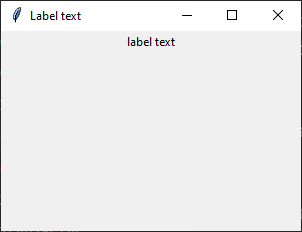
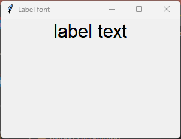
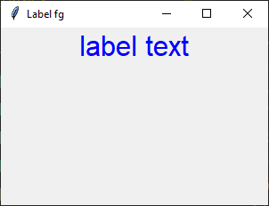
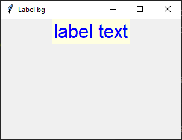
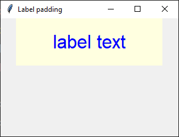
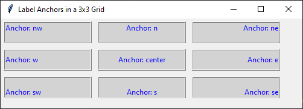
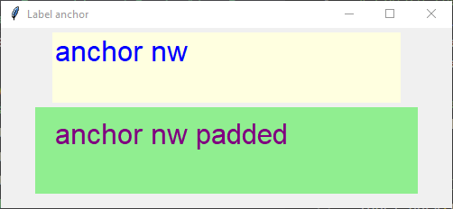
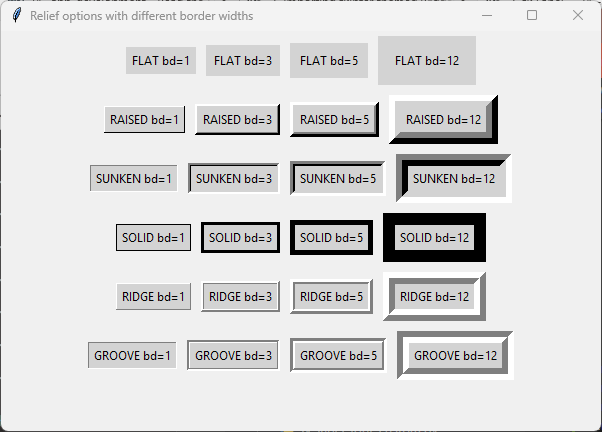
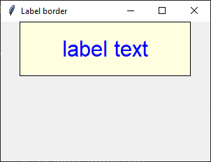

====================================================
tk Label
====================================================

| See: `<https://docs.python.org/3/library/tkinter.html#tkinter.Label>`_
| See: `<https://www.geeksforgeeks.org/python-tkinter-label/>`_

----

Usage
---------------

| The `tkinter.Label` widget displays text or an image in a window or frame.
| To create a Label widget the general syntax is (assuming import via "import tkinter as tk"):

.. py:function:: label_widget  = tk.Label(parent, option=value)

    | `parent` is the window or frame object.
    | Options can be passed as parameters separated by commas.

----

Text
--------------

.. py:function:: label_widget  = tk.Label(parent, text=text_string)

    | `text_string` is text to display in the Label widget.
    | e.g. label = tk.Label(root, text="label text")

Text example
~~~~~~~~~~~~~~~~~~

.. code-block:: python

    import tkinter as tk

    # Create the main window
    root = tk.Tk()
    root.geometry("300x200")  # Set window size
    root.title("Label text")  # Set window title

    # Create the Label widget
    label = tk.Label(root, text="label text")

    # Pack the label into the window
    label.pack()

    # Run the main event loop
    root.mainloop()

----

Font
----------

.. py:function:: label_widget  = tk.Label(parent, font=(font_type, font_size, font_style))

   - font_type is a font name. e.g "Arial"
   - font_size is the size of the font.  eg. 12
   - font_style can be "bold", "italic", "underline" or a space separated combination
   - Default Value: System-dependent (usually a default font)
   - Description: Specifies the font family, size, and style for the label text.
   - Example: To use a 12-point Arial font, use `font=("Arial", 12)`.
   - Example: To use a bold 12-point Arial font, use `font=("Arial", 12, "bold")`.
   - Example: To use a bold underlined 12-point Arial font, use `font=("Arial", 12, "bold underline")`.

font example
~~~~~~~~~~~~~~~~~~

.. code-block:: python

    import tkinter as tk

    # Create the main window
    root = tk.Tk()
    root.geometry("300x200")  # Set window size
    root.title("Label font")  # Set window title

    # Create the Label widget with options
    label = tk.Label(root, text="label text", font=("Arial", 24))

    # Pack the label into the window
    label.pack()

    # Run the main event loop
    root.mainloop()

----

Text color
---------------

.. py:function:: label_widget  = tk.Label(parent, fg=color)

   - color can be a color name, e.g blue, or a hex colour, e.g. #0000FF.
   - Default Value: System-dependent (usually black)
   - Description: Sets the foreground (text) color of the label.
   - Example: To set the text color to blue, use `fg="blue"` or `fg="#0000FF"`.

fg example
~~~~~~~~~~~~~~~~~~

.. code-block:: python

    import tkinter as tk

    # Create the main window
    root = tk.Tk()
    root.geometry("300x200")  # Set window size
    root.title("Label fg")  # Set window title

    # Create the Label widget with options
    label = tk.Label(root, text="label text", font=("Arial", 24), fg="blue")

    # Pack the label into the window
    label.pack()

    # Run the main event loop
    root.mainloop()

----

Background color
--------------------------

.. py:function:: label_widget  = tk.Label(parent, bg=color)

   - color can be a color name or a hex colour.
   - Default Value: System-dependent (usually white)
   - Description: Sets the background color of the label.
   - Example: To set the background color to light yellow, use `bg="lightyellow"`.

bg example
~~~~~~~~~~~~~~~~~~

.. code-block:: python

    import tkinter as tk

    # Create the main window
    root = tk.Tk()
    root.geometry("300x200")  # Set window size
    root.title("Label bg")  # Set window title

    # Create the Label widget with options
    label = tk.Label(root, text="label text", font=("Arial", 24), fg="blue", bg="lightyellow")

    # Pack the label into the window
    label.pack()

    # Run the main event loop
    root.mainloop()

----

Padding
-------------------

.. py:function:: label_widget  = tk.Label(parent, padx=x_integer, pady=y_integer)

   - x_integer and y_integer are integers
   - Default Value: 0
   - Description: Adds extra space (in pixels) around the label text.
   - Example: To add 12 pixels of padding on the left and right sides, use `padx=12`.
   - Example: To add 5 pixels of padding on the top and bottom, use `pady=5`.

padding example
~~~~~~~~~~~~~~~~~~

.. code-block:: python

    import tkinter as tk

    # Create the main window
    root = tk.Tk()
    root.geometry("300x200")  # Set window size
    root.title("Label padding]")  # Set window title

    # Create the Label widget with options
    label = tk.Label(root, text="label text", font=("Arial", 24), fg="blue", bg="lightyellow",
                    padx=60, pady=20)

    # Pack the label into the window
    label.pack()

    # Run the main event loop
    root.mainloop()

----

Anchor
-------------------

.. py:attribute:: anchor

    | Syntax: ``label_widget = tk.Label(parent, anchor="position")``
    | Description: Sets the position of the text within the label. Options are "nw", "n", "ne", "w", "center", "e", "sw", "s", "se".
    | Default: center
    | Example: ``label_widget = tk.Label(root, anchor="center")``

Height and width
-------------------

.. py:attribute:: height

    | Syntax: ``label_widget = tk.Label(parent, height=value)``
    | Description: Sets the height of the label in number of lines.
    | Default: 0
    | Example: ``label_widget = tk.Label(root, height=2)``

.. py:attribute:: width

    | Syntax: ``label_widget = tk.Label(parent, width=value)``
    | Description: Sets the width of the label in number of characters.
    | Default: 0
    | Example: ``label_widget = tk.Label(root, width=20)``

Anchor example
~~~~~~~~~~~~~~~~~~~~~

| The label height and width need to be set larger than needed for the text to fit so that the anchor setting can move the text.

.. code-block:: python

    import tkinter as tk

    # Create the main window
    root = tk.Tk()
    root.geometry("500x200")  # Set window size
    root.title("Label anchor")  # Set window title

    # Create the Label widget with options
    label = tk.Label(text="anchor nw", font=("Arial", 24), fg="blue", bg="lightyellow",
                    width=20, height=2, anchor="nw")

    # Pack the label into the window
    label.pack(pady=5)

    # Create the Label widget with options
    label_2 = tk.Label(text="anchor nw padded", font=("Arial", 24), fg="purple", bg="lightgreen",
                    width=20, height=2, anchor="nw", padx=20, pady=10)

    # Pack the label into the window
    label_2.pack()

    # Run the main event loop
    root.mainloop()

----

Border
---------------

.. py:function:: label_widget  = tk.Label(parent, borderwidth=width)

   - width is an integer
   - Default Value: 0
   - Description: Specifies the border width for the label.
   - Example: To create a width of 2 pixels, use `borderwidth=2`.

.. py:function:: label_widget  = tk.Label(parent, relief=border_style)

   - border_style is one of "flat", "raised", "sunken", "solid", "ridge", "groove"
   - Default Value: "flat" (no border)
   - Description: Specifies the border style and width for the label.
   - Example: To create a solid border with a width of 1 pixel, use `relief="solid"` and `borderwidth=1`.

border example
~~~~~~~~~~~~~~~~~~~~~

.. code-block:: python

    import tkinter as tk

    # Create the main window
    root = tk.Tk()
    root.geometry("300x200")  # Set window size
    root.title("Label border")  # Set window title

    # Create the Label widget with options
    label = tk.Label(root, text="label text", font=("Arial", 24), fg="blue", bg="lightyellow",
                    padx=60, pady=20, relief="solid", borderwidth=1)

    # Pack the label into the window
    label.pack()

    # Run the main event loop
    root.mainloop()

----

.. admonition:: Tasks

    #. Create a Tkinter window with a label using the following specifications:

      - The window should have a title "Formatted Label Example" and a size of 500x300 pixels.
      - Use the "Comic Sans MS" font with a size of 20, bold weight, and italic slant for the Label widget.
      - The Label widget should display the text "This is a Label widget." with a pale mauve background (`#e0b0ff`) and purple text color.
      - Add a raised border with a borderwidth of 2 pixels, padding of 10 pixels on all sides, and anchor the text to the northwest.
      - Set the width of the Label widget to 30 characters and the height to 2 lines.
      - Ensure the Label widget is packed with padding of 20 pixels on all sides.

        .. image:: images/label_question.png
            :scale: 67

    .. dropdown::
        :icon: codescan
        :color: primary
        :class-container: sd-dropdown-container

        .. tab-set::

            .. tab-item:: Q1

                Create a Tkinter window with a label.

                .. code-block:: python

                    import tkinter as tk

                    # Create the main window
                    root = tk.Tk()
                    root.title("Formatted Label Example")
                    root.geometry("500x300")

                    # Define the custom font
                    custom_font = ("Comic Sans MS", 20)

                    # Create the Label widget with the specified formatting, border, padding, and anchor options
                    label = tk.Label(root, text="This is a Label widget.", font=custom_font,
                                    bg="#e0b0ff", fg="purple", borderwidth=2, relief="raised",
                                    padx=10, pady=10, anchor="nw", width=30, height=2)
                    label.pack(padx=20, pady=20)

                    # Run the Tkinter event loop
                    root.mainloop()

----

Changing a label while the program runs
-------------------------------------------

| Labels are often used to show results, so a program usually needs to change the label text after the label has been created.
| The most commonly used methods are:

.. py:function:: label_widget.config(option=value)

    | Changes one or more options after the label has been created.
    | e.g. ``label.config(text="Done!", fg="green")``

.. py:function:: label_widget.cget(option)

    | Returns the current value of an option.
    | e.g. ``current_text = label.cget("text")``

.. py:function:: label_widget["option"] = value

    | A shorter way to change a single option.
    | e.g. ``label["text"] = "Done!"``

config example
~~~~~~~~~~~~~~~~~~

| The label text and colour change when the button is clicked.

.. code-block:: python

    import tkinter as tk

    def show_message():
        # Change the text and colour of the existing label
        message_label.config(text="Button clicked!", fg="green")

    root = tk.Tk()
    root.geometry("300x200")
    root.title("Label config")

    message_label = tk.Label(root, text="Waiting...", font=("Arial", 18), fg="red")
    message_label.pack(pady=20)

    button = tk.Button(root, text="Click me", font=("Arial", 14), command=show_message)
    button.pack()

    root.mainloop()

cget example
~~~~~~~~~~~~~~~~~~

| ``cget("text")`` reads what the label is currently showing.
| The text is always a string, so ``int()`` is used to turn it into a number before adding 1.

.. code-block:: python

    import tkinter as tk

    def add_one():
        count = int(count_label.cget("text"))  # Read the current text as a number
        count_label.config(text=count + 1)     # Show the new number

    root = tk.Tk()
    root.geometry("300x200")
    root.title("Label cget")

    count_label = tk.Label(root, text="0", font=("Arial", 36))
    count_label.pack(pady=20)

    button = tk.Button(root, text="Add 1", font=("Arial", 14), command=add_one)
    button.pack()

    root.mainloop()

textvariable example
~~~~~~~~~~~~~~~~~~~~~~~~

| A ``StringVar`` is a special Tkinter variable that holds text.
| When a label uses ``textvariable``, the label updates automatically whenever the variable is changed with ``.set()``.

.. code-block:: python

    import tkinter as tk

    def win_points():
        score_text.set("Score: 10")  # The label updates automatically

    root = tk.Tk()
    root.geometry("300x200")
    root.title("Label textvariable")

    score_text = tk.StringVar(value="Score: 0")

    score_label = tk.Label(root, textvariable=score_text, font=("Arial", 24))
    score_label.pack(pady=20)

    button = tk.Button(root, text="Win points", font=("Arial", 14), command=win_points)
    button.pack()

    root.mainloop()

wraplength and justify example
~~~~~~~~~~~~~~~~~~~~~~~~~~~~~~~~~~~

| ``wraplength`` sets how wide (in pixels) a line can be before the text wraps onto the next line.
| ``justify`` lines up the wrapped lines on the "left", "center" or "right".

.. code-block:: python

    import tkinter as tk

    root = tk.Tk()
    root.geometry("300x200")
    root.title("Label wrapping")

    label = tk.Label(
        root,
        text="This is a long sentence that wraps onto several lines inside the label.",
        font=("Arial", 14),
        bg="lightyellow",
        wraplength=200,  # Wrap lines longer than 200 pixels
        justify="left",  # Line up the wrapped lines on the left
    )
    label.pack(pady=20)

    root.mainloop()

image example
~~~~~~~~~~~~~~~~~~

| A label can show a .png or .gif picture using ``tk.PhotoImage``.
| The image file (here ``logo.png``) must be saved in the same folder as the Python file.
| ``compound="top"`` shows the image above the text. Leave out ``compound`` to show only the image.

.. code-block:: python

    import tkinter as tk

    root = tk.Tk()
    root.geometry("300x250")
    root.title("Label image")

    logo = tk.PhotoImage(file="logo.png")  # Load the picture

    image_label = tk.Label(root, image=logo, text="Our logo", compound="top", font=("Arial", 14))
    image_label.pack(pady=20)

    root.mainloop()

----

Options
--------------

.. py:function:: label_widget = tk.Label(parent, option=value)

    | parent is the window or frame object.
    | Options can be passed as parameters separated by commas.

    **Parameters:**

    .. py:attribute:: activebackground

        | Syntax: ``label_widget = tk.Label(parent, activebackground="color")``
        | Description: Sets the background color when the label is active.
        | Default: SystemButtonFace
        | Example: ``label_widget = tk.Label(root, activebackground="SystemButtonFace")``

    .. py:attribute:: activeforeground

        | Syntax: ``label_widget = tk.Label(parent, activeforeground="color")``
        | Description: Sets the foreground color when the label is active.
        | Default: SystemButtonText
        | Example: ``label_widget = tk.Label(root, activeforeground="SystemButtonText")``

    .. py:attribute:: anchor

        | Syntax: ``label_widget = tk.Label(parent, anchor="position")``
        | Description: Sets the position of the text within the label.
        | Default: center
        | Example: ``label_widget = tk.Label(root, anchor="center")``

    .. py:attribute:: background
    .. py:attribute:: bg

        | Syntax: ``label_widget = tk.Label(parent, bg="color")``
        | Description: Sets the background color of the label.
        | Default: SystemButtonFace
        | Example: ``label_widget = tk.Label(root, bg="SystemButtonFace")``

    .. py:attribute:: bd
    .. py:attribute:: borderwidth

        | Syntax: ``label_widget = tk.Label(parent, bd=value)``
        | Description: Sets the border width of the label.
        | Default: 2
        | Example: ``label_widget = tk.Label(root, bd=2)``

    .. py:attribute:: bitmap

        | Syntax: ``label_widget = tk.Label(parent, bitmap="bitmap")``
        | Description: Sets a bitmap to be displayed in the label.
        | Default: None
        | Example: ``label_widget = tk.Label(root, bitmap="error")``

    .. py:attribute:: compound

        | Syntax: ``label_widget = tk.Label(parent, compound="position")``
        | Description: Specifies the relative position of the image and text. Controls how to combine text and image in the label. By default, if an image or bitmap is given, it is drawn instead of the text. If this option is set to CENTER, the text is drawn on top of the image. If this option is set to one of BOTTOM, LEFT, RIGHT, or TOP, the image is drawn beside the text (use BOTTOM to draw the image under the text, etc.).
        | Default: none
        | Example: ``label_widget = tk.Label(root, compound="left")``

    .. py:attribute:: cursor

        | Syntax: ``label_widget = tk.Label(parent, cursor="cursor_type")``
        | Description: Sets the cursor that appears when the mouse is over the label.
        | Default: None; standard cursor
        | Example: ``label_widget = tk.Label(root, cursor="arrow")``

    .. py:attribute:: disabledforeground

        | Syntax: ``label_widget = tk.Label(parent, disabledforeground="color")``
        | Description: Sets the foreground color of the label when it is disabled.
        | Default: SystemDisabledText
        | Example: ``label_widget = tk.Label(root, disabledforeground="SystemDisabledText")``

    .. py:attribute:: fg
    .. py:attribute:: foreground

        | Syntax: ``label_widget = tk.Label(parent, fg="color")``
        | Description: Sets the foreground color of the label.
        | Default: SystemButtonText
        | Example: ``label_widget = tk.Label(root, fg="SystemButtonText")``

    .. py:attribute:: font

        | Syntax: ``label_widget = tk.Label(parent, font="font")``
        | Description: Sets the font of the label text. The label can only contain text in single font.
        | Default: TkDefaultFont
        | Example: ``label_widget = tk.Label(root, font="TkDefaultFont")``

    .. py:attribute:: height

        | Syntax: ``label_widget = tk.Label(parent, height=value)``
        | Description: Sets the height of the label in number of lines. If the label displays an image, the size is given in pixels. If the size is set to 0, or omitted, it is calculated based on the label contents.
        | Default: 0
        | Example: ``label_widget = tk.Label(root, height=2)``

    .. py:attribute:: highlightbackground

        | Syntax: ``label_widget = tk.Label(parent, highlightbackground="color")``
        | Description: Sets the color of the focus highlight border when the label does not have focus.
        | Default: SystemButtonFace
        | Example: ``label_widget = tk.Label(root, highlightbackground="SystemButtonFace")``

    .. py:attribute:: highlightcolor

        | Syntax: ``label_widget = tk.Label(parent, highlightcolor="color")``
        | Description: Sets the color of the focus highlight border when the label has focus.
        | Default: SystemWindowFrame
        | Example: ``label_widget = tk.Label(root, highlightcolor="SystemWindowFrame")``

    .. py:attribute:: highlightthickness

        | Syntax: ``label_widget = tk.Label(parent, highlightthickness=value)``
        | Description: Sets the thickness of the focus highlight border.
        | Default: 0
        | Example: ``label_widget = tk.Label(root, highlightthickness=1)``

    .. py:attribute:: image

        | Syntax: ``label_widget = tk.Label(parent, image="image")``
        | Description: Sets an image to be displayed in the label. The value should be a PhotoImage (.gif, .png), BitmapImage (.bmp), or a .jpg via the pillow library. If specified, this takes precedence over the text and bitmap options.
        | Default: None
        | Example: ``label_widget = tk.Label(root, image=my_image)``

    .. py:attribute:: justify

        | Syntax: ``label_widget = tk.Label(parent, justify="alignment")``
        | Description: Sets the justification of multiple lines of text within the label. Use LEFT, RIGHT, or CENTER. Note that to position the text inside the widget, use the anchor option.
        | Default: center
        | Example: ``label_widget = tk.Label(root, justify="center")``

    .. py:attribute:: padx

        | Syntax: ``label_widget = tk.Label(parent, padx=value)``
        | Description: Sets the horizontal padding to add around the text of the label.
        | Default: 1
        | Example: ``label_widget = tk.Label(root, padx=5)``

    .. py:attribute:: pady

        | Syntax: ``label_widget = tk.Label(parent, pady=value)``
        | Description: Sets the vertical padding to add around the text of the label.
        | Default: 1
        | Example: ``label_widget = tk.Label(root, pady=5)``

    .. py:attribute:: relief

        | Syntax: ``label_widget = tk.Label(parent, relief="style")``
        | Description: Sets the 3D effect of the label border. Possible values are FLAT, RAISED, SUNKEN, GROOVE, RIDGE and SOLID.
        | Default: flat
        | Example: ``label_widget = tk.Label(root, relief="raised")``

    .. py:attribute:: state

        | Syntax: ``label_widget = tk.Label(parent, state="state")``
        | Description: Sets the state of the label (normal, active or disabled).
        | Default: normal
        | Example: ``label_widget = tk.Label(root, state="normal")``

    .. py:attribute:: takefocus

        | Syntax: ``label_widget = tk.Label(parent, takefocus=value)``
        | Description: Controls whether the label accepts focus.
        | Default: 0; False
        | Example: ``label_widget = tk.Label(root, takefocus=1)``

    .. py:attribute:: text

        | Syntax: ``label_widget = tk.Label(parent, text="text")``
        | Description: Sets the text to be displayed in the label. The text can contain newlines. If the bitmap or image options are used, this option is ignored.
        | Default: ""
        | Example: ``label_widget = tk.Label(root, text="Hello, World!")``

    .. py:attribute:: textvariable

        | Syntax: ``label_widget = tk.Label(parent, textvariable=variable)``
        | Description: Associates a Tkinter variable with the label text. If the variable is changed, the label text is updated.
        | Default: None
        | Example: ``label_widget = tk.Label(root, textvariable=my_var)``

    .. py:attribute:: underline

        | Syntax: ``label_widget = tk.Label(parent, underline=index)``
        | Description: Underlines the character at the given index. (e.g. for keyboard shortcuts)
        | Default: -1; (no underline)
        | Example: ``label_widget = tk.Label(root, underline=0)``

    .. py:attribute:: width

        | Syntax: ``label_widget = tk.Label(parent, width=value)``
        | Description: Sets the width of the label in number of characters. If the label displays an image, the size is given in pixels. If the size is set to 0, or omitted, it is calculated based on the label contents.
        | Default: 0
        | Example: ``label_widget = tk.Label(root, width=20)``

    .. py:attribute:: wraplength

        | Syntax: ``label_widget = tk.Label(parent, wraplength=value)``
        | Description: Sets the maximum line length before wrapping into multiple lines. This is given in screen units.
        | Default: 0
        | Example: ``label_widget = tk.Label(root, wraplength=100)``
