====================================================
tk Radiobutton
====================================================

| See: `<https://docs.python.org/3/library/tkinter.html#tkinter.Radiobutton>`_

----

What is a Radiobutton?
-------------------------

| A **Radiobutton** is a small round button with words next to it.
| Radiobuttons come in **groups**. The user can choose **only one** button in a group. Choosing another one un-chooses the first.
| Use radiobuttons for questions with one answer, e.g. "Which year are you in?" or a multiple-choice quiz.
| To let the user choose **many** options, use **Checkbuttons** instead.

----

Making a group of Radiobuttons
---------------------------------

| All the radiobuttons in a group share **one variable**. Each radiobutton has its own **value**.
| When a radiobutton is chosen, its value is stored in the shared variable.

#. **Create** one variable with ``tk.StringVar()``.
#. **Create** each radiobutton with the **same** ``variable`` and a **different** ``value``.
#. **Place** each radiobutton with ``.pack()``.

.. code-block:: python

    import tkinter as tk            # Load the tkinter library

    root = tk.Tk()                  # Make the window
    root.geometry("300x200")        # Window size: 300 wide, 200 high
    root.title("My first radiobuttons")

    drink = tk.StringVar(value="Water")     # 1. One shared variable. "Water" is chosen at the start

    water_radio = tk.Radiobutton(root, text="Water", variable=drink, value="Water")   # 2. Create
    juice_radio = tk.Radiobutton(root, text="Juice", variable=drink, value="Juice")
    milk_radio = tk.Radiobutton(root, text="Milk", variable=drink, value="Milk")

    water_radio.pack()              # 3. Place them
    juice_radio.pack()
    milk_radio.pack()

    root.mainloop()                 # Keep the window open

| Click each one and notice that only one can be chosen at a time.

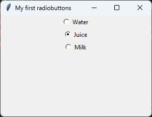

----

Radiobutton options
-----------------------

| Options are written as ``option=value`` inside ``tk.Radiobutton( )``, separated by commas.

text
~~~~~~~~~~~~~~~~~~

| **What it does:** sets the words next to the round button.
| **How to write it:** ``text="your words"``

.. code-block:: python

    import tkinter as tk

    root = tk.Tk()
    root.geometry("300x200")
    root.title("text")

    answer = tk.StringVar(value="none")      # "none" matches no button, so nothing is chosen

    yes_radio = tk.Radiobutton(root, text="Yes, please", variable=answer, value="yes")
    yes_radio.pack()
    no_radio = tk.Radiobutton(root, text="No, thank you", variable=answer, value="no")
    no_radio.pack()

    root.mainloop()

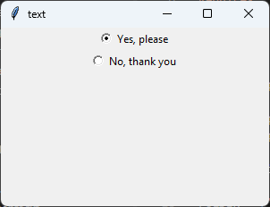

variable and value
~~~~~~~~~~~~~~~~~~~~~~

| **What they do:** ``variable`` is the shared variable for the group. ``value`` is what gets stored when **this** button is chosen.
| **How to write them:** ``variable=year, value="Year 7"``
| Read the chosen value with ``variable.get()``.
| Use a ``tk.StringVar()`` for words or a ``tk.IntVar()`` for whole numbers.

.. code-block:: python

    import tkinter as tk

    def show():
        result_label.config(text="You chose " + year.get())

    root = tk.Tk()
    root.geometry("300x220")
    root.title("variable and value")

    year = tk.StringVar(value="Year 7")

    tk.Radiobutton(root, text="Year 7", variable=year, value="Year 7").pack()
    tk.Radiobutton(root, text="Year 8", variable=year, value="Year 8").pack()
    tk.Radiobutton(root, text="Year 9", variable=year, value="Year 9").pack()

    show_button = tk.Button(root, text="Show", command=show)
    show_button.pack(pady=5)

    result_label = tk.Label(root, text="")
    result_label.pack()

    root.mainloop()

| ``tk.Radiobutton(...).pack()`` creates and places a widget in one line. Only do this when you never need to use the widget's name again.

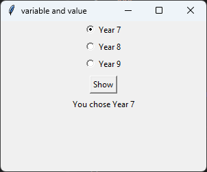

command
~~~~~~~~~~~~~~~~~~

| **What it does:** chooses a function to run as soon as the radiobutton is clicked.
| **How to write it:** ``command=function_name`` (no brackets)
| Give every radiobutton in the group the same command.

.. code-block:: python

    import tkinter as tk

    def change_colour():
        root.config(bg=colour.get())     # Use the chosen value as the colour

    root = tk.Tk()
    root.geometry("300x200")
    root.title("command")

    colour = tk.StringVar(value="white")

    tk.Radiobutton(root, text="Red", variable=colour, value="red", command=change_colour).pack()
    tk.Radiobutton(root, text="Green", variable=colour, value="green", command=change_colour).pack()
    tk.Radiobutton(root, text="Blue", variable=colour, value="blue", command=change_colour).pack()

    root.mainloop()

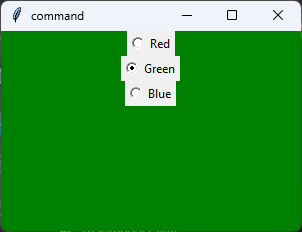

font, fg and bg
~~~~~~~~~~~~~~~~~~

| **What they do:** ``font`` sets the style and size of the words, ``fg`` sets the colour of the words and ``bg`` sets the background colour.
| **How to write them:** ``font=("Arial", 16)``, ``fg="purple"``, ``bg="lavender"``

.. code-block:: python

    import tkinter as tk

    root = tk.Tk()
    root.geometry("300x200")
    root.title("font, fg and bg")

    size = tk.StringVar(value="Small")

    tk.Radiobutton(root, text="Small", variable=size, value="Small",
                   font=("Arial", 16), fg="purple", bg="lavender").pack(pady=2)
    tk.Radiobutton(root, text="Large", variable=size, value="Large",
                   font=("Arial", 16), fg="purple", bg="lavender").pack(pady=2)

    root.mainloop()

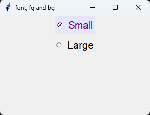

selectcolor
~~~~~~~~~~~~~~~~~~

| **What it does:** sets the colour inside the round button.
| **How to write it:** ``selectcolor="colour"``

.. code-block:: python

    import tkinter as tk

    root = tk.Tk()
    root.geometry("300x200")
    root.title("selectcolor")

    pet = tk.StringVar(value="Dog")

    tk.Radiobutton(root, text="Dog", variable=pet, value="Dog", selectcolor="yellow").pack()
    tk.Radiobutton(root, text="Cat", variable=pet, value="Cat", selectcolor="yellow").pack()

    root.mainloop()

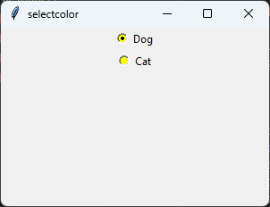

indicatoron
~~~~~~~~~~~~~~~~~~

| **What it does:** ``indicatoron=0`` hides the round button so each choice looks like a normal button. The chosen one stays pressed in.
| **How to write it:** ``indicatoron=0``
| Add ``width`` so all the buttons are the same size, and ``selectcolor`` to colour the chosen one.

.. code-block:: python

    import tkinter as tk

    root = tk.Tk()
    root.geometry("300x200")
    root.title("indicatoron")

    level = tk.StringVar(value="Easy")

    for choice in ["Easy", "Medium", "Hard"]:
        tk.Radiobutton(root, text=choice, variable=level, value=choice,
                       indicatoron=0, width=12, selectcolor="lightgreen").pack(pady=2)

    root.mainloop()

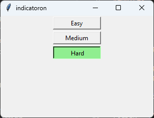

anchor and width
~~~~~~~~~~~~~~~~~~

| **What they do:** ``width`` sets how wide each radiobutton is (in characters). ``anchor="w"`` lines it up on the **left**.
| Use the same ``width`` and ``anchor="w"`` on every radiobutton so the round buttons line up neatly.

.. code-block:: python

    import tkinter as tk

    root = tk.Tk()
    root.geometry("300x200")
    root.title("anchor and width")

    sport = tk.StringVar(value="Soccer")

    for choice in ["Soccer", "Netball", "Basketball", "Swimming"]:
        tk.Radiobutton(root, text=choice, variable=sport, value=choice,
                       width=15, anchor="w").pack()

    root.mainloop()

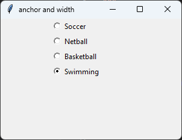

state
~~~~~~~~~~~~~~~~~~

| **What it does:** turns a radiobutton on or off.
| **How to write it:** ``state="disabled"``
| **Values:** ``"normal"`` (can be clicked, the default) and ``"disabled"`` (greyed out).

.. code-block:: python

    import tkinter as tk

    root = tk.Tk()
    root.geometry("300x200")
    root.title("state")

    seat = tk.StringVar(value="Window")

    tk.Radiobutton(root, text="Window seat", variable=seat, value="Window").pack()
    tk.Radiobutton(root, text="Aisle seat (full)", variable=seat, value="Aisle",
                   state="disabled").pack()

    root.mainloop()

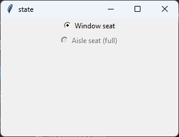

----

Radiobutton methods
-----------------------

| A **method** is an action that a widget can do. Methods are written after a dot.

get and set (the variable)
~~~~~~~~~~~~~~~~~~~~~~~~~~~~~~~~

| **What they do:** ``variable.get()`` reads which value is chosen. ``variable.set(value)`` chooses a button from your code.
| **How to write them:** ``choice = drink.get()``, ``drink.set("Milk")``
| If the variable's value does not match any button, **no** button is chosen. ``drink.set("none")`` clears the group.
| Do not use an empty string ``""`` for this: it makes every button look half-chosen.

.. code-block:: python

    import tkinter as tk

    def reset():
        drink.set("none")       # Matches no button, so nothing is chosen

    root = tk.Tk()
    root.geometry("300x200")
    root.title("get and set")

    drink = tk.StringVar()
    drink.set("Juice")          # Start with Juice chosen

    tk.Radiobutton(root, text="Water", variable=drink, value="Water").pack()
    tk.Radiobutton(root, text="Juice", variable=drink, value="Juice").pack()
    tk.Radiobutton(root, text="Milk", variable=drink, value="Milk").pack()

    reset_button = tk.Button(root, text="Reset", command=reset)
    reset_button.pack(pady=10)

    root.mainloop()

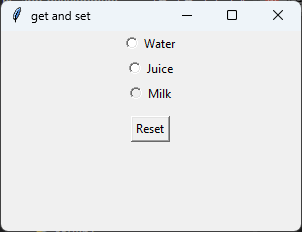

Checking a quiz answer
~~~~~~~~~~~~~~~~~~~~~~~~~~

| Radiobuttons are great for multiple-choice questions. Compare ``variable.get()`` with the correct answer.

.. code-block:: python

    import tkinter as tk

    def check():
        if answer.get() == "Mars":
            result_label.config(text="Correct!", fg="green")
        else:
            result_label.config(text="Try again", fg="red")

    root = tk.Tk()
    root.geometry("300x250")
    root.title("Quiz")

    question_label = tk.Label(root, text="Which planet is red?", font=("Arial", 14))
    question_label.pack(pady=5)

    answer = tk.StringVar(value="none")

    for planet in ["Venus", "Mars", "Jupiter"]:
        tk.Radiobutton(root, text=planet, variable=answer, value=planet).pack()

    check_button = tk.Button(root, text="Check", command=check)
    check_button.pack(pady=5)

    result_label = tk.Label(root, text="", font=("Arial", 14))
    result_label.pack()

    root.mainloop()

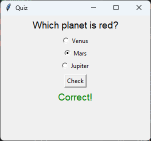

select and invoke
~~~~~~~~~~~~~~~~~~~~~~

| **What they do:**
| ``select()`` chooses this radiobutton (without running its command).
| ``invoke()`` chooses this radiobutton **and** runs its command, just like a click.

.. code-block:: python

    import tkinter as tk

    def show():
        result_label.config(text="Size: " + size.get())

    root = tk.Tk()
    root.geometry("300x200")
    root.title("select and invoke")

    size = tk.StringVar(value="none")

    small_radio = tk.Radiobutton(root, text="Small", variable=size, value="Small", command=show)
    small_radio.pack()
    large_radio = tk.Radiobutton(root, text="Large", variable=size, value="Large", command=show)
    large_radio.pack()

    result_label = tk.Label(root, text="")
    result_label.pack(pady=10)

    large_radio.invoke()        # Choose "Large" and run show() at the start

    root.mainloop()

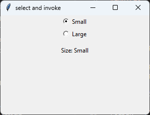

config
~~~~~~~~~~~~~~~~~~

| **What it does:** changes options **after** the radiobutton has been made.
| **How to write it:** ``radio.config(option=value)``

.. code-block:: python

    import tkinter as tk

    def lock_answer():
        for radio in all_radios:
            radio.config(state="disabled")      # No more changing the answer

    root = tk.Tk()
    root.geometry("300x200")
    root.title("config")

    answer = tk.StringVar(value="none")

    a_radio = tk.Radiobutton(root, text="A", variable=answer, value="A", command=lock_answer)
    a_radio.pack()
    b_radio = tk.Radiobutton(root, text="B", variable=answer, value="B", command=lock_answer)
    b_radio.pack()

    all_radios = [a_radio, b_radio]

    root.mainloop()

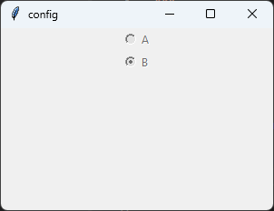

----

Quick reference
-------------------

.. list-table::
    :header-rows: 1
    :widths: 25 45 30

    * - Option or method
      - What it does
      - Example
    * - ``text``
      - Words next to the button
      - ``text="Year 7"``
    * - ``variable``
      - Shared variable for the whole group
      - ``variable=year``
    * - ``value``
      - What is stored when this button is chosen
      - ``value="Year 7"``
    * - ``command``
      - Function to run when clicked
      - ``command=show``
    * - ``font``, ``fg``, ``bg``
      - Font, word colour, background colour
      - ``font=("Arial", 14)``
    * - ``selectcolor``
      - Colour inside the round button
      - ``selectcolor="yellow"``
    * - ``indicatoron``
      - ``0`` makes it look like a normal button
      - ``indicatoron=0``
    * - ``width``, ``anchor``
      - Width, and where it sits
      - ``width=15, anchor="w"``
    * - ``state``
      - Turn it on or off
      - ``state="disabled"``
    * - ``variable.get()``
      - Read the chosen value
      - ``year.get()``
    * - ``variable.set()``
      - Choose a button from code
      - ``year.set("Year 8")``
    * - ``select()``
      - Choose this button
      - ``small_radio.select()``
    * - ``invoke()``
      - Choose this button and run its command
      - ``small_radio.invoke()``

----

All Radiobutton options
---------------------------

| Here is every option a radiobutton can have, for reference. You will only need a few of them most of the time.

.. list-table::
    :header-rows: 1
    :widths: 25 45 30

    * - Option
      - What it does
      - Example
    * - ``activebackground``
      - Background colour when the mouse is over the button
      - ``activebackground="lightblue"``
    * - ``activeforeground``
      - Word colour when the mouse is over the button
      - ``activeforeground="red"``
    * - ``anchor``
      - Where the words sit inside the button (``"w"`` = left)
      - ``anchor="w"``
    * - ``bg`` or ``background``
      - Background colour
      - ``bg="lavender"``
    * - ``bitmap``
      - Shows a small built-in picture
      - ``bitmap="question"``
    * - ``bd`` or ``borderwidth``
      - How thick the border is
      - ``bd=3``
    * - ``command``
      - Function to run when the button is clicked
      - ``command=show``
    * - ``compound``
      - Where the picture goes compared to the words
      - ``compound="left"``
    * - ``cursor``
      - Mouse pointer shape over the button
      - ``cursor="hand2"``
    * - ``disabledforeground``
      - Word colour when the button is turned off
      - ``disabledforeground="grey"``
    * - ``fg`` or ``foreground``
      - Word colour
      - ``fg="purple"``
    * - ``font``
      - Style and size of the words
      - ``font=("Arial", 14)``
    * - ``height``
      - How tall the button is (in lines of text)
      - ``height=2``
    * - ``highlightbackground``
      - Colour of the outline when the button is not selected by the keyboard
      - ``highlightbackground="white"``
    * - ``highlightcolor``
      - Colour of the outline when the button is selected by the keyboard
      - ``highlightcolor="blue"``
    * - ``highlightthickness``
      - How thick that keyboard outline is
      - ``highlightthickness=2``
    * - ``image``
      - Shows a picture instead of (or with) the words
      - ``image=dog_picture``
    * - ``indicatoron``
      - ``0`` hides the round button so it looks like a normal button
      - ``indicatoron=0``
    * - ``justify``
      - Lines up many lines of words: ``"left"``, ``"center"`` or ``"right"``
      - ``justify="left"``
    * - ``offrelief``
      - Border style when not chosen (used with ``indicatoron=0``)
      - ``offrelief="flat"``
    * - ``overrelief``
      - Border style when the mouse is over the button
      - ``overrelief="raised"``
    * - ``padx``
      - Extra space on the left and right of the words
      - ``padx=10``
    * - ``pady``
      - Extra space above and below the words
      - ``pady=5``
    * - ``relief``
      - Border style: ``"raised"``, ``"sunken"``, ``"flat"``, ``"ridge"``, ``"groove"``
      - ``relief="sunken"``
    * - ``selectcolor``
      - Colour inside the round button when chosen
      - ``selectcolor="yellow"``
    * - ``selectimage``
      - Picture to show when the button is chosen
      - ``selectimage=tick_picture``
    * - ``state``
      - ``"normal"`` (can click), ``"active"`` or ``"disabled"`` (greyed out)
      - ``state="disabled"``
    * - ``takefocus``
      - Whether the Tab key can move to this button
      - ``takefocus=0``
    * - ``text``
      - Words next to the button
      - ``text="Year 7"``
    * - ``textvariable``
      - A variable that holds the words, so they can change
      - ``textvariable=label_words``
    * - ``tristateimage``
      - Picture to show when the button is half-chosen
      - ``tristateimage=half_picture``
    * - ``tristatevalue``
      - The variable value that makes the button look half-chosen (default ``""``)
      - ``tristatevalue="maybe"``
    * - ``underline``
      - Number of the letter to underline (``0`` = first letter)
      - ``underline=0``
    * - ``value``
      - What is stored in the variable when this button is chosen
      - ``value="Year 7"``
    * - ``variable``
      - Shared variable for the whole group
      - ``variable=year``
    * - ``width``
      - How wide the button is (in characters)
      - ``width=15``
    * - ``wraplength``
      - Starts a new line when the words get this long (in pixels)
      - ``wraplength=100``

| The picture options (``image``, ``selectimage``, ``tristateimage``) need a picture made first, e.g. ``dog_picture = tk.PhotoImage(file="dog.png")``.

----

Quiz
--------------------------------

.. mcqgroup::
    :nav_position: top
    :show-instant-feedback:
    :enable-instant-feedback:
    :shuffle_questions:
    :num_questions: 20

    .. multichoice::

        What is a Radiobutton?

        [x] A round button in a group where only one can be chosen | Correct. Choosing one un-chooses the others.
        [ ] A tick box where many can be ticked | Incorrect. That is a Checkbutton.
        [ ] A box for typing | Incorrect. That is an Entry.
        [ ] A slider | Incorrect. That is a Scale.

    .. multichoice::

        What makes radiobuttons belong to the same group?

        [ ] They have the same text | Incorrect. Text can differ.
        [x] They share the same variable | Correct. One shared variable makes a group.
        [ ] They are next to each other | Incorrect. Position does not group them.
        [ ] They have the same value | Incorrect. Values must be different.

    .. multichoice::

        What must be different for each radiobutton in a group?

        [ ] The variable | Incorrect. That must be the same.
        [x] The value | Correct. Each stores its own value.
        [ ] The parent | Incorrect. They can share a parent.
        [ ] The font | Incorrect. Font does not matter.

    .. multichoice::

        What is stored in the variable when a radiobutton is chosen?

        [x] Its value | Correct. The chosen button's value goes in the variable.
        [ ] Its text | Incorrect. value is stored, not text.
        [ ] 1 | Incorrect. Only if its value is 1.
        [ ] True | Incorrect. Only if its value is True.

    .. multichoice::

        How do you start with no radiobutton chosen?

        [ ] Do not make a variable | Incorrect. A variable is needed.
        [x] Set the variable to a value no button has, like "none" | Correct. Then none match.
        [ ] Set it to "" | Incorrect. An empty string can make every button look half-chosen.
        [ ] Use state="disabled" | Incorrect. That turns them off.

    .. multichoice::

        Why should you not use "" to clear a group?

        [ ] It causes an error | Incorrect. No error.
        [x] It can make every button look half-chosen | Correct. Use "none" instead.
        [ ] It deletes the buttons | Incorrect. Nothing is deleted.
        [ ] It chooses every button | Incorrect. It looks half-chosen.

    .. multichoice::

        What does command do on a Radiobutton?

        [ ] Chooses it | Incorrect. Clicking chooses it.
        [x] Runs a function as soon as it is clicked | Correct. Give every button the same command.
        [ ] Stores the value | Incorrect. variable does that.
        [ ] Sets the text | Incorrect. text does that.

    .. multichoice::

        What does selectcolor="yellow" change?

        [x] The colour inside the round button | Correct. selectcolor colours the circle.
        [ ] The words | Incorrect. fg does that.
        [ ] The window | Incorrect. Only the button.
        [ ] The border | Incorrect. Not the border.

    .. multichoice::

        What does indicatoron=0 do?

        [ ] Turns the button off | Incorrect. state does that.
        [x] Hides the circle so each choice looks like a normal button | Correct. The chosen one stays pressed in.
        [ ] Shows a tick | Incorrect. Radiobuttons do not tick.
        [ ] Deletes the text | Incorrect. Text still shows.

    .. multichoice::

        Why use anchor="w" and the same width on each Radiobutton?

        [x] So the round buttons line up neatly on the left | Correct. Same width and left anchor line them up.
        [ ] To choose them all | Incorrect. Only one can be chosen.
        [ ] To colour them | Incorrect. anchor is about position.
        [ ] To make them bigger | Incorrect. width alone sets size.

    .. multichoice::

        What does state="disabled" do?

        [ ] Chooses the button | Incorrect. It does not choose.
        [x] Greys it out so it cannot be chosen | Correct. Use it for unavailable choices.
        [ ] Deletes it | Incorrect. destroy deletes.
        [ ] Hides the text | Incorrect. Text still shows.

    .. multichoice::

        How do you find which radiobutton is chosen?

        [ ] radio.get() | Incorrect. Read the variable.
        [x] drink.get(), where drink is the shared variable | Correct. The variable holds the chosen value.
        [ ] radio.chosen | Incorrect. Not an attribute.
        [ ] radio.cget("value") | Incorrect. That gives that button's value, chosen or not.

    .. multichoice::

        What does drink.set("Milk") do?

        [x] Chooses the radiobutton whose value is "Milk" | Correct. set chooses from code.
        [ ] Adds a Milk button | Incorrect. It does not make widgets.
        [ ] Changes the text to Milk | Incorrect. It changes the variable.
        [ ] Deletes the Milk button | Incorrect. Nothing is deleted.

    .. multichoice::

        What does radio.select() do?

        [ ] Runs its command | Incorrect. select does not run command.
        [x] Chooses this radiobutton without running its command | Correct. invoke would also run command.
        [ ] Unchooses it | Incorrect. Radiobuttons cannot be unclicked this way.
        [ ] Deletes it | Incorrect. destroy deletes.

    .. multichoice::

        What does radio.invoke() do?

        [ ] Only chooses it | Incorrect. select only chooses.
        [x] Chooses it and runs its command, like a click | Correct. invoke acts like a click.
        [ ] Disables it | Incorrect. config does that.
        [ ] Changes its colour | Incorrect. config does that.

    .. multichoice::

        How do you check a quiz answer stored in answer?

        [x] if answer.get() == "Mars": | Correct. Compare the variable with the right answer.
        [ ] if answer == "Mars": | Incorrect. answer is a variable object.
        [ ] if radio.get() == "Mars": | Incorrect. Read the variable.
        [ ] if answer.set("Mars"): | Incorrect. set changes the value.

    .. multichoice::

        Which variable type suits radiobuttons with whole-number values?

        [ ] tk.StringVar() | Incorrect. That is for text.
        [x] tk.IntVar() | Correct. IntVar holds whole numbers.
        [ ] tk.BooleanVar() | Incorrect. That is for True or False.
        [ ] A list | Incorrect. Use a tkinter variable.

    .. multichoice::

        Which line turns off a radiobutton later?

        [x] radio.config(state="disabled") | Correct. config changes options.
        [ ] radio.disable() | Incorrect. Not a method.
        [ ] radio.set(state="disabled") | Incorrect. Not a method.
        [ ] radio.state = "disabled" | Incorrect. Use config.

    .. multichoice::

        Which widget suits "Which year are you in?"

        [ ] Checkbuttons | Incorrect. Those allow many answers.
        [x] Radiobuttons | Correct. Only one answer is right.
        [ ] Text | Incorrect. Typing is not needed.
        [ ] Canvas | Incorrect. Canvas draws.

    .. multichoice::

        How many radiobuttons in one group can be chosen at once?

        [ ] As many as you like | Incorrect. That is Checkbuttons.
        [x] One | Correct. Choosing one un-chooses the others.
        [ ] Two | Incorrect. Only one.
        [ ] None | Incorrect. One can be chosen.

----

Fill in the gaps
--------------------------------

.. clozegroup::
    :nav-position: top
    :num-questions: 5
    :show-instant-feedback:

    .. cloze::
        :instructions: Make a group of radiobuttons.

        drink = tk.@@StringVar | IntVar | Label@@(value="Water")
        tk.@@Radiobutton | Checkbutton | Button@@(root, text="Water", variable=drink, @@value | text | onvalue@@="Water").pack()
        tk.Radiobutton(root, text="Juice", @@variable | value | group@@=drink, value="Juice").pack()

    .. cloze::
        :instructions: Run a function when a choice is clicked.

        def show():
            result_label.config(text="You chose " + drink.@@get | set | value@@())

        tk.Radiobutton(root, text="Milk", variable=drink, value="Milk", @@command | click | run@@=show).pack()

    .. cloze::
        :instructions: Make choices look like buttons.

        tk.Radiobutton(root, text="Easy", variable=level, value="Easy", @@indicatoron | indicator | circle@@=0, @@selectcolor | bg | fg@@="lightgreen").pack()

    .. cloze::
        :instructions: Choose and clear from code.

        drink.@@set | get | select@@("Juice")
        drink.set("@@none | empty | 0@@")

    .. cloze::
        :instructions: Check a quiz answer.

        if answer.get() @@== | = | !=@@ "Mars":
            result_label.config(text="Correct!", fg="@@green | red | blue@@")

----

.. admonition:: Tasks

    #. Make a window titled "Transport" that is 300x200. Add a group of three radiobuttons: "Bus", "Car" and "Walk", sharing one ``StringVar``.
    #. Make "Walk" chosen when the program starts.
    #. Add a button labelled "Show" and a label. When clicked, the label shows "You travel by" followed by the chosen transport.
    #. Make a multiple-choice question "What is 5 x 6?" with the choices 25, 30 and 35. Use ``command`` so the answer is checked as soon as a choice is clicked.

    .. dropdown::
        :icon: codescan
        :color: primary
        :class-container: sd-dropdown-container

        .. tab-set::

            .. tab-item:: Q1

                .. code-block:: python

                    import tkinter as tk

                    root = tk.Tk()
                    root.geometry("300x200")
                    root.title("Transport")

                    transport = tk.StringVar(value="none")

                    bus_radio = tk.Radiobutton(root, text="Bus", variable=transport, value="Bus")
                    bus_radio.pack()
                    car_radio = tk.Radiobutton(root, text="Car", variable=transport, value="Car")
                    car_radio.pack()
                    walk_radio = tk.Radiobutton(root, text="Walk", variable=transport, value="Walk")
                    walk_radio.pack()

                    root.mainloop()

            .. tab-item:: Q2

                .. code-block:: python

                    import tkinter as tk

                    root = tk.Tk()
                    root.geometry("300x200")
                    root.title("Transport")

                    transport = tk.StringVar(value="Walk")

                    bus_radio = tk.Radiobutton(root, text="Bus", variable=transport, value="Bus")
                    bus_radio.pack()
                    car_radio = tk.Radiobutton(root, text="Car", variable=transport, value="Car")
                    car_radio.pack()
                    walk_radio = tk.Radiobutton(root, text="Walk", variable=transport, value="Walk")
                    walk_radio.pack()

                    root.mainloop()

            .. tab-item:: Q3

                .. code-block:: python

                    import tkinter as tk

                    def show():
                        result_label.config(text="You travel by " + transport.get())

                    root = tk.Tk()
                    root.geometry("300x200")
                    root.title("Transport")

                    transport = tk.StringVar(value="Walk")

                    bus_radio = tk.Radiobutton(root, text="Bus", variable=transport, value="Bus")
                    bus_radio.pack()
                    car_radio = tk.Radiobutton(root, text="Car", variable=transport, value="Car")
                    car_radio.pack()
                    walk_radio = tk.Radiobutton(root, text="Walk", variable=transport, value="Walk")
                    walk_radio.pack()

                    show_button = tk.Button(root, text="Show", command=show)
                    show_button.pack(pady=5)

                    result_label = tk.Label(root, text="")
                    result_label.pack()

                    root.mainloop()

            .. tab-item:: Q4

                .. code-block:: python

                    import tkinter as tk

                    def check():
                        if answer.get() == 30:
                            result_label.config(text="Correct!", fg="green")
                        else:
                            result_label.config(text="Try again", fg="red")

                    root = tk.Tk()
                    root.geometry("300x200")
                    root.title("Quiz")

                    question_label = tk.Label(root, text="What is 5 x 6?", font=("Arial", 14))
                    question_label.pack()

                    answer = tk.IntVar(value=0)

                    for number in [25, 30, 35]:
                        tk.Radiobutton(root, text=number, variable=answer, value=number,
                                       command=check).pack()

                    result_label = tk.Label(root, text="", font=("Arial", 14))
                    result_label.pack()

                    root.mainloop()

